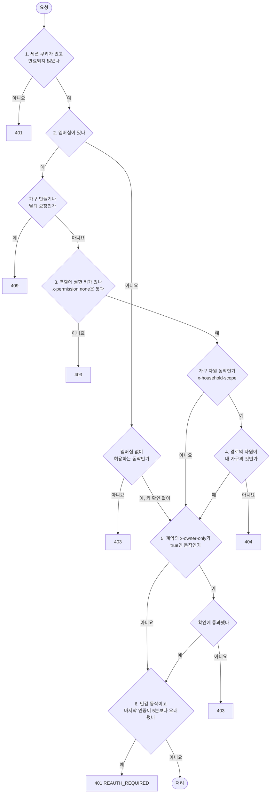

# API 공통 규칙

이 문서는 기능마다 만드는 API 계약이 함께 따를 규칙을 정합니다. 경로와 값의 형식, 오류 응답, 목록 형식, 권한 확인 순서, 응답에 담는 개인정보, 계약 파일 쓰는 법을 다룹니다. 엔드포인트와 요청, 응답 스키마는 이 문서에서 정하지 않습니다. 기능마다 `/speckit-plan`이 `specs/NNN-이름/contracts/`에 정합니다. 세션 방식과 로그인 흐름은 [결정 기록 0013](../adr/0013-session.md)에 있습니다.

이 문서의 경로와 값은 모두 규칙을 보이려고 만든 가짜 예시입니다.

## 경로와 형식

| 항목 | 규칙 | 예시와 이유 |
|---|---|---|
| 경로 | `/api/v1`로 시작합니다 | `/api/v1/household/listings` |
| 가구 자원 경로 | 단수 `/household` 아래에 둡니다. 경로에 가구 번호를 넣지 않고, 요청한 가구는 세션의 사용자로 정합니다 | 1단계에서 한 사용자는 가구 하나에만 속합니다([결정 기록 0011](../adr/0011-household-sharing.md#결정)). 경로에 가구 번호가 없으므로 다른 가구 번호를 넣어 보는 요청이 생기지 않습니다 |
| JSON 필드 이름 | camelCase | `visitedOn`, `nextCursor` |
| 시각 | 시간대를 붙인 ISO 8601 | `2026-10-18T14:30:00+09:00` |
| 날짜만 있는 값 | `YYYY-MM-DD` | 방문일 `2026-10-18` |
| 금액 | 만원 단위 정수 | 8억 5,000만 원은 `85000` |
| 만들기 응답 | 201 | 매물 등록, 임장 기록 작성, 초대 발급 |
| 안전한 메서드 | GET 요청은 상태를 바꾸지 않습니다. 상태를 바꾸는 동작은 POST, PUT, PATCH, DELETE로 만듭니다 | 초대 수락도 링크를 연 화면이 POST로 보냅니다. 로그인 시작 요청과 콜백 요청은 예외입니다. 콜백은 구글에서 돌아오는 최상위 GET 이동이라 세션을 만드는 일을 GET에서 할 수밖에 없고, 대신 state, nonce, PKCE 검증값으로 위조를 막습니다. 로그인 시작 요청은 세션을 바꾸지 않고 임시 값 쿠키만 새로 만듭니다([결정 기록 0013](../adr/0013-session.md)). 콜백은 세션 쿠키가 아니라 SameSite=Lax 임시 값 쿠키로 이어집니다. 요청 위조 방어는 Strict 세션 쿠키, 상태를 바꾸는 요청의 Origin 검사, 이 GET 규칙 셋입니다. Strict 쿠키는 다른 사이트에서 시작한 화면 이동에 붙지 않으므로 GET 규칙은 이중 방어입니다. 쿠키 이름과 속성은 [결정 기록 0013](../adr/0013-session.md)에 있습니다 |
| 보안 응답 헤더 | 모든 응답에 HSTS(브라우저가 늘 HTTPS로만 접속하게 함)와 CSP(허용한 출처의 스크립트만 실행)를 둡니다 | 지도 API처럼 웹 화면이 직접 부르는 외부 주소는 CSP 허용 목록에 넣고, 정확한 값은 구현에서 정합니다. 근거는 [결정 기록 0013](../adr/0013-session.md)입니다 |

## 오류 응답

오류 응답 본문은 RFC 9457 Problem Details(HTTP API의 오류 응답 본문 형식을 정한 인터넷 표준)를 따르고, 미디어 타입은 `application/problem+json`입니다. 표준 필드에 두 필드를 더합니다.

| 필드 | 구분 | 뜻 |
|---|---|---|
| `type` | 표준 | 오류 종류를 가리키는 URI |
| `title` | 표준 | 오류 종류를 사람이 읽을 수 있게 적은 짧은 문장. 같은 `type`이면 같은 문장입니다 |
| `status` | 표준 | HTTP 상태 코드 |
| `detail` | 표준 | 이번 요청에서 일어난 일을 사람이 읽을 수 있게 적은 설명 |
| `code` | 더함 | 웹 화면이 분기에 쓰는 오류 코드. 대문자와 밑줄로 씁니다 |
| `errors` | 더함 | 입력 검증에 실패한 필드의 목록. 400일 때만 채웁니다. 항목마다 요청 본문의 위치(`pointer`, JSON Pointer)와 설명(`detail`)이 있습니다 |

일반 오류의 예시입니다.

```json
{
  "type": "https://example.com/problems/invitation-expired",
  "title": "초대 링크가 만료되었습니다",
  "status": 409,
  "detail": "가족에게 새 초대 링크를 받아 주세요.",
  "code": "INVITATION_EXPIRED"
}
```

입력 검증 실패의 예시입니다.

```json
{
  "type": "https://example.com/problems/validation-failed",
  "title": "입력값이 올바르지 않습니다",
  "status": 400,
  "detail": "입력값 두 개를 확인해 주세요.",
  "code": "VALIDATION_FAILED",
  "errors": [
    { "pointer": "#/visitedOn", "detail": "방문일을 입력해 주세요." },
    { "pointer": "#/score", "detail": "점수는 1에서 5 사이여야 합니다." }
  ]
}
```

| 상태 코드 | 쓰는 때 |
|---|---|
| 400 | 입력 검증에 실패했습니다. `errors`를 채웁니다 |
| 401 | 세션 쿠키가 없거나 만료되었습니다. 민감 동작에서 마지막 인증이 5분보다 오래됐으면 코드 `REAUTH_REQUIRED`로 답합니다 |
| 403 | 로그인은 했지만 이 동작을 할 수 없습니다. 멤버십이 없거나, 역할에 권한 키가 없거나, 그 임장 기록을 쓴 사람이 아니거나, 본인의 알림 설정과 표시 이름이 아닙니다 |
| 404 | 경로의 자원이 없거나 내 가구의 것이 아닙니다 |
| 409 | 요청이 현재 상태와 부딪힙니다. 예: 유일 조건에 걸림, 만료된 초대, 이미 가구가 있는 사용자의 가구 만들기와 탈퇴 |

입력 검증(400)은 권한 확인을 통과한 뒤에 합니다. 그래서 로그인하지 않은 요청은 입력이 틀려도 401을 받습니다.

## 목록 형식

커서는 끝없이 늘 수 있는 목록에만 쓰고, 화면이 한 번에 받는 목록(단지 추가 시트의 단지 목록, 체크리스트 항목, 구성원, 전용면적, 호가 이력)은 나누지 않습니다. 나누는 목록은 커서 방식으로 답합니다. 요청은 `limit`(한 번에 받을 항목 수)과 `cursor`(앞 응답의 `nextCursor`)를 받고, 응답은 나누는 목록이 모두 같은 모양으로 `items`와 `nextCursor`를 담습니다. 다음 항목이 없으면 `nextCursor`는 `null`입니다. 첫 요청에는 `cursor`를 보내지 않습니다.

쪽 번호 방식은 쓰지 않습니다. 실거래가 매일 바뀌어 쪽 번호로 나누면 다음 쪽에서 항목이 밀리거나 겹치고, 전체 건수를 보여 주는 목록 화면이 없기 때문입니다.

```
GET /api/v1/household/listings?limit=20&cursor=eyJpZCI6MTIzfQ
```

```json
{
  "items": [
    { "id": 124, "complexName": "예시마을 1단지", "status": "검토 중" }
  ],
  "nextCursor": null
}
```

## 인증과 권한 확인

세션 쿠키, 로그인 흐름, 요청 위조 방어는 [결정 기록 0013](../adr/0013-session.md)을 따릅니다. 세션 없이 받는 요청은 로그인 시작 요청과 콜백 요청 둘뿐입니다. 이 둘은 아래 확인 흐름 밖에 있고, 안전한 메서드 규칙과 Origin 검사의 예외이며(위 경로와 형식 표의 안전한 메서드 행), 기능 계약에는 `security: []`로 적습니다. 그 밖의 모든 요청은 API 서버가 아래 순서로 확인하고, 처음 걸린 단계의 상태 코드로 답합니다.



| 단계 | 확인하는 것 | 걸리면 |
|---|---|---|
| 1 | 세션 쿠키가 있고 만료되지 않았는지 | 401 |
| 2 | 멤버십이 있는지. 없으면 멤버십 없이 허용하는 동작인지. 이 판단은 동작이 초대 수락인지 같은 종류만 보고, 초대 토큰이 있는지, 만료됐는지, 취소됐는지, 이미 쓰였는지는 초대 수락 기능이 확인해 오류 형식대로 답합니다. 그래서 만료된 링크는 403이 아니라 기능이 정한 오류(오류 예시의 409 `INVITATION_EXPIRED`)를 받습니다. 허용하면 3단계와 4단계를 건너뛰고 5단계로 갑니다. 멤버십이 있는 사용자가 가구 만들기나 탈퇴를 요청하면 409입니다 | 403, 409 |
| 3 | 역할에 그 동작의 권한 키가 있는지. 계약에 `x-permission: none`으로 적은 동작은 이 단계를 통과합니다. 멤버십이 없는 사용자는 2단계에서 이 단계를 건너뜁니다 | 403 |
| 4 | 경로가 가리키는 자원이 내 가구의 것인지. 내 정보, 로그아웃처럼 가구 자원이 아닌 동작(`x-household-scope: false`)은 이 단계를 건너뜁니다 | 404 |
| 5 | 계약의 `x-owner-only`가 `true`인 동작(`visit_log:write`, `notification_setting:read`, `notification_setting:write`, `profile:write`)이면 그 임장 기록을 쓴 사람인지, 본인의 알림 설정과 표시 이름인지 | 403 |
| 6 | 계약의 `x-reauth`가 `true`인 민감 동작이면 세션의 마지막 인증 시각(ID 토큰의 `auth_time`)이 5분 안인지. 값이 없거나 서버의 지금 시각보다 60초를 넘게 미래이면 오래된 것으로 봅니다 | 401 `REAUTH_REQUIRED` |

- 권한 키와 역할별 허용 여부는 [결정 기록 0011의 권한 키 표](../adr/0011-household-sharing.md#결정)를 따릅니다.
- 멤버십 없이 허용하는 동작은 로그아웃, 내 정보 조회, 자기 표시 이름 수정, 초대 수락, 가구 만들기, 탈퇴입니다. 이 동작들도 세션은 있어야 합니다. 멤버십이 없는 사용자의 자기 표시 이름 수정은 키 확인 없이 5단계의 본인 확인만 거칩니다. 멤버십이 있는 사용자는 3단계에서 `profile:write`도 확인합니다. 결정 기록 0011의 목록에 있는 "로그인"은 세션 없이 받는 요청이라 이 목록에서 뺐습니다.
- 멤버십이 있는 사용자는 이미 가구가 있으므로 가구 만들기와 탈퇴를 409로 거절합니다. 탈퇴는 member는 가구를 나간 뒤, owner는 가구를 삭제한 뒤에만 할 수 있습니다([데이터 모델의 앱에서 확인하는 규칙](data-model.md#앱에서-확인하는-규칙)).
- 로그아웃과 내 정보 조회는 결정 기록 0011의 "멤버십이 없는 계정도 할 수 있는 동작" 목록에 이름이 없습니다. 이 문서는 두 동작을 로그인에 딸린 동작으로 보고 멤버십 없이 허용합니다.
- 다른 가구의 자원을 가리키면 403이 아니라 404로 답해, 그 자원이 있는지 알려 주지 않습니다.
- owner 역할이라도 다른 구성원의 임장 기록은 고치지 못합니다(결정 기록 0011의 `visit_log:write`). 같은 가구의 다른 구성원이 쓴 임장 기록을 고치거나 삭제하려 하면 403으로 답합니다. 같은 가구 구성원은 그 기록을 이미 볼 수 있으므로 있는지 숨길 이유가 없고, 403이 "볼 수는 있지만 고칠 수 없다"를 알려 줍니다.
- 민감 동작은 가구 삭제, 구성원 제거, 탈퇴, 초대 발급 넷입니다. 알림 켜고 끄기는 대상이 아닙니다. 1단계부터 5단계를 통과한 뒤에도 세션의 마지막 인증 시각(ID 토큰의 `auth_time`)이 없거나, 5분보다 오래됐거나, 서버의 지금 시각보다 60초를 넘게 미래이면 401과 코드 `REAUTH_REQUIRED`로 답합니다. 웹 화면은 이 응답을 받으면 구글 재인증을 안내하고, 재인증을 마치고 돌아오면 사용자가 같은 버튼을 다시 눌러 동작을 보냅니다. 웹 화면은 밀린 동작을 자동으로 다시 보내지 않고, 밀린 동작과 입력값을 브라우저 저장소, 주소(URL), 돌아갈 경로 어디에도 담지 않습니다. 재인증한 구글 계정이 지금 세션의 사용자와 같아야 하며, 다르면 재인증이 실패하고 서버가 지금 세션도 삭제합니다. 재인증하면 새 세션이 발급됩니다. 재인증 방법(`max_age=0`, `auth_time`)은 [결정 기록 0013](../adr/0013-session.md)에 있습니다.
- 역할은 세션에 담지 않고 요청마다 멤버십을 다시 읽습니다. 그래서 owner가 구성원을 제거하면 그 사람의 다음 요청부터 막힙니다.

기능 명세는 아래 시험 다섯을 꼭 넣습니다. 가구 범위 확인이 한 겹뿐이고 로그인에 허용 목록이 없어 구글 계정이면 누구나 가구를 만들 수 있기 때문입니다.

- 가구 둘을 만들어, 가구 자원 경로마다 다른 가구의 자원을 가리키면 404인지 봅니다. 사진 내려받기도 포함합니다.
- 404, 403, 401 `REAUTH_REQUIRED`가 위 순서대로 나오는지 봅니다.
- 로그아웃, 탈퇴, 다른 구글 계정으로 한 재인증 뒤에 세션 저장소의 세션 행이 실제로 줄었는지 봅니다.
- 절대 30일이 지난 세션은 유휴 7일이 지나지 않았어도 401인지 봅니다.
- 로그인 뒤 돌아갈 경로가 `/\t/x`, `/%09/x`, `//x`, `/\x`이면 `/`로 가는지 봅니다.

## 응답에 담는 개인정보

| 값 | 담는 응답 | 받는 사람 |
|---|---|---|
| 매물 주소, 동, 호 | 매물 목록과 상세 | 같은 가구 구성원 |
| 로그인 이메일과 검증 여부 | 내 정보, 구성원 목록 | 본인, 같은 가구 구성원 |
| 표시 이름 | 내 정보, 구성원 목록, 임장 기록 작성자 | 본인, 같은 가구 구성원 |
| 초대 링크 | 초대 발급 응답 | 발급한 owner, 그 응답 한 번 |
| 세션 토큰 | 쿠키(응답 본문에는 없음) | 본인 |
| 담지 않음 | 구글 subject, 이메일 해시, 토큰 해시, 사진 저장 위치 | |

로그와 오류 메시지에는 위 값 가운데 어느 것도 평문으로 남기지 않습니다([결정 기록 0012](../adr/0012-personal-data-storage.md#결정)).

## 기능의 계약 파일

기능의 `contracts/`는 OpenAPI 3.1로 씁니다. 기능마다 따로 쓰더라도 형식이 같아야 나중에 합쳐 볼 수 있습니다. 와이어프레임의 화면별 표에서 출처나 보내는 곳이 API 서버인 항목을 그 기능의 계약이 요청과 응답으로 옮깁니다.

| 적는 곳 | 적는 것 |
|---|---|
| `security` | 로그인이 필요한 동작에 세션 쿠키 방식을 적습니다. 세션 없이 받는 로그인 시작 요청과 콜백 요청은 `security: []`입니다 |
| `x-permission` | 그 동작에 필요한 권한 키. 값은 결정 기록 0011의 권한 키입니다. `none`은 권한 키가 아니라 "0011의 권한 키가 필요 없는 동작"이라는 표시이고, 0011 권한 키 표에 없는 동작(로그아웃, 내 정보 조회, 초대 수락, 가구 만들기, 탈퇴)에만 씁니다. 표에 키가 있는 동작은 멤버십 없이 허용하더라도 그 키를 적습니다. 예를 들어 자기 표시 이름 수정은 `profile:write`입니다. 그래서 "표에 없는 키를 요구하는 요청은 거부"한다는 0011의 규칙과 부딪히지 않습니다(권한 확인 3단계) |
| `x-household-scope` | 경로의 자원이 내 가구의 것인지 확인해야 하면 `true`, 가구 자원이 아닌 동작이면 `false`(권한 확인 4단계). 초대 수락은 아직 그 가구의 구성원이 아닌 사용자가 하므로 `false`입니다. 값은 키 이름이 아니라 경로가 가리키는 자원으로 정합니다. 단지와 실거래 조회(`complex:read`)처럼 경로가 수집 자료(단지, 실거래)를 가리키면 `false`입니다. 이런 응답에 관심 단지 여부나 남은 매물 수처럼 가구의 자료를 함께 담을 때는 요청 값이 아니라 세션의 멤버십으로 가구를 고릅니다. 관심 단지처럼 경로가 가구 자원을 가리키면 `true`입니다. 알림 설정 조회(`notification_setting:read`)는 가구 자원이 아니라 `false`이며 5단계의 본인 확인으로 막습니다 |
| `x-owner-only` | 경로의 자원을 쓴 사람인지, 본인의 알림 설정과 표시 이름인지 확인해야 하면 `true`, 아니면 `false`. 5단계는 `true`인 동작에만 겁니다(권한 확인 5단계). 네 키(`visit_log:write`, `notification_setting:read`, `notification_setting:write`, `profile:write`)로 이미 있는 자원을 보거나 고치거나 삭제하는 동작은 `true`로 적습니다. 같은 키로 새 임장 기록을 만드는 동작은 고칠 자원이 아직 없으므로 `false`입니다. 자기 표시 이름 수정은 `x-permission: profile:write`, `x-owner-only: true`입니다. 알림 설정 조회는 `x-permission: notification_setting:read`, `x-owner-only: true`입니다 |
| `x-reauth` | 구글 재인증이 필요한 민감 동작이면 `true`, 아니면 `false`. 가구 삭제, 구성원 제거, 탈퇴, 초대 발급 넷만 `true`입니다(권한 확인 6단계) |

아래는 형식을 보이려는 가짜 예시입니다. 실제 경로와 스키마는 그 기능의 계약이 정합니다.

```yaml
openapi: 3.1.0
paths:
  /api/v1/household/visit-logs/{visitLogId}:
    patch:
      summary: 내 임장 기록 고치기 (가짜 예시)
      security:
        - sessionCookie: []
      x-permission: visit_log:write
      x-household-scope: true
      x-owner-only: true
      x-reauth: false
components:
  securitySchemes:
    sessionCookie:
      type: apiKey
      in: cookie
      name: __Host-Http-session
```

## 넘겨받은 항목을 정하는 곳

결정 기록, 데이터 모델, 와이어프레임은 아래 항목을 "API 계약에서 정합니다"라고 넘겼습니다. 엔드포인트 단위 계약을 설계 문서로 쓰지 않기로 했으므로, 항목마다 이제 정하는 곳을 적습니다. 이 문서가 스스로 새로 넘기는 항목도 넘긴 문서 칸에 "이 문서에서 넘김"으로 적습니다.

| 넘긴 문서와 자리 | 항목 | 정하는 곳 |
|---|---|---|
| [결정 기록 0010](../adr/0010-login-method.md) 배경 절 | 로그인 방식에 따라 달라지는 로그인 흐름 | [결정 기록 0013](../adr/0013-session.md) |
| 결정 기록 0010 결정 절 | 세션을 쿠키 세션으로 유지할지 자체 토큰으로 유지할지 | 결정 기록 0013 |
| 결정 기록 0010 결과 절 | 로그인 흐름(제공자 로그인 화면으로 보내기, ID 토큰 검증, 세션 발급) | 결정 기록 0013 |
| [결정 기록 0011](../adr/0011-household-sharing.md) 결정 절 | 가구를 만드는 시점 | 데이터 모델의 [`household` 절](data-model.md#household)과 와이어프레임 가구 없음 화면 |
| 결정 기록 0011 결정 절 | 초대 링크의 만료 기간 | 기능 명세(가족 공유) |
| 결정 기록 0011 결과 절 | 초대, 구성원, 가구 나가기와 삭제, 탈퇴 API와 API마다 필요한 권한 키나 멤버십 없이 허용하는 조건 | 기능의 `contracts/`(키 값), 이 문서의 [기능의 계약 파일](#기능의-계약-파일) 절(적는 법) |
| 결정 기록 0011 결과 절 | 가구를 만드는 시점 | 데이터 모델의 [`household` 절](data-model.md#household)과 와이어프레임 가구 없음 화면 |
| 결정 기록 0011 결과 절 | 이미 가구가 있는 사람이 초대를 수락할 때 | 기능 명세(가족 공유) |
| 결정 기록 0011 결과 절 | 가구 삭제 전 확인 절차 | 기능 명세(가족 공유) |
| [결정 기록 0012](../adr/0012-personal-data-storage.md) 결과 절 | 세션 방식과 토큰 발급 | 결정 기록 0013 |
| 결정 기록 0012 결과 절 | 초대 링크를 만든 직후에만 보여 주는 것 | 이 문서의 [응답에 담는 개인정보](#응답에-담는-개인정보) 절 |
| [결정 기록 0007](../adr/0007-change-history.md) 결과 절 | 실거래 추이와 호가 비교에서 해제된 거래와 그 해제 전 행을 보이는 방법 | 기능 명세(실거래 조회) |
| [데이터 모델](data-model.md) 세션 저장 절(옛 `session` 절, 지금 `spring_session`) | 세션을 쿠키 세션으로 둘지 자체 토큰으로 둘지 | 결정 기록 0013 |
| 데이터 모델 삭제와 보존 절 | 가구 삭제 전 확인 절차 | 기능 명세(가족 공유) |
| 데이터 모델 다른 문서로 넘기는 것 절 | 세션을 쿠키 세션으로 둘지 자체 토큰으로 둘지 | 결정 기록 0013 |
| 데이터 모델 다른 문서로 넘기는 것 절 | 초대 링크의 만료 기간 | 기능 명세(가족 공유) |
| 이 문서에서 넘김 | 데이터 모델의 "가구 구성원은 둘까지" 규칙을 두 사람이 동시에 수락할 때도 지키는 방법 | 기능 명세(가족 공유) |
| [와이어프레임](../design/wireframes.md) 머리 문단 | 화면별 표의 API 서버 항목을 요청과 응답으로 옮기기 | 이 문서의 [기능의 계약 파일](#기능의-계약-파일) 절 |
| 와이어프레임 가족 초대 화면의 보여 주는 데이터 표 | 초대 링크의 만료 기간 | 기능 명세(가족 공유) |
| 와이어프레임 정하지 않은 것 절 | 초대 링크의 만료 기간 | 기능 명세(가족 공유) |
| 와이어프레임 정하지 않은 것 절 | 매물 상세에서 비교할 최근 실거래의 건수와 해제된 거래를 비교에서 뺄지 | 기능 명세(실거래 조회) |
| 이 문서에서 넘김 | 사진을 올리는 방식 | 기능 명세(임장 기록) |
