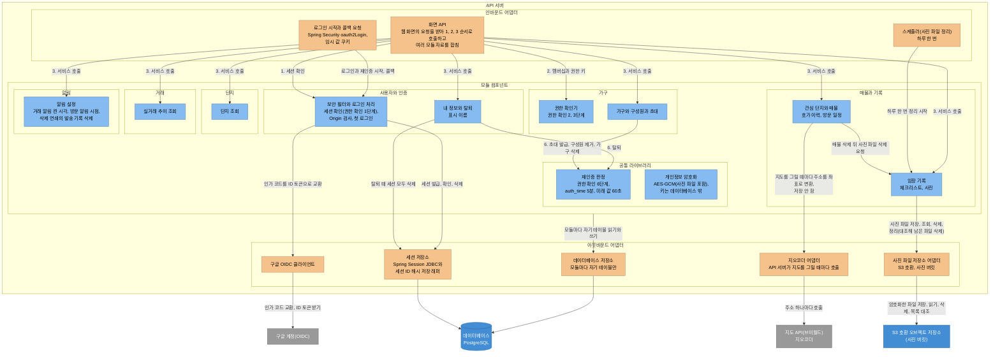
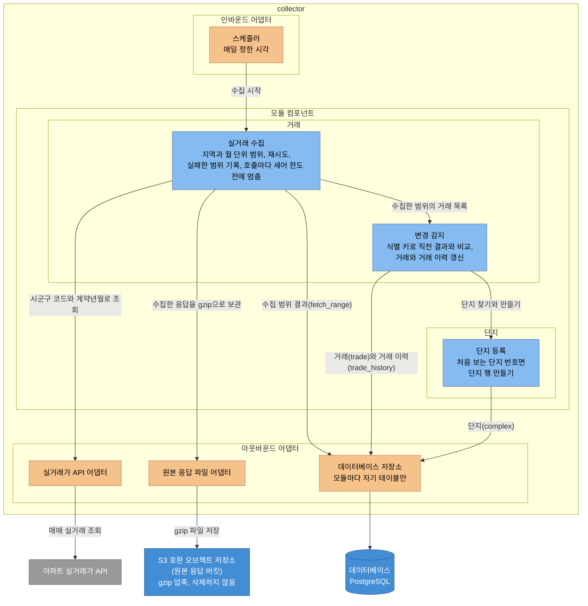
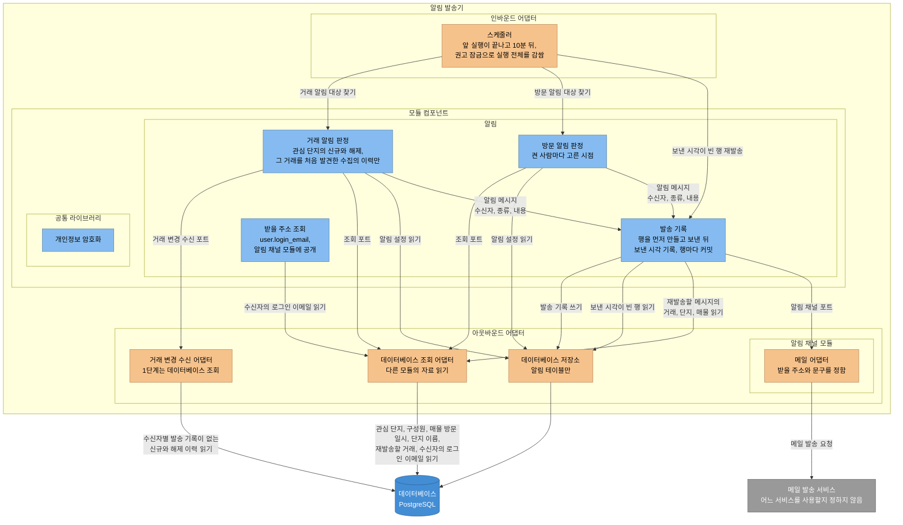

# C4 컴포넌트

이 문서는 1단계 애플리케이션 안의 세 실행 단위(API 서버, collector, 알림 발송기)를 모듈과 컴포넌트로 나누고, 모듈 사이에서 자료를 주고받는 규칙을 정합니다. [C4 컨테이너](c4-container.md)의 1단계 구성에서 애플리케이션 하나로 그린 부분을 확대한 것입니다.

- 세 실행 단위는 1단계와 2단계에는 한 애플리케이션 안에서 실행되고, 3단계에 collector와 알림 발송기를 따로 실행합니다([결정 기록 0005](../adr/0005-modular-monolith.md)). 이 문서는 3단계에 따로 실행할 때 경계를 다시 긋지 않도록 1단계부터 그 경계를 정합니다.
- 컴포넌트는 포트와 어댑터로 나눕니다. 포트는 모듈이 바깥과 주고받는 일을 Java 인터페이스로 정한 것이고, 어댑터는 그 인터페이스를 데이터베이스, 외부 API, 예약 작업 같은 기술로 구현한 것입니다. 인바운드 어댑터는 화면의 요청이나 예약된 시각을 받아 모듈을 호출하고, 아웃바운드 어댑터는 모듈 대신 데이터베이스와 외부 시스템을 호출합니다. 메일 어댑터처럼 다른 모듈의 공개 인터페이스를 호출하는 아웃바운드 어댑터도 있습니다.
- 2단계 이후에 추가하는 기능(단지 기본 정보, 청약 알림, 자금 계산)의 컴포넌트는 그리지 않았습니다.

다이어그램은 Mermaid flowchart로 그렸고, 색은 C4 컨테이너와 같은 규칙을 따릅니다. 연한 파랑은 모듈 안의 컴포넌트, 연한 주황은 어댑터, 파랑은 데이터 저장(데이터베이스, S3 호환 오브젝트 저장소), 회색은 외부 시스템입니다. 묶음 상자는 실행 단위, 어댑터의 방향, 모듈을 나타냅니다.

## 모듈과 테이블

[데이터 모델](data-model.md)의 테이블 19개를 업무 모듈 여섯이 나눠 소유합니다. 모듈은 테이블이나 외부 연동을 소유하는 단위이고, 알림 채널 모듈은 1단계에 테이블이 없습니다. 테이블마다 쓰는 모듈은 하나입니다. 업무 모듈 여섯은 데이터 모델의 영역 넷을 여섯으로 나눈 것입니다. 사용자와 가구 영역을 사용자와 인증 모듈과 가구 모듈로 나누고, 단지와 거래 영역을 단지 모듈과 거래 모듈로 나눴습니다.

| 모듈 | 쓰는 테이블 | 실행 단위 |
|---|---|---|
| 사용자와 인증 | `user`, `spring_session`, `spring_session_attributes` | API 서버 |
| 가구 | `household`, `household_member`, `invitation` | API 서버 |
| 매물과 기록 | `interest_complex`, `listing`, `asking_price`, `checklist_item`, `visit_log`, `visit_log_check`, `visit_photo` | API 서버 |
| 단지 | `complex` | collector(단지 등록), API 서버(조회) |
| 거래 | `trade`, `trade_history`, `fetch_range` | collector(수집과 변경 감지), API 서버(추이 조회) |
| 알림 | `notification_setting`(API 서버), `notification_delivery`(알림 발송기. 삭제 연쇄만 API 서버) | API 서버(설정, 삭제 연쇄), 알림 발송기(판정과 발송) |
| 알림 채널 | 없음(1단계). 2단계에 카카오톡을 추가하면 사용자별 토큰과 사용자가 고른 채널을 이 모듈의 테이블로 둡니다 | 알림 발송기. 2단계에 채널 설정과 카카오톡 동의를 추가하면 API 서버에도 이 모듈의 컴포넌트가 생깁니다 |

단지, 거래, 알림 모듈은 두 실행 단위에 걸쳐 있습니다. 이 세 모듈은 실행 단위마다 컴포넌트가 따로 있고, 테이블을 쓰는 실행 단위는 위 표의 괄호대로 하나입니다. 예외는 발송 기록(`notification_delivery`) 하나입니다. 알림 발송기가 행을 만들고 보낸 시각을 기록합니다. 탈퇴, 가구 삭제, 매물 삭제 때는 API 서버의 알림 설정 컴포넌트가 아래 [삭제 연쇄](#삭제-연쇄) 규칙대로 행을 삭제합니다. 두 쪽 모두 알림 모듈이므로 쓰는 모듈이 하나라는 규칙은 지켜집니다.

## 모듈 사이 규칙

- 테이블에 쓰는 것은 소유 모듈만 합니다. 다른 모듈의 테이블을 바꿔야 하면 소유 모듈의 공개 인터페이스를 호출합니다. 예를 들어 가구를 만들 때 체크리스트 기본 항목(`checklist_item`)은 가구 모듈이 매물과 기록 모듈의 공개 인터페이스를 호출해 만듭니다.
- 같은 실행 단위 안의 모듈끼리는 소유 모듈의 공개 인터페이스를 Java 메서드로 호출합니다. 다른 모듈의 테이블을 직접 조회하지 않습니다.
- 여러 모듈의 자료를 한 화면에 함께 보여 줄 때는 화면 API(인바운드 어댑터)가 각 모듈의 공개 인터페이스를 호출해 합칩니다. 모듈끼리는 업무 규칙(삭제 연쇄, 탈퇴 전 멤버십 확인, 첫 로그인의 알림 설정 만들기, 가구 만들기의 체크리스트 기본 항목, 알림 채널의 받을 주소 조회)이 있을 때만 호출합니다. 화면 표시 때문에 모듈끼리 호출하면 단지가 매물과 기록을 호출하고 매물과 기록이 단지를 호출하는 순환 호출이 생기기 때문입니다.
- 알림 채널 모듈은 알림 모듈이 정의한 알림 채널 포트를 구현하고, 수신자의 메일 주소는 알림 모듈의 공개 인터페이스로 받습니다. 의존은 알림 채널에서 알림으로 한 방향이며 알림 모듈은 알림 채널 모듈을 모릅니다. 구현 때 경계 검사 도구(Spring Modulith 등)를 사용해 알림 모듈이 알림 채널 모듈에 의존하지 않는지 테스트합니다.
- 실행 단위가 다르면(API 서버, collector, 알림 발송기 사이) 서로 호출하지 않습니다. 읽는 쪽 모듈이 조회 포트를 정의하고, 1단계에서는 그 포트의 데이터베이스 조회 어댑터가 같은 데이터베이스를 바로 조회합니다. 3단계에 데이터베이스를 함께 쓰면 어댑터를 그대로 두고, 나누면 어댑터만 바꿉니다.

다른 모듈의 자료를 읽거나 다른 모듈에 쓰기를 맡기는 곳은 아래와 같습니다.

| 읽는 모듈과 컴포넌트 | 읽는 자료(테이블) | 소유 모듈 | 실행 단위 | 방식 |
|---|---|---|---|---|
| 알림의 거래 알림 판정 | 거래 이력(`trade_history`)과 그 이력의 거래(`trade`). 포트는 거래 변경 수신 포트이고, 1단계 어댑터는 거래 변경 수신 어댑터입니다. 이 어댑터는 후보를 고르려고 `interest_complex`, `household_member`, `user`도 함께 읽습니다 | 거래 | 알림 발송기와 collector | 조회 포트와 데이터베이스 조회 어댑터 |
| 알림의 거래 알림 판정, 방문 알림 판정 | 관심 단지와 추가 시각(`interest_complex`) | 매물과 기록 | 알림 발송기와 API 서버 | 조회 포트와 데이터베이스 조회 어댑터 |
| 알림의 거래 알림 판정, 방문 알림 판정 | 구성원과 가구에 들어온 시각(`household_member`) | 가구 | 알림 발송기와 API 서버 | 조회 포트와 데이터베이스 조회 어댑터 |
| 알림의 방문 알림 판정 | 매물의 방문 일시(`listing`) | 매물과 기록 | 알림 발송기와 API 서버 | 조회 포트와 데이터베이스 조회 어댑터 |
| 알림의 거래 알림 판정, 방문 알림 판정, 발송 기록(재발송) | 알림 메일 내용에 사용할 단지 이름(`complex`) | 단지 | 알림 발송기와 collector | 조회 포트와 데이터베이스 조회 어댑터 |
| 알림의 발송 기록(재발송) | 재발송할 거래 알림의 거래(`trade`, 재확인에는 `first_seen_at`) | 거래 | 알림 발송기와 collector | 조회 포트와 데이터베이스 조회 어댑터 |
| 알림 채널의 메일 어댑터 | 수신자의 로그인 이메일(`user.login_email`. 알림 모듈의 받을 주소 조회가 읽어 복호화해 넘김. `user.email_verified`가 거짓인 사람은 판정에서 빠져 발송 기록 행이 없으므로 이 어댑터까지 오지 않음) | 알림 | 알림 발송기 | 공개 인터페이스 호출 |
| 알림의 받을 주소 조회 | 수신자의 로그인 이메일과 검증 여부(`user.login_email`, `user.email_verified`) | 사용자와 인증 | 알림 발송기와 API 서버 | 조회 포트와 데이터베이스 조회 어댑터 |
| 사용자와 인증의 보안 필터와 로그인 처리 | 첫 로그인 때 알림 설정 행 만들기(`notification_setting`). 행은 알림 모듈이 씁니다 | 알림 | API 서버 | 공개 인터페이스 호출 |
| 사용자와 인증의 내 정보와 탈퇴 | 탈퇴 전 멤버십이 없는지(`household_member`) | 가구 | API 서버 | 공개 인터페이스 호출 |
| 가구의 가구와 구성원과 초대 | 가구를 만들 때 체크리스트 기본 항목 만들기(`checklist_item`). 행은 매물과 기록 모듈이 씁니다 | 매물과 기록 | API 서버 | 공개 인터페이스 호출 |
| 거래의 변경 감지 | 단지 번호로 단지 찾기와 처음 보는 단지 만들기(`complex`) | 단지 | collector | 공개 인터페이스 호출 |
| 화면 API 어댑터가 합침(단지 상세, 단지 추가 시트) | 관심 단지 여부, 남은 매물 수와 임장 기록 수(`interest_complex`, `listing`, `visit_log`). 가구는 요청 값이 아니라 세션의 멤버십으로 고릅니다([API 공통 규칙의 `x-household-scope`](api-conventions.md#기능의-계약-파일)) | 매물과 기록 | API 서버 | 화면 API 어댑터 조합 |
| 화면 API 어댑터가 합침(관심 단지 목록) | 관심 단지의 단지 이름(`complex`) | 단지 | API 서버 | 화면 API 어댑터 조합 |
| 화면 API 어댑터가 합침(관심 단지 목록, 매물 상세) | 관심 단지의 최근 실거래 한 건, 매물 상세에서 호가와 비교할 최근 실거래(`trade`) | 거래 | API 서버 | 화면 API 어댑터 조합 |
| 화면 API 어댑터가 합침(가족 초대) | 구성원의 표시 이름, 로그인 이메일과 검증 여부(`user`) | 사용자와 인증 | API 서버 | 화면 API 어댑터 조합 |
| 화면 API 어댑터가 합침(매물 상세, 임장 기록 작성) | 임장 기록의 작성자 표시 이름(`user`) | 사용자와 인증 | API 서버 | 화면 API 어댑터 조합 |
| 화면 API 어댑터가 합침(알림 설정) | 로그인 이메일의 검증 여부(`user.email_verified`). 검증되지 않았으면 알림을 보내지 않는다는 안내를 표시합니다 | 사용자와 인증 | API 서버 | 화면 API 어댑터 조합 |

삭제 연쇄에서 다른 모듈에 삭제를 맡기는 곳은 아래 [삭제 연쇄](#삭제-연쇄) 표에 있습니다.

알림 판정이 읽는 알림 설정(`notification_setting`)은 알림 모듈 자신의 테이블이라 이 표에 넣지 않았습니다. API 서버의 알림 설정이 쓰고, 알림 발송기에서는 판정 컴포넌트가 알림 모듈의 데이터베이스 저장소로 읽습니다(거래 알림 켠 시각, 방문 알림 켜짐과 시점).

### 삭제 연쇄

[데이터 모델의 삭제와 보존](data-model.md#삭제와-보존) 표에는 한 동작이 여러 모듈의 테이블을 삭제하거나 비우는 경우가 넷 있습니다. 이때는 동작을 시작한 모듈이 각 소유 모듈의 공개 인터페이스를 호출합니다. 네 동작 모두 API 서버 안에서 일어나므로, 시작한 모듈의 서비스가 연 데이터베이스 트랜잭션 하나로 묶습니다. 중간에 하나라도 실패하면 데이터베이스 행의 변경을 모두 롤백합니다. 사진 파일은 데이터베이스 밖에 있어 트랜잭션으로 롤백할 수 없으므로 아래 순서대로 따로 삭제합니다.

| 동작 | 시작하는 모듈 | 다른 모듈에 맡기는 일 |
|---|---|---|
| member가 가구를 나가거나 owner가 member를 제거함 | 가구 | 매물과 기록: 그 사람의 임장 기록 `author_id` 비우기 |
| 탈퇴 | 사용자와 인증 | 알림: 알림 설정과 그 사람의 발송 기록 삭제 |
| owner가 가구를 삭제함 | 가구 | 매물과 기록: 그 가구의 관심 단지, 매물, 호가 이력, 임장 기록과 그 체크 결과와 사진(사진 파일 포함), 체크리스트 항목 삭제. 알림: 그 가구 매물의 방문 알림 발송 기록 삭제 |
| 매물을 삭제함 | 매물과 기록 | 알림: 그 매물의 방문 알림 발송 기록 삭제 |

- 시작한 모듈은 삭제할 부모 행을 `SELECT ... FOR UPDATE`로 먼저 잠급니다. 부모 행은 매물 삭제에서는 그 매물, 가구 삭제에서는 그 가구의 매물들, 탈퇴에서는 사용자 행입니다.
- 다른 행을 참조하는 행부터 삭제합니다. 잠근 뒤 알림의 발송 기록을 먼저 삭제하고, 그다음 매물과 기록의 행, 마지막에 동작을 시작한 모듈 자신의 행을 삭제합니다. 탈퇴에서는 알림 설정과 발송 기록 삭제를 마친 뒤 사용자 행을 삭제합니다.
- 매물 삭제는 그 매물에 요청한 사람이 작성하지 않은 임장 기록(작성자가 나가 `author_id`가 빈 기록 포함)이 있으면 거절하고 아무것도 삭제하지 않습니다. 이 거절 확인은 매물 행을 `SELECT ... FOR UPDATE`로 잠근 뒤에 합니다. 확인과 잠금 사이에 다른 구성원이 커밋한 기록이 함께 삭제되지 않게 하려는 것입니다.
- 알림이 삭제할 방문 알림 발송 기록의 매물 번호는 시작 모듈이 넘깁니다. 가구 삭제에서는 가구 모듈이 매물과 기록의 "그 가구의 매물 번호 받기" 공개 인터페이스를 호출합니다. 이 인터페이스가 그 가구의 매물 행을 잠그고 번호를 반환하면, 가구 모듈이 그 번호를 알림에 넘깁니다.
- 사진 파일은 데이터베이스 트랜잭션이 커밋된 뒤 매물과 기록 모듈의 임장 기록이 사진 파일 저장소 어댑터로 삭제합니다. 매물 삭제에서는 관심 단지와 매물이 어댑터를 직접 호출하지 않고 임장 기록에 삭제할 오브젝트 키를 넘깁니다. 트랜잭션이 롤백되면 파일을 삭제하지 않습니다. 파일 삭제가 실패해 남은 파일은 스케줄러(사진 파일 정리)가 임장 기록을 호출해 하루 한 번 삭제합니다.

API 서버가 발송 기록을 삭제하는 동안 알림 발송기가 같은 사람이나 같은 매물의 발송 기록 행을 만들면, 부모 행의 잠금 때문에 한쪽이 기다립니다. 발송기가 먼저 커밋한 행은 삭제 연쇄가 함께 삭제합니다. 삭제가 먼저 커밋되면 발송기의 행 만들기가 외래 키 오류로 실패하고, 발송기는 그 행만 건너뜁니다. 흐름은 [핵심 흐름](flows.md)에 있습니다.

## API 서버

그림의 번호는 요청 하나를 처리하는 순서입니다. 화면 API가 1, 2, 3 순서로 호출하고, 민감 동작이면 모듈 서비스가 4, 5단계를 확인한 직후 재인증 판정(6)을 호출합니다([권한 확인 6단계를 맡는 곳](#권한-확인-6단계를-맡는-곳)). 서비스 호출 선은 화면이 호출하는 컴포넌트마다 그렸습니다. 모듈 사이 호출은 [모듈 사이 규칙](#모듈-사이-규칙)의 표와 [삭제 연쇄](#삭제-연쇄) 표에 있고, 개인정보 암호화를 호출하는 곳은 아래 표에 있습니다. 인바운드 어댑터는 모듈 컴포넌트를 호출하고, 아웃바운드 어댑터는 모듈 컴포넌트가 호출합니다. 지오코더 호출은 화면 API, 관심 단지와 매물, 지오코더 어댑터 순서로 이어지고, 사진 파일 정리는 스케줄러(사진 파일 정리), 임장 기록, 사진 파일 저장소 어댑터 순서로 이어집니다.

| 컴포넌트 | 모듈 | 책임 | 근거 문서 |
|---|---|---|---|
| 화면 API(인바운드 어댑터) | 모든 모듈 | 웹 화면의 요청을 받아 보안 필터, 권한 확인기, 모듈 서비스 순서로 호출합니다. 여러 모듈의 자료를 한 화면에 보여 줄 때는 각 모듈의 공개 인터페이스를 호출해 합칩니다. 오류는 RFC 9457 Problem Details(HTTP API의 오류 응답 본문 형식을 정한 인터넷 표준) 형식으로 응답합니다 | [API 공통 규칙](api-conventions.md) |
| 로그인 시작과 콜백 요청(인바운드 어댑터) | 사용자와 인증 | 세션 없이 받는 두 요청입니다. 로그인 시작 요청은 state, nonce, PKCE(Proof Key for Code Exchange, 인가 코드를 가로챈 사람이 토큰으로 바꾸지 못하게 하는 검증값) 검증값을 임시 값 쿠키에 담아 구글로 보내고, 콜백 요청은 그 값을 비교합니다 | [결정 기록 0013](../adr/0013-session.md) |
| 보안 필터와 로그인 처리 | 사용자와 인증 | Spring Security의 OAuth2 로그인(`oauth2Login`, OIDC)으로 로그인과 재인증을 마치고 세션을 발급합니다. 세션에는 사용자 번호와 `auth_time`만 둡니다. 요청마다 세션 쿠키를 확인하고(권한 확인 1단계), 상태를 바꾸는 요청의 Origin을 검사합니다. 첫 로그인 때 사용자 행을 만들고 알림 설정 행을 만들게 합니다. 이때 로그인 이메일은 개인정보 암호화 라이브러리로 암호화해 저장합니다([결정 기록 0012](../adr/0012-personal-data-storage.md)). 로그인 임시 값 쿠키의 값은 같은 라이브러리의 인증 암호화로 감싸 위조를 탐지합니다(결정 기록 0013). 로그아웃하면 그 기기의 세션을 삭제합니다 | 결정 기록 0013, [결정 기록 0010](../adr/0010-login-method.md), 결정 기록 0012 |
| 내 정보와 탈퇴 | 사용자와 인증 | 내 정보 조회, 표시 이름 수정, 탈퇴(사용자 행과 그 사용자의 세션 모두 삭제)를 맡습니다 | 결정 기록 0013, [데이터 모델의 삭제와 보존](data-model.md#삭제와-보존) |
| 권한 확인기 | 가구 | 요청마다 멤버십을 다시 읽어 권한 확인 2, 3단계를 확인합니다(아래 [권한 확인 6단계를 맡는 곳](#권한-확인-6단계를-맡는-곳)) | API 공통 규칙, [결정 기록 0011](../adr/0011-household-sharing.md) |
| 재인증 판정 | 공통 라이브러리(모듈 아님) | 권한 확인 6단계입니다. 세션의 로그인 정보에 담긴 `auth_time`이 없거나, 5분보다 오래됐거나, 서버의 현재 시각보다 60초를 넘게 미래이면 재인증이 필요하다는 응답(401 `REAUTH_REQUIRED`)을 반환합니다. 민감 동작을 맡은 모듈 서비스가 4, 5단계를 확인한 직후 호출합니다 | 결정 기록 0013, API 공통 규칙 |
| 가구와 구성원과 초대 | 가구 | 가구 만들기와 삭제, 구성원 목록과 제거, 가구 나가기, 초대 발급과 취소와 수락을 맡습니다. 초대 토큰은 해시만 저장합니다 | 결정 기록 0011, [결정 기록 0012](../adr/0012-personal-data-storage.md), 데이터 모델 |
| 관심 단지와 매물 | 매물과 기록 | 관심 단지 추가와 빼기, 매물 등록과 수정과 삭제, 호가 이력, 방문 일정, 상태를 맡습니다. 매물에 요청한 사람이 작성하지 않은 임장 기록(작성자가 나가 `author_id`가 빈 기록 포함)이 있으면 삭제를 거절하고 "다른 구성원의 기록이 있어 지울 수 없습니다"를 표시합니다. 매물 상태를 바꾸라는 안내는 넣지 않습니다. 상태 코드와 오류 코드는 기능 명세에서 정합니다. 매물을 등록하면 그 단지를 관심 단지로 만듭니다. 매물 상세에서 호가와 비교할 최근 실거래는 화면 API가 실거래 추이 조회에서 받아 합칩니다 | 데이터 모델, [와이어프레임](../design/wireframes.md) |
| 임장 기록 | 매물과 기록 | 임장 기록 작성과 수정과 삭제(작성자만), 가구의 체크리스트 항목 편집, 체크 결과에 항목 이름 복사, 사진 업로드와 삭제, 스케줄러(사진 파일 정리)가 시작한 남은 파일 정리를 맡습니다 | 데이터 모델, 와이어프레임 |
| 단지 조회 | 단지 | collector가 만든 단지 행으로 단지 이름과 주소, 단지 추가 시트의 단지 목록을 반환합니다. 관심 단지 여부와 남은 매물 수는 화면 API가 매물과 기록 모듈에서 받아 합칩니다 | 데이터 모델, 와이어프레임 |
| 실거래 추이 조회 | 거래 | 단지의 전용면적 목록, 면적별 최근 5년 추이, 최근 실거래 목록을 반환합니다 | [결정 기록 0007](../adr/0007-change-history.md), 와이어프레임 |
| 알림 설정 | 알림 | 사용자마다 거래 알림을 켠 시각(`trade_alert_on_at`), 방문 알림 켜짐(`visit_alert_on`)과 시점(`visit_alert_lead_hours`. 3, 24, 48 중 하나이고 기본 24)을 저장합니다. `trade_alert_on_at`이 비어 있으면 꺼진 상태입니다. 꺼진 상태에서 켤 때만 현재 시각을 적고, 켜진 채로 다른 설정을 저장할 때는 바꾸지 않습니다. 알림 메일은 로그인 이메일로만 보내므로 메일 주소를 따로 저장하지 않고, 재인증도 거치지 않습니다. 삭제 연쇄에서 다른 모듈이 호출하면 알림 설정과 발송 기록 행을 삭제합니다 | [결정 기록 0003](../adr/0003-notification-channel.md), API 공통 규칙, 와이어프레임 |
| 개인정보 암호화 | 공통 라이브러리(모듈 아님) | 로그인 이메일, 매물 주소와 동과 호, 사진 파일을 AES-GCM으로 암호화하고 복호화합니다. 로그인 임시 값 쿠키를 인증 암호화로 감쌉니다. 키는 데이터베이스 밖에 둡니다. 보안 필터와 로그인 처리(로그인 이메일, 임시 값 쿠키), 내 정보와 탈퇴(로그인 이메일), 관심 단지와 매물(주소, 동, 호), 임장 기록(사진 파일)이 호출합니다 | 결정 기록 0012, 결정 기록 0013 |
| 데이터베이스 저장소(아웃바운드 어댑터) | 모든 모듈 | 모듈마다 자기 테이블만 읽고 씁니다 | 이 문서의 [모듈과 테이블](#모듈과-테이블) |
| 세션 저장소(아웃바운드 어댑터) | 사용자와 인증 | Spring Session JDBC에 세션을 저장하고, `session_id`에는 쿠키 토큰의 SHA-256 해시만 저장하는 래퍼를 둡니다 | 결정 기록 0013, 결정 기록 0012 |
| 구글 OIDC 클라이언트(아웃바운드 어댑터) | 사용자와 인증 | 인가 코드를 ID 토큰으로 바꾸고, 서명과 `iss`, `aud`, `exp`, `nonce`, `auth_time`을 확인합니다. 구글 토큰은 저장하지 않습니다 | 결정 기록 0013 |
| 사진 파일 저장소 어댑터(아웃바운드 어댑터) | 매물과 기록 | 암호화한 사진 파일을 S3 호환 오브젝트 저장소의 사진 버킷에 저장하고 읽고 삭제하며, 파일 목록을 대조합니다. 오브젝트 키(`visit_photo.storage_key`)는 버킷 안의 `{household_id}/{임의 UUID}`입니다. 파일 업로드와 다운로드는 늘 API 서버를 거치며, 저장소 주소를 화면에 노출하지 않습니다. API 서버의 접근 키는 사진 버킷에만 권한이 있습니다. 파일을 먼저 저장하고 `visit_photo` 행을 저장하며, 삭제할 때는 행을 삭제하는 트랜잭션이 커밋된 뒤 파일을 삭제합니다 | [결정 기록 0014](../adr/0014-file-storage.md), 데이터 모델의 `visit_photo` 절 |
| 스케줄러(사진 파일 정리)(인바운드 어댑터) | 매물과 기록 | 하루 한 번 임장 기록을 호출해 정리를 시작합니다. 임장 기록이 사진 파일 저장소 어댑터로 사진 버킷만 대조해, `visit_photo` 행이 없고 업로드한 지 하루가 지난 파일을 삭제합니다. 트랜잭션 커밋 뒤 파일 삭제가 실패해 남은 파일을 정리합니다 | 결정 기록 0014 |
| 지오코더 어댑터(아웃바운드 어댑터) | 매물과 기록 | 화면이 지도를 그릴 때마다 화면 API가 관심 단지와 매물을 호출하고, 관심 단지와 매물이 이 어댑터로 브이월드 지오코더를 호출해 주소를 좌표로 변환합니다. 좌표만 화면에 반환합니다. 변환할 주소는 화면이 보낸 주소(저장 전 입력)나 저장된 매물 주소입니다. 좌표는 저장하지 않습니다. 사용자마다 하루 호출 상한을 둡니다(값은 기능 명세). 로그인 허용 목록이 없어, 한 사용자가 하루 호출 한도를 다 사용하면 지오코더를 호출할 수 없어 다른 사용자도 지도에 위치를 표시하지 못하기 때문입니다. 지오코더 요청에는 주소 평문이 담기므로 요청 URL을 로그에 남기지 않습니다([결정 기록 0012](../adr/0012-personal-data-storage.md)). 주소를 좌표로 변환하지 못하면 "주소의 위치를 찾지 못했습니다. 주소를 확인하세요."를 표시하고 저장은 막지 않습니다. 구현 전에 인증키로 서버 호출이 되는지 확인하고, 안 되면 웹 화면이 JSONP로 호출하고 CSP 허용 목록에 지오코더 주소를 넣습니다 | [결정 기록 0015](../adr/0015-geocoder.md), [C4 컨테이너](c4-container.md) |

OIDC(OpenID Connect)는 외부 제공자 계정으로 로그인하는 표준입니다([결정 기록 0010](../adr/0010-login-method.md)).

## collector

| 컴포넌트 | 모듈 | 책임 | 근거 문서 |
|---|---|---|---|
| 스케줄러(인바운드 어댑터) | 거래 | 정한 시각에 실거래 수집을 시작합니다 | [C4 컨테이너](c4-container.md) |
| 실거래 수집 | 거래 | 관심 지역의 실거래를 지역과 월 단위 범위로 수집합니다. 범위마다 결과를 `fetch_range`에 기록합니다. HTTP 오류나 네트워크 오류가 나면 같은 요청을 2초, 4초 쉬고 최대 3번 시도합니다. 응답 결과 코드가 정상이 아니면 다시 시도하지 않고 그 범위를 실패로 둡니다. 인증키 오류와 하루 한도 초과(코드 22)는 그 실행을 멈추고 남은 범위를 실패로 기록합니다. 수집한 건수가 응답의 `totalCount`와 다르거나, 직전 수집 결과에 거래가 있던 범위가 0건이면 실패로 두고 비교하지 않습니다. 원본 응답 저장이 끝나야 비교합니다. 반영(단지 만들기, 거래와 이력 갱신, `fetch_range` 성공 기록)은 한 트랜잭션에서 합니다. 실패한 범위는 재수집 기간 밖이어도 다음 날 스케줄러가 함께 수집합니다. 페이지 수는 첫 응답을 받아야 알 수 있어 시작 전에 최대 호출 수를 계산하지 않습니다. 대신 실행 안에서 호출할 때마다 호출 수를 세어 하루 한도에 도달하기 전에 멈추고 남은 범위를 실패로 기록합니다. 호출 수 테이블은 두지 않습니다. 같은 날 여러 번 실행하면 앞 실행의 호출 수를 모르는 한계가 있고, 3단계에 재검토합니다. 한 범위의 모든 페이지를 수집하면 원본 응답을 먼저 저장하고 그다음 건수 확인과 비교를 합니다. 흐름은 [핵심 흐름](flows.md)에 있습니다 | [PRD 비기능 요구사항](../prd.md#비기능-요구사항), [데이터 모델의 `fetch_range`](data-model.md#fetch_range) |
| 변경 감지 | 거래 | 수집 결과를 [결정 기록 0006](../adr/0006-transaction-identity.md)의 식별 키로 직전 수집 결과와 비교해 `trade`를 갱신하고, 바뀐 것을 `trade_history`에 한 행씩 기록합니다. 범위 하나를 반영할 때 수집 시각 하나를 정해, 그 반영에서 새로 만드는 `trade.first_seen_at`과 기록하는 `trade_history.observed_at` 두 열에 같은 값을 씁니다. `fetched_at`이 있는 범위는 재수집 기간을 벗어난 실패한 범위를 포함해 늘 직전 결과와 비교해 이력을 기록합니다. `fetched_at`이 빈 범위는 `fetch_range` 행이 있는지로 나뉩니다. 행이 있는 범위(앞서 실패만 한 범위)는 어느 실행에서든 기준 적재로 두어 이력을 기록하지 않습니다. 앞서 실패한 범위를 빈 결과와 비교하면 그 달 거래가 모두 새 거래 알림으로 나가기 때문입니다. 행이 없는 범위는 처음 수집하는 범위입니다. 초기 적재나 범위 확장 실행이면 기준 적재입니다. 매일 수집이면(달이 바뀌어 재수집 기간에 새로 들어온 달) 빈 직전 결과와 비교해 이력을 기록합니다. 대가로 새 달의 첫 매일 수집이 실패하면 그 달은 다음 성공 때 기준 적재가 되어, 그 사이 신고된 그 달 거래의 알림이 빠집니다 | 결정 기록 0006, [결정 기록 0007](../adr/0007-change-history.md) |
| 단지 등록 | 단지 | 실거래 응답에서 처음 보는 단지 번호(`aptSeq`)를 만나면 `complex` 행을 만듭니다 | [데이터 모델의 `complex`](data-model.md#complex), [결정 기록 0008](../adr/0008-complex-matching.md) |
| 실거래가 API 어댑터(아웃바운드 어댑터) | 거래 | 시군구 코드와 계약년월로 아파트 매매 실거래가 상세 API를 호출합니다 | [C4 시스템 컨텍스트](c4-context.md) |
| 원본 응답 파일 어댑터(아웃바운드 어댑터) | 거래 | 수집한 응답을 데이터베이스에 넣지 않고 gzip으로 압축해 원본 응답 버킷에 `{수집 날짜 YYYY-MM-DD}/{실행 시작 시각 HHmmss}/{시군구 코드}-{계약년월}-p{페이지 번호}.xml.gz` 파일로 보관하고 삭제하지 않습니다. collector의 접근 키는 원본 응답 버킷에만 권한이 있습니다 | 결정 기록 0007, [결정 기록 0014](../adr/0014-file-storage.md) |
| 데이터베이스 저장소(아웃바운드 어댑터) | 거래, 단지 | 모듈마다 자기 테이블만 읽고 씁니다 | 이 문서의 [모듈과 테이블](#모듈과-테이블) |

## 알림 발송기

API 서버 그림과 같이 모듈 사이 호출(메일 어댑터가 받을 주소 조회를 호출하는 것)은 [모듈 사이 규칙](#모듈-사이-규칙)의 표에 있고, 개인정보 암호화를 호출하는 곳은 아래 표에 있습니다.

| 컴포넌트 | 모듈 | 책임 | 근거 문서 |
|---|---|---|---|
| 스케줄러(인바운드 어댑터) | 알림 | 앞 실행이 끝나고 10분 뒤 다시 실행되어 알림 판정과 재발송을 시작합니다. 수집 직후 따로 돌지 않습니다. 실행 전체를 PostgreSQL 권고 잠금(`pg_try_advisory_lock`)으로 감쌉니다. 실행 동안 유지하는 전용 연결 하나에서 잠금을 획득하고 같은 연결에서 해제하며, 획득하지 못하면 그 실행을 건너뜁니다 | [C4 컨테이너](c4-container.md) |
| 거래 알림 판정 | 알림 | 후보는 `change_type`이 `신규`나 `해제`이고, 그 이력의 `observed_at`이 그 거래 행의 `first_seen_at`과 같은 이력입니다. 사라졌다 다시 보인 키와 건수가 늘어난 기존 키의 이력은 보내지 않습니다. 후보는 `observed_at`이 최근 3일 안인 이력으로 한정합니다. 3일은 재발송 기한과 같게 정한 값입니다. 이렇게 해서 이메일이 나중에 검증되거나 발송기가 오래 멈췄다 돌아올 때 지난 이력의 알림이 한꺼번에 만들어지지 않게 합니다. 수신자는 그 단지를 관심 단지로 둔 가구의 현재 구성원 가운데 `trade_alert_on_at`이 비어 있지 않은 사람입니다. 이력의 `observed_at`이 `interest_complex.added_at`, 수신자의 `household_member.joined_at`, 수신자의 `trade_alert_on_at`보다 뒤여야 합니다. `user.email_verified`가 거짓인 사람은 수신자에서 빼고 발송 기록 행을 만들지 않습니다. 발송 기록이 없는 (사람, 거래, 종류) 조합만 행을 만듭니다. 메일에는 단지 이름, 알림 종류(새 거래, 해제), 계약일, 전용면적, 층, 금액, 서비스 링크를 담고 주소, 동, 호는 넣지 않습니다 | [데이터 모델의 알림 대상](data-model.md#알림-대상), [결정 기록 0007](../adr/0007-change-history.md) |
| 방문 알림 판정 | 알림 | 방문 일시가 있는 매물 가운데 그 단지가 가구의 관심 단지인 것을 고릅니다. 수신자는 현재 구성원 가운데 방문 알림을 켠 모든 사람입니다. 현재 시각이 `visit_at`에서 그 사람의 `visit_alert_lead_hours`를 뺀 시각 이후이고 `visit_at` 전이면 보냅니다. `user.email_verified`가 거짓인 사람은 수신자에서 빼고 발송 기록 행을 만들지 않습니다. 발송 기록이 없는 (사람, 매물, 방문 일시) 조합만 행을 만들고, 메일에는 단지 이름, 방문 일시, 서비스 링크만 담습니다 | 데이터 모델의 알림 대상과 [앱에서 확인하는 규칙](data-model.md#앱에서-확인하는-규칙) |
| 발송 기록 | 알림 | `notification_delivery` 행을 먼저 만들고(`sent_at`은 비움) 알림 채널 포트로 보낸 뒤 `sent_at`을 기록합니다. 유니크 제약으로 같은 알림을 두 번 만들지 않고, `sent_at`이 빈 행은 실행마다 데이터베이스 저장소로 읽어 재발송합니다. 거래 알림은 행의 `created_at`에서 3일이 지나면, 방문 알림은 `visit_at`이 지나면 재발송하지 않고, 그 행은 `sent_at`이 빈 채 남습니다. 보내기 전에 행마다 수신자와 대상이 여섯 조건을 모두 지금도 만족하는지 다시 확인하고, 하나라도 어긋나면 보내지 않습니다. 여섯 조건은 현재 구성원인지, 그 알림을 켰는지, 관심 단지인지, `email_verified`가 참인지, 방문 알림이면 매물의 현재 `visit_at`이 행의 `visit_at`과 같은지, 거래 알림이면 조회 포트로 읽은 `trade.first_seen_at`이 현재의 `interest_complex.added_at`, `household_member.joined_at`, `trade_alert_on_at`보다 뒤인지입니다. 보낼 행은 `trade.first_seen_at`이 이력의 `observed_at`과 같습니다. 나간 구성원이나 알림을 끈 사람에게 가지 않게 하고, 메일이 실패한 사이 알림을 껐다 켜거나 단지를 뺐다 다시 넣으면 그 전 이력은 보내지 않게 하려는 것입니다. 발송 기록 행은 행마다 따로 커밋하며, 삭제 연쇄와 겹쳐 행을 만들다 외래 키 오류가 나면 그 행만 건너뜁니다. 행에는 메시지 내용이 없으므로, 재발송할 때는 행의 참조(거래 알림은 `trade_id`, 방문 알림은 `listing_id`와 `visit_at`)로 조회 포트를 호출해 알림 메시지를 다시 만듭니다. 거래도 거래 변경 수신 포트가 아니라 조회 포트로 `trade_id`의 거래를 읽습니다. 거래 변경 수신 포트는 3단계에 Kafka 컨슈머로 바뀌므로 번호로 거래 하나를 읽는 일을 맡기지 않습니다 | [데이터 모델의 `notification_delivery`](data-model.md#notification_delivery) |
| 개인정보 암호화 | 공통 라이브러리(모듈 아님) | 받을 주소 조회가 로그인 이메일을 넘길 때 복호화합니다. API 서버의 것과 같은 라이브러리입니다 | [결정 기록 0012](../adr/0012-personal-data-storage.md) |
| 거래 변경 수신 어댑터(아웃바운드 어댑터) | 알림 | 거래 변경 수신 포트를 구현합니다. 1단계에서는 데이터베이스에서 판정과 같은 조건을 만족하는 수신자 가운데 한 사람이라도 발송 기록이 없는 이력을 후보로 읽습니다. 그 조건은 다섯입니다. `신규`나 `해제` 이력이고 `observed_at`이 거래의 `first_seen_at`과 같습니다. `observed_at`이 최근 3일 안입니다. `user.email_verified`가 참입니다. 관심 단지를 둔 가구의 현재 구성원 가운데 `trade_alert_on_at`이 비어 있지 않습니다. `observed_at`이 `interest_complex.added_at`, `household_member.joined_at`, `trade_alert_on_at`보다 뒤입니다. 같은 fixture로 이 조건과 판정의 결과가 같은지 테스트합니다. 그래서 `trade_history`, `trade`와 함께 `interest_complex`, `household_member`, `user`, 알림 모듈의 `notification_setting`, `notification_delivery`를 읽습니다. 조건을 판정과 같게 두는 것은 보낼 사람이 없는 이력이 실행마다 후보로 다시 읽히지 않게 하려는 것입니다 | 이 문서의 [collector에서 알림 발송기로 전달](#collector에서-알림-발송기로-전달) |
| 데이터베이스 조회 어댑터(아웃바운드 어댑터) | 알림 | 알림 모듈이 정의한 조회 포트를 구현해 다른 모듈의 테이블(`interest_complex`, `household_member`, `listing`, `complex`, `trade`, `user`)을 읽습니다. 쓰지 않습니다 | 이 문서의 [모듈 사이 규칙](#모듈-사이-규칙) |
| 데이터베이스 저장소(아웃바운드 어댑터) | 알림 | 알림 모듈의 테이블을 읽고, `notification_delivery`를 씁니다 | 이 문서의 [모듈과 테이블](#모듈과-테이블) |
| 받을 주소 조회 | 알림 | 알림 채널 모듈이 호출하는 공개 인터페이스입니다. 수신자의 `user.login_email`을 사용자와 인증 모듈의 `user`에서 조회 포트와 데이터베이스 조회 어댑터로 읽습니다. 읽은 값은 개인정보 암호화로 복호화해 넘깁니다. 판정이 수신자를 고를 때 이 조회로 검증 여부를 함께 읽어, `user.email_verified`가 거짓인 사람은 수신자에서 빼고 발송 기록 행을 만들지 않습니다 | [결정 기록 0012](../adr/0012-personal-data-storage.md), 이 문서의 [모듈 사이 규칙](#모듈-사이-규칙) |
| 메일 어댑터(아웃바운드 어댑터) | 알림 채널 | 알림 채널 포트를 구현합니다. 수신자의 메일 주소는 알림 모듈의 공개 인터페이스로 받고, 알림 종류와 내용으로 메일 문구를 만들어 메일 발송 서비스에 요청합니다 | [결정 기록 0003](../adr/0003-notification-channel.md) |

## collector에서 알림 발송기로 전달

- collector와 알림 발송기는 서로 호출하지 않고 데이터베이스의 거래 이력(`trade_history`)으로 넘깁니다. collector의 변경 감지는 이력 행을 쓰기만 하고 알림 발송기를 호출하지 않습니다.
- 알림 발송기는 "거래 변경 수신" 포트로 후보 이력을 받고, 거래 알림 판정이 거래, 알림 종류, 수신자의 조합마다 발송 기록이 있는지 확인해 없는 조합만 발송 기록 행을 만듭니다([데이터 모델의 알림 대상](data-model.md#알림-대상)). 같은 조합의 행을 두 번 만들지 않게 마지막으로 막는 것은 발송 기록의 유니크 제약(`user_id`, `trade_id`, `kind`)입니다. 그래서 한 사람의 행만 만든 뒤 멈춰도 다음 실행에서 남은 사람의 행을 만들고, 체크포인트를 따로 기록하지 않아도 이력을 놓치지 않습니다.
- 3단계 Kafka 어댑터는 받은 이벤트를 후보로 넘기기만 합니다. 조합마다 확인하고 유니크 제약으로 막는 일은 판정과 발송 기록이 하므로 판정을 수정하지 않습니다. 다만 한 사람의 행만 만든 뒤 멈췄을 때 남은 수신자의 행을 다시 만들 수 있게 하는 방법은 1단계에서는 데이터베이스를 다시 읽는 어댑터이고, Kafka에서는 오프셋을 모든 수신자의 행을 만든 뒤 커밋하는 것이어야 합니다. 오프셋 커밋 시점은 3단계에 정합니다.
- 3단계에 Kafka를 넣으면 "거래 변경 수신" 포트의 어댑터만 Kafka 컨슈머로 바꾸고, 거래 알림 판정은 수정하지 않습니다. 같은 이벤트를 읽어 집계를 갱신하는 일은 API 서버에 둡니다([결정 기록 0005](../adr/0005-modular-monolith.md)). collector가 이벤트를 발행하는 부분([C4 컨테이너의 목표 구성](c4-container.md#목표-구성))은 그때 collector에 추가합니다.

## 권한 확인 6단계를 맡는 곳

[API 공통 규칙](api-conventions.md#인증과-권한-확인)의 권한 확인 6단계를 아래 컴포넌트가 맡습니다. 1단계부터 3단계는 모든 요청에 같은 방식으로 적용하는 공통 계층이 확인하고, 4단계부터 6단계는 자원을 아는 각 모듈 서비스가 확인합니다.

| 단계 | 확인하는 것 | 맡는 컴포넌트 |
|---|---|---|
| 1 | 세션 쿠키가 있고 만료되지 않았는지 | 사용자와 인증의 보안 필터와 로그인 처리(Spring Security와 세션 저장소) |
| 2 | 멤버십이 있는지, 없으면 멤버십 없이 허용하는 동작인지 | 가구의 권한 확인기 |
| 3 | 역할에 그 동작의 권한 키가 있는지 | 가구의 권한 확인기 |
| 4 | 경로가 가리키는 자원이 내 가구의 것인지 | 각 모듈 서비스 |
| 5 | 그 임장 기록을 작성한 사람인지, 본인의 알림 설정과 표시 이름인지 | 각 모듈 서비스 |
| 6 | 민감 동작이면 마지막 인증이 5분 안인지 | 각 모듈 서비스가 4, 5단계를 확인한 직후 공통 라이브러리의 재인증 판정을 호출함 |

- 4단계는 각 모듈 서비스가 가구 자원을 조회할 때 늘 세션 멤버십의 가구 번호를 조회 조건에 넣는 방식으로 확인합니다. 다른 가구의 자원은 조회 결과에 없으므로 404가 됩니다.
- API 공통 규칙은 1단계부터 5단계를 통과한 뒤 6단계를 확인하고, 처음 걸린 단계의 상태 코드로 응답합니다. 이 순서를 지키려고 6단계를 모듈 서비스 안에 둡니다. 6단계를 4단계보다 먼저 확인하면 다른 가구의 구성원을 제거하는 요청에 404 대신 401 `REAUTH_REQUIRED`로 응답합니다.
- 재인증 판정은 세션의 로그인 정보에 담긴 `auth_time`만 읽는 공통 라이브러리라, 모듈 서비스가 다른 모듈을 호출하지 않고 확인합니다.
- 계약 확장 필드(`x-permission`, `x-household-scope`, `x-owner-only`, `x-reauth`)의 값을 코드에 어떻게 표시해 권한 확인기와 모듈 서비스가 읽을지는 구현에서 정합니다.

## 알림 채널 포트

거래 알림 판정과 방문 알림 판정은 채널을 모르는 알림 메시지만 발송 기록에 넘기고, 발송 기록은 그 메시지를 알림 채널 포트로 보냅니다. 알림 메시지에는 수신자와 알림 종류와 내용만 담고, 받을 주소와 문구는 채널 어댑터가 정합니다. 1단계의 채널 어댑터는 메일 어댑터 하나입니다. [결정 기록 0003](../adr/0003-notification-channel.md)의 "발송 채널을 별도 모듈로 분리"는 알림 채널 모듈로 구현합니다. 포트는 알림 모듈이 정의하고 알림 채널 모듈이 구현하며, 알림 모듈은 알림 채널 모듈을 모릅니다.

2단계에 카카오톡을 넣는다면 아래와 같습니다. 카카오 연동은 2단계 계획에서 따로 검토합니다([결정 기록 0010](../adr/0010-login-method.md)).

| 구분 | 내용 |
|---|---|
| 바뀌는 것 | 알림 채널 모듈에 카카오톡 어댑터, 사용자별 토큰, 사용자가 고른 채널, 카카오톡으로 보내지 못할 때 메일로 대신 보내는 경로를 추가합니다. 채널 선택값을 알림 설정(`notification_setting`)에 넣지 않는 것은 알림 모듈을 수정하지 않으려는 것입니다. 알림 채널 포트는 메일로 대신 보낸 경우까지 포함해 보냈는지만 반환하고, 발송 기록은 지금처럼 그 결과로 `sent_at`을 기록합니다 |
| 바뀌지 않는 것 | 알림 모듈 전체(거래 알림 판정, 방문 알림 판정, 발송 기록, 알림 메시지의 모양) |

## 화면별 컴포넌트

[와이어프레임](../design/wireframes.md)의 화면마다 데이터를 주고받는 API 서버 컴포넌트입니다. 로그인 시작과 콜백을 뺀 모든 화면 요청은 화면 API와 보안 필터를 거치므로 표에서는 뺐습니다. 한 화면에 여러 컴포넌트가 있으면 화면 API가 각 컴포넌트를 호출해 합칩니다. 경로 단위 계약(엔드포인트, 요청, 응답)은 기능마다 `/speckit-plan`이 `specs/NNN-이름/contracts/`에 정합니다.

| 화면 | API 서버 컴포넌트 |
|---|---|
| 로그인 | 로그인 시작과 콜백 요청, 보안 필터와 로그인 처리(첫 로그인 때 알림 설정 행 만들기), 초대 링크로 들어왔으면 가구와 구성원과 초대(초대 수락) |
| 관심 단지 목록 | 관심 단지와 매물(관심 단지, 매물 수, 단지 추가 시트에 보일 예전 관심 단지의 남은 매물 수), 단지 조회(관심 단지의 단지 이름, 단지 추가 시트의 단지 목록), 실거래 추이 조회(최근 실거래 한 건), 보안 필터와 로그인 처리(로그아웃) |
| 관심 단지 목록의 가구 없음 | 가구와 구성원과 초대(가구 만들기. 체크리스트 기본 항목은 임장 기록에 맡김), 보안 필터와 로그인 처리(로그아웃), 내 정보와 탈퇴(탈퇴), 재인증 판정(탈퇴) |
| 단지 상세 | 단지 조회(단지 이름), 실거래 추이 조회(전용면적 구분, 추이, 최근 실거래), 관심 단지와 매물(관심 단지 여부, 남은 매물 수, 등록한 매물 목록, 임장 후보로 추가, 관심 단지에서 빼기), 임장 기록(남은 기록 수) |
| 매물 등록과 방문 일정 | 단지 조회(단지 이름과 주소), 실거래 추이 조회(전용면적 구분), 관심 단지와 매물(매물, 첫 호가, 방문 일시 저장과 매물 삭제), 관심 단지와 매물(지도 좌표. 지오코더 어댑터를 거침) |
| 매물 상세 | 관심 단지와 매물(매물 정보, 상태, 호가 이력과 호가 추가), 실거래 추이 조회(호가와 비교할 최근 실거래), 임장 기록(두 사람의 기록과 사진), 내 정보와 탈퇴(작성자 표시 이름), 관심 단지와 매물(지도 좌표. 지오코더 어댑터를 거침) |
| 임장 기록 작성 | 임장 기록(방문일, 체크리스트 결과, 사진, 메모, 점수, 기록 삭제), 관심 단지와 매물(매물 동호수), 내 정보와 탈퇴(작성자 표시 이름) |
| 임장 기록 작성의 체크리스트 편집 | 임장 기록(가구의 체크리스트 항목 수정, 순서 바꾸기, 삭제, 추가) |
| 알림 설정 | 알림 설정(거래 알림 켜고 끄기, 방문 알림 켜짐과 시점), 내 정보와 탈퇴(로그인 이메일 검증 여부) |
| 가족 초대 | 가구와 구성원과 초대(구성원 목록, 초대 발급과 취소, 구성원 제거, 가구 나가기와 삭제), 내 정보와 탈퇴(표시 이름 수정, 구성원의 표시 이름과 이메일), 재인증 판정(초대 발급, 구성원 제거, 가구 삭제) |

## 3단계에 따로 실행할 때

그림 세 장은 실행 단위 셋과 같게 나눴습니다. 3단계에는 collector 그림과 알림 발송기 그림의 컴포넌트와 어댑터를 각각 따로 실행하는 애플리케이션으로 분리하고, 모듈 경계와 테이블 쓰기 주체는 바꾸지 않습니다.

| 모듈 | API 서버에 남는 컴포넌트 | 분리하는 컴포넌트 | 테이블을 쓰는 실행 단위 |
|---|---|---|---|
| 단지 | 단지 조회 | 단지 등록(collector) | collector |
| 거래 | 실거래 추이 조회 | 실거래 수집, 변경 감지(collector) | collector |
| 알림 | 알림 설정 | 거래 알림 판정, 방문 알림 판정, 발송 기록(알림 발송기) | 알림 설정 테이블은 API 서버, 발송 기록 테이블은 알림 발송기(삭제 연쇄만 API 서버) |
| 알림 채널 | 없음(1단계) | 메일 어댑터(알림 발송기) | 1단계에는 테이블이 없음. 2단계 테이블(토큰, 채널 선택)을 어느 실행 단위가 쓸지는 2단계 계획에서 정합니다(동의와 채널 설정은 API 서버, 토큰 갱신은 알림 발송기에서 일어날 수 있음). 어느 채널로 보냈는지 기록할지도 2단계 계획에서 정하며, 기록한다면 발송 기록 행을 참조하지 않는 알림 채널 모듈의 기록으로 둡니다 |

- 사용자와 인증, 가구, 매물과 기록 모듈은 API 서버에만 있어 바뀌지 않습니다.
- 개인정보 암호화 라이브러리는 API 서버와 알림 발송기에 함께 들어갑니다.
- 다른 모듈의 자료를 실행 단위를 넘어 읽는 곳은 이미 조회 포트와 데이터베이스 조회 어댑터로 구현되어 있으므로, 데이터베이스를 함께 쓰는 동안 코드를 바꾸지 않습니다. 데이터베이스를 나누면 그 어댑터만 바꿉니다.
- 같은 모듈이 실행 단위를 넘어 같은 테이블에 접근하는 곳은 조회 포트 없이 그 모듈의 데이터베이스 저장소가 바로 읽거나 씁니다. 아래 세 곳이고, 데이터베이스를 나눌 때 이 접근도 함께 다시 정합니다.
  - API 서버의 단지 조회와 실거래 추이 조회가 collector가 쓴 `complex`, `trade`, `trade_history`를 읽습니다.
  - 알림 발송기가 API 서버가 쓴 `notification_setting`을 읽습니다.
  - API 서버의 알림 설정이 삭제 연쇄에서 알림 발송기가 쓰는 `notification_delivery`를 삭제합니다.

## 정하지 않은 것

| 항목 | 정하는 곳 |
|---|---|
| 메일 발송 서비스 | 009(거래 알림) plan |
| 모듈 경계를 코드로 검사하는 도구(Spring Modulith, ArchUnit 등) | 구현 |
| 계약 확장 필드를 코드에 표시하는 방법 | 구현 |
| 3단계에 데이터베이스를 실행 단위마다 나눌지, 나눈다면 같은 모듈이 실행 단위를 넘어 테이블에 접근하는 세 곳(단지와 거래 테이블 읽기, 알림 설정 읽기, 발송 기록 삭제)을 어떻게 바꿀지 | 3단계 |
| Kafka를 넣을 때 오프셋을 언제 커밋할지(모든 수신자의 발송 기록 행을 만든 뒤) | 3단계 |
