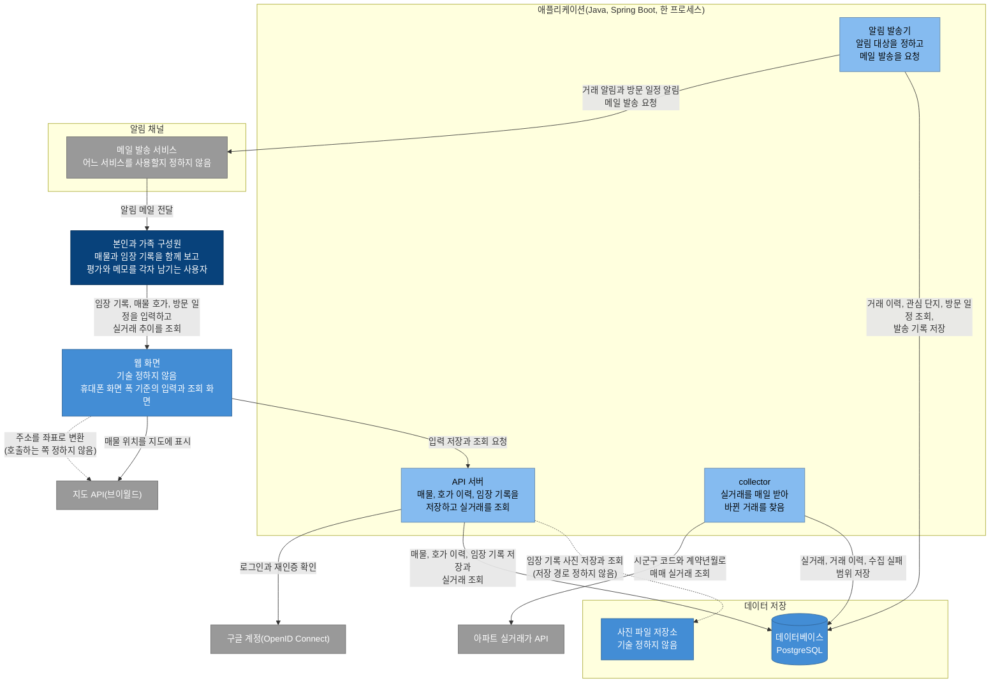
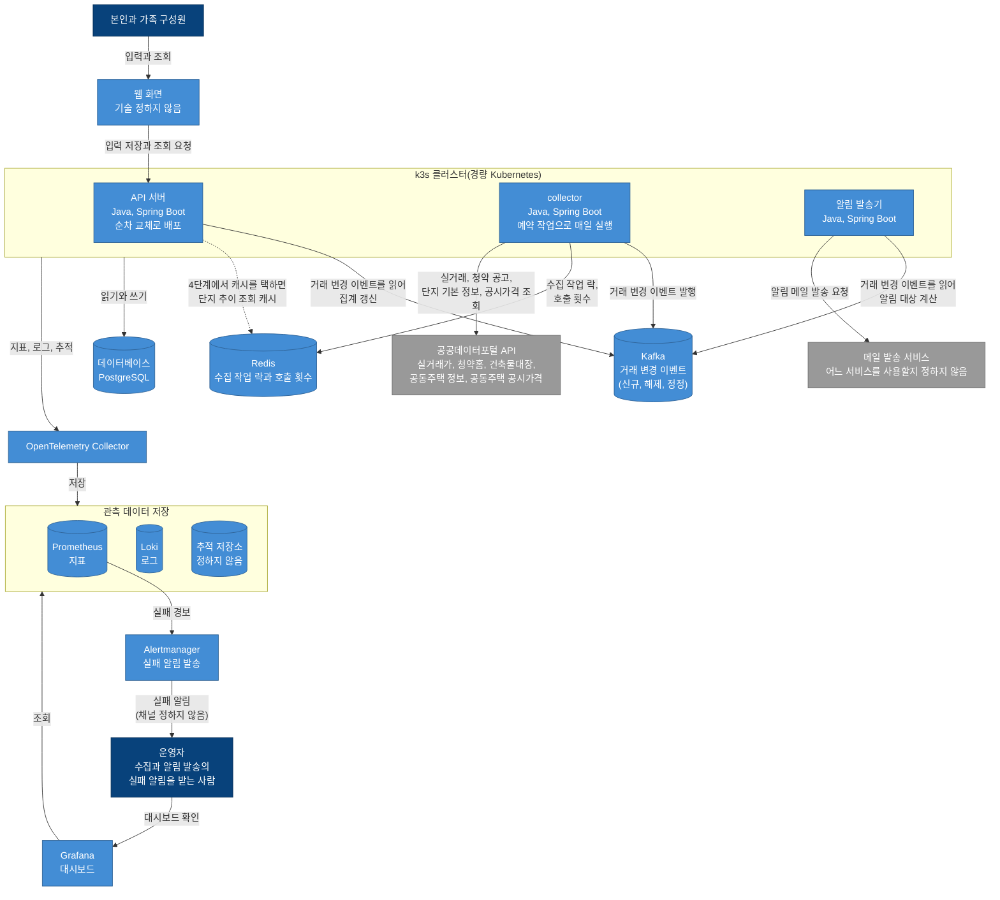

# C4 컨테이너

이 문서는 서비스를 따로 실행하는 단위와 데이터를 저장하는 단위로 나눠 보여 줍니다. C4에서는 이런 단위를 컨테이너라고 부르며, Docker 컨테이너와는 다른 뜻입니다. [C4 시스템 컨텍스트](c4-context.md)에서 시스템 하나로 그린 서비스를 1단계 구성과 목표 구성 두 장으로 나눠 그렸습니다.

- 무엇을 하나의 애플리케이션으로 두고 무엇을 따로 실행하는지는 [결정 기록 0005](../adr/0005-modular-monolith.md)에 있습니다.
- Kafka, Redis, Kubernetes를 어느 단계에 어떤 조건으로 넣는지는 [결정 기록 0004](../adr/0004-staged-adoption.md)에 있습니다.
- 외부 시스템의 호출 단위와 호출 한도는 C4 시스템 컨텍스트의 표에 있습니다.

다이어그램은 Mermaid flowchart로 그렸습니다. 진한 파랑은 사람, 파랑은 컨테이너, 연한 파랑은 1단계 애플리케이션 안의 모듈, 회색은 외부 시스템이고, 점선 화살표는 아직 정하지 않은 관계입니다. 1단계의 지오코더 호출과 사진 저장 경로, 4단계에서 측정한 뒤 정하는 캐시가 여기에 해당합니다.

## 1단계 구성

[PRD 기능 범위](../prd.md#기능-범위)의 1단계 기능을 실행하는 구성입니다.

- API 서버, collector, 알림 발송기는 하나의 애플리케이션 안에서 모듈로 실행됩니다(결정 기록 0005). 애플리케이션이 멈추면 세 모듈이 함께 멈춥니다.
- collector는 새 거래와 해제를 거래 이력으로 데이터베이스에 쓰고, 알림 발송기가 그 거래 이력을 읽습니다. 둘은 서로 호출하지 않습니다. 모듈 경계는 [C4 컴포넌트](c4-component.md)에 있습니다.
- Kafka, Redis, Kubernetes는 1단계에 넣지 않습니다(결정 기록 0004).
- 주소를 좌표로 바꾸는 지오코더 API를 어느 쪽에서 호출할지와 사진 파일을 저장하는 경로는 정하지 않았습니다. 다이어그램에는 두 관계를 점선으로 그렸습니다. 핵심 흐름(`docs/architecture/flows.md`, 작성 예정)을 쓸 때 정합니다.

## 목표 구성

4단계까지 마치고 결정 기록 0004의 도입 조건을 모두 만족했을 때의 구성입니다. 측정 결과 넣지 않기로 한 기술이 생기면 그 결정 기록에 맞춰 이 다이어그램을 고칩니다.

- k3s(경량 Kubernetes 배포판) 클러스터에서 API 서버, collector, 알림 발송기를 따로 실행합니다. collector는 예약 작업(CronJob)으로 매일 실행하고, API 서버는 순차 교체(롤링 업데이트)로 배포합니다(PRD 기능 범위의 무중단 배포).
- PostgreSQL, Kafka, Redis, 관측 구성을 k3s 클러스터 안에서 실행할지는 배포 환경([PRD 열린 질문](../prd.md#열린-질문))을 정할 때 결정합니다.
- collector는 거래 변경 이벤트(신규, 해제, 정정)를 Kafka에 발행합니다. API 서버는 이 이벤트를 읽어 집계를 갱신하고, 알림 발송기는 같은 이벤트를 읽어 알림 대상을 계산합니다.
- collector는 Redis에 수집 작업 락과 외부 API 호출 횟수를 둡니다. 4단계에서 캐시를 택하면 API 서버가 단지 추이 조회 결과를 Redis에 캐시합니다(점선).
- 관측 구성은 2단계부터 있습니다. OpenTelemetry Collector가 애플리케이션(3단계부터는 API 서버, collector, 알림 발송기)의 지표, 로그, 추적을 받아 Prometheus(지표), Loki(로그), 추적 저장소에 저장합니다. OpenTelemetry Collector는 이 서비스의 collector와 다른 구성 요소입니다.
- 운영자는 Grafana 대시보드로 지표, 로그, 추적을 확인합니다. Prometheus의 경보 규칙 조건을 만족하는 지표가 있으면 Alertmanager가 운영자에게 실패 알림을 보냅니다.
- 추적 저장소와 운영자에게 보내는 실패 알림의 채널은 정하지 않았습니다([결정 기록 0003](../adr/0003-notification-channel.md)의 결과 절).
- 운영자는 C4 시스템 컨텍스트에 없습니다. 실패 알림 채널을 정하지 않아 컨텍스트에는 넣지 않았고, 이 다이어그램에는 실패 알림을 받는 사람으로 그렸습니다.
- 목표 다이어그램은 1단계와 달라지는 부분을 중심으로 그렸습니다. 1단계와 같아 뺀 것은 지도 API, 구글 계정, 사진 파일 저장소, 메일이 사용자에게 전달되는 선입니다.
- 데이터베이스는 세 구성 요소가 함께 읽고 쓰므로 k3s 경계에서 선 하나로 그렸습니다. C4 시스템 컨텍스트 다이어그램의 공공데이터포털 API 다섯 개(공동주택 정보 API는 K-apt 기본 정보와 관리비 두 API를 하나로 그린 것)는 상자 하나로 묶었습니다. 보류 중인 카카오톡 메시지 API는 두 다이어그램에 모두 넣지 않았습니다.

## 컨테이너

API 서버, collector, 알림 발송기 행의 "멈추면 영향받는 기능"은 collector와 알림 발송기를 API 서버와 따로 실행하는 3단계부터의 영향입니다. 1단계와 2단계에는 애플리케이션 행이 적용됩니다.

| 컨테이너 | 기술 | 책임 | 멈추면 영향받는 기능 | 단계 |
|---|---|---|---|---|
| 웹 화면 | 정하지 않음 | 휴대폰 화면 폭을 기준으로 입력 화면과 조회 화면을 보여 줍니다. 매물 위치를 지도에 표시합니다 | 모든 입력과 조회 | 1단계 |
| 애플리케이션 | Java, Spring Boot | API 서버, collector, 알림 발송기를 한 프로세스에서 모듈로 실행합니다 | 모든 기능. 세 모듈이 함께 멈춥니다 | 1단계와 2단계 |
| API 서버 | Java, Spring Boot | 화면이 호출하는 API에 응답합니다. 로그인과 가족 공유를 맡습니다. 매물, 방문 일정, 호가 이력, 임장 기록을 저장하고 조회합니다. 실거래 추이와 호가와 실거래 비교를 조회합니다. 2단계부터 단지 기본 정보, 매물 비교, 계약 추정 표시, 자금 계산을 더합니다. Kafka를 넣으면 거래 변경 이벤트를 읽어 집계를 갱신합니다 | 로그인과 가족 공유, 매물 등록과 방문 일정, 호가 직접 입력과 이력, 임장 기록, 실거래 추이, 호가와 실거래 비교. 2단계부터 단지 기본 정보, 매물 비교, 계약 추정 표시, 자금 계산 | 1단계부터. 3단계 이후에도 하나의 애플리케이션으로 실행 |
| collector | Java, Spring Boot | 관심 지역의 매매 실거래를 처음 한 번 최근 5년치를 받고, 그 뒤로 매일 최근 몇 달치를 다시 받습니다. 다시 받은 결과에서 바뀐 거래(신규, 해제, 정정, 등기)를 찾습니다. 지역과 월 단위로 실패를 기록하고 실패한 범위만 다시 받습니다. 각 외부 API의 하루 호출 한도 안에서 호출합니다. 2단계부터 청약 공고, 단지 기본 정보, 공시가격을 받습니다. Kafka를 넣으면 거래 변경 이벤트를 발행합니다 | 실거래 추이와 호가와 실거래 비교에 새 거래가 반영되지 않습니다. 새 거래와 해제를 찾지 못해 거래 알림도 보내지 않습니다. 2단계부터 단지 기본 정보 갱신과 새 청약 공고 알림도 멈춥니다 | 1단계부터. 3단계에 따로 실행 |
| 알림 발송기 | Java, Spring Boot | 관심 단지의 새 거래와 해제, 방문 일정을 보고 알림 대상을 정합니다. 같은 거래나 같은 일정의 알림을 같은 사람에게 두 번 보내지 않도록 발송 기록을 남깁니다. 발송 채널은 별도 모듈로 나눠, 채널을 더해도 알림 판단 로직을 고치지 않습니다([결정 기록 0003](../adr/0003-notification-channel.md)). 2단계부터 청약 알림을 보냅니다. Kafka를 넣으면 거래 변경 이벤트를 읽어 알림 대상을 계산합니다 | 거래 알림, 방문 일정 알림. 2단계부터 청약 알림 | 1단계부터. 3단계에 따로 실행 |
| 데이터베이스 | PostgreSQL | 사용자, 매물, 방문 일정, 호가 이력, 임장 기록, 실거래, 수집 실패 범위, 알림 발송 기록을 저장합니다. 테이블과 키는 [데이터 모델](data-model.md)에 있습니다 | 모든 기능 | 1단계 |
| 사진 파일 저장소 | 정하지 않음 | 임장 기록의 사진 파일을 저장합니다 | 임장 기록의 사진 올리기와 보기 | 1단계 |
| Kafka | Kafka | collector가 발행한 거래 변경 이벤트(신규, 해제, 정정)를 보관합니다. 받는 쪽(집계 갱신, 알림)은 이 이벤트를 각자 읽고, 알림 규칙을 바꾸면 지난 이벤트를 다시 읽습니다 | 거래 알림, 실거래 추이의 집계 갱신 | 3단계. 결정 기록 0004의 조건을 만족하면 |
| Redis | Redis | 서버를 두 대로 실행할 때 수집 작업이 두 번 실행되지 않게 막는 락과, 외부 API 호출 횟수를 보관합니다. 4단계에서 캐시를 택하면 단지 추이 조회 결과도 캐시합니다 | 실거래 수집. 락과 호출 횟수를 확인하지 못할 때 수집을 멈출지는 3단계에서 정합니다. 4단계에서 캐시를 택하면 실거래 추이 조회도 영향을 받습니다 | 3단계(락과 호출 제한)와 4단계(캐시). 결정 기록 0004의 조건을 만족하면 |
| OpenTelemetry Collector | OpenTelemetry | 애플리케이션(3단계부터 API 서버, collector, 알림 발송기)의 지표, 로그, 추적을 받아 저장소로 보냅니다 | 운영 관측 전체 | 2단계 |
| Prometheus | Prometheus | 지표를 저장합니다. 경보 규칙 조건을 만족하는 지표가 있으면 Alertmanager에 경보를 보냅니다 | 운영 관측의 지표 조회와 실패 알림 | 2단계 |
| Loki | Loki | 로그를 저장합니다 | 운영 관측의 로그 조회 | 2단계 |
| 추적 저장소 | 정하지 않음 | 추적을 저장합니다 | 운영 관측의 추적 조회 | 정하지 않음 |
| Grafana | Grafana | 지표, 로그, 추적을 대시보드로 보여 줍니다 | 운영 관측의 대시보드 | 2단계 |
| Alertmanager | Alertmanager | Prometheus가 보낸 경보를 운영자에게 실패 알림으로 보냅니다. 채널은 정하지 않았습니다 | 운영 관측의 실패 알림 | 2단계 |

## 단계 사이의 변화

| 단계 | 바뀌는 구성 | 근거 |
|---|---|---|
| 1 | 웹 화면, 애플리케이션(API 서버, collector, 알림 발송기 모듈), PostgreSQL, 사진 파일 저장소로 시작합니다 | PRD 1단계 기능, 결정 기록 0005 |
| 2 | collector가 청약홈, 건축물대장, 공동주택 정보, 공동주택 공시가격 API를 더 호출하고, 알림 발송기가 청약 알림을 보냅니다. 관측 구성(OpenTelemetry Collector, Prometheus, Loki, Grafana, Alertmanager)을 더합니다 | PRD 2단계 기능(단지 기본 정보, 청약 알림, 자금 계산, 운영 관측) |
| 3 | collector와 알림 발송기를 API 서버와 따로 실행합니다. k3s, Kafka, Redis(락과 호출 제한)는 결정 기록 0004의 도입 조건을 측정한 뒤 도입합니다 | PRD 3단계 기능, 결정 기록 0004, 0005 |
| 4 | collector가 실거래 수집 범위를 서울 전체 10년치로 넓힙니다. 단지별 추이 조회에는 인덱스, 파티셔닝, 집계 테이블, 캐시 중 측정해 고른 방법을 적용하고, 캐시를 고르면 Redis를 캐시로도 사용합니다 | PRD 4단계 기능, 결정 기록 0004 |
