# C4 시스템 컨텍스트

이 문서는 사용자와 외부 시스템 사이에서 이 서비스의 경계를 보여 줍니다. 여기서는 서비스 안의 API 서버, collector, 알림 발송기를 나누지 않고 시스템 하나로 그립니다. 외부 시스템 목록은 [PRD](../prd.md)의 외부 데이터 출처, 지도 API, 알림 기능을 기준으로 정했고, 구글 계정은 [결정 기록 0010](../adr/0010-login-method.md)의 로그인 방식에서 더했습니다. 다이어그램은 Mermaid flowchart로 그렸습니다. 진한 파랑은 사용자, 파랑은 이 서비스, 회색은 외부 시스템이고, 점선 테두리와 점선 화살표는 보류 중인 카카오톡 메시지 API입니다.

## 다이어그램

```mermaid
%%{init: {'flowchart': {'wrappingWidth': 260}}}%%
flowchart TB
  subgraph users[사용자]
    direction LR
    owner["본인<br/>매물과 임장 기록을 함께 보고<br/>평가와 메모를 각자 남기는 사용자"]
    family["가족 구성원<br/>매물과 임장 기록을 함께 보고<br/>평가와 메모를 각자 남기는 사용자"]
  end

  service["아파트 임장 기록과 실거래 알림<br/>임장 기록, 호가 이력, 실거래 추이를<br/>보여 주고 알림을 보내는 서비스"]

  subgraph channels[알림 채널]
    direction LR
    mail["메일 발송 서비스<br/>어느 서비스를 사용할지 정하지 않음<br/>1단계부터 사용"]
    kakao["카카오톡 메시지 API(보류)<br/>추가할지 정하지 않음"]
  end

  google["구글 계정(OpenID Connect)<br/>로그인과 재인증 확인<br/>1단계부터 사용"]

  subgraph data[공공데이터포털 API와 지도 API]
    direction LR
    trade["아파트 실거래가 API<br/>1단계부터 사용"]
    map["지도 API(브이월드)<br/>지도 표시, 주소를 좌표로 변환<br/>1단계부터 사용"]
    subscription["청약홈 API<br/>2단계부터 사용"]
    building["건축물대장 API<br/>2단계부터 사용"]
    kapt["공동주택 정보 API<br/>K-apt 기본 정보와 관리비<br/>2단계부터 사용"]
    price["공동주택 공시가격 API<br/>2단계부터 사용"]
  end

  owner -->|"임장 기록, 매물 호가, 방문 일정을 입력하고<br/>실거래 추이를 조회"| service
  family -->|"임장 기록, 매물 호가, 방문 일정을 입력하고<br/>실거래 추이를 조회"| service
  service -->|"시군구 코드와 계약년월로<br/>매매 실거래 조회"| trade
  service -->|"매물 위치를 지도에 표시하고<br/>주소를 좌표로 변환"| map
  service -->|"공급지역과 모집공고일 조건으로<br/>청약 공고 조회"| subscription
  service -->|"시군구 코드와 법정동 코드로<br/>표제부와 총괄표제부 조회"| building
  service -->|"단지코드로 기본 정보와<br/>월별 관리비 조회"| kapt
  service -->|"공동주택 공시가격 조회"| price
  service -->|"거래, 방문 일정, 청약 알림 메일을<br/>보내도록 요청"| mail
  service -.->|"각자의 토큰으로<br/>나에게 보내기 호출"| kakao
  service -->|"로그인과 재인증을<br/>구글 계정으로 확인"| google
  mail -->|"알림 메일 전달"| users
  kakao -.->|"카카오톡 알림 전달"| users

  classDef person fill:#08427b,stroke:#052e56,color:#fff
  classDef system fill:#1168bd,stroke:#0b4884,color:#fff
  classDef ext fill:#999999,stroke:#6b6b6b,color:#fff
  classDef hold fill:#999999,stroke:#6b6b6b,color:#fff,stroke-dasharray:5 5
  class owner,family person
  class service system
  class trade,map,subscription,building,kapt,price,mail,google ext
  class kakao hold
```

호가는 사용자가 부동산 앱이나 중개사무소에서 확인해 직접 입력하고, KB 시세도 사용자가 직접 입력합니다. 서비스는 부동산 앱에 연결하지 않으므로 부동산 앱을 외부 시스템으로 그리지 않았습니다.

## 외부 시스템별 호출 조건

공공데이터포털 API의 호출 단위와 하루 호출 한도는 2026-10-12에 각 링크의 페이지에서 확인했습니다.

| 외부 시스템 | 호출 단위 | 호출 한도 | 실패하면 멈추는 기능 | 사용 단계 |
|---|---|---|---|---|
| 아파트 실거래가 API([공공데이터포털 15126468](https://www.data.go.kr/data/15126468/openapi.do)) | 시군구 코드 5자리와 계약년월 6자리 | 개발계정 하루 10,000건. 운영계정은 활용사례를 등록하면 늘릴 수 있음 | 실거래 수집과 추이, 호가와 실거래 비교, 거래 알림 | 1 |
| 지도 API(브이월드) | 화면에서 지도를 열 때 지도 API 호출. 주소를 좌표로 바꿀 때는 지도를 그릴 때마다 [지오코더 API](https://www.vworld.kr/dev/v4dv_geocoderguide2_s001.do) 호출. 좌표는 저장하지 않음([결정 기록 0015](../adr/0015-geocoder.md)) | 지오코더 하루 최대 40,000건. 개발 단계는 자동승인, 운영 단계는 심의승인. 지도 화면에 출처 표시(공공저작물 제1유형) | 매물 등록, 매물 상세, 방문 일정의 위치(지도) 표시와 주소 좌표 변환 | 1 |
| 메일 발송 서비스(어느 서비스를 사용할지 정하지 않음) | 서비스를 정한 뒤 적음 | 서비스를 정한 뒤 적음 | 거래 알림, 방문 일정 알림, 청약 알림 | 1(청약 알림은 2) |
| 청약홈 API([공공데이터포털 15098547](https://www.data.go.kr/data/15098547/openapi.do)) | 공급지역, 공급위치, 모집공고일을 조건으로 조회. 결과는 공고 단위 | 개발계정 하루 40,000건. 운영계정은 활용사례를 등록하면 늘릴 수 있음 | 청약 알림 | 2 |
| 건축물대장 API([공공데이터포털 15134735](https://www.data.go.kr/data/15134735/openapi.do)) | 시군구 코드와 법정동 코드(필수), 번과 지(선택). 표제부와 총괄표제부를 따로 조회 | 개발계정 하루 10,000건. 운영계정은 활용사례를 등록하면 늘릴 수 있음 | 단지 기본 정보(세대수, 층수, 주차 대수, 준공 연도) | 2 |
| 공동주택 정보 API(K-apt 기본 정보, [공공데이터포털 15058453](https://www.data.go.kr/data/15058453/openapi.do)) | K-apt(공동주택관리정보시스템) 단지코드 | 개발계정 하루 5,000건. 운영계정은 활용사례를 등록하면 늘릴 수 있음 | 단지 기본 정보(난방 방식) | 2 |
| 공동주택 정보 API(K-apt 관리비, [공공데이터포털 15059469](https://www.data.go.kr/data/15059469/openapi.do)) | K-apt 단지코드와 발생년월. 난방비, 수도료 같은 항목마다 따로 조회 | 개발계정 하루 5,000건. 운영계정은 활용사례를 등록하면 늘릴 수 있음 | 단지 기본 정보(관리비) | 2 |
| 공동주택 공시가격 API([공공데이터포털 15124003](https://www.data.go.kr/data/15124003/openapi.do)) | 공간정보(WMS/WFS/속성정보) 형식. 페이지에 호출 단위가 없음 | 페이지에 한도 숫자가 없음(기관 정책에 따라 다름). 개발 단계는 자동승인, 운영 단계는 심의승인 | 자금 계산의 공시가격 참고값 | 2 |
| 구글 계정(OpenID Connect, [결정 기록 0010](../adr/0010-login-method.md)) | 로그인과 재인증마다 한 번 | 확인하지 않음 | 로그인과 재인증(민감 동작) | 1 |
| 카카오톡 메시지 API(보류. PRD 열린 질문) | 사용자 각자의 토큰으로 "나에게 보내기" 호출. 검수가 필요 없음 | 확인하지 않음 | 없음(메일이 기본 채널). 토큰이 만료되거나 동의를 철회하면 메일로 대신 보냄(PRD 열린 질문) | 보류 |

- 실거래 신고 기한은 계약 후 30일이고, 해제 신고는 더 늦게 접수될 수 있습니다. 그래서 최근 몇 달치를 매일 다시 받습니다. 다시 받는 기간은 결정 기록 0009(작성 예정)에서 정합니다.
- 실거래 응답에는 거래 고유 번호와 신고일이 없습니다. 같은 거래를 구분하는 방법은 [결정 기록 0006](../adr/0006-transaction-identity.md)에서 정합니다.

## PRD와 대조

PRD에 나오는 외부 데이터와 서비스를 다이어그램의 외부 시스템과 대조합니다. 다이어그램에 넣지 않은 항목은 이유를 적었습니다.

| PRD의 데이터 또는 서비스 | PRD 절 | 다이어그램의 외부 시스템 |
|---|---|---|
| 아파트 매매 실거래가 상세 | 외부 데이터 출처 | 아파트 실거래가 API |
| 청약홈 분양정보 | 외부 데이터 출처 | 청약홈 API |
| 공동주택 기본 정보(K-apt) | 외부 데이터 출처 | 공동주택 정보 API |
| 공동주택 관리비(K-apt) | 외부 데이터 출처 | 공동주택 정보 API |
| 건축물대장 | 외부 데이터 출처 | 건축물대장 API |
| 공동주택 공시가격 | 외부 데이터 출처 | 공동주택 공시가격 API |
| 브이월드(기본) | 지도 API | 지도 API(브이월드) |
| 카카오맵(대안) | 지도 API | 대안이라 다이어그램에 넣지 않음. 조건은 PRD 지도 API 표에 있음 |
| 네이버 지도(제외) | 지도 API | 제외한 API라 다이어그램에 넣지 않음 |
| 거래 알림(메일) | 기능 범위 | 메일 발송 서비스 |
| 방문 일정 알림(매물 등록과 방문 일정) | 기능 범위 | 메일 발송 서비스 |
| 청약 알림 | 기능 범위 | 메일 발송 서비스 |
| 운영 관측의 실패 알림 | 기능 범위 | 알림 채널을 PRD에서 정하지 않아 넣지 않음 |
| 카카오톡 알림 | 열린 질문 | 카카오톡 메시지 API(보류) |
| 로그인 방식 | 열린 질문(결정 기록 0010에서 정함) | 구글 계정(OpenID Connect) |
| 지역 가격지수(R-ONE) | 열린 질문 | 열린 질문이라 다이어그램에 넣지 않음 |

## 다음 문서

C4 컨테이너([`docs/architecture/c4-container.md`](c4-container.md))에서 이 시스템을 1단계 실행 단위와 최종 목표 구성으로 나눕니다.
