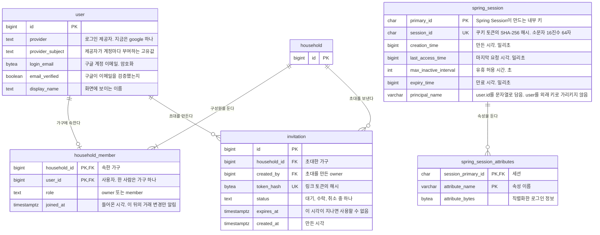
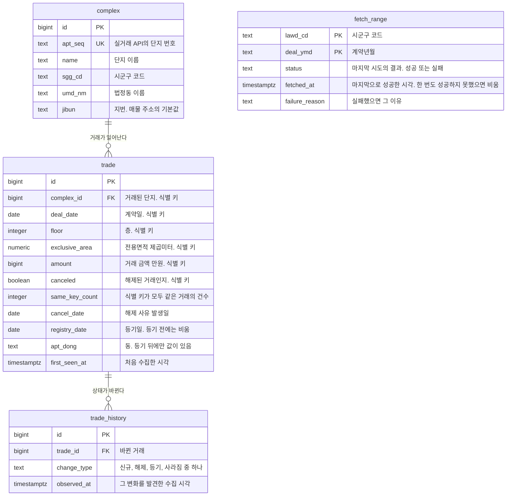
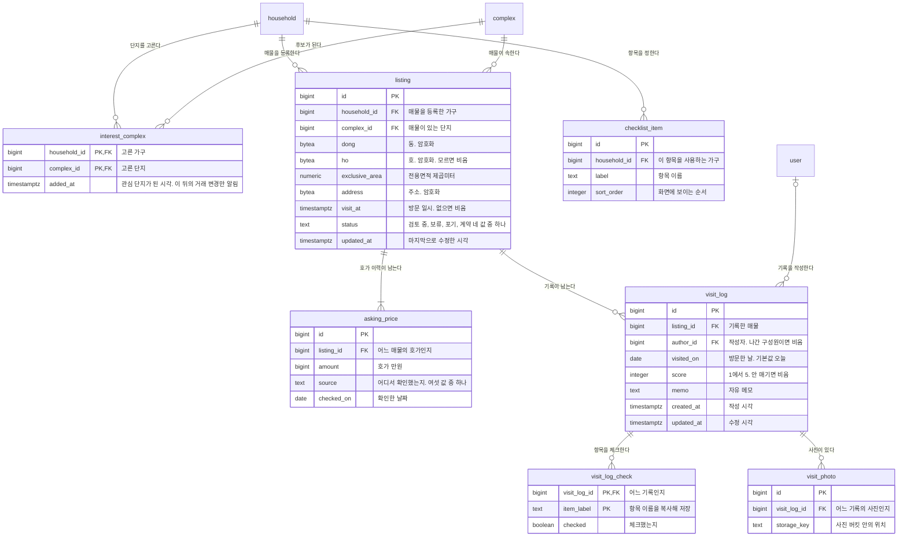
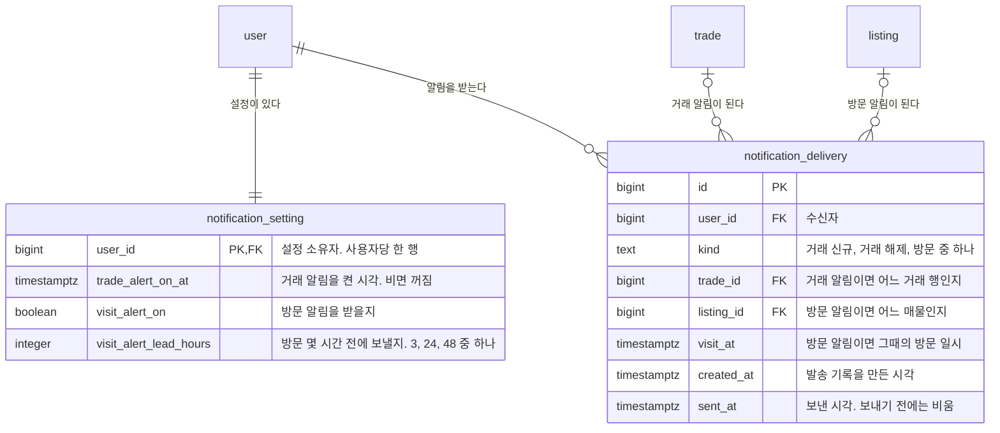

# 데이터 모델

이 문서는 1단계에서 데이터베이스에 두는 테이블 19개와 키, 유니크 제약, 거래와 호가의 이력을 기록하는 방식, 삭제 범위를 정합니다. 데이터베이스는 PostgreSQL입니다([C4 컨테이너](c4-container.md)). 열마다 그 열을 요구한 화면 항목, PRD 요구사항, 결정 기록을 출처로 적었고, 개인정보 열의 저장 방식은 [결정 기록 0012](../adr/0012-personal-data-storage.md)를 따릅니다.

## 만드는 기준

| 기준 | 이 문서에 적용한 결과 |
|---|---|
| 열마다 출처를 적고, 출처가 없는 열은 두지 않습니다 | 테이블마다 열 근거 표의 출처 칸에 적었습니다. `id`는 행 하나를 지정하는 대리 키입니다. 다른 테이블이 가리키거나 API가 행을 지정하는 데 사용합니다 |
| 계산할 수 있는 값은 저장하지 않습니다 | 현재 호가(호가 이력에서 확인 날짜가 가장 늦은 행. 같은 날이면 나중에 저장한 행), 단지별 매물 수(행 수), 초대 만료 여부(만료 시각과 현재 시각 비교), 호가와 실거래의 차이(화면에서 계산)는 열이 없습니다 |
| 이력은 PRD가 이력으로 남기라고 한 것만 둡니다 | 호가 이력(`asking_price`)과 거래 이력(`trade_history`)만 있습니다. 매물과 임장 기록은 수정 이력 없이 수정 시각 한 열만 둡니다 |
| 2단계 열은 두지 않습니다 | 다른 기관의 단지 키는 2단계에 고른 방법에 맞춰 그때 열을 추가합니다([결정 기록 0008](../adr/0008-complex-matching.md)). 관리비, 공시가격, 자금 프로필, 청약 공고를 담는 테이블과 열도 없습니다 |
| 상태와 역할은 열거 값으로 두고 별도 테이블을 만들지 않습니다 | 값 목록은 [규칙과 제약](#규칙과-제약) 절에 있고, 체크 제약으로 검사합니다 |
| 만든 시각과 수정 시각은 화면에 표시하거나 규칙에 사용하는 테이블에만 둡니다 | 초대의 만든 시각, 임장 기록의 작성 시각, 매물과 임장 기록의 수정 시각이 해당합니다. 거래 이력의 수집 시각, 수집 범위의 마지막 성공 시각, 발송 기록의 만든 시각과 보낸 시각도 둡니다. 알림 대상 판정에 사용하는 관심 단지의 추가 시각과 구성원이 들어온 시각도 둡니다. 이 밖에는 두지 않습니다 |
| 삭제는 물리 삭제(행 삭제)가 기본입니다 | 남아야 하는 자료(나간 구성원의 임장 기록, 체크 결과의 항목 이름)만 보존 방식을 따로 정했습니다([삭제와 보존](#삭제와-보존)) |
| 성능을 위한 비정규화와 집계 테이블은 두지 않습니다 | 4단계에서 조회 성능을 측정한 뒤 정합니다([결정 기록 0004](../adr/0004-staged-adoption.md)) |

열 근거 표의 저장 방식 칸은 평문, 암호화(0012), 해시 셋 중 하나입니다. 암호화는 `user.login_email`, `listing.address`, `dong`, `ho` 네 열이고, 해시는 `invitation.token_hash`와 `spring_session.session_id`입니다. 방법은 결정 기록 0012에 있습니다.

테이블은 아래 네 영역으로 나눴습니다. 영역마다 ERD를 한 장씩 그렸고, 다른 영역의 테이블은 관계를 보이려고 이름만 그렸습니다.

| 영역 | 테이블 | 주로 사용하는 모듈 |
|---|---|---|
| [사용자와 가구](#사용자와-가구) | `user`, `household`, `household_member`, `invitation`, `spring_session`, `spring_session_attributes` | API 서버 |
| [단지와 거래](#단지와-거래) | `complex`, `trade`, `trade_history`, `fetch_range` | collector가 기록하고, API 서버가 읽습니다 |
| [매물과 기록](#매물과-기록) | `interest_complex`, `listing`, `asking_price`, `checklist_item`, `visit_log`, `visit_log_check`, `visit_photo` | API 서버 |
| [알림](#알림) | `notification_setting`, `notification_delivery` | 알림 발송기와 API 서버 |

## 사용자와 가구

로그인한 사람, 기록을 함께 보는 가구, 가구에 들어오게 하는 초대, 로그인 상태를 유지하는 세션을 담습니다. 로그인은 구글 계정의 OIDC로 하고([결정 기록 0010](../adr/0010-login-method.md)), 기록은 가구 단위로 공유하며 역할은 owner와 member 둘입니다([결정 기록 0011](../adr/0011-household-sharing.md)).

| 테이블 | 무엇을 담나 | 한 행은 | 왜 있나 |
|---|---|---|---|
| `user` | 로그인한 사람 | 구글 계정 하나 | 결정 기록 0010 결과 절이 사용자 테이블에 제공자, subject, 로그인 이메일, 검증 여부, 표시 이름을 두라고 정했습니다 |
| `household` | 기록을 함께 보는 사람들 | 가구 하나 | 관심 단지, 매물, 호가 이력, 임장 기록이 가구에 속합니다(결정 기록 0011 결정 절) |
| `household_member` | 누가 어느 가구에 어떤 역할로 속하는지 | 사용자 한 명의 멤버십 | 요청마다 사용자의 가구 역할로 권한 키를 확인합니다(결정 기록 0011 결정 절) |
| `invitation` | 가족 초대 링크 | 초대 링크 하나 | owner가 일회용 초대 링크로 구성원을 초대합니다(결정 기록 0011 결정 절) |
| `spring_session` | 로그인 상태 | 로그인으로 만든 세션 하나 | 로그인 흐름이 ID 토큰을 검증한 뒤 세션을 발급합니다(결정 기록 0010 결과 절, 결정 기록 0013). Spring Session JDBC의 기본 테이블입니다 |
| `spring_session_attributes` | 세션의 속성 | 세션 속성 하나 | 세션에 로그인 정보를 둡니다(결정 기록 0013). Spring Session JDBC의 기본 테이블입니다 |

### `user`

| 열 | 형식 | 출처 | 저장 방식 |
|---|---|---|---|
| `id` | bigint, 기본 키 | 대리 키 | 평문 |
| `provider` | text | 결정 기록 0010 결과 절(제공자) | 평문 |
| `provider_subject` | text | 결정 기록 0010 결정 절(사용자 식별자는 subject 값 `sub`) | 평문 |
| `login_email` | bytea | 결정 기록 0010 결정 절(구글이 보낸 `email`), 와이어프레임 가족 초대 화면의 함께 보는 사람 목록(로그인 이메일) | 암호화(0012) |
| `email_verified` | boolean | 결정 기록 0010 결정 절(`email_verified`), 결정 기록 0011 결정 절("검증되지 않음" 표시) | 평문 |
| `display_name` | text, 비울 수 있음 | 결정 기록 0011 결정 절(제공자 이름이 기본값이고 사용자가 수정함), 와이어프레임 가족 초대 화면의 입력 표(새 표시 이름) | 평문(0012) |

- 같은 사용자는 `provider`와 `provider_subject`의 쌍으로 찾습니다.
- 다시 로그인할 때 구글이 보낸 이메일이나 검증 여부가 저장된 값과 다르면 최신 값으로 덮어씁니다.
- 구글이 이름을 보내지 않으면 `display_name`을 비우고 사용자가 입력합니다.
- PostgreSQL에서 `user`는 예약어라 SQL에서는 `"user"`처럼 큰따옴표로 인용해 사용합니다.

### `household`

| 열 | 형식 | 출처 | 저장 방식 |
|---|---|---|---|
| `id` | bigint, 기본 키 | 대리 키 | 평문 |

가구 이름은 화면에 없어 열을 두지 않습니다. 가구의 owner는 `household_member`의 역할로 찾습니다.

- 멤버십이 없는 사용자가 와이어프레임 가구 없음 화면에서 "가구 만들기"를 누를 때 가구를 만들고, 그 사람이 owner가 됩니다. 첫 로그인만으로는 가구를 만들지 않습니다.
- 초대 링크로 들어온 사람은 가구를 만들지 않고 그 가구의 member가 됩니다.
- 가구를 나간 member와 가구를 삭제한 owner도 가구 없음 화면으로 갑니다.

### `household_member`

| 열 | 형식 | 출처 | 저장 방식 |
|---|---|---|---|
| `household_id` | bigint, `household` 참조 | 결정 기록 0011 결과 절(멤버십 테이블의 가구) | 평문 |
| `user_id` | bigint, `user` 참조 | 결정 기록 0011 결정 절(1단계에서 한 사용자는 가구 하나) | 평문 |
| `role` | text | 결정 기록 0011 결정 절(owner와 member) | 평문 |
| `joined_at` | timestamptz | 알림 대상 판정([알림 대상](#알림-대상)). 이 시각 이후에 발견한 거래 변경만 이 사람에게 보냅니다 | 평문 |

기본 키는 `household_id`와 `user_id`의 쌍이고, `user_id`에 따로 유니크 제약을 둡니다. 멤버십 행이 없는 계정은 로그인은 되지만 어느 가구의 기록도 보지 못합니다(결정 기록 0011).

### `invitation`

| 열 | 형식 | 출처 | 저장 방식 |
|---|---|---|---|
| `id` | bigint, 기본 키 | 대리 키 | 평문 |
| `household_id` | bigint, `household` 참조 | 결정 기록 0011 결과 절(초대 테이블의 가구) | 평문 |
| `created_by` | bigint, `user` 참조 | 결정 기록 0011 결과 절(발급한 사람) | 평문 |
| `token_hash` | bytea | 결정 기록 0011 결과 절(토큰의 해시만 저장), 결정 기록 0012 결정 절 | 해시 |
| `status` | text | 결정 기록 0011 결과 절(초대 상태 값), 와이어프레임의 정하지 않은 것 절에서 데이터 모델로 넘긴 초대 상태 값 | 평문 |
| `expires_at` | timestamptz | 결정 기록 0011 결정 절(링크에 만료가 있음), 와이어프레임 가족 초대 화면의 보낸 초대 목록(만료까지 남은 기간) | 평문 |
| `created_at` | timestamptz | 와이어프레임 가족 초대 화면의 보낸 초대 목록(만든 날짜) | 평문 |

- 상태 값과 만료 판단의 규칙은 [규칙과 제약](#규칙과-제약)에 있습니다.
- 링크를 열어 수락하면 상태를 `수락`으로 바꾼 뒤 멤버십 행을 만듭니다. 수락한 사람은 멤버십 행으로 찾습니다.

### `spring_session`

| 열 | 형식 | 출처 | 저장 방식 |
|---|---|---|---|
| `primary_id` | char(36), 기본 키 | Spring Session JDBC 기본 스키마. Spring Session이 만드는 내부 키 | 평문 |
| `session_id` | char(64), 유니크, 체크 제약 `^[0-9a-f]{64}$` | 결정 기록 0013, 결정 기록 0012 결정 절(세션 토큰은 해시로 저장). 기본 스키마의 `CHAR(36)`을 SHA-256 해시의 소문자 16진수 64자 형식으로 변경한 열입니다. 쿠키의 원문 토큰은 32바이트를 base64url로 인코딩한 43자라 형식이 다릅니다. 그래서 해시 래퍼를 거치지 않고 원문이 저장되면 이 제약에 걸려 저장이 실패하고, 바로 발견됩니다 | 해시 |
| `creation_time` | bigint | Spring Session JDBC 기본 스키마. 로그인 시각이며 절대 만료 판단에 사용합니다(결정 기록 0013) | 평문 |
| `last_access_time` | bigint | Spring Session JDBC 기본 스키마. 마지막 요청 시각 | 평문 |
| `max_inactive_interval` | int | Spring Session JDBC 기본 스키마. 유휴 허용 시간(초)이며 7일입니다(결정 기록 0013) | 평문 |
| `expiry_time` | bigint | Spring Session JDBC 기본 스키마. 마지막 요청 시각에 유휴 허용 시간을 더한 만료 시각 | 평문 |
| `principal_name` | varchar(100), 비울 수 있음 | Spring Session JDBC 기본 스키마. `user.id`를 문자열로 담습니다. 사용자별 세션을 찾고 탈퇴할 때 삭제하는 데 사용합니다 | 평문 |

### `spring_session_attributes`

| 열 | 형식 | 출처 | 저장 방식 |
|---|---|---|---|
| `session_primary_id` | char(36), `spring_session.primary_id` 참조 | Spring Session JDBC 기본 스키마. 세션이 삭제되면 속성도 함께 삭제됩니다 | 평문 |
| `attribute_name` | varchar(200) | Spring Session JDBC 기본 스키마. 기본 키는 `session_primary_id`와 이 열의 쌍입니다 | 평문 |
| `attribute_bytes` | bytea | 결정 기록 0013. 로그인 정보를 직렬화한 값입니다. 서비스 사용자 번호와 마지막 인증 시각(ID 토큰의 `auth_time`)만 담고 구글 토큰과 이메일 같은 개인정보는 담지 않습니다 | 평문 |

- 세션 방식은 [결정 기록 0013](../adr/0013-session.md)에서 정했습니다. 로그인은 Spring Security로 하고, 세션은 Spring Session JDBC에 저장합니다. 세션 속성에는 사용자 번호와 마지막 인증 시각(ID 토큰의 `auth_time`)만 담은 로그인 정보가 저장되며, 열을 추가하지 않았습니다. 쿠키로 무작위 토큰을 발급하고 `session_id`에는 그 토큰의 SHA-256 해시만 저장합니다.
- 세션은 `user`를 외래 키로 가리키지 않고 `principal_name`에 `user.id`를 문자열로 담습니다. 그래서 사용자 행을 삭제해도 세션은 저절로 삭제되지 않습니다. 탈퇴할 때 같은 `principal_name`의 세션을 모두 삭제합니다([삭제와 보존](#삭제와-보존)).
- 세션은 7일 동안 요청이 없으면 만료되고, 계속 사용해도 로그인한 지 30일이면 만료됩니다(결정 기록 0013). 7일은 `max_inactive_interval`과 `expiry_time`으로 정하고, 30일은 로그인 시각(`creation_time`)으로 계산합니다. 절대 30일 만료를 어느 열로 적용할지는 구현에서 정하며 열을 추가하지 않았습니다.

## 단지와 거래

collector가 아파트 매매 실거래가 상세 API에서 수집한 단지와 거래, 지역과 월 단위의 수집 결과를 담습니다. 같은 거래의 식별 키는 [결정 기록 0006](../adr/0006-transaction-identity.md), 바뀐 거래를 남기는 방식은 [결정 기록 0007](../adr/0007-change-history.md), 다른 기관의 단지 키는 [결정 기록 0008](../adr/0008-complex-matching.md)을 따릅니다. 원본 API 응답은 데이터베이스에 저장하지 않고 원본 응답 버킷에 `{수집 날짜 YYYY-MM-DD}/{실행 시작 시각 HHmmss}/{시군구 코드}-{계약년월}-p{페이지 번호}.xml.gz` 파일로 보관합니다(결정 기록 0007, [결정 기록 0014](../adr/0014-file-storage.md)).

| 테이블 | 무엇을 담나 | 한 행은 | 왜 있나 |
|---|---|---|---|
| `complex` | 실거래 응답에 나온 단지 | 단지 번호(`aptSeq`) 하나 | 관심 단지, 매물, 거래가 가리키는 단지입니다. 2단계의 다른 기관 키는 고른 방법에 맞춰 열을 추가합니다(결정 기록 0008) |
| `trade` | 거래의 최신 상태 | 결정 기록 0006의 식별 키 여섯 항목 조합 하나 | 실거래 추이와 호가와 실거래 비교가 이 테이블을 조회합니다(결정 기록 0006, 0007) |
| `trade_history` | 거래가 바뀐 기록 | 변경 하나 | 알림 발송기가 새 행을 보고 알림 대상을 정하고, 3단계에서 지난 변경을 다시 읽습니다(결정 기록 0007) |
| `fetch_range` | 지역과 월 단위의 수집 결과 | 시군구 코드와 계약년월 한 쌍 | 실패한 범위만 다시 수집합니다(PRD 비기능 요구사항의 수집 실패 격리) |

### `complex`

| 열 | 형식 | 출처 | 저장 방식 |
|---|---|---|---|
| `id` | bigint, 기본 키 | 대리 키 | 평문 |
| `apt_seq` | text | 결정 기록 0008 결정 절(실거래 단지 번호, 단지마다 하나). 응답 필드 `aptSeq` | 평문 |
| `name` | text | 와이어프레임 관심 단지 목록 화면(단지 이름). 응답 필드 `aptNm` | 평문 |
| `sgg_cd` | text | 와이어프레임 관심 단지 목록 화면의 단지 추가 시트(관심 지역의 단지 목록). 응답 필드 `sggCd` | 평문 |
| `umd_nm` | text | 와이어프레임 매물 등록 화면(단지 주소의 법정동). 응답 필드 `umdNm` | 평문 |
| `jibun` | text | 와이어프레임 매물 등록 화면(단지 주소의 지번, 주소 입력란의 기본값). 응답 필드 `jibun` | 평문 |

- collector가 실거래 응답에서 처음 나온 `aptSeq`를 발견하면 단지 행을 만듭니다. 단지 추가 시트의 목록은 이 테이블에서 관심 단지가 아닌 행입니다.
- 건축물대장 키와 K-apt 단지코드 같은 다른 기관의 키는 1단계에 열이 없습니다. 2단계에서 단지 키를 연결하는 방법을 고른 뒤 그 방법에 맞춰 열을 추가합니다(결정 기록 0008).

### `trade`

| 열 | 형식 | 출처 | 저장 방식 |
|---|---|---|---|
| `id` | bigint, 기본 키 | 대리 키 | 평문 |
| `complex_id` | bigint, `complex` 참조 | 결정 기록 0006 결정 절(식별 키: 단지 `aptSeq`) | 평문 |
| `deal_date` | date | 결정 기록 0006 결정 절(식별 키: 계약일 `dealYear`, `dealMonth`, `dealDay`) | 평문 |
| `floor` | integer | 결정 기록 0006 결정 절(식별 키: 층 `floor`) | 평문 |
| `exclusive_area` | numeric | 결정 기록 0006 결정 절(식별 키: 전용면적 `excluUseAr`) | 평문 |
| `amount` | bigint | 결정 기록 0006 결정 절(식별 키: 거래 금액 `dealAmount`, 만원) | 평문 |
| `canceled` | boolean | 결정 기록 0006 결정 절(식별 키: 해제 여부 `cdealType`, 비어 있지 않으면 참) | 평문 |
| `same_key_count` | integer | 결정 기록 0006 결정 절(식별 키가 모두 같은 거래의 건수. 오늘 결과의 건수로 갱신, 키가 응답에 없으면 0) | 평문 |
| `cancel_date` | date, 비울 수 있음 | 결정 기록 0007 결정 절(해제 사유 발생일 `cdealDay`. 건수가 1인 행은 오늘 결과의 값으로 갱신, 2 이상인 행은 처음 값을 유지) | 평문 |
| `registry_date` | date, 비울 수 있음 | 결정 기록 0007 결정 절(등기일 `rgstDate`. 건수가 1인 행은 오늘 결과의 값으로 갱신, 2 이상인 행은 처음 값을 유지) | 평문 |
| `apt_dong` | text, 비울 수 있음 | 결정 기록 0006 결정 절(동 `aptDong`은 키가 아닌 열) | 평문 |
| `first_seen_at` | timestamptz | 결정 기록 0007 결정 절(그 거래 행을 만든 범위 반영의 수집 시각. 같은 반영에서 기록한 `trade_history.observed_at`과 같은 값) | 평문 |

- 식별 키는 `complex_id`, `deal_date`, `floor`, `exclusive_area`, `amount`, `canceled` 여섯 열이고, 이 조합에 유니크 제약을 둡니다. 동은 등기 뒤에야 값이 생기므로 키에 넣지 않습니다(결정 기록 0006).
- 여섯 열이 모두 같은 거래는 한 행으로 두고 건수를 `same_key_count`에 저장합니다. 한 자치구 60개월 실거래 11,865건(2026-10-19 확인)에서 응답 항목이 모두 같은 거래는 55묶음 241건입니다. 해제 여부로 나눈 뒤에도 한쪽 키에 두 건 이상 남는 거래는 적어도 34묶음입니다. 이 묶음들이 이렇게 저장됩니다(결정 기록 0006).
- 거래 행은 어떤 경우에도 삭제하지 않습니다. 키가 응답에 없으면 `same_key_count`를 0으로 둡니다. 이력 행과 발송 기록이 그 행을 가리킵니다(결정 기록 0007).

### `trade_history`

| 열 | 형식 | 출처 | 저장 방식 |
|---|---|---|---|
| `id` | bigint, 기본 키 | 대리 키 | 평문 |
| `trade_id` | bigint, `trade` 참조 | 결정 기록 0007 결정 절(바뀔 때마다 한 행) | 평문 |
| `change_type` | text | 결정 기록 0007 결정 절(변경 종류 네 가지) | 평문 |
| `observed_at` | timestamptz | 결정 기록 0007 결정 절(그 변화를 발견한 수집 시각. 같은 범위 반영에서 만든 `trade.first_seen_at`과 같은 값), PRD 성공 기준(거래를 처음 발견한 시각과 메일 발송 시각 비교) | 평문 |

변경 종류는 아래 네 가지이고 뜻은 결정 기록 0007과 같습니다. 알림은 `신규`와 `해제` 가운데 그 거래를 처음 발견한 수집에서 기록한 이력에만 보냅니다([알림 대상](#알림-대상)).

| `change_type` | 뜻 |
|---|---|
| `신규` | 해제되지 않은 키가 직전 수집 결과에 없다가 오늘 결과에 나타나거나, 그 키의 건수가 늘었습니다. 사라졌던 키가 다시 나타나는 경우도 여기 해당합니다 |
| `해제` | 해제된 키가 직전 수집 결과에 없다가 오늘 결과에 나타나거나, 그 키의 건수가 늘었습니다 |
| `등기` | 같은 키에서 비어 있던 등기일이나 동에 값이 생겼습니다 |
| `사라짐` | 직전 수집 결과에 있던 키가 오늘 결과에 나타나지 않거나, 그 키의 건수가 줄었습니다 |

`fetched_at`이 있는 범위는 재수집 기간을 벗어난 실패한 범위를 포함해 늘 직전 결과와 비교해 이력을 기록합니다. `fetched_at`이 빈 범위는 `fetch_range` 행이 있는지로 나뉩니다.

- 행이 있는 범위(앞서 실패만 한 범위)는 어느 실행에서든 기준 적재로 두어, 이력을 기록하지 않고 거래 행의 `first_seen_at`만 기록합니다.
- 행이 없는 범위(처음 수집하는 범위)는 초기 적재나 범위 확장 실행이면 기준 적재입니다.
- 행이 없는 범위가 매일 수집에 나오면(달이 바뀌어 재수집 기간에 새로 들어온 달) 빈 직전 결과와 비교해 이력을 기록합니다.

앞서 실패만 한 범위를 기준 적재로 두는 이유는, 그 범위를 빈 결과와 비교하면 그 달의 거래가 모두 새 거래 알림으로 나가기 때문입니다. 그 대신 새 달의 첫 매일 수집이 실패하면 그 달은 다음 성공 때 기준 적재가 되어, 그 사이 신고된 그 달 거래의 알림이 빠집니다(결정 기록 0007).

건수가 2 이상인 거래 행은 묶음 안에서 처음 기록된 등기일, 동, 해제 사유 발생일을 유지하고, `등기` 이력도 한 번만 기록합니다(결정 기록 0007).

PRD의 정정(금액이나 층 같은 키 항목이 바뀐 신고)은 옛 키의 `사라짐`과 새 키의 `신규` 한 쌍으로 남습니다.

### `fetch_range`

| 열 | 형식 | 출처 | 저장 방식 |
|---|---|---|---|
| `lawd_cd` | text, 기본 키 | PRD 비기능 요구사항의 수집 실패 격리(지역 단위). 요청 인자 `LAWD_CD` | 평문 |
| `deal_ymd` | text, 기본 키 | PRD 비기능 요구사항의 수집 실패 격리(월 단위). 요청 인자 `DEAL_YMD`, 값은 `YYYYMM` | 평문 |
| `status` | text | PRD 비기능 요구사항의 수집 실패 격리(실패를 기록하고 그 범위만 다시 수집함). 마지막 시도의 결과입니다 | 평문 |
| `fetched_at` | timestamptz, 비울 수 있음 | PRD 비기능 요구사항의 실거래 최신성(최근 몇 달치를 매일 재수집함), 핵심 흐름 문서 [flows.md](flows.md)의 수집 절(기준 적재는 이 열이 빈 범위 가운데 `fetch_range` 행이 있는 범위, 그리고 행이 없는 범위의 초기 적재나 범위 확장 실행에 적용함). 마지막으로 성공한 시각이며 실패해도 이 값을 비우지 않습니다 | 평문 |
| `failure_reason` | text, 비울 수 있음 | PRD 비기능 요구사항의 수집 실패 격리(실패 기록) | 평문 |

`lawd_cd`는 `complex.sgg_cd`와 같은 시군구 코드 다섯 자리입니다. 수집 테이블은 요청 인자의 이름을, 단지 테이블은 응답 필드의 이름을 따랐습니다. 기본 키는 `lawd_cd`와 `deal_ymd`의 쌍입니다. 한 번도 성공하지 못한 범위는 `fetched_at`이 비어 있고, 이력을 기록할지는 이 행이 있는지에 따라 위 `trade_history` 절의 기준 적재 규칙으로 정합니다.

## 매물과 기록

가구가 고른 관심 단지, 등록한 매물과 호가 이력, 가족이 각자 작성하는 임장 기록을 담습니다. 이 영역의 자료는 모두 가구에 속하고 그 가구의 구성원 모두가 봅니다(결정 기록 0011). 화면 항목은 [와이어프레임](../design/wireframes.md)의 매물 등록, 매물 상세, 임장 기록 작성 화면을 따릅니다.

| 테이블 | 무엇을 담나 | 한 행은 | 왜 있나 |
|---|---|---|---|
| `interest_complex` | 가구의 관심 단지 | 가구와 단지 한 쌍 | 관심 단지 목록과 거래 알림의 대상입니다(PRD 기능 범위의 관심 단지) |
| `listing` | 가구가 등록한 매물과 방문 일정 | 매물 하나 | PRD 기능 범위의 매물 등록과 방문 일정 |
| `asking_price` | 매물의 호가 이력 | 호가 확인 한 번 | 호가를 덮어쓰지 않고 날짜와 함께 이력으로 기록합니다(PRD 기능 범위의 호가 직접 입력과 이력) |
| `checklist_item` | 가구가 사용하는 체크리스트 항목 | 항목 하나 | 임장 기록 작성 화면의 체크리스트 항목 목록입니다(와이어프레임의 정하지 않은 것 절에서 데이터 모델로 넘긴 체크리스트 항목) |
| `visit_log` | 한 사람이 한 매물에 작성한 임장 기록 | 한 사람의 방문 한 번 | PRD 기능 범위의 임장 기록. 두 사람이 각자 작성합니다 |
| `visit_log_check` | 임장 기록의 체크리스트 결과 | 임장 기록 하나에 속한 항목 하나 | 와이어프레임 임장 기록 작성 화면의 체크리스트 결과 |
| `visit_photo` | 임장 기록의 사진 | 사진 파일 하나 | 와이어프레임 임장 기록 작성 화면의 사진(여러 장) |

### `interest_complex`

| 열 | 형식 | 출처 | 저장 방식 |
|---|---|---|---|
| `household_id` | bigint, `household` 참조 | 결정 기록 0011 결정 절(관심 단지는 가구에 속함) | 평문 |
| `complex_id` | bigint, `complex` 참조 | 와이어프레임 단지 상세 화면의 입력 표(임장 후보로 추가) | 평문 |
| `added_at` | timestamptz | 알림 대상 판정([알림 대상](#알림-대상)). 이 시각 이후에 발견한 거래 변경만 이 가구에 보냅니다. 뺐다가 다시 추가하면 새 시각으로 행을 만듭니다 | 평문 |

- 기본 키는 `household_id`와 `complex_id`의 쌍입니다.
- 단지 상세의 "임장 후보로 추가" 버튼으로 행을 만듭니다. 매물을 등록할 때 만드는 규칙은 [앱에서 확인하는 규칙](#앱에서-확인하는-규칙)에 있습니다.
- 단지 상세의 "관심 단지에서 빼기" 버튼으로 행을 삭제합니다. 뺀 뒤의 보존 범위는 [삭제와 보존](#삭제와-보존)에 있습니다.

### `listing`

| 열 | 형식 | 출처 | 저장 방식 |
|---|---|---|---|
| `id` | bigint, 기본 키 | 대리 키 | 평문 |
| `household_id` | bigint, `household` 참조 | 결정 기록 0011 결정 절(매물은 가구에 속함) | 평문 |
| `complex_id` | bigint, `complex` 참조 | 와이어프레임 매물 등록 화면(단지는 매물을 등록할 때 정해짐) | 평문 |
| `dong` | bytea | 와이어프레임 매물 등록 화면의 입력 표(동, 필수) | 암호화(0012) |
| `ho` | bytea, 비울 수 있음 | 와이어프레임 매물 등록 화면의 입력 표(호, 선택) | 암호화(0012) |
| `exclusive_area` | numeric | 와이어프레임 매물 등록 화면의 입력 표(전용면적, 필수) | 평문 |
| `address` | bytea | 와이어프레임 매물 등록 화면의 입력 표(주소, 필수) | 암호화(0012) |
| `visit_at` | timestamptz, 비울 수 있음 | 와이어프레임 매물 등록 화면의 입력 표(방문 일시, 선택) | 평문 |
| `status` | text | PRD 기능 범위의 매물 등록과 방문 일정(상태), 와이어프레임 매물 상세 화면의 입력 표(상태) | 평문 |
| `updated_at` | timestamptz | 이 문서의 만드는 기준(매물은 수정 이력 대신 수정 시각만 둠), 와이어프레임 매물 상세 화면의 매물 수정 | 평문 |

- 상태는 등록하면 `검토 중`으로 시작합니다(와이어프레임 매물 등록 화면).
- 현재 호가는 열로 두지 않고 `asking_price`에서 `checked_on`이 가장 늦은 행으로 구합니다. 같은 날 호가가 둘 이상이면 나중에 저장한 행(`id`가 큰 행)입니다.
- 좌표는 저장하지 않습니다. 지도를 그릴 때마다 API 서버가 주소를 좌표로 변환합니다([결정 기록 0015](../adr/0015-geocoder.md)).
- 중개사 전화번호는 저장하지 않습니다(PRD 기능 범위).

### `asking_price`

| 열 | 형식 | 출처 | 저장 방식 |
|---|---|---|---|
| `id` | bigint, 기본 키 | 대리 키 | 평문 |
| `listing_id` | bigint, `listing` 참조 | PRD 기능 범위의 호가 직접 입력과 이력 | 평문 |
| `amount` | bigint | 와이어프레임 매물 등록 화면과 매물 상세 화면의 입력 표(호가, 만원) | 평문 |
| `source` | text | PRD 기능 범위(호가 출처 목록), 와이어프레임 매물 등록 화면의 입력 표(호가 출처) | 평문 |
| `checked_on` | date | 와이어프레임 매물 등록 화면과 매물 상세 화면의 입력 표(호가 확인 날짜) | 평문 |

매물을 등록할 때 첫 호가 한 행을 함께 만들고, 그 뒤로는 매물 상세의 "호가 추가"로만 행을 추가합니다. 이미 있는 행은 수정하지 않습니다.

### `checklist_item`

| 열 | 형식 | 출처 | 저장 방식 |
|---|---|---|---|
| `id` | bigint, 기본 키 | 대리 키 | 평문 |
| `household_id` | bigint, `household` 참조 | 결정 기록 0011 결정 절(기록은 가구 단위로 공유) | 평문 |
| `label` | text | 와이어프레임 임장 기록 작성 화면(체크리스트 항목) | 평문 |
| `sort_order` | integer | 와이어프레임 임장 기록 작성 화면(체크할 항목 목록의 순서) | 평문 |

가구마다 항목을 수정하고, 삭제하고, 추가할 수 있습니다. 항목 이름의 유니크 제약은 [규칙과 제약](#규칙과-제약)에, 가구를 만들 때 만드는 항목은 [체크리스트 기본 항목](#체크리스트-기본-항목)에 있습니다.

### `visit_log`

| 열 | 형식 | 출처 | 저장 방식 |
|---|---|---|---|
| `id` | bigint, 기본 키 | 대리 키 | 평문 |
| `listing_id` | bigint, `listing` 참조 | PRD 기능 범위의 임장 기록 | 평문 |
| `author_id` | bigint, `user` 참조, 비울 수 있음 | 와이어프레임 임장 기록 작성 화면(작성자), 매물 상세 화면의 임장 기록(작성자 표시 이름) | 평문 |
| `visited_on` | date | 와이어프레임의 정하지 않은 것 절에서 데이터 모델로 넘긴 항목(한 사람이 한 매물에 기록을 몇 개 남기는지). 방문마다 기록 하나로 정하고 방문일로 구분합니다 | 평문 |
| `score` | integer, 비울 수 있음 | 와이어프레임 임장 기록 작성 화면의 입력 표(점수, 범위는 데이터 모델에서 정함) | 평문 |
| `memo` | text, 비울 수 있음 | 와이어프레임 임장 기록 작성 화면의 입력 표(메모) | 평문 |
| `created_at` | timestamptz | 와이어프레임 매물 상세 화면의 임장 기록(작성일. 수정한 적이 없을 때 방문일 옆에 보임) | 평문 |
| `updated_at` | timestamptz | 와이어프레임 매물 상세 화면의 임장 기록(수정일. 수정한 적이 있을 때 작성일 대신 보임) | 평문 |

- 방문마다 기록 하나를 작성하는 유니크 제약은 [규칙과 제약](#규칙과-제약)에 있습니다.
- `visited_on`은 임장 기록 작성 화면에서 입력받고 기본값은 오늘입니다.
- 점수는 1에서 5 사이의 정수이고 비워 둘 수 있습니다.
- 처음 저장할 때 `updated_at`은 `created_at`과 같은 값이고, 수정한 적이 있는지는 `updated_at`이 `created_at`보다 늦은지로 판단합니다.
- 수정할 수 있는 사람의 규칙은 [규칙과 제약](#규칙과-제약)에 있습니다.

### `visit_log_check`

| 열 | 형식 | 출처 | 저장 방식 |
|---|---|---|---|
| `visit_log_id` | bigint, `visit_log` 참조 | 와이어프레임 임장 기록 작성 화면의 입력 표(체크리스트 결과) | 평문 |
| `item_label` | text | 와이어프레임 매물 상세 화면의 임장 기록(체크리스트 결과). 항목이 바뀌어도 이미 저장한 기록을 그대로 보여 주려고 이름을 복사합니다 | 평문 |
| `checked` | boolean | 와이어프레임 임장 기록 작성 화면의 입력 표(항목마다 체크박스) | 평문 |

- 기록을 저장할 때 그 가구의 항목마다 한 행을 만들고, 항목 번호가 아니라 항목 이름을 복사해 저장합니다. 나중에 항목을 삭제하거나 이름을 바꿔도 이미 저장한 기록의 체크 결과는 그대로 남습니다.
- 기본 키는 `visit_log_id`와 `item_label`의 쌍입니다.
- 이미 저장한 기록을 수정할 때는 그 기록에 저장된 항목 이름 그대로 체크 결과를 보여 주고 저장합니다. 현재 체크리스트 항목은 새 기록에만 적용합니다.

### `visit_photo`

| 열 | 형식 | 출처 | 저장 방식 |
|---|---|---|---|
| `id` | bigint, 기본 키 | 대리 키 | 평문 |
| `visit_log_id` | bigint, `visit_log` 참조 | 와이어프레임 임장 기록 작성 화면의 입력 표(사진, 여러 장) | 평문 |
| `storage_key` | text | 파일 저장소(사진 버킷. 파일은 데이터베이스 밖에 둠), [결정 기록 0014](../adr/0014-file-storage.md) | 평문 |

- `storage_key`는 사진 버킷 안의 `{household_id}/{임의 UUID}`입니다.
- 사진 파일은 결정 기록 0012와 같은 애플리케이션 계층 AES-GCM(키 버전, nonce, 암호문, 인증 태그)으로 암호화하고, 항상 API 서버를 거쳐 업로드하고 다운로드합니다. 저장소 주소는 응답에 담지 않습니다.
- 파일을 먼저 저장하고 그다음 `visit_photo` 행을 저장합니다. 행 저장이 실패하면 파일이 남을 수 있습니다.
- 남은 파일은 API 서버의 스케줄러(사진 파일 정리)가 하루 한 번 사진 버킷만 대조해, 행이 없고 업로드한 지 하루가 지난 파일을 삭제합니다. 흐름은 [핵심 흐름](flows.md)에 있습니다.

## 알림

사용자별 알림 설정과, 같은 알림을 두 번 보내지 않으려고 기록하는 발송 기록을 담습니다. 알림 채널은 메일이고([결정 기록 0003](../adr/0003-notification-channel.md)), 알림 메일은 수신자의 로그인 이메일로만 보내므로 알림 메일 주소를 따로 저장하지 않습니다.

| 테이블 | 무엇을 담나 | 한 행은 | 왜 있나 |
|---|---|---|---|
| `notification_setting` | 알림 종류별 켜짐 여부와 방문 알림 시점 | 사용자 한 명의 설정 | 와이어프레임 알림 설정 화면. 설정은 로그인한 사람마다 따로 저장합니다 |
| `notification_delivery` | 보낸 알림 | 한 사람에게 보낸 알림 하나 | 같은 거래나 같은 일정의 알림을 같은 사람에게 두 번 보내지 않습니다(PRD 비기능 요구사항의 알림 중복 방지) |

### `notification_setting`

| 열 | 형식 | 출처 | 저장 방식 |
|---|---|---|---|
| `user_id` | bigint, 기본 키, `user` 참조 | 와이어프레임 알림 설정 화면(로그인한 사람마다 따로 저장) | 평문 |
| `trade_alert_on_at` | timestamptz, 비울 수 있음 | 와이어프레임 알림 설정 화면의 입력 표(거래 알림 켜고 끄기), 핵심 흐름 문서 [flows.md](flows.md)의 거래 알림 절(껐다 켜면 끈 동안의 거래는 보내지 않음). 끄면 비우고, 꺼진 상태에서 켤 때만 그 시각을 기록합니다. 켜진 채로 다른 설정(방문 알림 시점 등)을 저장할 때는 바꾸지 않습니다. 저장 버튼이 하나라, 저장할 때마다 덮어쓰면 그 직전에 수집된 거래 알림이 빠지기 때문입니다. 비어 있으면 꺼진 것입니다 | 평문 |
| `visit_alert_on` | boolean | 와이어프레임 알림 설정 화면의 입력 표(방문 알림 켜고 끄기) | 평문 |
| `visit_alert_lead_hours` | integer | 핵심 흐름 문서 [flows.md](flows.md)의 방문 알림 절(사람마다 알림 설정에서 시점을 고름), 기본 24 | 평문 |

- 알림 메일은 수신자의 `user.login_email`(복호화)로만 보냅니다. `user.email_verified`가 거짓인 사람은 판정 단계에서 수신자에서 빼고 발송 기록 행을 만들지 않습니다. 알림 발송기는 사용자와 인증 모듈의 `user`를 실행 단위를 넘어 읽으므로 알림 모듈의 조회 포트와 데이터베이스 조회 어댑터로 읽습니다([C4 컴포넌트](c4-component.md)).
- 거래 알림의 대상은 관심 단지 전체라 단지별 설정은 두지 않습니다.
- 행은 첫 로그인 때 사용자 행과 함께 만듭니다. `trade_alert_on_at`은 첫 로그인 시각, `visit_alert_on`은 참, `visit_alert_lead_hours`는 24입니다([결정 기록 0013](../adr/0013-session.md)).

### `notification_delivery`

| 열 | 형식 | 출처 | 저장 방식 |
|---|---|---|---|
| `id` | bigint, 기본 키 | 대리 키 | 평문 |
| `user_id` | bigint, `user` 참조 | PRD 비기능 요구사항의 알림 중복 방지(같은 사람) | 평문 |
| `kind` | text | PRD 기능 범위의 거래 알림(메일)과 매물 등록과 방문 일정(방문 알림), 결정 기록 0007 결과 절(알림 종류 거래 신규, 거래 해제) | 평문 |
| `trade_id` | bigint, `trade` 참조, 비울 수 있음 | 결정 기록 0007 결정 절과 결과 절(같은 거래 행에 같은 종류의 알림은 한 번) | 평문 |
| `listing_id` | bigint, `listing` 참조, 비울 수 있음 | PRD 비기능 요구사항의 알림 중복 방지(같은 일정) | 평문 |
| `visit_at` | timestamptz, 비울 수 있음 | PRD 비기능 요구사항의 알림 중복 방지(같은 일정) | 평문 |
| `created_at` | timestamptz | 핵심 흐름 문서 [flows.md](flows.md)의 재발송 절(만든 지 3일이 지난 거래 알림은 재발송하지 않음) | 평문 |
| `sent_at` | timestamptz, 비울 수 있음 | PRD 성공 기준(처음 발견한 시각과 메일 발송 시각 비교). 보내기 전에는 비움(발송 순서 규칙) | 평문 |

발송기는 발송 기록 행을 먼저 만들고(`sent_at`은 비움) 메일을 보낸 뒤 `sent_at`을 기록합니다. 행을 먼저 만들므로 같은 알림을 두 실행이 동시에 만들려 해도 유니크 제약에 걸려 하나만 진행합니다. 보내지 못하면 `sent_at`이 빈 채 남고, 다음 실행이 `sent_at`이 빈 행의 알림을 재발송합니다.

보내기 전에 행마다 수신자와 대상이 현재도 [알림 대상](#알림-대상)의 조건을 모두 만족하는지 다시 확인하고, 만족하지 않으면 보내지 않습니다. 다시 확인하는 조건은 아래와 같습니다.

- 현재 구성원입니다.
- 그 알림을 켰습니다.
- 관심 단지입니다.
- `email_verified`가 참입니다.
- 방문 알림이면 매물의 현재 `visit_at`이 행의 `visit_at`과 같습니다.
- 거래 알림이면 조회 포트로 읽은 `trade.first_seen_at`이 현재의 `interest_complex.added_at`, `household_member.joined_at`, `trade_alert_on_at`보다 뒤입니다. 보낼 행은 `trade.first_seen_at`이 이력의 `observed_at`과 같습니다.

이 재확인은 나간 구성원이나 알림을 끈 사람에게 알림이 가지 않게 합니다. 메일이 실패한 사이 알림을 껐다 켜거나 단지를 뺐다 다시 넣으면 그 전 이력은 보내지 않게 하는 역할도 합니다. 거래 알림은 `created_at`에서 3일이 지나면, 방문 알림은 `visit_at`이 지나면 재발송하지 않고, 그 행은 `sent_at`이 빈 채 남습니다.

이 방식의 한계는 둘입니다. 메일을 보낸 직후 `sent_at`을 기록하기 전에 프로세스가 중단되면 다음 실행이 같은 메일을 한 번 더 보낼 수 있습니다. 두 실행이 겹치면 보내는 중인 행을 실패한 행으로 잘못 판단할 수 있습니다. 그래서 발송기는 앞 실행이 끝나고 10분 뒤 다시 시작합니다. 실행 전체를 PostgreSQL 권고 잠금(`pg_try_advisory_lock`) 안에 둡니다. 잠금은 실행 동안 유지하는 전용 연결 하나에서 획득하고 같은 연결에서 해제하며, 획득하지 못하면 그 실행은 건너뜁니다. 발송 기록 행은 행마다 따로 커밋합니다. 발송 기록에 상태 열은 두지 않습니다. 자세한 흐름은 [핵심 흐름](flows.md)에 있습니다.

#### 알림 대상

거래 알림의 후보는 `change_type`이 `신규`나 `해제`이고, 그 이력의 `observed_at`이 그 거래 행의 `first_seen_at`과 같은 이력입니다. 사라졌다 다시 나타난 키와 건수가 늘어난 기존 키의 이력은 보내지 않습니다. 후보는 수집 시각(`observed_at`)이 최근 3일 안인 이력으로 한정합니다. 3일은 재발송 기한과 같게 정한 값입니다. 이렇게 해서 이메일이 나중에 검증되거나 발송기가 오래 중단됐다 재개될 때 지난 이력의 알림이 한꺼번에 만들어지지 않게 합니다.

수신자는 그 단지를 관심 단지로 둔 가구의 현재 구성원 가운데 `trade_alert_on_at`이 비어 있지 않고 `user.email_verified`가 참인 사람입니다. 이 사람이 아래 세 조건도 모두 만족해야 합니다.

| 조건 | 뜻 |
|---|---|
| 이력의 수집 시각(`observed_at`)이 그 가구가 단지를 관심 단지로 둔 시각(`interest_complex.added_at`) 이후 | 단지를 뺐다가 다시 추가해도 그 전의 변경은 보내지 않습니다 |
| 이력의 수집 시각이 수신자가 가구에 들어온 시각(`household_member.joined_at`) 이후 | 새로 들어온 구성원에게 지난 변경을 한꺼번에 보내지 않습니다 |
| 이력의 수집 시각이 수신자의 거래 알림을 켠 시각(`trade_alert_on_at`) 이후 | 껐다 켜면 끈 동안의 거래는 보내지 않습니다 |

발송 기록이 없는 (사람, 거래, 종류) 조합만 행을 만듭니다. 체크포인트(어디까지 처리했는지)를 따로 기록하지 않으므로 발송기가 하루 중단돼도 3일 안의 이력은 놓치지 않습니다.

방문 알림은 위 시각 조건과 관계없이 방문 일시가 있는 매물 가운데 그 단지가 가구의 관심 단지인 것을 대상으로 합니다. 수신자는 현재 구성원 가운데 `visit_alert_on`이 참이고 `user.email_verified`가 참인 모든 사람입니다. 현재 시각이 `visit_at`에서 그 사람의 `visit_alert_lead_hours`를 뺀 시각 이후이고 `visit_at` 전이면 보내며, 발송 기록이 없는 (사람, 매물, 방문 일시) 조합만 행을 만듭니다.

- 메일 본문에는 거래 알림이면 단지 이름, 알림 종류(새 거래, 해제), 계약일, 전용면적, 층, 금액, 서비스 링크를, 방문 알림이면 단지 이름, 방문 일시, 서비스 링크를 넣습니다. 매물 주소, 동, 호는 어떤 메일에도 넣지 않습니다.
- 거래 알림 행은 `trade_id`에 값을 두고 `listing_id`와 `visit_at`을 비웁니다. 방문 알림 행은 그 반대입니다.
- 방문 알림은 보낼 때의 방문 일시를 `visit_at`에 복사합니다. 방문 일시를 바꾸면 다른 일정이 되어 새 일정의 알림을 한 번 더 보냅니다.

## 규칙과 제약

### 유니크 제약

| 테이블 | 유니크 제약 열 | 근거 |
|---|---|---|
| `user` | `provider`, `provider_subject` | 같은 사용자는 제공자와 subject의 쌍으로 찾습니다(결정 기록 0010) |
| `spring_session` | `session_id`(해시) | 요청의 쿠키 토큰을 해시해 이 열로 행을 찾습니다 |
| `invitation` | `token_hash` | 초대 링크의 토큰을 해시해 이 열로 행을 찾습니다 |
| `household_member` | `user_id` | 1단계에서 한 사용자는 가구 하나에만 속합니다(결정 기록 0011) |
| `complex` | `apt_seq` | 실거래 단지 번호는 단지마다 하나입니다(결정 기록 0008) |
| `trade` | `complex_id`, `deal_date`, `floor`, `exclusive_area`, `amount`, `canceled` | 같은 거래의 식별 키 여섯 항목입니다(결정 기록 0006) |
| `fetch_range` | `lawd_cd`, `deal_ymd`(기본 키) | 수집 결과는 지역과 월 단위로 하나입니다(PRD 수집 실패 격리) |
| `interest_complex` | `household_id`, `complex_id`(기본 키) | 한 가구가 같은 단지를 두 번 고르지 않습니다 |
| `checklist_item` | `household_id`, `label` | 한 가구 안에서 항목 이름이 겹치지 않습니다. `visit_log_check`의 기본 키가 항목 이름을 포함하므로 데이터베이스 제약으로 둡니다 |
| `visit_log` | `listing_id`, `author_id`, `visited_on` | 한 사람이 한 매물에 방문마다 기록 하나를 작성합니다 |
| `notification_delivery` | `user_id`, `trade_id`, `kind` | 같은 거래 행의 같은 종류 알림을 같은 사람에게 두 번 보내지 않습니다. 건수가 줄었다 늘어 `신규` 이력이 두 번 남아도 알림은 한 번만 나갑니다(결정 기록 0007, PRD 알림 중복 방지) |
| `notification_delivery` | `user_id`, `listing_id`, `visit_at` | 같은 방문 일정의 알림을 같은 사람에게 두 번 보내지 않습니다(PRD 알림 중복 방지) |

PostgreSQL의 유니크 제약은 빈 값(NULL)끼리를 서로 다른 값으로 봅니다. 그래서 `listing_id`와 `visit_at`이 빈 거래 알림 행은 방문 알림의 유니크 제약에 걸리지 않고, `trade_id`가 빈 방문 알림 행은 거래 알림의 유니크 제약에 걸리지 않습니다. 작성자가 나가 `author_id`가 빈 임장 기록도 `visit_log`의 유니크 제약에 걸리지 않습니다.

### 상태 값과 범위

아래 값은 체크 제약으로 검사합니다.

| 열 | 값 |
|---|---|
| `user.provider` | `google` |
| `household_member.role` | `owner`, `member` |
| `invitation.status` | `대기`, `수락`, `취소`. 만료는 상태 값이 아니라 `expires_at`과 현재 시각의 비교로 판단합니다 |
| `listing.status` | `검토 중`, `보류`, `포기`, `계약` |
| `asking_price.source` | `네이버 부동산`, `호갱노노`, `KB부동산`, `직방`, `중개사무소`, `기타`. `중개사무소`는 방문이나 전화로 확인한 호가입니다 |
| `trade_history.change_type` | `신규`, `해제`, `등기`, `사라짐` |
| `fetch_range.status` | `성공`, `실패`. 마지막 시도의 결과입니다 |
| `notification_delivery.kind` | `거래 신규`, `거래 해제`, `방문`. 거래 종류이면 `trade_id`가 있고 `listing_id`와 `visit_at`이 비어 있으며, `방문`이면 그 반대입니다 |
| `notification_setting.visit_alert_lead_hours` | `3`, `24`, `48`. 기본은 24이고 화면 문구는 "3시간 전", "하루 전", "이틀 전"입니다 |
| `visit_log.score` | 1에서 5 사이의 정수, 또는 빈 값 |

가족 초대 화면의 "함께 보는 사람" 목록에 보이는 상태는 열로 두지 않습니다. 목록은 멤버십 행으로 만들므로 목록에 있는 사람은 모두 참여 중이고, 수락 대기 중인 초대는 `invitation`의 `대기` 행으로 보입니다.

### 앱에서 확인하는 규칙

아래 규칙은 데이터베이스 제약으로 두지 않고 API 서버가 요청을 받을 때 확인합니다.

| 규칙 | 근거 |
|---|---|
| 가구 구성원은 둘까지입니다. 구성원이 둘이면 초대를 발급할 수 없습니다 | 결정 기록 0011 결정 절 |
| 가구마다 `대기` 상태이면서 만료되지 않은 초대는 하나까지입니다 | 결정 기록 0011 결정 절(수락 대기 중인 초대는 한 번에 하나) |
| 임장 기록은 작성자만 수정하고 삭제합니다 | 결정 기록 0011 결정 절(`visit_log:write`) |
| 매물을 등록하면 그 단지가 관심 단지가 아닐 때 `interest_complex` 행을 만듭니다 | PRD 기능 범위(매물을 등록한 단지는 관심 단지) |
| member는 가구를 나간 뒤에, owner는 가구를 삭제한 뒤에 탈퇴할 수 있습니다 | 결정 기록 0011 결정 절 |
| 뺀 단지(관심 단지가 아닌데 이 가구의 매물이 남은 단지)의 매물과 임장 기록은 목록과 상세 조회 결과에 넣지 않습니다. 단지 추가 시트에는 남은 매물 수만, 단지 상세에는 남은 매물 수와 기록 수만 보여 줍니다 | 와이어프레임 단지 상세 화면(관심 단지가 아닐 때), 이 문서의 [삭제와 보존](#삭제와-보존) 표 |
| 방문 알림은 그 매물의 단지가 가구의 관심 단지일 때만 보냅니다 | 와이어프레임 단지 상세 화면(관심 단지가 아닐 때), 이 문서의 [삭제와 보존](#삭제와-보존) 표 |
| 삭제를 요청한 사람이 작성하지 않은 임장 기록(작성자가 나가 `author_id`가 빈 기록 포함)이 그 매물에 있으면 매물 삭제를 거절하고 "다른 구성원의 기록이 있어 지울 수 없습니다"를 표시합니다. 매물 상태를 바꾸라는 안내는 넣지 않습니다. 상태 코드와 오류 코드는 기능 명세에서 정합니다 | 핵심 흐름의 매물 삭제 흐름([flows.md](flows.md)) |
| 이미 저장한 기록을 수정할 때는 그 기록에 저장된 항목 이름 그대로 체크 결과를 보여 주고 저장합니다. 현재 체크리스트 항목은 새 기록에만 적용합니다 | 이 문서의 [`visit_log_check`](#visit_log_check) 절 |
| 알림은 보내는 시점의 가구 구성원에게만 보냅니다. 나간 사람은 그 가구의 거래 알림과 방문 알림을 받지 않습니다 | 결정 기록 0011 결정 절(가구 단위 공유), PRD 알림 중복 방지 |

## 삭제와 보존

| 일 | 삭제하는 것 | 남기는 것 |
|---|---|---|
| member가 가구를 나가거나 owner가 member를 제거함 | 그 사람의 멤버십 행. 그 사람이 이 가구에 작성한 임장 기록의 `author_id`를 비웁니다 | 그 사람의 임장 기록(체크 결과와 사진 포함)은 가구에 남고, 작성자를 "나간 구성원"으로 표시합니다. 사용자 행, 세션(`spring_session`), 알림 설정도 남습니다 |
| 탈퇴(member는 가구를 나간 뒤, owner는 가구를 삭제한 뒤에만 할 수 있음) | 사용자 행, 그 사람의 세션(`spring_session`에서 `principal_name`이 같은 행과 그 속성. `principal_name`으로 찾은 행은 저장된 `session_id` 값으로 바로 삭제하며 다시 해시하지 않습니다), 알림 설정, 그 사람의 발송 기록 | 나가기 전에 남긴 임장 기록은 가구에 남습니다 |
| owner가 가구를 삭제함 | 가구에 속한 관심 단지, 매물, 호가 이력, 임장 기록(체크 결과와 사진 포함), 체크리스트 항목, 초대, 멤버십, 가구 행, 그 가구 매물의 방문 알림 발송 기록 | 단지, 거래, 거래 이력, 수집 범위(수집한 자료), 거래 알림 발송 기록, 사용자 행 |
| 관심 단지에서 뺌 | `interest_complex` 행 하나 | 그 단지의 매물과 임장 기록. 뺀 단지는 관심 단지 목록에서 사라지고, 다시 추가하면 목록, 거래 알림과 방문 알림 대상으로 돌아오며 매물과 기록도 그대로 보입니다. 매물과 기록은 삭제하지 않지만 다시 추가하기 전까지 화면에 보이지 않습니다. 단지 추가 시트에는 남은 매물 수만, 단지 상세에는 남은 매물 수와 기록 수만 보입니다. 뺀 단지의 매물에는 거래 알림과 방문 알림을 보내지 않습니다 |
| 체크리스트 항목을 삭제함 | 그 항목 행 | 이미 저장한 체크 결과. 항목 이름을 복사해 두었으므로 이미 저장한 기록에 그대로 보입니다 |
| 매물을 삭제함(삭제를 요청한 사람이 작성하지 않은 임장 기록이 그 매물에 없을 때만. 있으면 거절) | 그 매물, 호가 이력, 임장 기록(체크 결과와 사진 포함), 그 매물의 방문 알림 발송 기록 | 관심 단지 행 |
| 임장 기록을 삭제함 | 그 기록, 체크 결과, 사진 | 매물과 다른 사람의 기록 |

- 가구를 삭제하면 member가 작성한 임장 기록도 함께 사라집니다. 삭제 전 확인 절차는 가족 공유 기능 명세에서 정합니다(결정 기록 0011, [API 공통 규칙의 넘겨받은 항목 표](api-conventions.md#넘겨받은-항목을-정하는-곳)).
- 삭제 연쇄의 잠금 순서(부모 행을 먼저 잠그고 발송 기록부터 삭제하며, 매물 삭제의 거절 확인은 매물 행을 잠근 뒤에 함)는 [C4 컴포넌트의 삭제 연쇄](c4-component.md#삭제-연쇄)에 있습니다.
- 사진은 데이터베이스의 `visit_photo` 행을 삭제할 때 저장소의 파일도 삭제해야 합니다. 행을 삭제하는 트랜잭션이 커밋된 뒤 파일을 삭제하고, 삭제하지 못해 남은 파일은 하루 한 번의 대조로 정리합니다(`visit_photo` 절, [결정 기록 0014](../adr/0014-file-storage.md)).

## 체크리스트 기본 항목

가구를 만들 때 아래 10개를 그 가구의 `checklist_item`에 만듭니다. 만든 뒤에는 가구가 수정하고 삭제하고 추가할 수 있습니다.

| 순서 | 항목 이름 |
|---|---|
| 1 | 채광 |
| 2 | 통풍 |
| 3 | 소음 |
| 4 | 누수와 결로 |
| 5 | 수압과 배수 |
| 6 | 주차 |
| 7 | 엘리베이터 |
| 8 | 조망과 향 |
| 9 | 동 위치 |
| 10 | 주변 환경 |

## 넣지 않는 것

| 넣지 않는 것 | 이유 |
|---|---|
| 거래 원본 JSON 열 | 원본 응답은 원본 응답 버킷에 파일로 보관합니다(결정 기록 0007, 0014) |
| 카카오 토큰 | 로그인은 구글로 하고, 카카오톡 알림은 2단계 후보로 따로 검토합니다(결정 기록 0010) |
| 사진 메타 정보(크기, 해상도) | 화면에 보이지 않고 사용하는 규칙도 없습니다 |
| 주소 테이블 분리 | 매물 주소는 매물마다 하나라 여러 테이블이 함께 사용하지 않고, 단지 주소는 `complex`의 법정동과 지번으로 충분합니다 |
| 역할 테이블 | 역할은 owner와 member 둘이고 권한 키는 결정 기록 0011의 표로 정해져 있어, 체크 제약으로 검사합니다 |
| 매물 수정 이력 | PRD가 이력으로 남기라고 한 것은 호가와 거래 변경뿐입니다. 매물은 수정 시각만 둡니다 |
| 가구 이름 | 가구 이름을 보여 주거나 입력받는 화면이 없습니다 |
| 단지별 알림 설정 | 거래 알림의 대상은 관심 단지 전체입니다(와이어프레임 알림 설정 화면) |

## 다른 문서로 넘기는 것

| 항목 | 정하는 문서 |
|---|---|
| 파일 저장소(사진 버킷), `storage_key`의 형식, 사진 파일을 삭제하는 방법, 사진 파일 암호화 | [결정 기록 0014](../adr/0014-file-storage.md)(정함), [핵심 흐름](flows.md) |
| 세션 방식 | [결정 기록 0013](../adr/0013-session.md)(정함) |
| 초대 링크의 만료 기간 | 가족 공유 기능 명세 |
| 실거래 재수집 기간 | [결정 기록 0009](../adr/0009-refetch-window.md)(정함) |
| 기관마다 다른 단지 키를 연결하는 방법과 2단계에 고른 방법에 맞춰 열을 추가하는 일 | 2단계(단지 기본 정보) 계획과 새 결정 기록 |
| 암호화 키를 두는 위치의 구체 값과 키를 바꾸는 절차 | 구현 |
