# 핵심 흐름

이 문서는 1단계의 네 흐름(수집과 변경 감지, 알림 판정과 발송, 임장 기록과 사진, 단지 등록에서 관심 단지와 매물 등록까지)이 어떤 컴포넌트를 어떤 순서로 지나고, 실패하면 어디서 멈추고 무엇이 남는지를 정합니다. 컴포넌트는 [C4 컴포넌트](c4-component.md), 테이블과 열은 [데이터 모델](data-model.md)을 따릅니다.

- 그림은 Mermaid 순서도(sequenceDiagram)로 그렸습니다. 참여자 이름은 C4 컴포넌트의 컴포넌트 이름 그대로이고, 한 그림 안에서 같은 이름이 두 실행 단위에 나오면 이름 뒤에 실행 단위를 괄호로 붙였습니다.
- 그림을 짧게 하려고 데이터베이스 읽기와 쓰기는 데이터베이스(PostgreSQL)로 바로 그렸습니다. 실제로는 그 실행 단위의 데이터베이스 저장소를 거치고, 다른 실행 단위의 테이블을 읽을 때는 데이터베이스 조회 어댑터를 거칩니다([C4 컴포넌트의 모듈 사이 규칙](c4-component.md#모듈-사이-규칙)). 알림 흐름에서는 이 구분이 규칙이라 두 어댑터를 따로 그렸습니다.
- 그림의 번호는 Mermaid가 붙인 화살표 순번이고, 실패 표의 "단계" 칸이 이 번호를 가리킵니다.
- 엔드포인트, 요청, 응답 본문, 상태 코드와 오류 코드는 이 문서에서 정하지 않습니다. 기능마다 `/speckit-plan`이 `specs/NNN-이름/contracts/`에 만듭니다([API 공통 규칙](api-conventions.md)).

## 수집과 변경 감지

collector가 매일 정한 시각에 관심 지역의 실거래를 지역과 월 단위 범위로 받고, 직전 수집 결과와 비교해 거래와 거래 이력을 갱신합니다. 같은 거래를 알아보는 키는 [결정 기록 0006](../adr/0006-transaction-identity.md), 변경 종류 넷은 [결정 기록 0007](../adr/0007-change-history.md)을 따릅니다. 매일 다시 받는 기간은 [결정 기록 0009](../adr/0009-refetch-window.md)가 정한 이번 달을 포함한 최근 6개월입니다.

매일 실행이 받을 범위는 아래 둘을 합친 것입니다.

- 매일 다시 받는 기간의 달
- `fetch_range.status`가 `실패`인 범위. 다시 받는 기간 밖이어도 함께 받습니다

처음 적재나 수집 범위 넓히기 실행은 그때 받는 달만 받습니다. 아래 그림의 예약 실행은 매일 실행이고, 처음 적재나 범위 넓히기 실행도 범위마다 같은 단계를 거칩니다.

매일 실행은 매일 다시 받는 기간의 달을 먼저 받고, 그다음 실패한 범위를 받습니다. 처음 적재와 범위 넓히기는 매일 실행과 따로 실행하고, 같은 날이면 매일 실행이 끝난 뒤에 시작합니다. 이유와 한도에 닿았을 때의 처리는 [결정 기록 0009](../adr/0009-refetch-window.md)에 있습니다.

- 매일 다시 받는 달이 밀리면 그 지역의 알림이 하루 늦습니다. 달이 바뀐 첫날 새 달의 매일 수집이 실패하면 그 달은 다음 성공 때 기준 적재가 되어, 그 사이 신고된 그 달 거래의 알림이 빠집니다([결정 기록 0007](../adr/0007-change-history.md)).
- 처음 적재나 범위 넓히기가 한도에 닿아 남긴 범위는 다음 날부터 매일 실행이 실패한 범위로 이어 받고, `fetch_range` 행이 있으므로 기준 적재가 됩니다. 매일 실행이 새 지역이나 넓힌 기간의 달을 먼저 받으면 빈 결과와 비교되어 그 달 거래가 모두 새 거래 알림이 되므로, 처음 적재를 시작하는 방법(아래 정하지 않은 것)은 이를 막게 정합니다.

### 범위마다 받기

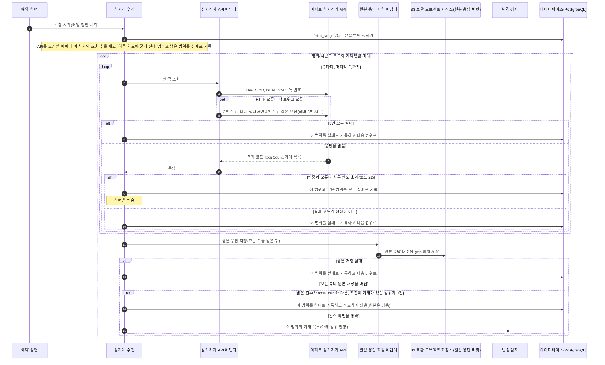

- 원본 응답 파일의 키는 원본 응답 버킷 안의 `{수집 날짜 YYYY-MM-DD}/{실행 시작 시각 HHmmss}/{시군구 코드}-{계약년월}-p{쪽 번호}.xml.gz`입니다. 원본은 gzip으로 압축해 삭제하지 않고 보관합니다([결정 기록 0014](../adr/0014-file-storage.md)). 실행마다 따로 남고 덮어쓰지 않으므로, 같은 날 다시 받아도 앞 실행의 파일과 섞이지 않습니다.
- 결과 코드는 쪽마다 응답을 받은 직후에 확인합니다. 모든 쪽을 받으면 원본 응답을 먼저 저장하고, 그다음 건수를 확인하고 비교합니다. 건수가 다른 범위도 원본이 남아 원인을 조사할 수 있습니다.
- 결과 코드가 정상이 아니면 같은 요청을 다시 보내도 같은 결과일 가능성이 커서 다시 시도하지 않습니다. 인증키 오류와 하루 한도 초과는 남은 범위도 같은 결과이므로 실행을 멈춥니다.
- 하루 호출 수를 세는 테이블은 두지 않습니다. 쪽 수는 첫 응답을 받아야 알 수 있어 시작 전에 최대 호출 수를 계산할 수 없으므로, 실행 안에서 호출할 때마다 호출 수를 세고 하루 한도에 닿기 전에 멈춥니다. 이때 남은 범위는 실패로 기록하고 다음 날 다시 받습니다. 같은 날 여러 번 실행하면 뒤 실행은 앞 실행의 호출 수를 모릅니다. 1단계에서도 처음 적재나 범위 넓히기를 하는 날에는 두 번 실행하므로, 뒤 실행이 스스로 멈추기 전에 하루 한도 초과(코드 22)를 받을 수 있습니다. 이때도 남은 범위가 실패로 남을 뿐 데이터는 손상되지 않습니다. 호출 수를 합산하는 방법은 3단계에 다시 봅니다([결정 기록 0004](../adr/0004-staged-adoption.md), [결정 기록 0009](../adr/0009-refetch-window.md)).
- "직전에 거래가 있던 범위"는 그 범위의 거래 행 가운데 `same_key_count`가 1 이상인 행이 있는 범위입니다.

### 범위 반영

한 범위의 반영(단지 만들기, 거래와 이력 갱신, `fetch_range` 성공 기록)은 트랜잭션 하나입니다.

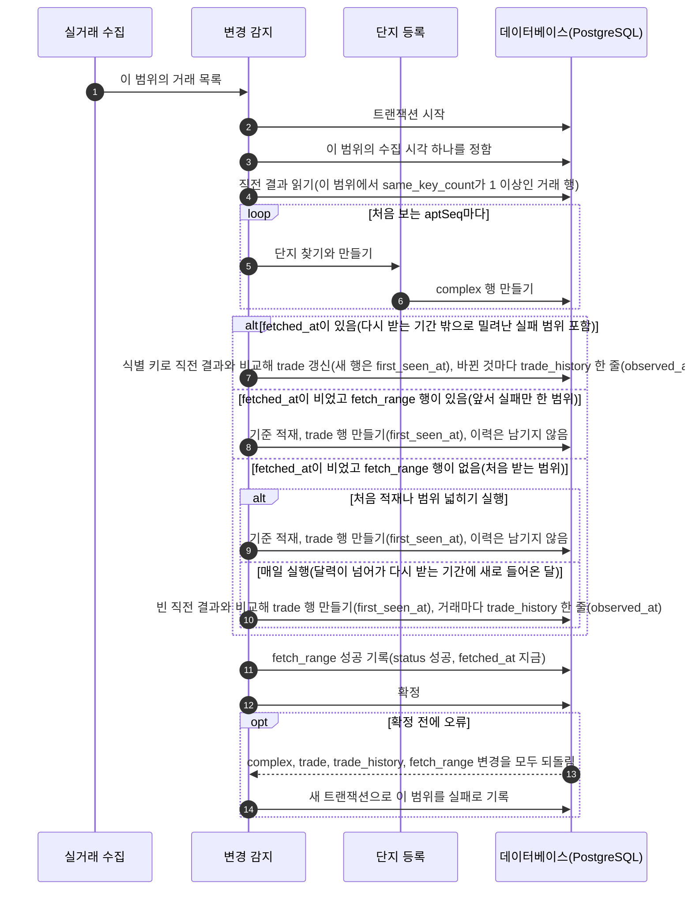

- 범위 하나를 반영할 때 수집 시각 하나를 정해, 그 반영에서 새로 만드는 `trade.first_seen_at`과 그 반영에서 남기는 `trade_history.observed_at`에 같은 값을 씁니다.
- `fetch_range.fetched_at`은 그 범위를 마지막으로 성공한 시각입니다. 실패해도 삭제하지 않고, `status`만 마지막 시도의 결과(`성공`, `실패`)로 바꿉니다.
- `fetched_at`이 있는 범위는 다시 받는 기간 밖으로 밀려난 실패 범위를 포함해 늘 직전 결과와 비교해 이력을 남깁니다.
- `fetched_at`이 빈 범위는 `fetch_range` 행이 있는지로 나눕니다. 행이 있는 범위(앞서 실패만 한 범위)는 어느 실행에서든 기준 적재입니다. 실패한 범위를 빈 결과와 비교하면 그 달 거래가 모두 새 거래 알림으로 나가기 때문입니다.
- 행이 없는 범위(처음 받는 범위)는 처음 적재나 수집 범위 넓히기 실행이면 기준 적재이고, 매일 실행이면(달력이 넘어가 다시 받는 기간에 새로 들어온 달) 빈 직전 결과와 비교해 이력을 남깁니다. 그래서 그 달의 새 거래에도 알림이 나갑니다.
- 대가로 새 달의 첫 매일 수집이 실패하면 그 달은 다음 성공 때 기준 적재가 되어, 그 사이 신고된 그 달 거래의 알림이 빠집니다.
- 기관마다 다른 단지 키를 잇는 일은 이 흐름에 없습니다. 2단계에 고른 방법에 맞춰 열을 더합니다([결정 기록 0008](../adr/0008-complex-matching.md)).

### 수집이 실패하면

| 단계 | 실패 | 멈추는 것 | 데이터베이스에 남는 것 | 파일에 남는 것 |
|---|---|---|---|---|
| 범위마다 받기 4~6 | HTTP 오류나 네트워크 오류로 3번 모두 실패 | 그 범위만. 다음 범위는 계속 받습니다 | `fetch_range`의 `status`가 `실패`, `failure_reason`에 이유. `fetched_at`과 거래, 이력은 그대로 | 바뀌는 것 없음(이 범위의 원본은 모든 쪽을 받은 뒤에 저장합니다) |
| 범위마다 받기 7, 8, 10 | 결과 코드가 정상이 아님(인증키 오류와 코드 22 제외) | 그 범위만 | 위와 같음 | 위와 같음 |
| 범위마다 받기 7~9 | 인증키 오류나 하루 한도 초과(코드 22) | 그 실행 전체 | 그 범위와 아직 받지 않은 범위가 모두 `실패` | 위와 같음 |
| 범위마다 받기(호출 전) | 실행 안에서 센 호출 수가 하루 한도에 닿아 스스로 멈춤 | 그 실행 전체 | 쪽을 받던 범위와 남은 범위가 모두 `실패` | 쪽을 받던 범위의 원본은 저장하지 않습니다(모든 쪽을 받아야 저장). 앞서 끝난 범위의 파일은 남습니다 |
| 범위마다 받기 11~13 | 원본 응답 저장 실패 | 그 범위만. 비교하지 않습니다 | 그 범위가 `실패` | 저장에 성공한 쪽의 원본 파일 |
| 범위마다 받기 14 | 받은 건수가 `totalCount`와 다르거나, 직전에 거래가 있던 범위가 0건 | 그 범위만. 비교하지 않습니다 | 그 범위가 `실패`. 거래와 이력은 그대로라 받지 못한 거래가 `사라짐`으로 남지 않습니다 | 그 범위의 원본 파일. 원인을 조사할 수 있게 남습니다 |
| 범위 반영 | 트랜잭션 확정 전 오류 | 그 범위만 | 그 범위의 단지, 거래, 이력, 성공 기록이 모두 되돌려지고 `실패` 기록만 | 원본 파일 모두 |

실패한 범위는 다음 날 예약 실행이 다시 받습니다. 반영이 범위마다 트랜잭션 하나라서 일부만 반영된 범위는 남지 않고, 다시 받으면 처음부터 비교합니다.

## 알림 판정과 발송

알림 발송기는 데이터베이스의 거래 이력과 매물의 방문 일시를 읽어 알림 대상을 정하고, 발송 기록 행을 먼저 만든 뒤 메일을 보냅니다. collector와 서로 호출하지 않습니다([C4 컴포넌트의 collector에서 알림 발송기로 전달](c4-component.md#collector에서-알림-발송기로-전달)).

### 실행과 판정

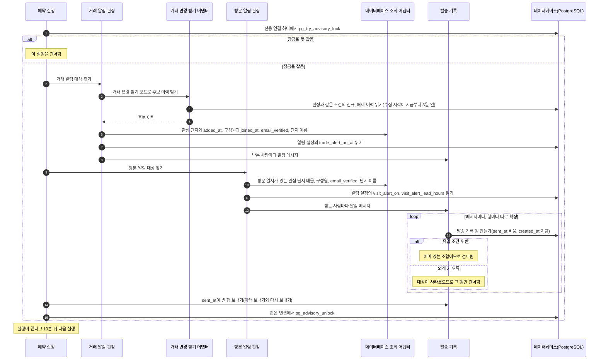

거래 알림 판정의 조건은 아래와 같습니다([데이터 모델의 알림 대상](data-model.md#알림-대상)).

- 후보는 `change_type`이 `신규`나 `해제`이고, 그 이력의 `observed_at`이 그 거래 행의 `first_seen_at`과 같은 이력입니다. 사라졌다 다시 보인 키와 건수가 늘어난 기존 키의 이력은 보내지 않습니다.
- 받는 사람은 그 단지를 관심 단지로 둔 가구의 지금 구성원 가운데 `trade_alert_on_at`이 비어 있지 않은 사람입니다.
- 이력의 `observed_at`이 `interest_complex.added_at`, 받는 사람의 `household_member.joined_at`, 받는 사람의 `trade_alert_on_at`보다 뒤여야 합니다. 그래서 거래 알림을 껐다 켜면 끈 동안의 거래는 보내지 않습니다.
- 후보는 수집 시각(`observed_at`)이 지금부터 3일 안인 이력으로 한정합니다. 다시 보내기 기한과 같게 해, 이메일이 나중에 검증되거나 발송기가 오래 멈췄다 돌아올 때 지난 이력의 알림이 한꺼번에 만들어지지 않게 합니다.
- `trade_alert_on_at`은 꺼진 상태에서 켤 때만 지금 시각을 적습니다. 켜진 채로 다른 설정(방문 알림 시점 등)을 저장할 때는 바꾸지 않습니다. 알림 설정 화면의 저장 버튼이 하나라, 저장할 때마다 덮으면 그 직전에 수집된 거래의 알림이 빠지기 때문입니다.
- 첫 로그인 때 만드는 알림 설정 행의 기본값은 `trade_alert_on_at` 첫 로그인 시각, `visit_alert_on` 참, `visit_alert_lead_hours` 24입니다.
- 발송 기록이 없는 (사람, 거래, 종류) 조합만 행을 만듭니다.
- 거래 변경 받기 어댑터는 같은 조건을 만족하는 받는 사람 가운데 한 사람이라도 발송 기록이 없는 이력만 후보로 읽습니다. 조건이 판정과 어댑터 두 곳에 있는 것은 3단계에 어댑터만 Kafka 소비로 바꾸려는 것이고, 두 조건이 같은지는 아래 [시험](#구현-때-고정할-시험)으로 확인합니다.

방문 알림 판정의 조건은 아래와 같습니다.

- 방문 일시가 있는 매물 가운데 그 단지가 가구의 관심 단지인 것이 대상입니다.
- 받는 사람은 지금 구성원 가운데 `visit_alert_on`이 참인 모든 사람입니다.
- 지금 시각이 `visit_at`에서 그 사람의 `visit_alert_lead_hours`(3, 24, 48 중 하나, 기본 24)를 뺀 시각 이후이고 `visit_at` 전이면 보냅니다. 그래서 같은 매물이라도 받는 사람마다 보내는 시각이 다를 수 있습니다.
- 발송 기록이 없는 (사람, 매물, 방문 일시) 조합만 행을 만듭니다.

두 판정 모두 `user.email_verified`가 거짓인 사람은 받는 사람에서 빼고 발송 기록 행을 만들지 않습니다. 알림 메일은 받는 사람의 로그인 이메일로만 보내기 때문입니다.

실행을 감싸는 권고 잠금은 아래와 같이 다룹니다.

- 실행 전체를 PostgreSQL 권고 잠금(`pg_try_advisory_lock`)으로 감쌉니다. 두 실행이 겹치면 한쪽이 보내는 중인 행을 다른 쪽이 실패한 행으로 보고 다시 보낼 수 있기 때문입니다.
- 권고 잠금은 그 잠금을 잡은 데이터베이스 연결에 묶입니다. 그래서 실행 동안 붙잡는 전용 연결 하나에서 잡고 같은 연결에서 풉니다. 연결 풀의 다른 연결에서 풀면 잠금이 풀리지 않습니다.
- 실행 중에 예외가 나도 같은 연결에서 잠금을 풉니다. 프로세스가 멈춰 연결이 끊기면 PostgreSQL이 잠금을 풉니다.
- 발송 기록 행은 행마다 따로 확정합니다. 한 행의 오류가 다른 행을 되돌리지 않습니다.
- 알림 발송기는 수집 직후에 따로 실행되지 않습니다. 앞 실행이 끝나고 10분 뒤 다음 실행을 시작합니다.

### 보내기와 다시 보내기

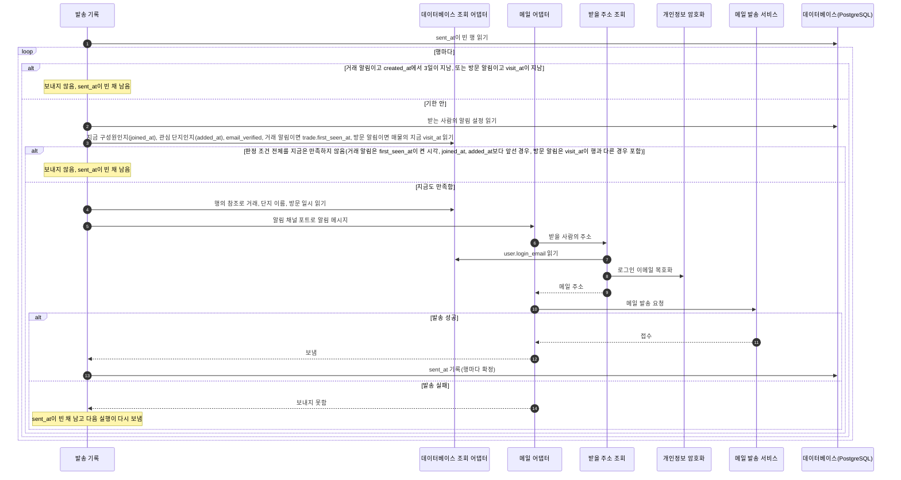

- 판정이 이번 실행에 만든 행과 앞 실행에서 보내지 못한 행은 모두 `sent_at`이 빈 행이므로 같은 순서로 보냅니다.
- 보내기 전에 행마다 받는 사람과 대상이 지금도 판정 조건(지금 구성원, 그 알림을 켬, 관심 단지, `email_verified`가 참, 방문 알림이면 매물의 지금 `visit_at`이 행의 `visit_at`과 같음, 거래 알림이면 조회 포트로 읽은 `trade.first_seen_at`(보낼 행은 이 값이 이력의 `observed_at`과 같음)이 지금의 `interest_complex.added_at`, `household_member.joined_at`, `trade_alert_on_at`보다 뒤임)을 만족하는지 다시 확인하고, 아니면 보내지 않습니다. 이 확인은 판정 조건 전체를 다시 보는 것이라, 메일이 실패한 사이 알림을 껐다 켜거나 단지를 뺐다 다시 넣으면 그 전 이력은 보내지 않습니다. 앞 실행에서 보내지 못한 사이에 가구를 나간 구성원이나 알림을 끈 사람에게 메일이 가지 않게 하려는 것입니다. 이번 실행에 만든 행은 방금 판정을 통과했으므로 같은 결과가 나옵니다.
- 발송 기록 행에는 메시지 내용이 없으므로, 행의 참조(거래 알림은 `trade_id`, 방문 알림은 `listing_id`와 `visit_at`)로 조회 포트를 불러 메시지를 다시 만듭니다.
- 알림 메일은 받는 사람의 `user.login_email`(복호화)로만 보냅니다. `user.email_verified`가 거짓인 사람은 판정에서 빠지므로 행이 없습니다. 알림 발송기는 사용자와 인증 모듈의 `user`를 실행 단위를 넘어 읽으므로 알림 모듈의 조회 포트와 데이터베이스 조회 어댑터로 읽습니다.
- 거래 알림 메일에는 단지 이름, 알림 종류(새 거래, 해제), 계약일, 전용면적, 층, 금액, 서비스 링크를 넣습니다. 방문 알림 메일에는 단지 이름, 방문 일시, 서비스 링크를 넣습니다. 매물 주소, 동, 호는 어떤 메일에도 넣지 않습니다.
- 실행마다 `sent_at`이 빈 행을 다시 보냅니다. 거래 알림은 `created_at`에서 3일이 지나면, 방문 알림은 `visit_at`이 지나면 다시 보내지 않고, 그 행은 `sent_at`이 빈 채 남습니다.

### 삭제 연쇄와 겹칠 때

API 서버의 삭제 연쇄(매물 삭제, 가구 삭제, 탈퇴)가 발송 기록을 삭제하는 동안 알림 발송기가 같은 매물이나 같은 사람의 발송 기록 행을 만들 수 있습니다. 삭제 연쇄는 삭제할 부모 행을 `SELECT ... FOR UPDATE`로 먼저 잠근 뒤 발송 기록부터 삭제합니다. 아래는 매물 삭제의 예입니다.

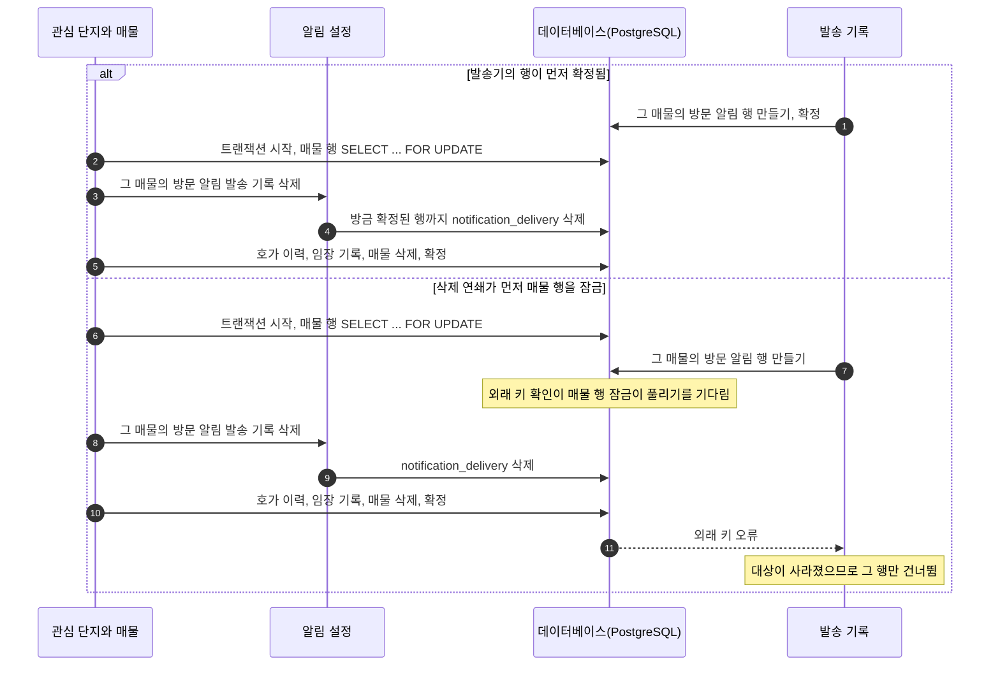

PostgreSQL은 외래 키가 있는 행을 만들 때 참조하는 부모 행에 잠금을 걸고, 이 잠금은 `FOR UPDATE`와 함께 걸리지 않습니다. 그래서 발송기의 행이 먼저 확정되면 삭제 연쇄가 그 행까지 삭제하고, 삭제 연쇄가 먼저 잠그면 발송기는 삭제가 확정된 뒤 외래 키 오류를 받습니다. 어느 순서든 삭제한 매물을 가리키는 발송 기록은 남지 않습니다.

| 동작 | 먼저 잠그는 부모 행 | 잠그는 곳 |
|---|---|---|
| 매물 삭제 | 그 매물 | 매물과 기록 모듈의 관심 단지와 매물 |
| 가구 삭제 | 그 가구의 매물들 | 매물과 기록 모듈의 "그 가구의 매물 번호 받기" 공개 인터페이스. 잠근 뒤 매물 번호를 가구 모듈에 돌려주고, 가구 모듈이 그 번호를 알림 모듈에 넘깁니다 |
| 탈퇴 | 사용자 행 | 사용자와 인증 모듈의 내 정보와 탈퇴 |

### 알림이 실패하면

| 단계 | 실패 | 멈추는 것 | 데이터베이스에 남는 것 | 파일 저장소에 남는 것 |
|---|---|---|---|---|
| 실행과 판정 1 | 권고 잠금을 못 잡음(앞 실행이 끝나지 않음) | 이 실행 전체 | 바뀌는 것 없음 | 바뀌는 것 없음 |
| 실행과 판정, 행 만들기 | 유일 조건 위반 | 그 행만 | 이미 있는 행 하나 | 바뀌는 것 없음 |
| 실행과 판정, 행 만들기 | 외래 키 오류(삭제 연쇄와 겹침) | 그 행만 | 행이 없음 | 바뀌는 것 없음 |
| 실행과 판정, 판정 중 | 예외 | 이 실행의 남은 일. 같은 연결에서 잠금을 풉니다 | 이미 확정한 발송 기록 행. 남은 조합은 다음 실행이 다시 판정해 만듭니다 | 바뀌는 것 없음 |
| 실행과 판정 | 받는 사람의 `email_verified`가 거짓 | 그 사람만 | 행을 만들지 않습니다 | 바뀌는 것 없음 |
| 보내기와 다시 보내기 | 보내기 전 다시 확인에서 판정 조건을 만족하지 않음(나간 구성원, 알림을 끔, 관심 단지에서 뺌, `email_verified`가 거짓으로 바뀜, 방문 일시가 바뀜, 알림을 껐다 켜거나 단지를 뺐다 다시 넣어 이력이 그 시각보다 앞섬) | 그 행만 | `sent_at`이 빈 행 | 바뀌는 것 없음 |
| 보내기와 다시 보내기 | 메일 발송 서비스 오류 | 그 행만 | `sent_at`이 빈 행. 다음 실행이 기한 안에서 다시 보냅니다 | 바뀌는 것 없음 |
| 보내기와 다시 보내기 | 메일을 보낸 뒤 `sent_at`을 기록하기 전에 프로세스가 멈춤 | 이 실행 전체 | `sent_at`이 빈 행. 다음 실행이 같은 메일을 한 번 더 보낼 수 있습니다([데이터 모델의 `notification_delivery`](data-model.md#notification_delivery)) | 바뀌는 것 없음 |
| 보내기와 다시 보내기 | 메일을 보낸 뒤 삭제 연쇄가 그 행을 삭제함 | 없음 | 행이 없습니다. 메일은 이미 나갔고 `sent_at`을 기록할 행이 없습니다 | 바뀌는 것 없음 |

처리 위치를 따로 기록하지 않으므로, 발송기가 하루 멈춰도 다시 실행되면 그 사이 이력의 행을 만듭니다. 다만 거래 알림 행을 만든 뒤 3일 안에 보내지 못하면 그 알림은 나가지 않습니다.

## 임장 기록과 사진

사진은 [결정 기록 0012](../adr/0012-personal-data-storage.md)와 같은 애플리케이션 계층 AES-GCM(키 버전, nonce, 암호문, 인증 태그)으로 암호화하고, 늘 API 서버를 거쳐 올리고 내려줍니다. 저장소 주소를 화면에 주지 않습니다. 사진은 S3 호환 오브젝트 저장소의 사진 버킷에 두고, API 서버의 저장소 접근 키는 사진 버킷에만 권한이 있습니다([결정 기록 0014](../adr/0014-file-storage.md)). 권한 확인 단계는 [API 공통 규칙의 인증과 권한 확인](api-conventions.md#인증과-권한-확인)을 따릅니다.

### 기록 저장과 사진 올리기

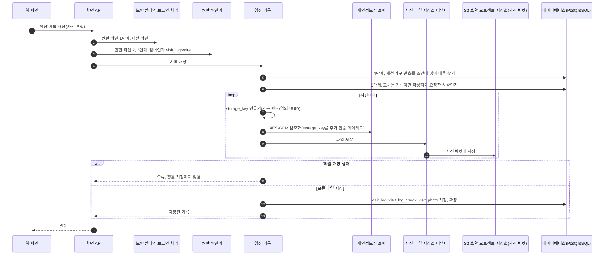

- `visit_photo.storage_key`는 사진 버킷 안의 `{household_id}/{임의 UUID}`입니다. 저장 키를 먼저 만들고, 그 키를 추가 인증 데이터(AAD)로 넣어 암호화한 뒤 저장합니다. 사진을 내려줄 때 복호화에도 같은 키를 넣습니다. 저장소 접근 키를 빼앗은 사람이 남의 암호문을 자기 키 자리로 옮겨도 복호화되지 않게 하려는 것입니다.
- 파일을 먼저 저장하고 `visit_photo` 행을 저장합니다. 행이 없는 파일은 아래 사진 파일 정리가 삭제할 수 있지만, 파일이 없는 행은 열리지 않는 사진으로 남기 때문입니다.
- GPS 등 메타데이터를 삭제할지와 어디서 삭제할지는 임장 기록 기능 명세에서 정합니다.

### 사진 보기

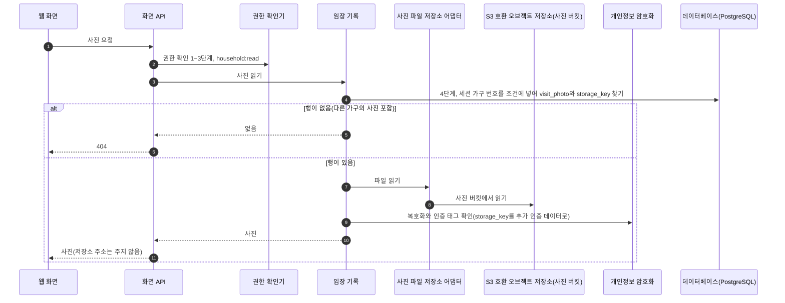

### 사진과 기록 삭제

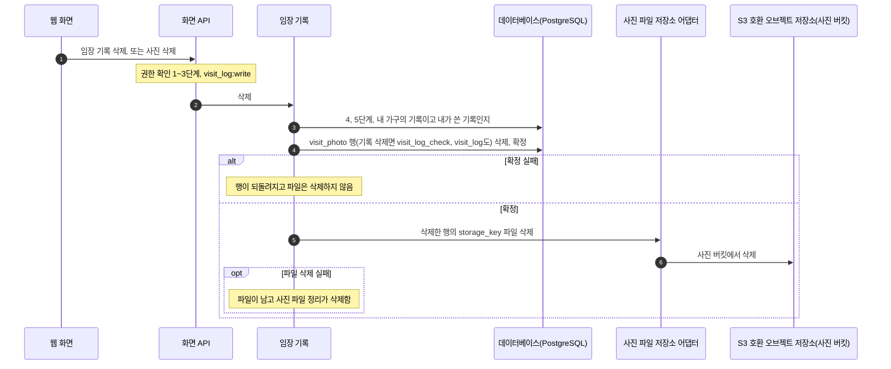

### 매물 삭제

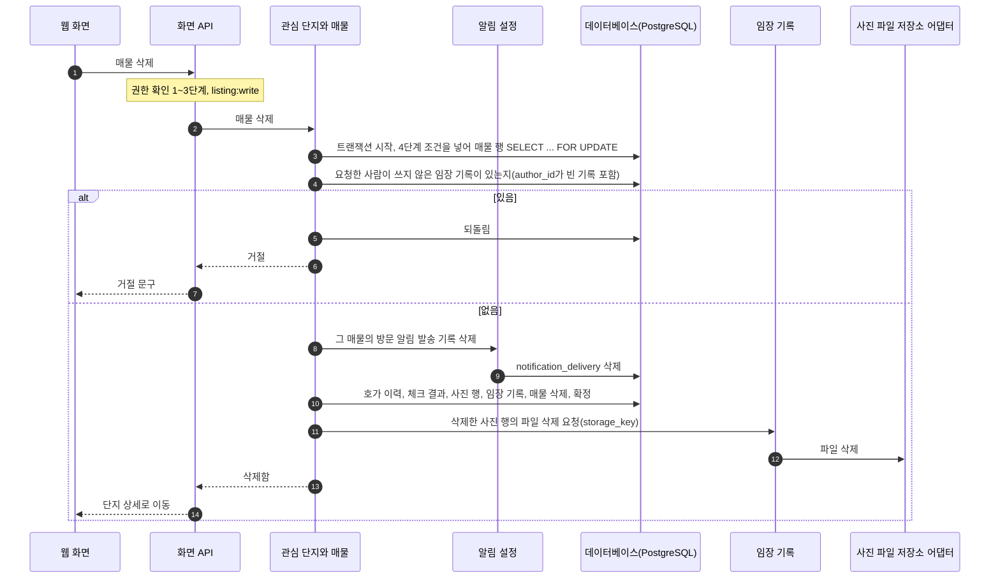

- 그 매물에 요청한 사람이 쓰지 않은 임장 기록(작성자가 나가 `author_id`가 빈 기록 포함)이 있으면 매물 삭제를 거절하고 "다른 구성원의 기록이 있어 지울 수 없습니다"를 보입니다. 매물 상태를 바꾸라는 안내는 넣지 않습니다. 상태 코드와 오류 코드는 기능 명세에서 정합니다.
- 관심 단지와 매물은 사진 파일 저장소 어댑터를 직접 부르지 않고, 확정 뒤 임장 기록 컴포넌트에 삭제한 사진 행의 저장 키를 넘겨 파일을 삭제하게 합니다. 사진 파일 삭제는 임장 기록의 몫입니다.
- 기록이 없거나 요청한 사람의 기록만 있는 매물은 삭제합니다. 남의 기록이 있는지는 매물 행을 잠근 뒤 확인하므로, 확인과 삭제 사이에 다른 구성원이 그 매물에 새 기록을 저장하지 못합니다.

### 사진 파일 정리

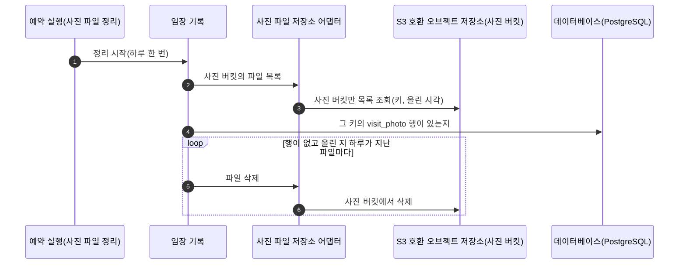

올린 지 하루가 지나지 않은 파일은 삭제하지 않습니다. 파일을 저장한 뒤 행을 저장하기 전인 요청의 파일을 삭제하지 않기 위해서입니다.

### 임장 기록과 사진이 실패하면

| 흐름 | 실패 | 멈추는 것 | 데이터베이스에 남는 것 | 파일에 남는 것 |
|---|---|---|---|---|
| 기록 저장과 사진 올리기 | 권한 확인 1~5단계에 걸림 | 그 요청. 걸린 단계의 상태 코드로 답합니다 | 바뀌는 것 없음 | 없음 |
| 기록 저장과 사진 올리기 | 파일 저장 실패 | 그 요청 | 바뀌는 것 없음 | 먼저 저장한 사진 파일. 사진 파일 정리가 삭제합니다 |
| 기록 저장과 사진 올리기 | 행 저장 실패 | 그 요청 | 되돌려져 바뀌는 것 없음 | 저장한 사진 파일 모두. 사진 파일 정리가 삭제합니다 |
| 사진 보기 | 다른 가구의 사진이거나 없는 사진 | 그 요청(404) | 바뀌는 것 없음 | 그대로 |
| 사진 보기 | 복호화나 인증 태그 확인 실패 | 그 요청 | 바뀌는 것 없음 | 그대로 |
| 사진과 기록 삭제, 매물 삭제 | 확정 실패 | 그 요청 | 되돌려져 바뀌는 것 없음 | 그대로 |
| 사진과 기록 삭제, 매물 삭제 | 확정 뒤 파일 삭제 실패 | 없음. 행 삭제는 확정됐습니다 | 삭제한 행은 없음 | 행이 없는 파일. 사진 파일 정리가 삭제합니다 |
| 매물 삭제 | 요청한 사람이 쓰지 않은 기록이 있음 | 그 요청(거절) | 되돌려져 바뀌는 것 없음 | 그대로 |
| 사진 파일 정리 | 목록 조회나 파일 삭제 실패 | 그 회차 | 바뀌는 것 없음 | 삭제하지 못한 파일. 다음 날 다시 대조합니다 |

## 단지 등록에서 관심 단지와 매물 등록까지

단지 행은 collector만 만들고, 사용자는 그 단지 가운데서 관심 단지를 고르고 매물을 등록합니다. 각 요청은 [임장 기록과 사진](#기록-저장과-사진-올리기)처럼 권한 확인 1~4단계를 거치며, 그림에는 권한 키만 적었습니다. 실거래, 건축물대장, K-apt, 청약의 단지 키를 잇는 흐름은 2단계에 고른 방법에 맞춰 더합니다([결정 기록 0008](../adr/0008-complex-matching.md)).

### 단지 등록, 관심 단지 추가, 매물 등록

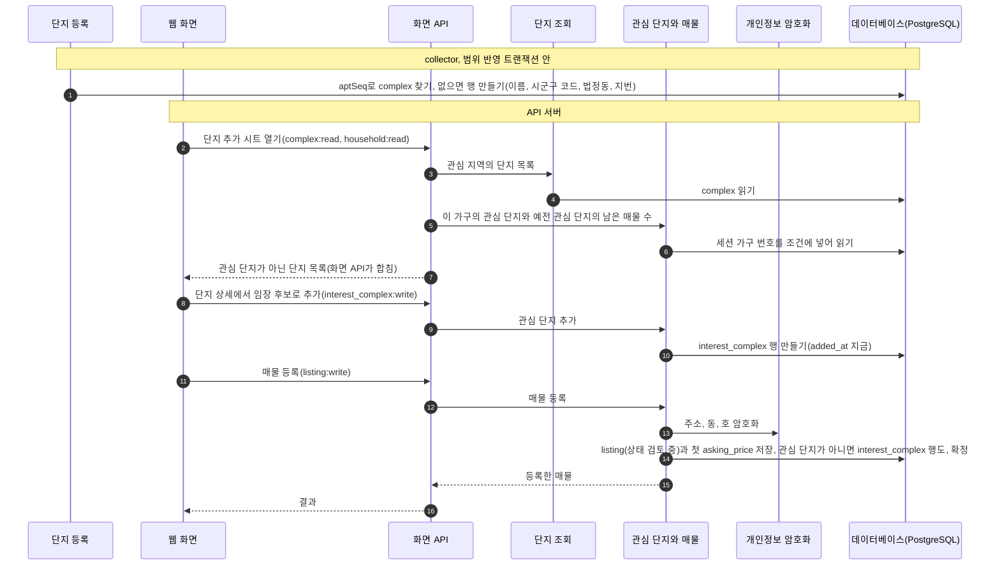

- `interest_complex.added_at`은 거래 알림 판정이 쓰는 시각입니다. 관심 단지로 둔 뒤에 본 거래 변경만 그 가구에 보냅니다. 뺐다가 다시 추가하면 새 시각으로 다시 만듭니다.
- 매물을 등록할 때 그 단지가 관심 단지가 아니면 같은 트랜잭션에서 `interest_complex` 행을 만듭니다.
- 매물 저장에 실패하면 웹 화면은 입력한 값을 그대로 두고 "저장하지 못했습니다. 다시 시도하세요."를 보여 줍니다([와이어프레임](../design/wireframes.md)).

### 지도를 그릴 때

매물 등록 화면과 매물 상세 화면이 지도를 그릴 때마다 API 서버가 브이월드 지오코더를 불러 주소를 좌표로 바꾸고, 좌표만 화면에 줍니다. 좌표는 저장하지 않습니다([결정 기록 0015](../adr/0015-geocoder.md)).

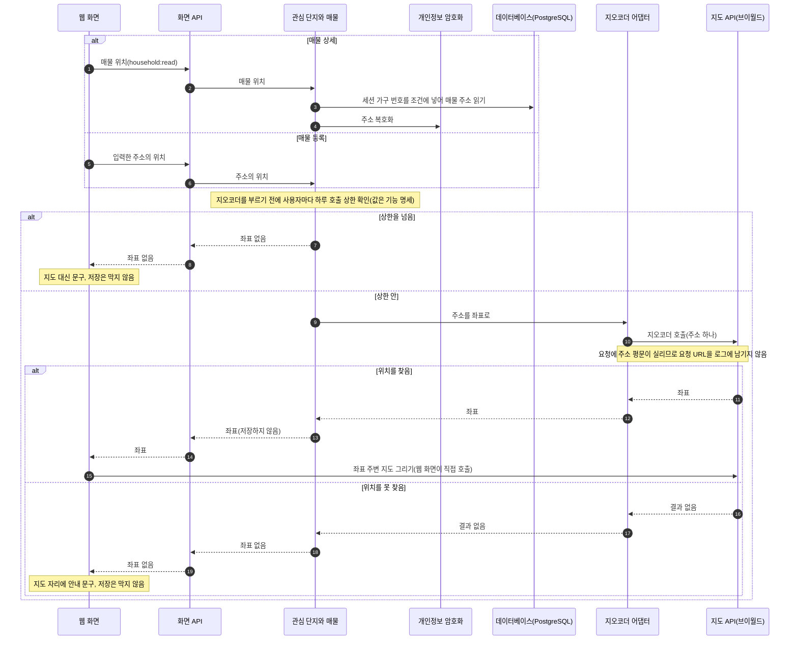

- 변환할 주소는 화면이 보낸 주소(저장 전 입력)나 저장된 매물 주소입니다. 지오코더를 부르기 전에 사용자마다 하루 호출 상한을 확인하고(값은 기능 명세), 넘으면 지도 대신 문구를 보입니다. 로그인 허용 목록이 없어 남이 하루 한도를 다 쓰면 지도가 꺼지기 때문입니다.
- 지오코더 요청에는 주소 평문이 실리므로, 평문을 로그에 남기지 않는 규칙([결정 기록 0012](../adr/0012-personal-data-storage.md))이 나가는 요청 URL에도 걸립니다. 요청 URL을 로그에 남기지 않습니다.
- 주소로 위치를 못 찾으면 지도 자리에 "주소의 위치를 찾지 못했습니다. 주소를 확인하세요."를 보이고 매물 저장은 막지 않습니다. 지도에서 직접 위치를 찍는 기능은 없습니다.
- 좌표를 저장하지 않는 근거는 브이월드 지오코더 API 2.0 안내 페이지(https://www.vworld.kr/dev/v4dv_geocoderguide2_s001.do) 소개 문단의 "단, API 요청은 실시간으로 사용하셔야 하며 별도의 저장장치나 데이터베이스에 저장할 수 없습니다."입니다(2026-10-20 확인). 지오코더 하루 한도는 40,000건입니다.
- 구현 전에 인증키로 서버에서 지오코더를 부를 수 있는지 확인합니다. 안 되면 웹 화면이 JSONP로 부르고 CSP 허용 목록에 지오코더 주소를 넣습니다([결정 기록 0015](../adr/0015-geocoder.md)). 이 대체 경로에서는 사용자별 상한과 요청 URL 로그 규칙을 서버가 지킬 수 없습니다.

### 단지와 매물 등록이 실패하면

| 흐름 | 실패 | 멈추는 것 | 데이터베이스에 남는 것 | 파일 저장소에 남는 것 |
|---|---|---|---|---|
| 단지 등록 | 범위 반영 트랜잭션 오류 | 그 범위의 반영 | 그 범위에서 만든 단지 행도 되돌려집니다. 다음 날 다시 받을 때 다시 만듭니다 | 원본 응답 파일은 남습니다(범위 반영 전에 저장했습니다). 다시 받으면 그 실행의 파일이 따로 새로 생깁니다 |
| 관심 단지 추가 | 권한 확인에 걸리거나 저장 실패 | 그 요청 | 바뀌는 것 없음 | 바뀌는 것 없음 |
| 매물 등록 | 저장 실패 | 그 요청 | 되돌려져 매물, 첫 호가, 관심 단지 행 모두 없음 | 바뀌는 것 없음 |
| 지도를 그릴 때 | 주소로 위치를 못 찾음 | 지도 표시만 | 바뀌는 것 없음. 좌표는 처음부터 저장하지 않습니다 | 바뀌는 것 없음 |

## 구현 때 고정할 시험

### 변경 감지

한 가구가 단지 하나를 미리 관심 단지로 두었고, 구성원 한 명이 그 전에 가구에 들어와 거래 알림을 켜 둔 상태에서 시작합니다. 키 A, B는 같은 범위의 거래이고 건수는 괄호에 적었습니다. "오늘"은 그 범위를 받는 수집 날짜입니다.

| 경우 | 어제 결과 | 오늘 결과 | 기대 이력 | 기대 발송 기록 |
|---|---|---|---|---|
| 신규 | 없음 | A(1) | A `신규` | (그 사람, A, 거래 신규) 한 행 |
| 해제 | A(1) | A(1), A의 해제 키 A'(1) | A' `해제` | (그 사람, A', 거래 해제) 한 행 |
| 등기 | A(1), 등기일 빔 | A(1), 등기일 있음 | A `등기` | 없음 |
| 사라짐 | A(1), B(1) | B(1) | A `사라짐`, A의 `same_key_count` 0 | 없음 |
| 사라졌다 다시 보인 키 | B(1), A는 전날 사라져 건수 0 | A(1), B(1) | A `신규` | 없음. 이력의 `observed_at`이 A의 `first_seen_at`과 다릅니다 |
| 건수가 늘어난 기존 키 | A(1), A는 앞선 수집에서 처음 봄 | A(2) | A `신규` | 없음. 이력의 `observed_at`이 A의 `first_seen_at`과 다릅니다 |
| 같은 날 기준 적재 뒤 같은 키 건수 증가 | 같은 날 앞 수집이 기준 적재로 A(1) 행을 만듦(이력 없음) | 같은 날 뒤이은 수집에서 A(2) | A `신규` | 없음. 기준 적재 행은 이력이 없어, 뒤이은 수집의 `observed_at`이 A의 `first_seen_at`과 다릅니다 |
| 빈 결과 | A(1) | 0건 | 없음. 범위를 `실패`로 두고 비교하지 않음 | 없음 |
| 건수 불일치 | A(1) | 받은 건수가 `totalCount`와 다름 | 없음. 범위를 `실패`로 두고 비교하지 않음 | 없음 |
| 기준 적재 | 처음 적재나 범위 넓히기로 받는 달, `fetched_at` 빔, `fetch_range` 행 없음 | A(1) | 없음. A 행만 만듦 | 없음 |
| 앞서 실패만 한 달(처음 적재 때 실패한 달, 새 달의 첫 매일 수집이 실패한 달) | `fetched_at` 빔, `fetch_range` 행 있음(`status` `실패`) | 매일 실행이 받은 A(1) | 없음. 기준 적재로 A 행만 만듦 | 없음 |
| 다시 받는 기간 밖으로 밀려난 실패 범위 | `fetched_at` 있음, `status` `실패`, A(1) | A(1), B(1) | B `신규` | (그 사람, B, 거래 신규) 한 행 |
| 다시 받는 기간에 새로 들어온 달 | 빈 직전 결과, `fetched_at` 빔, `fetch_range` 행 없음, 매일 실행 | A(1) | A `신규` | (그 사람, A, 거래 신규) 한 행 |

### 알림 발송기

| 시험 | 기대 결과 |
|---|---|
| 같은 자료로 발송기를 두 번 실행 | 조합마다 발송 기록이 한 행이고 메일도 한 번 나갑니다. 두 번째 실행은 행을 만들지 않고 보내지 않습니다 |
| 같은 고정 자료로 거래 알림 판정과 거래 변경 받기 어댑터의 조건(`email_verified` 참 포함)을 비교. 자료에는 거래 알림을 끈 사람, 켠 시각이 이력보다 뒤인 사람, 이력 뒤에 들어온 구성원, 이력 뒤에 관심 단지로 둔 가구, 다시 보인 키, `등기`와 `사라짐` 이력, 이미 발송 기록이 있는 조합, `email_verified`가 거짓인 사람, 건수가 늘어난 기존 키, 수집된 지 3일이 지난 이력을 넣습니다 | 어댑터가 후보로 읽은 이력의 집합과, 판정이 행을 만들 받는 사람이 하나 이상인 이력의 집합이 같습니다 |
| 실행 중에 예외를 일으킨 뒤 다음 실행 | 다음 실행이 권고 잠금을 다시 잡고 남은 조합의 행을 만듭니다 |
| 한 실행이 잠금을 잡은 동안 다른 실행을 시작 | 두 번째 실행은 잠금을 못 잡아 건너뜁니다 |
| 삭제 연쇄가 매물 행을 잠근 동안 그 매물의 방문 알림 행을 만듦 | 삭제가 확정된 뒤 외래 키 오류로 그 행만 건너뛰고, 다른 행은 확정됩니다 |
| `email_verified`가 거짓인 구성원이 있는 가구의 거래와 방문 알림 판정 | 그 사람의 발송 기록 행을 만들지 않습니다 |
| 행을 만든 뒤 보내지 못한 사이에 받는 사람이 가구를 나가거나 그 알림을 끔 | 다음 실행이 보내지 않고 `sent_at`이 빈 채 남습니다 |
| 행을 만든 뒤 보내지 못한 사이에 알림을 껐다 켜거나 관심 단지를 뺐다 다시 넣음 | 거래의 `first_seen_at`이 새 `trade_alert_on_at`이나 `added_at`보다 앞서므로 보내지 않고 `sent_at`이 빈 채 남습니다 |
| 거래 알림이 켜진 채로 방문 알림 시점만 바꿔 저장 | `trade_alert_on_at`이 바뀌지 않습니다 |
| 메일 발송 서비스가 실패를 돌려줌 | `sent_at`이 빈 채 남고 다음 실행이 다시 보냅니다. 거래 알림은 `created_at`에서 3일, 방문 알림은 `visit_at`이 지난 뒤에는 보내지 않습니다 |

## 이 문서에서 정한 것

| 정한 것 | 근거 |
|---|---|
| 받은 건수가 `totalCount`와 다르거나 직전에 거래가 있던 범위가 0건이면 그 범위를 실패로 두고 비교하지 않음 | 덜 받은 결과를 비교하면 받지 못한 거래가 `사라짐`으로 남고, 다음에 다시 받으면 다시 보인 거래가 됩니다 |
| HTTP 오류와 네트워크 오류만 2초, 4초 쉬고 최대 3번 시도. 정상이 아닌 결과 코드는 다시 시도하지 않음. 인증키 오류와 코드 22는 실행을 멈춤 | 일시적인 오류만 다시 시도해 하루 한도를 아낍니다. 인증키 오류와 한도 초과는 남은 범위도 같은 결과입니다 |
| 실패한 범위는 다음 날 다시 받는 기간 밖이어도 함께 받음 | 지역과 월 단위로 실패를 가두고 그 범위만 다시 받습니다(PRD 비기능 요구사항의 수집 실패 격리) |
| 한 범위의 모든 쪽을 받으면 원본을 먼저 저장하고 그다음 건수 확인과 비교. 반영은 트랜잭션 하나 | 일부만 반영된 범위가 남지 않아 다시 받으면 처음부터 비교합니다. 건수가 다른 범위도 원본이 남아 원인을 조사할 수 있습니다 |
| 하루 호출 수 테이블을 두지 않고, 실행 안에서 호출마다 세어 한도에 닿기 전에 멈추고 남은 범위를 실패로 기록 | 쪽 수는 첫 응답을 받아야 알아 미리 계산할 수 없습니다. 1단계에서 같은 날 두 번 실행하는 날(처음 적재나 범위 넓히기)에는 뒤 실행이 코드 22로 멈출 수 있지만 남은 범위가 실패로 남아 다음 날 이어 받습니다. 호출 수 합산은 3단계에 다시 봅니다 |
| `fetched_at`은 마지막으로 성공한 시각. `fetched_at`이 있는 범위는 늘 비교하고, 빈 범위는 `fetch_range` 행이 없고 매일 실행인 달(새로 들어온 달)만 빈 직전 결과와 비교하며 나머지는 기준 적재 | 새로 들어온 달을 비교해야 그 달의 새 거래에 알림이 나갑니다. 앞서 실패만 한 달을 비교하면 그 달 거래가 모두 새 거래 알림으로 나갑니다. 대가로 새 달의 첫 매일 수집이 실패하면 그 사이 신고된 거래의 알림이 빠집니다 |
| 거래 알림은 그 거래 행을 만든 수집(`observed_at`이 `first_seen_at`과 같음)의 `신규`, `해제` 이력에만 | 사라졌다 다시 보인 거래와 건수가 늘어난 기존 키에 알림이 다시 나가지 않습니다 |
| 이력의 수집 시각이 거래 알림을 켠 시각(`trade_alert_on_at`)보다 뒤여야 하고, 그 시각은 꺼진 상태에서 켤 때만 적음. 첫 로그인 기본값은 `trade_alert_on_at` 첫 로그인 시각, `visit_alert_on` 참, `visit_alert_lead_hours` 24 | 껐다 켤 때 끈 동안의 거래를 한꺼번에 보내지 않습니다. 켜진 채로 다른 설정을 저장할 때 시각을 덮으면 그 직전에 수집된 거래의 알림이 빠집니다 |
| 방문 알림은 켠 구성원 모두에게, 시점은 사람마다 3시간 전, 하루 전, 이틀 전 가운데 고름(기본 하루 전) | 방문 일정은 가구가 함께 보는 자료이고, 언제 알림을 받을지는 사람마다 다릅니다 |
| 알림 메일은 `user.login_email`로만 보내고, `email_verified`가 거짓인 사람은 판정에서 빼 행을 만들지 않음 | 주소를 따로 받지 않아 저장하는 개인정보와 민감 동작이 하나씩 줄고, 검증되지 않은 주소로 보내지 않습니다 |
| 보내기 전에 받는 사람과 대상이 지금도 판정 조건을 만족하는지 다시 확인 | 보내지 못한 사이에 가구를 나간 구성원이나 알림을 끈 사람에게 메일이 가지 않습니다 |
| 메일 본문에 매물 주소, 동, 호를 넣지 않음 | 메일은 서비스 밖의 메일함에 남습니다 |
| 발송기는 앞 실행이 끝나고 10분 뒤 실행하고, 실행 전체를 전용 연결의 권고 잠금으로 감쌈 | 두 실행이 겹치면 보내는 중인 행을 실패한 행으로 보고 다시 보낼 수 있습니다. 권고 잠금은 연결에 묶여 다른 연결에서는 풀리지 않습니다 |
| 거래 알림은 만든 지 3일, 방문 알림은 방문 시각이 지나면 다시 보내지 않음 | 늦게 받은 거래 알림과 지난 방문 알림은 쓸모가 없습니다 |
| 발송 기록 행은 행마다 따로 확정 | 한 행의 오류가 다른 받는 사람의 행을 되돌리지 않습니다 |
| 삭제 연쇄는 부모 행을 먼저 `SELECT ... FOR UPDATE`로 잠그고, 발송기는 외래 키 오류면 그 행만 건너뜀 | 외래 키 확인이 부모 행 잠금을 기다리므로, 어느 순서든 삭제한 대상을 가리키는 발송 기록이 남지 않습니다 |
| 요청한 사람이 쓰지 않은 임장 기록이 있으면 매물 삭제를 거절 | 다른 구성원의 기록을 그 사람이 모르게 삭제하지 않습니다 |
| 사진은 저장 키를 추가 인증 데이터로 넣어 AES-GCM으로 암호화하고 늘 API 서버를 거침. 파일을 먼저 저장하고 행을 저장하며, 삭제할 때는 확정 뒤 파일을 삭제함. 남은 파일은 하루 한 번 정리 | 저장소 주소를 화면에 주지 않고, 남의 암호문을 자기 키 자리로 옮겨도 복호화되지 않으며, 행이 없는 파일은 정리로 삭제할 수 있지만 파일이 없는 행은 열리지 않는 사진이 됩니다([결정 기록 0014](../adr/0014-file-storage.md)) |
| 지오코더 좌표를 저장하지 않고 지도를 그릴 때마다 API 서버가 부르며, 부르기 전에 사용자마다 하루 호출 상한을 확인하고 요청 URL을 로그에 남기지 않음 | 브이월드 안내 페이지가 결과 저장을 금지합니다([결정 기록 0015](../adr/0015-geocoder.md)). 허용 목록이 없어 남이 하루 한도를 다 쓰면 지도가 꺼지고, 요청에 주소 평문이 실립니다 |
| 거래 알림 조건을 판정과 거래 변경 받기 어댑터 두 곳에 두고, 같은 고정 자료로 두 결과가 같은지 시험 | 3단계에 어댑터만 Kafka 소비로 바꾸고 판정을 고치지 않습니다([C4 컴포넌트](c4-component.md#collector에서-알림-발송기로-전달)) |

## 정하지 않은 것

| 항목 | 정하는 곳 |
|---|---|
| 메일 발송 서비스 | 배포 환경을 정할 때 |
| S3 호환 오브젝트 저장소의 업체 | 배포 환경을 정할 때([결정 기록 0014](../adr/0014-file-storage.md)) |
| 사진 형식, 크기 제한, GPS 등 메타데이터를 삭제할지와 어디서 삭제할지 | 임장 기록 기능 명세 |
| collector 중복 실행 잠금 | 3단계([결정 기록 0004](../adr/0004-staged-adoption.md)) |
| 매일 다시 받는 기간 | [결정 기록 0009](../adr/0009-refetch-window.md)(정함) |
| 같은 날 여러 번 실행할 때 앞 실행의 호출 수를 아는 방법 | 3단계([결정 기록 0004](../adr/0004-staged-adoption.md)) |
| 처음 적재와 범위 넓히기를 시작하는 방법. 새 지역이나 넓힌 기간의 달을 매일 실행이 먼저 받지 않게 해야 합니다([결정 기록 0009](../adr/0009-refetch-window.md)) | 수집 기능 명세 |
| 지오코더 호출 오류와 하루 한도 초과 때 화면에 보일 것, 사용자별 하루 호출 상한의 값 | 매물 기능 명세 |
| 사용자별 하루 호출 상한을 세는 곳 | 1단계는 API 서버 메모리. 3단계에 API 서버가 두 대가 되면 다시 정함 |
| 위치 요청에 필요한 권한 키 | 매물 기능 명세 |
| 2단계 단지 연결의 좌표 거리 방법에 쓸 좌표(지오코더 좌표는 저장할 수 없음) | 2단계 계획([결정 기록 0008](../adr/0008-complex-matching.md), [0015](../adr/0015-geocoder.md)) |
| 엔드포인트, 요청, 응답, 상태 코드와 오류 코드(사진을 기록과 한 요청으로 올릴지 포함) | 기능마다 `/speckit-plan`의 `contracts/` |
