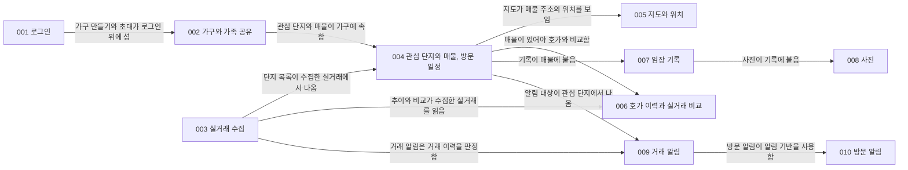

# 1단계 기능 백로그

1단계 기능을 구현 순서대로 적은 목록입니다. 기능 하나가 SpecKit 기능 하나이고 브랜치 하나입니다. 기능마다 `/speckit-specify`에 넣을 한 문장과 참조할 설계 문서 절을 적습니다.

## 나누는 기준

기능 하나가 커지면 머지 한 번의 검토가 어려워지므로, 아래 기준으로 나눕니다(2026-11-04 저장소 소유자 결정).

- 설계 문서가 이미 경계를 만들어 둔 곳에서 나눕니다. 외부 시스템 하나(지오코더, 파일 저장소, 메일), 보안 메커니즘 하나(로그인과 재인증), 뒤 기능이 의존하는 범위가 갈리는 곳입니다.
- 한 트랜잭션이나 한 응답을 가르는 곳에서는 나누지 않습니다. 수집과 변경 감지는 범위 반영 트랜잭션 하나로 묶여 있어 한 기능입니다.
- 기능의 spec에서 사용자 스토리가 여섯 개 이상이면 기능을 둘로 나누고 번호를 다시 매길지 저장소 소유자에게 묻습니다(2026-11-03 합의).

기능이 아닌 선행 작업으로, 001 전에 `chore/app-skeleton` 브랜치에서 앱 골격(빈 Spring Boot 애플리케이션, 데이터베이스와 테스트 기반, 빌드)을 만듭니다. 기반 스택은 이 브랜치 전에 정하고 결정 기록에 남깁니다. 웹 화면 기술은 화면이 처음 나오는 001의 plan에서 정합니다([constitution](../.specify/memory/constitution.md)의 기술 제약).

## 순서

선은 앞 기능의 데이터가 있어야 뒤 기능을 만들 수 있다는 뜻입니다. 번호는 구현 순서입니다.

- 006과 007은 서로 의존하지 않습니다. 008까지 만들면 알림 없이도 실제 임장에 사용할 수 있습니다.
- 009는 거래 이력(003)과 관심 단지(004)가 모두 있어야 알림 대상을 판정할 수 있습니다. 010은 방문 일정과 관심 단지(004)와 009가 만든 알림 기반(스케줄러, 발송 기록, 메일 어댑터, 알림 설정 화면)이 있어야 합니다.
- 003은 002를 기다리지 않습니다. 단지와 거래는 가구와 무관한 수집 자료입니다.

## 백로그

| 번호 | 기능 | `/speckit-specify` 한 문장 | 참조할 설계 문서 절 | 상태 | 이슈 |
|---|---|---|---|---|---|
| 001 | 로그인 | 사용자는 구글 계정으로 로그인하고 로그아웃하며, 로그인 상태는 쓰지 않으면 7일, 계속 써도 로그인한 지 30일이 지나면 만료되고, 민감 동작 앞에서는 구글 인증을 한 번 더 거치며(재인증), 탈퇴(자기 계정 삭제)할 수 있고, 내 정보 조회와 표시 이름 수정은 요청(API)으로 할 수 있습니다. 로그인 뒤에는 가구 없음 화면(로그아웃과 탈퇴 버튼만 있음)이 열립니다(가구, 초대, 매물, 기록, 알림은 다루지 않습니다). | [PRD 기능 범위](prd.md#기능-범위), [결정 기록 0010](adr/0010-login-method.md), [결정 기록 0013](adr/0013-session.md), [데이터 모델: 사용자와 가구](architecture/data-model.md#사용자와-가구), [API 공통 규칙: 인증과 권한 확인](architecture/api-conventions.md#인증과-권한-확인), [와이어프레임: 로그인](design/wireframes.md#로그인), [와이어프레임: 관심 단지 목록](design/wireframes.md#관심-단지-목록)(가구 없음과 로그아웃) | 진행 중 | [#1](https://github.com/Park-Seung-Hun/real-estate/issues/1) |
| 002 | 가구와 가족 공유 | 가구가 없는 사람은 가구 없음 화면에서 가구를 만들어 owner가 되고(가구 이름은 없습니다), 초대 링크로 가족을 구성원으로 들이고(초대 취소와 보낸 초대 목록 포함), 구성원 목록(로그인 이메일과 검증 여부 포함)을 보며, 구성원 제거, 가구 나가기, 가구 삭제, 표시 이름 수정 화면을 사용할 수 있고, 가구가 있는 사람의 탈퇴는 막습니다. 가구가 있는 사람의 로그인 뒤와 가구를 만든 뒤 첫 화면은 구성원 목록, 초대, 로그아웃을 담은 임시 첫 화면입니다(매물, 기록, 알림은 다루지 않습니다). | [PRD 기능 범위](prd.md#기능-범위), [결정 기록 0011](adr/0011-household-sharing.md), [결정 기록 0013](adr/0013-session.md), [데이터 모델: 사용자와 가구](architecture/data-model.md#사용자와-가구), [API 공통 규칙: 인증과 권한 확인](architecture/api-conventions.md#인증과-권한-확인), [와이어프레임: 가족 초대](design/wireframes.md#가족-초대), [와이어프레임: 관심 단지 목록](design/wireframes.md#관심-단지-목록)(가구 없음) | 대기 | [#7](https://github.com/Park-Seung-Hun/real-estate/issues/7) |
| 003 | 실거래 수집 | 서비스는 관심 지역의 아파트 매매 실거래를 초기 적재로 최근 5년치 수집하고 매일 수집에서 재수집 기간을 다시 수집해, 새 거래와 해제, 정정, 등기로 바뀐 거래를 거래 이력으로 기록하고, 원본 응답 파일을 보관하며, 실패한 범위는 다음 실행에서 다시 수집하고, 수집한 실거래에서 단지를 만듭니다(화면과 알림은 다루지 않습니다). | [PRD 비기능 요구사항](prd.md#비기능-요구사항), [결정 기록 0006](adr/0006-transaction-identity.md), [결정 기록 0007](adr/0007-change-history.md), [결정 기록 0008](adr/0008-complex-matching.md), [결정 기록 0009](adr/0009-refetch-window.md), [결정 기록 0014](adr/0014-file-storage.md), [데이터 모델: 단지와 거래](architecture/data-model.md#단지와-거래), [C4 컴포넌트: collector](architecture/c4-component.md#collector), [핵심 흐름: 수집과 변경 감지](architecture/flows.md#수집과-변경-감지), [핵심 흐름: 변경 감지 테스트](architecture/flows.md#변경-감지) | 대기 | [#2](https://github.com/Park-Seung-Hun/real-estate/issues/2) |
| 004 | 관심 단지와 매물, 방문 일정 | 가구 구성원은 수집된 단지에서 관심 단지를 추가하거나 빼고, 관심 단지 목록(단지별 매물 수, 최근 실거래 한 건, 추가할 단지 목록과 예전 관심 단지 표시 포함)과 단지 상세(전용면적 구분, 최근 실거래 목록, 등록한 매물 목록, 관심 단지가 아닌 단지의 남은 매물 수 안내, 임장 후보 추가와 빼기)에서 단지를 보며, 관심 단지에 매물(동호수, 주소, 전용면적, 상태, 첫 호가와 출처, 호가 확인 날짜)을 등록, 수정, 삭제하고 방문 일시를 정하고, 매물 상세에서 기본 정보를 보고 상태를 바꿀 수 있으며, 002의 임시 첫 화면을 관심 단지 목록으로 바꿉니다(지도, 호가 이력 추가, 실거래 추이, 임장 기록, 알림은 다루지 않습니다). | [PRD 기능 범위](prd.md#기능-범위), [데이터 모델: 매물과 기록](architecture/data-model.md#매물과-기록), [핵심 흐름: 단지 등록에서 관심 단지와 매물 등록까지](architecture/flows.md#단지-등록에서-관심-단지와-매물-등록까지), [핵심 흐름: 매물 삭제](architecture/flows.md#매물-삭제), [와이어프레임: 관심 단지 목록](design/wireframes.md#관심-단지-목록), [와이어프레임: 단지 상세](design/wireframes.md#단지-상세), [와이어프레임: 매물 등록과 방문 일정](design/wireframes.md#매물-등록과-방문-일정), [와이어프레임: 매물 상세](design/wireframes.md#매물-상세호가-이력과-실거래-비교)(기본 정보, 상태) | 대기 | [#3](https://github.com/Park-Seung-Hun/real-estate/issues/3) |
| 005 | 지도와 위치 | 가구 구성원은 매물 등록 화면과 매물 상세에서 매물 주소의 위치를 지도로 봅니다. 지도를 열 때마다 API 서버가 주소를 좌표로 변환하고(좌표는 저장하지 않습니다), 사용자마다 하루 호출 상한을 두며, 주소로 위치를 찾지 못해도 매물 저장은 막지 않습니다. | [PRD 지도 API](prd.md#지도-api), [결정 기록 0015](adr/0015-geocoder.md), [핵심 흐름: 단지 등록에서 관심 단지와 매물 등록까지](architecture/flows.md#단지-등록에서-관심-단지와-매물-등록까지)(지도를 그릴 때), [와이어프레임: 매물 등록과 방문 일정](design/wireframes.md#매물-등록과-방문-일정), [와이어프레임: 매물 상세](design/wireframes.md#매물-상세호가-이력과-실거래-비교)(지도) | 대기 | [#8](https://github.com/Park-Seung-Hun/real-estate/issues/8) |
| 006 | 호가 이력과 실거래 비교 | 가구 구성원은 매물의 바뀐 호가를 출처와 함께 직접 입력해 덮어쓰지 않고 이력으로 쌓고(매물 상세의 호가 이력과 호가 추가), 단지 상세에서 실거래 추이를 보며, 매물 상세에서 현재 호가와 같은 단지 같은 면적의 최근 실거래, 둘의 차이를 나란히 볼 수 있습니다(호가를 자동으로 모으지 않습니다). | [PRD 기능 범위](prd.md#기능-범위), [PRD 하지 않을 것](prd.md#하지-않을-것), [데이터 모델: 매물과 기록](architecture/data-model.md#매물과-기록), [데이터 모델: 단지와 거래](architecture/data-model.md#단지와-거래), [와이어프레임: 매물 상세](design/wireframes.md#매물-상세호가-이력과-실거래-비교), [와이어프레임: 단지 상세](design/wireframes.md#단지-상세) | 대기 | [#4](https://github.com/Park-Seung-Hun/real-estate/issues/4) |
| 007 | 임장 기록 | 가구 구성원은 방문마다 매물에 임장 기록 하나를 각자 작성해 가구 단위 체크리스트(항목 편집 포함), 메모, 점수를 남기고, 다른 구성원의 기록은 볼 수만 있고, 매물 상세에서 임장 기록 목록을, 단지 상세에서 남은 임장 기록 수 안내를 봅니다(사진은 다루지 않습니다). | [PRD 기능 범위](prd.md#기능-범위), [결정 기록 0012](adr/0012-personal-data-storage.md), [데이터 모델: 매물과 기록](architecture/data-model.md#매물과-기록), [데이터 모델: 체크리스트 기본 항목](architecture/data-model.md#체크리스트-기본-항목), [핵심 흐름: 임장 기록과 사진](architecture/flows.md#임장-기록과-사진)(기록 저장), [와이어프레임: 임장 기록 작성](design/wireframes.md#임장-기록-작성), [와이어프레임: 매물 상세](design/wireframes.md#매물-상세호가-이력과-실거래-비교)(임장 기록 목록) | 대기 | [#5](https://github.com/Park-Seung-Hun/real-estate/issues/5) |
| 008 | 사진 | 가구 구성원은 자기 임장 기록에 사진을 올리고 임장 기록의 사진을 보며, 사진은 암호화해 보관하고, 기록이나 매물이나 가구를 삭제하면 사진 파일도 삭제하며, 삭제하지 못해 남은 파일은 하루 한 번의 대조로 정리합니다. | [PRD 기능 범위](prd.md#기능-범위), [결정 기록 0012](adr/0012-personal-data-storage.md), [결정 기록 0014](adr/0014-file-storage.md), [데이터 모델: 매물과 기록](architecture/data-model.md#매물과-기록), [핵심 흐름: 임장 기록과 사진](architecture/flows.md#임장-기록과-사진), [와이어프레임: 임장 기록 작성](design/wireframes.md#임장-기록-작성), [와이어프레임: 매물 상세](design/wireframes.md#매물-상세호가-이력과-실거래-비교)(사진) | 대기 | [#9](https://github.com/Park-Seung-Hun/real-estate/issues/9) |
| 009 | 거래 알림 | 가구 구성원은 관심 단지에 새 거래나 해제가 수집되면 메일로 거래 알림을 받고, 알림 설정에서 거래 알림을 각자 켜고 끄고, 알림 메일의 링크로 들어오면 화면 이동 규칙에 따라 해당 화면이 열리며, 서비스는 이메일이 검증되지 않은 사람에게 알림을 보내지 않고 안내하며, 같은 알림은 같은 사람에게 한 번만 보내도록 발송 기록으로 막되(메일을 보낸 직후 `sent_at`을 기록하기 전에 중단되면 한 번 더 갈 수 있습니다) 보내지 못한 알림은 재발송합니다. 알림 판정, 스케줄러, 발송 기록, 메일 어댑터, 알림 설정은 이 기능이 처음 만듭니다(방문 알림은 다루지 않습니다). | [PRD 기능 범위](prd.md#기능-범위), [PRD 비기능 요구사항](prd.md#비기능-요구사항), [결정 기록 0003](adr/0003-notification-channel.md), [결정 기록 0010](adr/0010-login-method.md), [결정 기록 0012](adr/0012-personal-data-storage.md), [데이터 모델: 알림](architecture/data-model.md#알림), [C4 컴포넌트: 알림 발송기](architecture/c4-component.md#알림-발송기), [핵심 흐름: 알림 판정과 발송](architecture/flows.md#알림-판정과-발송), [핵심 흐름: 알림 발송기 테스트](architecture/flows.md#알림-발송기), [와이어프레임: 알림 설정](design/wireframes.md#알림-설정), [와이어프레임: 화면 이동](design/wireframes.md#화면-이동) | 대기 | [#6](https://github.com/Park-Seung-Hun/real-estate/issues/6) |
| 010 | 방문 알림 | 가구 구성원은 방문 일시 전 사람마다 고른 시점(3시간, 하루, 이틀 전, 기본 하루)에 메일로 방문 알림을 받고, 알림 설정에서 방문 알림을 각자 켜고 끄고 시점을 고릅니다. 009가 만든 알림 기반 위에 방문 알림의 판정과 설정 항목을 더합니다. | [PRD 기능 범위](prd.md#기능-범위), [결정 기록 0003](adr/0003-notification-channel.md), [결정 기록 0012](adr/0012-personal-data-storage.md), [데이터 모델: 알림](architecture/data-model.md#알림), [C4 컴포넌트: 알림 발송기](architecture/c4-component.md#알림-발송기), [핵심 흐름: 알림 판정과 발송](architecture/flows.md#알림-판정과-발송), [핵심 흐름: 알림 발송기 테스트](architecture/flows.md#알림-발송기), [와이어프레임: 알림 설정](design/wireframes.md#알림-설정), [와이어프레임: 화면 이동](design/wireframes.md#화면-이동) | 대기 | [#10](https://github.com/Park-Seung-Hun/real-estate/issues/10) |

- 브랜치와 `specs/` 폴더 이름은 `NNN-기능이름`이고 둘이 같습니다. 기능 이름은 영문 kebab-case로 적습니다. 정한 이름은 `001-login`, `002-household-sharing`, `003-trade-collection`, `004-interest-listings`, `005-map-location`, `006-asking-price-compare`, `007-visit-log`, `008-visit-photos`, `009-trade-alerts`, `010-visit-alerts`입니다.
- 기능의 `contracts/`는 [API 공통 규칙](architecture/api-conventions.md)을 따릅니다. 기능의 `data-model.md`는 설계 문서의 [데이터 모델](architecture/data-model.md)을 참조하고 그 기능의 테이블만 적습니다(2026-10-20 결정).
- 뒤 기능의 동작이 앞 기능에 붙는 부분은 뒤 기능이 맡습니다. 뒤 기능은 이미 있는 가구와 사용자의 자료도 채웁니다.
  - 002가 맡습니다: 가구 없음 화면의 가구 만들기 버튼, 구성원 목록과 표시 이름 수정 화면, 가구가 있는 사람의 탈퇴 거절(409). 001은 가구라는 개념 없이 가구 없음 화면, 로그아웃, 탈퇴, 내 정보 조회, 표시 이름 수정 요청만 만듭니다.
  - 005가 맡습니다: 매물 등록 화면과 매물 상세의 지도.
  - 007이 맡습니다: 가구 만들기 때의 기본 체크리스트 항목, 매물 상세의 임장 기록 목록.
  - 008이 맡습니다: 임장 기록 저장 흐름의 사진 첨부, 사진 파일 삭제.
  - 009가 알림 설정을 처음 만들고, 이미 있는 사용자의 행도 채웁니다. 이때 `trade_alert_on_at`은 그 행을 만든 시각입니다(첫 로그인 때 만들면 그 시각이 첫 로그인 시각입니다). 방문 알림 열(켜짐 여부와 시점)은 010이 추가하고 이미 있는 행의 값을 채웁니다.
  - 근거는 [C4 컴포넌트: 모듈 사이 규칙](architecture/c4-component.md#모듈-사이-규칙), [데이터 모델: 알림](architecture/data-model.md#알림), [데이터 모델: 체크리스트 기본 항목](architecture/data-model.md#체크리스트-기본-항목)입니다.
- [API 공통 규칙](architecture/api-conventions.md#인증과-권한-확인)의 테스트 다섯 개는 001과 002가 나눠 넣습니다. 세션 행 삭제, 절대 30일 만료, 돌아갈 경로 검증은 001이, 다른 가구 자원 404와 요청이 막히는 순서(401, 403, 404, 401 `REAUTH_REQUIRED`)는 002가 넣습니다. 경로에 식별자가 있는 가구 자원(초대, 구성원)과 민감 동작이 함께 있어야 순서를 끝까지 확인할 수 있기 때문입니다. 001은 가구가 없으므로 401과 탈퇴의 재인증(401 `REAUTH_REQUIRED`)만 확인합니다.
- 탈퇴, 가구 삭제, 구성원 나가기와 제거(임장 기록의 작성자 `author_id`를 비움), 매물 삭제의 삭제 연쇄와 매물 삭제 거절은 [C4 컴포넌트: 삭제 연쇄](architecture/c4-component.md#삭제-연쇄)가 기준입니다. 연쇄에 걸리는 테이블을 새로 만드는 기능이 그 테이블을 연쇄에 추가하고, 그 기능의 테스트가 연쇄를 확인합니다.
- 진행 상태의 기준은 이 표의 상태 열입니다. 기능 이슈는 GitHub Milestone `v1`에 묶여 있고, 기능을 `develop/v1`에 머지하면 상태를 완료로 바꾸고 이슈에 머지 커밋 링크를 남긴 뒤 이슈를 닫습니다. 기본 브랜치가 `main`이라 `develop/v1` 머지로는 이슈가 자동으로 닫히지 않습니다.
- 상태는 대기(시작하지 않음), 진행 중(브랜치를 만들고 SpecKit 단계를 진행 중), 완료(`develop/v1`에 머지함) 셋입니다.
- 2단계 이후 기능은 이 문서에 없습니다. 단계마다 백로그를 따로 만듭니다.

## PRD 대조

[PRD 기능 범위](prd.md#기능-범위)의 단계 1 기능마다 그 기능을 맡는 백로그 번호입니다.

| PRD 기능 | 백로그 번호 |
|---|---|
| 로그인과 가족 공유 | 001(로그인, 재인증, 탈퇴), 002(가구, 가족 공유) |
| 매물 등록과 방문 일정 | 004(매물 등록, 수정, 삭제, 첫 호가, 방문 일시, 매물 상세의 상태 변경), 005(위치), 010(방문 알림) |
| 호가 직접 입력과 이력 | 004(매물 등록 때 첫 호가와 출처), 006(바뀐 호가의 이력) |
| 임장 기록 | 007(체크리스트, 메모, 점수), 008(사진) |
| 실거래 수집과 추이 | 003(수집), 004(단지를 관심 단지로 추가), 006(단지별 추이) |
| 호가와 실거래 비교 | 006 |
| 거래 알림(메일) | 009 |
