# 화면 와이어프레임

이 문서는 1단계 화면 여덟 개의 구성과 화면 사이 이동을 정합니다. 1단계 화면은 웹으로 만들고 휴대폰 세로 화면 폭을 기준으로 하므로([결정 기록 0002](../adr/0002-own-input-screen.md)), 와이어프레임도 휴대폰 세로 화면 한 장을 그린 것입니다. 그림은 `wireframes/` 폴더의 Wireloom 원문(`.wireloom`)에서 생성한 SVG입니다. 원문을 고친 뒤 그 폴더에서 `npm install`과 `npm run render`를 실행하면 SVG가 다시 만들어집니다. 화면마다 보여 주는 데이터와 입력받는 데이터를 표로 적었습니다. API 계약(`docs/api/openapi.yaml`, 작성 예정)은 이 표의 항목 가운데 출처나 보내는 곳이 API 서버인 것을 요청과 응답으로 옮깁니다. 기능과 시나리오의 근거는 [PRD](../prd.md)이고, 화면이 어느 구성 요소에서 데이터를 받는지는 [C4 컨테이너](../architecture/c4-container.md)의 1단계 구성을 따릅니다.

## 그림 읽는 법

| 그림 요소 | 뜻 |
|---|---|
| 꺾쇠가 붙은 글자(예: `‹ 관심 단지`) | 바로 앞 화면으로 돌아가기. 옆의 이름은 화면 이동 그림에서 가장 흔한 앞 화면이고, 실제로는 들어온 화면으로 돌아갑니다 |
| 진한 바탕 버튼 | 그 화면의 주 동작. 버튼 이름은 눌렀을 때 일어나는 일과 같습니다(매물 등록, 호가 추가, 기록 저장) |
| 회색 상자(지도 영역, 사진, 그래프) | 그림으로 그리지 않은 화면 요소의 자리 |
| 점선 상자 | 내용 영역의 묶음 |
| "정하지 않았습니다"나 "데이터 모델에서 정합니다"처럼 정하는 문서를 적은 작은 회색 글 | 아직 정하지 않은 것에 붙인 설계 메모. 실제 화면에 보이는 글이 아닙니다. 그 밖의 작은 회색 글(출처 표시, 안내 문구)은 화면에 보이는 글입니다 |

그림 속 단지 이름, 주소, 금액, 날짜는 모두 가짜 예시입니다. 금액 단위는 만원입니다.

## 화면 이동

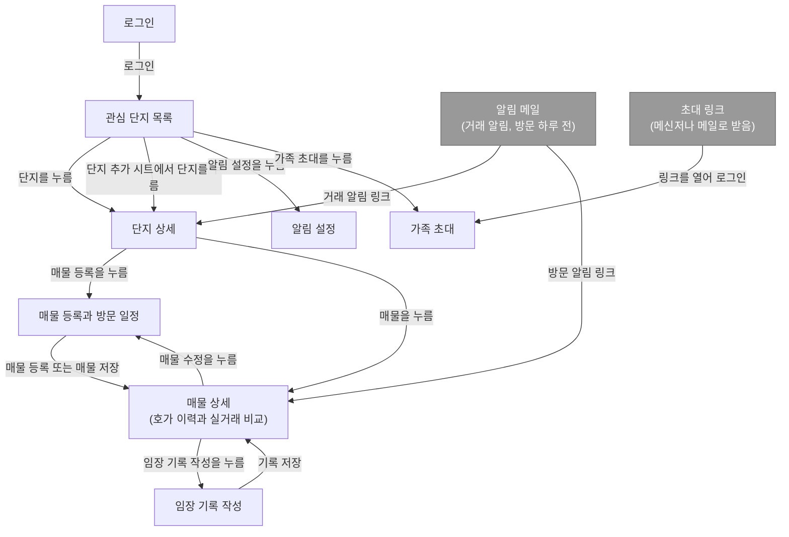

- 시작 화면은 로그인입니다. 로그인하지 않은 사람에게는 다른 화면을 보여 주지 않습니다.
- 로그인 뒤 처음 보이는 화면은 관심 단지 목록입니다.
- 로그인과 관심 단지 목록을 뺀 모든 화면은 위쪽 `<`로 바로 앞 화면에 돌아갑니다. `<`를 거듭 누르면 관심 단지 목록까지 돌아갈 수 있습니다. 그림에는 돌아가는 선을 그리지 않았습니다.
- 매물 등록, 임장 기록 작성에서 저장하면 그 입력 화면은 방문 기록에서 빠집니다. 저장 뒤 매물 상세에서 `<`를 누르면 입력 화면이 아니라 그 앞 화면으로 돌아갑니다.
- 알림 메일의 링크로 단지 상세나 매물 상세에 바로 들어옵니다. 로그인돼 있지 않으면 로그인 뒤 그 화면으로 갑니다. 메일에 링크를 넣는 것은 PRD에 없고 이 문서에서 정했습니다. PRD는 메일을 받는다고만 적습니다.
- 초대 링크로 들어오면 로그인 뒤 가족 초대 화면으로 가고, 수락된 상태로 목록에 보입니다.

## 로그인

본인과 가족 구성원이 각자 로그인합니다([PRD 기능 범위](../prd.md#기능-범위)의 로그인과 가족 공유). 로그인은 구글 계정으로 정했습니다([결정 기록 0010](../adr/0010-login-method.md)). 알림 메일의 링크나 초대 링크로 들어온 사람은 로그인 뒤 그 화면으로 갑니다. 버튼에 구글 로고를 넣는 것과 색은 구글 브랜드 가이드를 따르며, 와이어프레임에서는 글자만 그렸습니다.

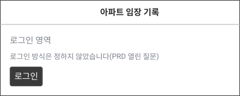

원문: [`wireframes/login.wireloom`](wireframes/login.wireloom)

보여 주는 데이터

| 항목 | 내용 | 출처 |
|---|---|---|
| 서비스 이름 | 고정 문구입니다 | 없음(고정 문구) |
| 안내 문구 | 가족에게 받은 초대 링크로 들어왔다면 로그인하면 바로 수락된다는 고정 문구입니다 | 없음(고정 문구) |

입력받는 데이터

| 항목 | 형식 | 필수 여부 | 보내는 곳 |
|---|---|---|---|
| 구글 로그인 | 버튼을 누르면 구글 로그인 화면으로 갔다가 돌아옴 | 필수 | API 서버(돌아온 결과를 검증하고 세션을 만듦) |

## 관심 단지 목록

로그인 뒤 처음 보이는 화면으로, 관심 단지를 모아 보고 새 단지를 임장 후보로 추가합니다(시나리오 1, 기능 범위의 실거래 수집과 추이). 관심 단지는 임장 후보로 추가했거나, 매물을 등록했거나, 임장 기록을 남긴 단지입니다.

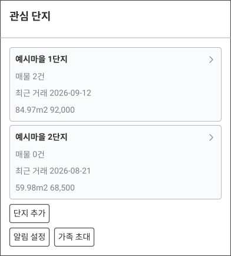

원문: [`wireframes/complex-list.wireloom`](wireframes/complex-list.wireloom)

펼쳤을 때: "단지 추가"를 누르면 화면 아래에서 관심 지역의 단지 목록 시트가 올라옵니다. 단지를 누르면 단지 상세가 열리고, 추이를 본 뒤 거기서 임장 후보로 추가합니다. 목록의 단지는 collector가 받은 실거래에 나온 단지 중 아직 관심 단지가 아닌 것입니다.

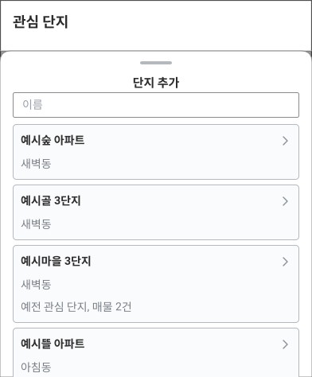

원문: [`wireframes/complex-list-add.wireloom`](wireframes/complex-list-add.wireloom)

보여 주는 데이터

| 항목 | 내용 | 출처 |
|---|---|---|
| 단지 이름 | 관심 단지마다 표시합니다 | API 서버 |
| 매물 수 | 이 단지에 등록한 매물 수입니다 | API 서버 |
| 최근 실거래 한 건 | 계약일, 전용면적, 금액입니다 | API 서버 |
| 추가할 수 있는 단지 목록 | collector가 받은 관심 지역 실거래에 나온 단지 이름입니다 | API 서버 |

입력받는 데이터

| 항목 | 형식 | 필수 여부 | 보내는 곳 |
|---|---|---|---|
| 단지 이름으로 좁히기 | 자유 입력 | 선택 | 화면 안에서 계산(목록을 한 번에 받아 좁힘) |

- 단지 목록을 좁히는 조건은 이름 하나뿐입니다. 목록은 한 번에 모두 받아 화면 안에서 좁힙니다.
- 이미 관심 단지인 단지는 시트 목록에 나오지 않습니다.
- 관심 단지가 없으면 목록 자리에 "아직 관심 단지가 없습니다. 단지 추가를 눌러 임장 후보를 고르세요."를 보여 줍니다. 단지 추가 시트에 고를 단지가 없으면(실거래를 아직 받지 않음) "불러온 단지가 없습니다. 실거래 수집이 끝난 뒤 다시 열어 주세요."를 보여 줍니다.

## 단지 상세

한 단지의 최근 5년 매매 실거래 추이와 최근 거래, 이 단지에 등록한 매물을 봅니다(시나리오 1, 기능 범위의 실거래 수집과 추이). 아직 관심 단지가 아닌 단지도 단지 추가 시트에서 눌러 이 화면을 열 수 있고, 그때는 위쪽에 "임장 후보로 추가" 버튼이 보이고 등록한 매물 영역은 없습니다. 아래 그림은 설명을 위해 두 상태를 한 장에 겹쳐 그렸습니다.

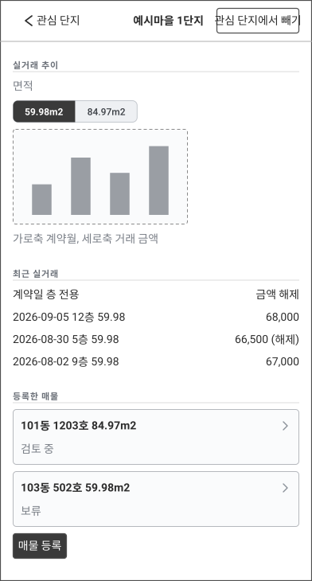

원문: [`wireframes/complex-detail.wireloom`](wireframes/complex-detail.wireloom)

보여 주는 데이터

| 항목 | 내용 | 출처 |
|---|---|---|
| 단지 이름 | 화면 제목입니다 | API 서버 |
| 전용면적 구분 | 실거래 데이터에 나온 이 단지의 전용면적 목록입니다 | API 서버 |
| 실거래 추이 | 고른 면적의 최근 5년 거래를 계약월과 금액으로 표시합니다 | API 서버 |
| 최근 실거래 목록 | 계약일, 층, 전용면적, 금액, 해제 여부입니다 | API 서버 |
| 등록한 매물 목록 | 동호수, 전용면적, 상태입니다 | API 서버 |

입력받는 데이터

| 항목 | 형식 | 필수 여부 | 보내는 곳 |
|---|---|---|---|
| 보여 줄 전용면적 | 목록에서 선택(이 단지의 전용면적 구분) | 선택 | API 서버(실거래 추이와 최근 실거래의 조회 조건) |
| 임장 후보로 추가 | 버튼(아직 관심 단지가 아닐 때만 보임) | 선택 | API 서버 |

- 실거래 추이와 최근 실거래는 면적별로 봅니다. 호가와 실거래 비교(PRD 시나리오 3)도 같은 면적을 기준으로 합니다. 면적 선택과 "임장 후보로 추가"를 뺀 버튼은 다른 화면으로 이동만 합니다.
- 처음 열면 면적 구분 중 가장 작은 면적을 골라 둡니다.
- 등록한 매물이 없으면 "등록한 매물이 없습니다."를 보여 줍니다. 고른 면적에 최근 5년 거래가 없으면 그래프 자리에 "이 면적의 거래가 없습니다."를 보여 줍니다.

## 매물 등록과 방문 일정

단지 상세에서 들어와 그 단지의 매물을 등록하고 방문 일시를 저장합니다(시나리오 2, 기능 범위의 매물 등록과 방문 일정, 호가 직접 입력과 이력). 단지는 들어올 때 이미 정해져 있습니다.

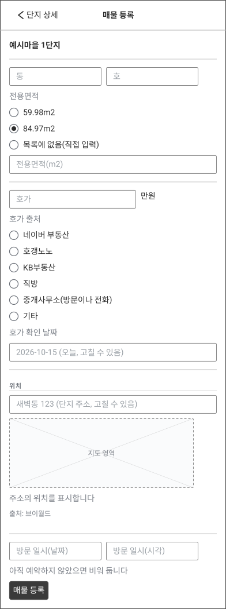

원문: [`wireframes/listing-form.wireloom`](wireframes/listing-form.wireloom)

보여 주는 데이터

| 항목 | 내용 | 출처 |
|---|---|---|
| 단지 이름 | 단지 상세에서 넘어온 단지입니다 | API 서버 |
| 전용면적 구분 | 실거래 데이터에 나온 이 단지의 전용면적 목록입니다 | API 서버 |
| 단지 주소 | 실거래 데이터의 법정동과 지번입니다. 주소 입력란의 기본값입니다 | API 서버 |
| 지도 | 매물 위치 주변의 지도와 브이월드 출처 표시입니다 | 지도 API(웹 화면이 직접 호출) |
| 매물 위치 좌표 | 입력한 주소를 좌표로 바꾼 값입니다. 지도에 위치를 표시하는 데 씁니다 | 정하지 않음(지오코더 호출 주체) |

입력받는 데이터

| 항목 | 형식 | 필수 여부 | 보내는 곳 |
|---|---|---|---|
| 동 | 자유 입력 | 필수 | API 서버 |
| 호 | 자유 입력 | 선택 | API 서버 |
| 전용면적 | 목록에서 선택(이 단지의 전용면적 구분). 목록에 없으면 숫자 직접 입력 | 필수 | API 서버 |
| 호가 | 숫자(만원) | 필수 | API 서버 |
| 호가 출처 | 목록에서 선택(네이버 부동산, 호갱노노, KB부동산, 직방, 중개사무소(방문이나 전화), 기타) | 필수 | API 서버 |
| 호가 확인 날짜 | 날짜(기본값 오늘) | 필수 | API 서버 |
| 주소 | 자유 입력(단지 주소가 미리 채워짐) | 필수 | API 서버 |
| 위치 좌표 | 주소를 변환한 값. 웹 화면이 변환할 때만 보내고, 변환하는 쪽은 정하지 않음 | 선택 | API 서버 |
| 방문 일시 | 날짜와 시각 | 선택 | API 서버 |

- 같은 화면을 매물 수정에도 씁니다. 수정할 때 버튼 이름은 "매물 저장"입니다. 수정할 때는 호가, 호가 출처, 호가 확인 날짜 입력란을 감춥니다. 호가는 덮어쓰지 않고 이력으로 남기므로 매물 상세의 "호가 추가"에서만 바꿉니다.
- 직접 입력한 면적은 같은 면적의 실거래가 없어 매물 상세의 비교가 비어 있을 수 있습니다.
- 호는 예약 단계에서 모를 수 있어 비워 둘 수 있습니다. 비어 있으면 목록에 동만 표시합니다.
- 상태는 등록하면 "검토 중"으로 시작하고, 매물 상세에서 바꿉니다.
- 주소를 좌표로 바꾸지 못하면 지도 자리에 "주소의 위치를 찾지 못했습니다. 주소를 확인하거나 지도에서 위치를 지정하세요."를 보여 주고 저장은 막지 않습니다. 저장에 실패하면 입력한 값을 그대로 두고 "저장하지 못했습니다. 다시 시도하세요."를 보여 줍니다.
- 중개사 전화번호를 적는 입력란은 두지 않습니다(PRD 기능 범위).
- 주소와 좌표는 매물에 저장합니다. 주소를 좌표로 바꾸는 쪽이 웹 화면인지 API 서버인지는 핵심 흐름에서 정합니다.
- 방문 하루 전 알림은 방문 일시가 있는 매물에만 보냅니다. 받을지 말지는 알림 설정 화면에서 정합니다.

## 매물 상세(호가 이력과 실거래 비교)

한 매물의 정보, 호가 이력, 같은 단지와 같은 면적의 최근 실거래를 나란히 보고, 두 사람의 임장 기록을 봅니다(시나리오 3, 기능 범위의 호가 직접 입력과 이력, 호가와 실거래 비교).

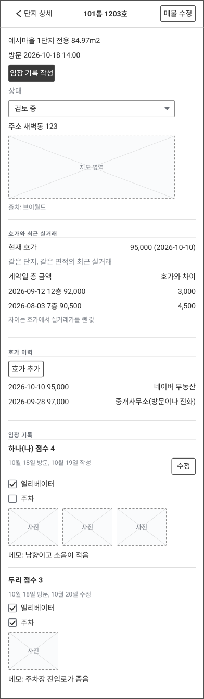

원문: [`wireframes/listing-detail.wireloom`](wireframes/listing-detail.wireloom)

펼쳤을 때: "호가 추가"를 누르면 화면 아래에서 입력 시트가 올라옵니다.

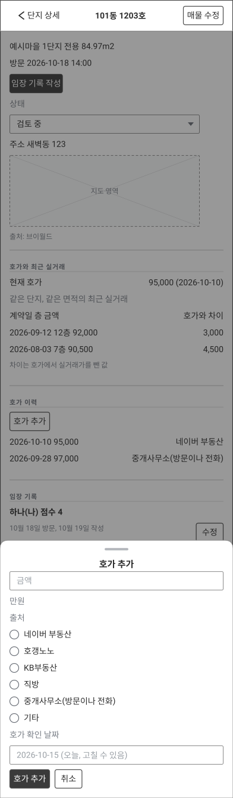

원문: [`wireframes/listing-detail-add-price.wireloom`](wireframes/listing-detail-add-price.wireloom)

보여 주는 데이터

| 항목 | 내용 | 출처 |
|---|---|---|
| 매물 기본 정보 | 단지 이름, 동호수, 전용면적, 방문 일시, 상태입니다 | API 서버 |
| 주소 | 매물 등록에서 입력한 주소입니다 | API 서버 |
| 위치 좌표 | 매물에 저장한 좌표입니다. 지도에 위치를 표시하는 데 씁니다 | API 서버 |
| 지도 | 매물 위치 주변의 지도와 브이월드 출처 표시입니다 | 지도 API(웹 화면이 직접 호출) |
| 현재 호가 | 호가 이력에서 날짜가 가장 늦은 호가와 그 날짜입니다 | API 서버 |
| 같은 단지, 같은 면적의 최근 실거래 | 계약일, 층, 금액입니다 | API 서버 |
| 호가와 실거래의 차이 | 현재 호가에서 실거래 금액을 뺀 값입니다 | 화면 안에서 계산 |
| 호가 이력 | 날짜, 금액, 출처입니다. 날짜가 늦은 것부터 보여 줍니다 | API 서버 |
| 임장 기록 | 작성자 표시 이름(내 기록에는 "(나)"를 붙임), 작성일, 점수, 체크리스트 결과, 사진, 메모입니다. 두 사람의 기록을 모두 보여 줍니다. 사진 파일의 저장 경로는 정하지 않았습니다 | API 서버 |

입력받는 데이터

| 항목 | 형식 | 필수 여부 | 보내는 곳 |
|---|---|---|---|
| 상태 | 한 줄 선택 목록(검토 중, 보류, 포기, 계약) | 필수 | API 서버 |
| 추가할 호가 금액 | 숫자(만원) | 필수 | API 서버 |
| 추가할 호가 출처 | 목록에서 선택(매물 등록과 같은 여섯 개) | 필수 | API 서버 |
| 추가할 호가 날짜 | 날짜(기본값 오늘) | 필수 | API 서버 |

- 상태는 고르면 바로 저장합니다. 호가는 시트의 "호가 추가"를 눌러야 저장합니다.
- 차이는 화면이 이미 받은 호가와 실거래 금액을 빼서 구합니다. 뺄셈 한 번이라 API 서버가 따로 계산해 반환하지 않습니다.
- 매물, 호가 이력, 방문 일정, 상태는 두 사람이 함께 보고 고칩니다. 임장 기록은 각자 남기고, 다른 사람의 기록은 이 화면에서 봅니다.
- 같은 면적의 실거래가 없으면 비교 자리에 "같은 면적의 최근 실거래가 없습니다."를, 임장 기록이 없으면 "아직 임장 기록이 없습니다."를, 방문 일시가 없으면 "방문 일시 없음"을 보여 줍니다.

## 임장 기록 작성

임장 현장에서 매물 하나에 체크리스트, 사진, 메모, 점수를 남깁니다(시나리오 4, 기능 범위의 임장 기록). 작성자는 로그인한 사람입니다.

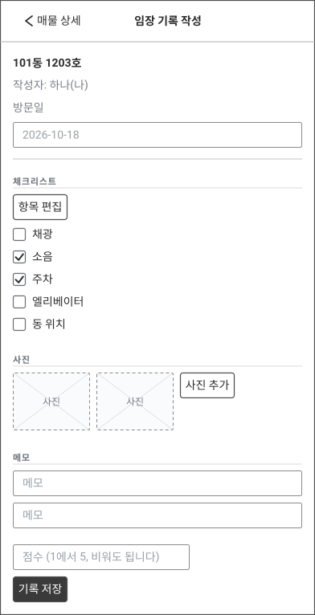

원문: [`wireframes/visit-log-form.wireloom`](wireframes/visit-log-form.wireloom)

보여 주는 데이터

| 항목 | 내용 | 출처 |
|---|---|---|
| 매물 동호수 | 기록을 남길 매물입니다 | API 서버 |
| 작성자 | 로그인한 사람의 표시 이름입니다 | API 서버 |
| 체크리스트 항목 | 체크할 항목 목록입니다. 항목은 데이터 모델에서 정하고, 그림의 항목은 예시입니다 | API 서버 |
| 올린 사진 | 이 기록에 추가한 사진입니다 | API 서버(사진 파일 저장 경로는 정하지 않음) |

입력받는 데이터

| 항목 | 형식 | 필수 여부 | 보내는 곳 |
|---|---|---|---|
| 체크리스트 결과 | 항목마다 체크박스 | 선택 | API 서버 |
| 사진 | 사진 파일, 여러 장 | 선택 | API 서버(사진 파일 저장 경로는 정하지 않음) |
| 메모 | 자유 입력 | 선택 | API 서버 |
| 점수 | 숫자(범위는 데이터 모델에서 정함) | 선택 | API 서버 |

- 이 화면에는 로그인한 사람의 기록만 보입니다. 다른 사람의 기록은 매물 상세에서 봅니다.
- 저장이나 사진 올리기에 실패하면 입력한 체크리스트, 메모, 점수와 고른 사진을 그대로 두고 "저장하지 못했습니다. 다시 시도하세요."를 보여 줍니다.

## 알림 설정

알림을 받을 메일 주소와 받을 알림의 종류를 정합니다(시나리오 2와 6, 기능 범위의 거래 알림(메일)과 매물 등록과 방문 일정). 알림 채널은 메일입니다([결정 기록 0003](../adr/0003-notification-channel.md)).

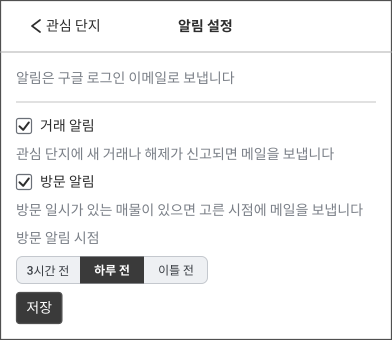

원문: [`wireframes/notification-settings.wireloom`](wireframes/notification-settings.wireloom)

보여 주는 데이터

| 항목 | 내용 | 출처 |
|---|---|---|
| 저장한 메일 주소 | 지금 알림을 받는 메일 주소입니다 | API 서버 |
| 알림 켜짐 여부 | 거래 알림과 방문 하루 전 알림 각각의 켜짐 여부입니다 | API 서버 |

입력받는 데이터

| 항목 | 형식 | 필수 여부 | 보내는 곳 |
|---|---|---|---|
| 알림 받을 메일 주소 | 자유 입력(메일 주소). 처음에는 구글 계정 이메일이 채워져 있습니다 | 필수 | API 서버 |
| 거래 알림 켜고 끄기 | 체크박스 | 필수 | API 서버 |
| 방문 하루 전 알림 켜고 끄기 | 체크박스 | 필수 | API 서버 |

- 설정은 로그인한 사람마다 따로 저장합니다.
- 거래 알림의 대상은 관심 단지 전체입니다. 단지마다 알림을 고르는 설정은 두지 않습니다.

## 가족 초대

함께 볼 가족 구성원을 초대하고, 함께 보는 사람을 확인합니다(기능 범위의 로그인과 가족 공유). 기록은 가구 단위로 공유하고 역할은 owner와 member 둘입니다([결정 기록 0011](../adr/0011-household-sharing.md)). 사용자는 본인과 가족 구성원, 두 명입니다.

구성원이 owner 혼자이고 기다리는 초대가 없을 때

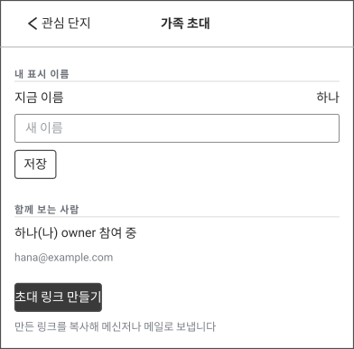

원문: [`wireframes/family-invite.wireloom`](wireframes/family-invite.wireloom)

초대를 보내고 기다리는 중일 때

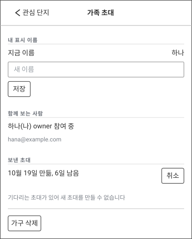

원문: [`wireframes/family-invite-pending.wireloom`](wireframes/family-invite-pending.wireloom)

구성원이 둘일 때

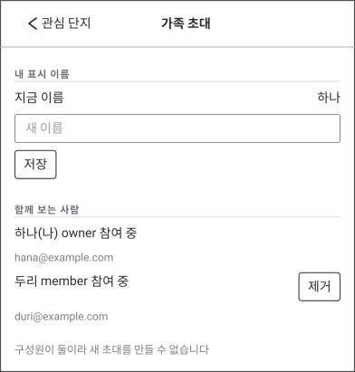

원문: [`wireframes/family-invite-full.wireloom`](wireframes/family-invite-full.wireloom)

보여 주는 데이터

| 항목 | 내용 | 출처 |
|---|---|---|
| 내 표시 이름 | 지금 저장된 표시 이름입니다. 처음에는 구글 계정 이름이고, 구글이 이름을 주지 않으면 비어 있습니다 | API 서버 |
| 함께 보는 사람 목록 | 사람마다 표시 이름, 역할, 상태, 로그인 이메일입니다. 로그인 이메일은 구글이 준 값이라 사용자가 고칠 수 없고, owner가 수락한 사람이 가족인지 확인하는 데 사용합니다. 구글이 검증하지 않은 이메일이면 "검증되지 않음"을 함께 보여 줍니다. 내 항목에는 "(나)"를 붙입니다. 그림의 상태 문구는 예시이고 상태 값은 데이터 모델에서 정합니다 | API 서버 |
| 보낸 초대 목록 | 초대마다 만든 날짜와 만료까지 남은 기간입니다. owner에게만 보입니다. 그림의 남은 기간은 예시이고 만료 기간은 API 계약에서 정합니다 | API 서버 |
| 새 초대를 만들 수 없는 이유 안내 | 기다리는 초대가 있거나 구성원이 둘일 때 보이는 고정 문구입니다. owner에게만 보입니다 | 없음(고정 문구) |
| 링크 보내기 안내 | 초대 링크 만들기 버튼 아래 고정 문구입니다 | 없음(고정 문구) |

입력받는 데이터

| 항목 | 형식 | 필수 여부 | 보내는 곳 |
|---|---|---|---|
| 새 표시 이름 | 자유 입력. 바꿀 때만 입력하고 저장을 누릅니다 | 선택 | API 서버 |
| 초대 링크 만들기 | 버튼 | 선택 | API 서버(일회용 링크를 만들어 돌려줌) |
| 초대 취소 | 버튼 | 선택 | API 서버 |
| 구성원 제거 | 버튼 | 선택 | API 서버 |
| 가구 나가기 | 버튼. 구성원 가운데 member가 본 화면에서 자기 행에 보입니다. 그림은 owner가 본 화면만 그렸습니다 | 선택 | API 서버 |

- 초대 링크 만들기, 초대 취소, 구성원 제거, 보낸 초대 목록은 owner에게만 보입니다. 구성원 가운데 member가 보면 이 넷이 없고 자기 행에 가구 나가기 버튼이 보입니다.
- 기다리는 초대가 있거나 구성원이 둘이면 owner가 보는 화면에는 초대 링크 만들기 버튼 대신 그 이유를 적은 문구가 보입니다. 구성원 가운데 member에게는 버튼도 문구도 없습니다.
- 받은 사람은 링크를 열어 구글 로그인하면 바로 수락되어 구성원 목록에 나타납니다. 토큰은 해시로만 저장하므로 만든 링크를 나중에 다시 보여 주지 않습니다. 복사는 만든 직후에만 할 수 있습니다. 링크를 만든 직후 링크와 복사 버튼이 보이는 상태는 그리지 않았고, 그 모습은 API 계약에서 정합니다.
- 초대가 없으면 "보낸 초대" 묶음은 보이지 않습니다.

## 정하지 않은 것

| 항목 | 정하는 문서 |
|---|---|
| 초대 링크의 만료 기간과 링크를 만든 직후 화면의 모습 | API 계약 |
| 주소를 좌표로 바꾸는 지오코더를 웹 화면과 API 서버 중 어디서 호출할지 | 핵심 흐름(`docs/architecture/flows.md`, 작성 예정) |
| 사진 파일을 저장하는 경로 | 핵심 흐름 |
| 매물 상세에서 비교할 최근 실거래의 건수와 해제된 거래를 비교에서 뺄지 | API 계약 |
| 방문 하루 전 알림을 두 사람 모두에게 보낼지, 매물을 등록한 사람에게만 보낼지 | 핵심 흐름 |

초대 상태 값, 체크리스트 항목과 점수 범위, 임장 기록의 개수와 수정, 관심 단지에서 빼는 방법은 [데이터 모델](../architecture/data-model.md)에서 정했습니다. 데이터 모델이 더한 입력(임장 기록의 방문일 입력란, 체크리스트 항목 편집)은 아직 그림에 없고, API 계약을 쓰기 전에 그림을 보완합니다.
