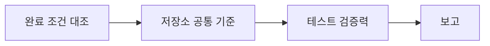

# 리뷰 기준

기능 브랜치를 리뷰할 때 공통으로 대조하는 기준과 보고 형식입니다. 구현 단계마다 하는 리뷰와 `develop/vN`에 머지하기 전 브랜치 전체를 보는 리뷰에 같이 씁니다. 리뷰어가 사람이든 도구든 기준은 같습니다.

기능마다 달라지는 완료 조건은 그 기능의 `specs/NNN-이름/spec.md`와 `tasks.md`가 정합니다. 이 문서에는 모든 기능에 공통인 것만 둡니다.

## 대조하는 문서

| 대조 대상 | 문서 |
|---|---|
| 그 기능의 완료 조건 | `specs/NNN-이름/spec.md`의 acceptance, `tasks.md`의 작업 원문 |
| 설계 | 이 폴더의 설계 문서와 [결정 기록](adr/README.md) |
| 원칙 | [constitution](../.specify/memory/constitution.md) |

리뷰는 완료 조건을 항목마다 먼저 확인한 뒤 지적을 적습니다. 지적부터 적으면 눈에 띄는 결함만 남고, 아무도 구현하지 않은 조건은 조용히 빠집니다.

## 저장소 공통 기준

| 기준 | 확인하는 것 | 근거 |
|---|---|---|
| 공개 저장소 | 코드, 테스트 데이터, 문서, 커밋 메시지에 실제 임장 기록, 주소, 사진, 관심 지역 이름, 인증키, 실제 이메일이 없는가 | [constitution III](../.specify/memory/constitution.md#iii-실제-데이터를-저장소에-두지-않음) |
| 개인정보와 로그 | 로그, 오류 응답, 예외 메시지에 이메일, 구글 계정 식별자(`sub`), 토큰과 쿠키 원문, SQL 값이 남지 않는가 | [결정 기록 0012](adr/0012-personal-data-storage.md), [결정 기록 0013](adr/0013-session.md#결정) |
| 오류 응답 | 오류 응답이 정한 형식이고, 요청 경로와 입력값을 그대로 돌려주지 않는가 | [API 공통 규칙: 오류 응답](architecture/api-conventions.md#오류-응답) |
| 권한 확인 순서 | 로그인 상태가 없으면 입력이나 권한과 관계없이 401이 먼저이고, 403은 로그인한 뒤의 거절인가 | [API 공통 규칙: 인증과 권한 확인](architecture/api-conventions.md#인증과-권한-확인) |
| 상태를 바꾸는 요청 | 상태를 바꾸는 요청에 출처 검사가 걸리고, GET이 상태를 바꾸지 않는가 | [결정 기록 0013](adr/0013-session.md#결정) |
| 설계와 다른 결정 | 구현이 설계 문서와 다른 것을 정했으면 `docs/*` 브랜치에서 설계 문서를 먼저 고쳤는가 | [constitution IV](../.specify/memory/constitution.md#iv-설계-문서를-따름) |
| 데이터베이스 테스트 | 데이터베이스가 걸린 테스트가 목이 아니라 실제 PostgreSQL로 도는가 | [constitution V](../.specify/memory/constitution.md#v-기능마다-테스트) |
| 보안 경계 테스트 | 권한 확인, 재인증, 삭제 연쇄를 검증하는 테스트를 구현한 쪽과 다른 쪽이 요구사항에서 썼는가 | [constitution V](../.specify/memory/constitution.md#v-기능마다-테스트) |

## 테스트 검증력

테스트가 통과한다는 것과 요구사항을 검증한다는 것은 다릅니다. 리뷰는 테스트마다 "구현 한 줄을 요구사항과 반대로 바꾸면 이 테스트가 실패하는가"를 묻습니다.

- "없음"을 확인하는 테스트가 먼저 대상이 있음을 확인하는가. 행이 처음부터 없거나 조회가 빈 결과를 돌려줘도 통과하는 테스트는 아무것도 검증하지 않습니다.
- 경계값을 양쪽에서 보는가. 거절되어야 하는 값만 보면, 통과해야 하는 값이 거절되는 결함을 놓칩니다. 예를 들어 "5분보다 오래되면 거절"은 정확히 5분(통과)과 5분 1초(거절)를 함께 봅니다.
- 만료나 재인증 시간처럼 시각에 따라 결과가 달라지는 요구를, 테스트가 시각을 옮겨 가며 확인하는가. 실제로 기다리거나 현재 시각을 그대로 쓰는 테스트는 실행할 때마다 결과가 달라질 수 있습니다.
- 순서가 요구사항이면, 순서가 바뀔 때 결과가 달라지게 썼는가. 한 트랜잭션 안의 순서는 롤백이 결과 상태를 똑같이 되돌려 상태만 봐서는 드러나지 않습니다. 다른 연결로 행을 잠가 두거나, 트리거로 특정 변경을 막아 순서를 결과로 드러냅니다.
- 트랜잭션이 롤백된 경로의 응답에 쿠키와 성공 쪽 이동 주소가 남지 않는가.
- 동시 실행 테스트가 실제로 두 순서를 모두 만드는가. 한 순서만 나와도 통과하는 테스트는 나머지 순서를 검증하지 않습니다.
- 오류 응답 본문이 걸린 요구를 실제 서버로 확인하는가. MockMvc는 오류 페이지로 넘기는 처리(error dispatch)를 하지 않아, 실제 서버가 내보내는 오류 응답을 보지 못합니다.
- 테스트가 만든 트리거, 잠금, 스레드, 설정이 다음 테스트로 새지 않는가. 검증 조건이 실패하는 경로에서도 정리되어야 합니다.

리뷰에서 의심한 테스트는 구현을 일부러 틀리게 바꿔 실행해 보고 원래대로 되돌립니다. 실패하면 그 테스트가 그 결함을 검출한다는 근거가 됩니다.

## 보고 형식

1. 완료 조건 표: 항목마다 충족이나 미충족과 근거(파일과 줄, 또는 실행 결과)를 적습니다. 실행해야 증명되는 조건은 실행 결과가 없으면 미충족으로 적습니다.
2. 지적: 한 줄에 하나씩, 심각도와 파일과 줄, 현상을 적고, 깨지는 구체적인 장면을 한 줄 덧붙입니다.
3. 참고: 결함이 아닌 관찰은 지적과 나눠 적습니다.
4. 결론: Critical이나 Important가 남았으면 Needs fixes, 없으면 Approved입니다.

| 심각도 | 뜻 | 처리 |
|---|---|---|
| Critical | 데이터 손상, 개인정보 노출, 권한 우회 | 머지 전에 고칩니다 |
| Important | 완료 조건 미충족, 요구사항을 검증하지 못하는 테스트, 테스트끼리 서로 영향을 주는 결함 | 머지 전에 고칩니다 |
| Minor | 그 밖의 구조와 가독성 | 브랜치 전체 리뷰에서 한 번에 판단합니다 |

지적을 반영할지는 완료 조건, 설계 문서, 저장소 소유자의 결정에 대어 정합니다. 반영하지 않은 지적은 그 근거를 남겨, 브랜치 전체 리뷰가 다시 판단하게 합니다.
