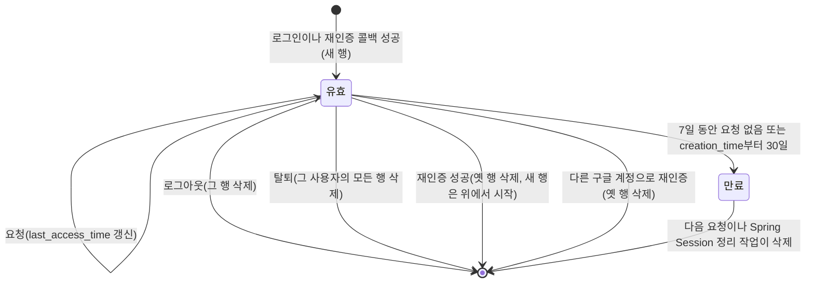

# Data Model: 001 로그인

001이 만드는 테이블은 셋입니다. 열의 형식, 출처, 저장 방식의 기준은 설계 문서의 [데이터 모델](../../docs/architecture/data-model.md)이고, 이 문서는 001이 그 가운데 무엇을 어떻게 만드는지만 적습니다. 마이그레이션은 `V1__login.sql` 하나입니다.

| 테이블 | 기준 절 | 001에서 하는 일 |
|---|---|---|
| `user` | [`user`](../../docs/architecture/data-model.md#user) | 첫 로그인 때 만들고, 다시 로그인할 때 이메일과 검증 여부를 고치고, 표시 이름을 고치고, 탈퇴 때 지웁니다 |
| `spring_session` | [`spring_session`](../../docs/architecture/data-model.md#spring_session) | 로그인과 재인증마다 새 행을 만들고, 로그아웃과 만료와 탈퇴 때 지웁니다 |
| `spring_session_attributes` | [`spring_session_attributes`](../../docs/architecture/data-model.md#spring_session_attributes) | 세션의 로그인 정보 한 행을 둡니다. 세션 행이 지워지면 함께 지워집니다 |

`notification_setting`, 가구와 멤버십 테이블은 만들지 않습니다(백로그 경계 규칙).

## `user`

| 열 | 형식 | 001의 규칙 |
|---|---|---|
| `id` | bigint, 기본 키 | 시퀀스 `user_id_seq`에서 먼저 받습니다(암호화 AAD에 쓰므로 삽입 전에 알아야 함). 열에 기본값을 두지 않습니다 |
| `provider` | text, 비울 수 없음 | `google` 하나입니다 |
| `provider_subject` | text, 비울 수 없음 | ID 토큰의 `sub`입니다. 구글 문서상 최대 255자입니다 |
| `login_email` | bytea, 비울 수 없음 | ID 토큰의 `email`을 AES-GCM으로 암호화한 값입니다. AAD는 `user.login_email:{id}`입니다 |
| `email_verified` | boolean, 비울 수 없음 | ID 토큰의 `email_verified`입니다. 값이 없으면 거짓입니다 |
| `display_name` | text, 비울 수 있음 | 아래 표시 이름 규칙을 지킨 값이나 빈 값(NULL)입니다 |

- 유니크 제약 `(provider, provider_subject)`. 같은 사용자는 이 쌍으로 찾습니다.
- SQL에서는 예약어라 `"user"`로 인용합니다. 엔티티는 `@Table(name = "\"user\"")`입니다.
- 표시 이름 규칙(research R11): 앞뒤 공백을 지운 값이 1자 이상 20자 이하(코드 포인트)이고 제어 문자(Cc), 줄 구분 문자(Zl, Zp), 방향 제어 문자(U+202A~U+202E, U+2066~U+2069)가 없습니다. 사용자가 저장할 때 어기면 400입니다. 구글이 보낸 이름은 앞뒤 공백과 금지 문자를 지우고 20자로 자르며, 그 결과가 비면 빈 값입니다. 화면이나 API로 빈 값을 저장할 수는 없습니다.
- 다시 로그인할 때 구글이 보낸 이메일이나 검증 여부가 저장된 값과 다르면 바꿉니다. 이메일 비교는 복호화한 값으로 합니다. 표시 이름은 다시 로그인해도 바꾸지 않습니다.
- 탈퇴하면 행을 지웁니다. 같은 구글 계정으로 다시 로그인하면 새 행(새 번호)이 생깁니다.

## `spring_session`, `spring_session_attributes`

열은 설계 데이터 모델과 같습니다. 001에서 정한 값은 아래와 같습니다.

| 항목 | 값 |
|---|---|
| `session_id` | 쿠키 원문 토큰의 SHA-256 소문자 16진수 64자. `char(64)`, 유니크, 체크 제약 `^[0-9a-f]{64}$` |
| `creation_time` | 로그인이나 재인증을 마친 시각(밀리초). 절대 30일 판단에 씁니다 |
| `max_inactive_interval` | 604800초(7일) |
| `principal_name` | `user.id`를 문자열로. 사용자별 조회와 탈퇴 때 삭제에 씁니다. 인덱스를 둡니다(Spring Session 기본 스키마) |
| 속성 | 로그인 정보 한 행. 사용자 번호와 마지막 구글 인증 시각만 담습니다 |

- `spring_session_attributes.session_primary_id`는 `spring_session.primary_id`를 참조하고 `on delete cascade`입니다.
- `spring_session`은 `user`를 외래 키로 가리키지 않습니다. 탈퇴 때 같은 `principal_name`의 행을 모두 지웁니다.

## 세션의 상태

- 만료된 세션으로 온 요청은 401입니다. 절대 30일이 지난 세션은 필터가 그 자리에서 지웁니다.
- 마지막 구글 인증 시각은 세션이 만들어질 때 한 번 정해지고 바뀌지 않습니다. 재인증하면 새 세션이 생기므로 새 값을 갖습니다.
