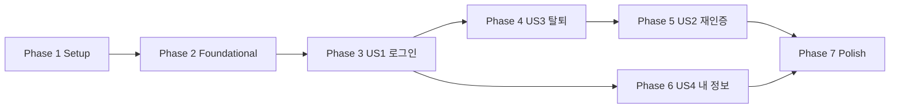

# Tasks: 001 로그인

**Input**: `specs/001-login/`의 spec.md, plan.md, research.md, data-model.md, contracts/openapi.yaml, quickstart.md

**Tests**: constitution V에 따라 테스트 작업을 둡니다. 테스트 작업마다 검증하는 spec 시나리오(US번호-시나리오 번호), FR, SC를 적었습니다. "보안 경계" 표시가 있는 테스트는 구현과 다른 쪽이 spec과 결정 기록(0012, 0013)에서 직접 쓰고, 같은 단계의 구현 작업보다 먼저 씁니다. 데이터베이스가 걸린 테스트는 Testcontainers PostgreSQL 18입니다. 7일과 30일은 세션 행의 시각 열을 옮기고, 5분과 60초는 `Clock`으로 테스트합니다(research R8).

**Organization**: 사용자 스토리별 단계입니다. US2(재인증)의 유일한 민감 동작이 탈퇴라서, 같은 P2인 US3(탈퇴)을 먼저 만들고 US2가 탈퇴에 재인증을 붙입니다.

## Format: `[ID] [P?] [Story] Description`

- **[P]**: 다른 파일을 다루고 끝나지 않은 작업에 기대지 않아 함께 진행할 수 있음
- **[Story]**: 사용자 스토리(US1~US4)
- 경로는 저장소 루트 기준입니다. 서버는 `src/main/java/estate/`, 서버 테스트는 `src/test/java/estate/`, 웹 화면은 `web/`입니다.

---

## Phase 1: Setup

**Purpose**: 의존성, 설정, 스키마, 웹 빌드 연결

- [X] T001 `specs/001-login/checklists/requirements.md`의 미완료 항목이 없는지 확인한다(CLAUDE.md 구현 절). 있으면 구현 전에 사용자에게 알린다
- [X] T002 `build.gradle.kts`에 research R1의 서버 의존성을 추가한다: `spring-boot-starter-webmvc`, `spring-boot-starter-security-oauth2-client`, `spring-boot-starter-session-jdbc`(Bean Validation 스타터는 넣지 않음), 테스트 `spring-boot-starter-webmvc-test`, `spring-boot-starter-security-test`, `no.nav.security:mock-oauth2-server:7.0.0`. 버전은 Boot 4.1.2 BOM이 정하고 mock-oauth2-server만 고정한다
- [X] T003 [P] `.gitignore`에 `web/dist/`, `web/test-results/`, `web/playwright-report/`를 추가하고, `.env.example`에 항목 이름만 추가한다: `GOOGLE_CLIENT_ID`, `GOOGLE_CLIENT_SECRET`, `ESTATE_COLUMN_KEYS`, `ESTATE_COLUMN_KEY_ACTIVE`, `ESTATE_LOGIN_COOKIE_KEY`(값은 `your-...` 자리표시). 이미 있는 공공데이터 항목은 그대로 둔다
- [X] T004 [P] `compose.yaml`을 만든다. `postgres` 서비스(`postgres:18`, 볼륨 유지, `application-local.yml`과 같은 계정과 데이터베이스 이름)와 `e2e` 프로필에서만 뜨는 `mock-oauth2` 서비스(`ghcr.io/navikt/mock-oauth2-server:7.0.0`)
- [X] T005 [P] `web/`을 만든다: `package.json`(React 19.3.1, React DOM 19.3.1, React Router 8.5.1, Vite 8.3.8, `@vitejs/plugin-react` 6.3.0, TypeScript 7.0.2, Vitest 5.1.0, `@testing-library/react` 16.3.3, `@playwright/test` 1.65.1, 정확한 버전 고정, `engines.node >=24`), `package-lock.json`, `tsconfig.json`, `vite.config.ts`(개발 프록시 `/api`, `/oauth2`, `/login/oauth2`를 `http://localhost:8080`으로), `vitest.config.ts`, `playwright.config.ts`, `index.html`, `src/main.tsx`. 스크립트 `dev`, `build`, `test`, `e2e`
- [X] T006 `build.gradle.kts`에 웹 빌드 연결을 추가한다(research R1): `Exec` 태스크 `npmCi`, `npmBuild`(입력 `web/src`, `web/index.html`, `web/package-lock.json`, 설정 파일, 출력 `web/dist`), `processResources`가 `web/dist`를 `static/`으로 복사, `-PskipWeb`이면 npm 태스크를 건너뜀
- [X] T007 설정 파일을 만든다(research R3, R6, R9, R16): `src/main/resources/application.yml`에 `spring.session.timeout: 7d`, `spring.session.jdbc.initialize-schema: never`, 구글 클라이언트 등록(범위 `openid`, `email`, `profile`, 값은 `${GOOGLE_CLIENT_ID}`와 `${GOOGLE_CLIENT_SECRET}`), `estate.oidc.allowed-issuers`(`https://accounts.google.com`, `accounts.google.com`). `application-local.yml`(`spring.config.import: optional:file:.env[.properties]`, `compose.yaml`과 같은 데이터베이스 기본값, `estate.web.allowed-origins: http://localhost:8080`), `application-local-vite.yml`(허용 출처와 리디렉션 주소 `http://localhost:5173`), `application-tunnel.yml`(`server.forward-headers-strategy: framework`, 허용 출처와 리디렉션 주소 `${ESTATE_PUBLIC_ORIGIN}`), `application-e2e.yml`(가짜 구글 서버 issuer와 주소)
- [X] T008 `src/main/resources/db/migration/V1__login.sql`을 만든다(data-model.md): 시퀀스 `user_id_seq`, 테이블 `"user"`(`id bigint primary key` 기본값 없음, `provider text not null`, `provider_subject text not null`, `login_email bytea not null`, `email_verified boolean not null`, `display_name text` null 허용, 유니크 `(provider, provider_subject)`), `spring_session`(Spring Session 기본 스키마에서 `session_id char(64)` 유니크와 체크 제약 `^[0-9a-f]{64}$`, `principal_name` 인덱스), `spring_session_attributes`(`session_primary_id`가 `spring_session.primary_id`를 참조하고 `on delete cascade`)
- [X] T009 스키마 테스트 `src/test/java/estate/schema/LoginSchemaTest.java`: 43자 원문 형식의 `session_id` 저장이 체크 제약으로 실패하고, 같은 `(provider, provider_subject)` 두 행이 유니크 제약으로 실패하며, 세션 행을 삭제하면 속성 행도 삭제된다

---

## Phase 2: Foundational

**Purpose**: 모든 사용자 스토리가 함께 사용하는 것. 이 단계가 끝나야 사용자 스토리를 시작합니다.

- [X] T010 [P] 테스트 `src/test/java/estate/common/crypto/ColumnCipherTest.java`: 암호화 뒤 복호화가 원래 값, 결과 형식이 키 버전 1바이트와 nonce 12바이트와 태그 16바이트를 포함, 같은 값도 nonce가 매번 다름, AAD(`user.login_email:{id}`)가 다르면 복호화 실패, 다른 키 버전의 옛 값도 복호화, 키가 32바이트가 아니면 시작 실패(research R10, 결정 기록 0012)
- [X] T011 개인정보 암호화를 만든다 `src/main/java/estate/common/crypto/`(AES-256-GCM 암호화 객체, 키 설정 `ESTATE_COLUMN_KEYS`, `ESTATE_COLUMN_KEY_ACTIVE`, 쿠키 키 `ESTATE_LOGIN_COOKIE_KEY`를 받는 설정 클래스). 키가 없거나 길이가 틀리면 앱이 시작하지 않는다
- [X] T012 [P] Problem Details 응답을 만든다 `src/main/java/estate/common/web/`: `application/problem+json`, 필드 `type`, `title`, `status`, `detail`, `code`, `errors`(`pointer`, `detail`), 코드 `UNAUTHENTICATED`, `REAUTH_REQUIRED`, `VALIDATION_FAILED`, `ORIGIN_REJECTED`(contracts/openapi.yaml의 예시 문구 그대로). 오류 본문과 로그에 요청 값을 그대로 넣지 않는다
- [X] T013 [P] `Clock` 빈을 만든다 `src/main/java/estate/common/ClockConfiguration.java`(`Clock.systemUTC()`, 시각은 `Instant`로만 다룸)
- [X] T014 [P] 테스트 지원을 만든다 `src/test/java/estate/support/`: 가짜 구글 서버(`MockOAuth2Server`를 테스트 컨텍스트와 함께 띄우고 테스트마다 `sub`, `email`, `email_verified`, `name`을 정하는 도우미, issuer와 클라이언트 등록 주소를 그 서버로 바꾸는 설정), MockMvc로 로그인 시작과 가짜 서버 인가와 콜백을 이어 보내 쿠키를 반환하는 로그인 도우미, 시각을 옮길 수 있는 `Clock` 빈, `spring_session` 행의 `creation_time`, `last_access_time`, `expiry_time`을 과거로 옮기는 도우미
- [X] T015 [P] 보안 경계 테스트(구현과 다른 쪽이 spec과 결정 기록 0013에서 작성) `src/test/java/estate/user/session/SessionIdHashSecurityTest.java`: 쿠키 값은 패딩 없는 base64url 43자이고, `spring_session.session_id`는 그 값의 SHA-256 소문자 16진수 64자이며, 데이터베이스 어디에도 쿠키 원문이 없다. 쿠키 속성이 `__Host-Http-session`, HttpOnly, Secure, SameSite=Strict, Path=/, Domain 없음, Max-Age 30일이다(결정 기록 0012, 0013)
- [X] T016 세션 ID 해시 변환과 세션 쿠키를 만든다 `src/main/java/estate/user/session/`(research R3): `SessionIdGenerator` 빈(32바이트 무작위 원문, 해시를 세션 ID로, 원문은 현재 요청 속성), `HttpSessionIdResolver` 빈(받은 쿠키를 해시, 쓸 때는 요청 속성의 원문, 원문이 없으면 쓰지 않음, 삭제할 때 `Max-Age=0`), `DefaultCookieSerializer` 설정(base64 끔, Secure 명시), `springSessionTransactionOperations` 빈(`PROPAGATION_REQUIRED`)
- [X] T017 [P] 화면 경로 해석기와 테스트 `src/main/java/estate/common/web/SpaResourceConfig.java`, `src/test/java/estate/common/web/SpaResourceConfigTest.java`(research R2): `/no-household`, `/withdraw`는 `index.html`, `/api/v1/없는경로`는 404 Problem Details, `/oauth2/`와 `/login/oauth2/`로 시작하는 경로는 `index.html`로 가지 않음
- [X] T018 [P] 보안 응답 헤더와 테스트 `src/main/java/estate/common/web/SecurityHeadersConfig.java`, `src/test/java/estate/common/web/SecurityHeadersTest.java`(research R15): CSP 값 그대로, `frame-ancestors 'none'`, HTTPS 요청에 HSTS `max-age` 1년

**Checkpoint**: 암호화, 오류 응답, 세션 해시, 화면 경로, 헤더가 준비되어 사용자 스토리를 시작할 수 있습니다.

---

## Phase 3: User Story 1 - 구글 계정으로 로그인하고 로그아웃한다 (P1) MVP

**Goal**: 구글 계정 선택 화면을 거쳐 로그인하면 가구 없음 화면에 도착하고, 로그아웃하면 그 기기의 로그인 상태만 사라지며, 7일과 30일에 만료됩니다.

**Independent Test**: 가짜 구글 계정으로 로그인해 가구 없음 화면이 열리고, 로그아웃하면 로그인 화면으로 돌아가며 이전 로그인 상태로 한 요청이 401인지 확인합니다.

### 보안 경계 테스트 (구현과 다른 쪽이 먼저 작성)

- [X] T019 [P] [US1] `src/test/java/estate/user/security/ReturnPathSecurityTest.java`: 돌아갈 경로가 `/` 다음 탭, `/%09/x`, `//x`, `/\x`이면 로그인 뒤 `/`로 가고, `%`가 있거나 ASCII 밖 문자가 있어도 `/`, `/withdraw`는 그대로 감(US1-7, FR-006, SC-005)
- [X] T020 [P] [US1] `src/test/java/estate/user/security/LogoutSessionSecurityTest.java`: 두 기기로 로그인한 뒤 한쪽이 `POST /api/v1/logout`하면 그 세션 행만 삭제되고 그 쿠키의 다음 요청은 401, 다른 기기는 200, 로그인 상태 없는 로그아웃은 401, `GET /api/v1/logout`은 로그아웃하지 않음(US1-5, FR-009, FR-019, SC-004)
- [X] T021 [P] [US1] `src/test/java/estate/user/security/SessionExpirySecurityTest.java`: 세션 행 시각을 옮겨 로그인 31일, 마지막 요청 어제인 세션과 로그인 10일, 마지막 요청 8일 전인 세션이 `/api/v1/me`에서 401이고, 절대 30일이 지난 쿠키로 `/withdraw`를 열면 `index.html`이고 세션 행이 삭제되며, 로그인 시작은 구글로 보냄(US1-6, FR-008, SC-004)
- [X] T022 [P] [US1] `src/test/java/estate/user/security/IdTokenValidationSecurityTest.java`: RS256이 아닌 알고리즘으로 서명한 ID 토큰, 허용 목록 밖 `iss`, 다른 `aud`, 만료된 토큰, nonce 불일치, state 위조, 시작 시각이 10분 지난 임시 값 쿠키는 모두 `/login-failed`이고 세션이 생기지 않음(결정 기록 0013 ID 토큰 확인 표, research R6)
- [X] T023 [P] [US1] `src/test/java/estate/user/security/CallbackSessionSecurityTest.java`: 로그인 콜백 응답이 끝난 뒤 세션 행이 정확히 하나이고 그 속성에 이메일, ID 토큰, `sub` 문자열이 없음. 구글 오류(`error=access_denied`), 옛 세션 삭제를 실패시킨 롤백 뒤에는 새 세션 행이 없고 응답에 `__Host-Http-session`을 만드는 Set-Cookie가 없음(US1-4, FR-007, research R4)
- [X] T024 [P] [US1] `src/test/java/estate/user/security/OriginCheckSecurityTest.java`: 로그인 상태에서 허용 밖 Origin의 `POST /api/v1/logout`, `PATCH /api/v1/me`, `DELETE /api/v1/me`는 모두 403 `ORIGIN_REJECTED`이고 아무것도 바뀌지 않음, 허용 밖 Origin에 잘못된 본문을 보낸 PATCH도 400이 아니라 403, Origin 없고 Referer가 허용 출처면 통과, 둘 다 없으면 403, 로그인 상태가 없으면 출처와 관계없이 401(결정 기록 0013, research R9)

### 동작 테스트

- [X] T025 [P] [US1] `src/test/java/estate/user/LoginFlowTest.java`: 로그인 시작 응답이 구글로 보내고 `prompt=select_account`, `code_challenge_method=S256`, state, nonce를 담으며 `__Host-Http-login` 쿠키(10분, HttpOnly, Secure, SameSite=Lax, Path=/)를 발급함(FR-012). 처음 로그인하면 사용자 행이 생기고 표시 이름은 구글 이름, `login_email`은 복호화하면 구글 이메일, `email_verified`가 저장되고 `/`로 감(US1-2, FR-003, FR-005). 다시 로그인하면 바뀐 이메일과 검증 여부로 수정되고 표시 이름은 그대로(US1-3, FR-004). 로그인 없이 `/api/v1/me`는 401(US1-1, FR-002). 로그인 시작 요청은 세션 행을 만들지 않음(요청 캐시 끔, research R6). `purpose=reauth` 로그인 시작에도 `prompt=select_account`가 있음(FR-012). `email_verified=false` 계정도 로그인되고 내 정보에 거짓으로 담김(spec Edge Cases). 로그인 방법은 구글 하나뿐이고 폼 로그인(`POST /login`)이나 다른 제공자 경로가 없음(FR-001). 구글 이름이 21자면 앞 20자, 방향 제어 문자는 삭제됨(research R11)
- [X] T026 [P] [US1] `src/test/java/estate/user/domain/DisplayNameTest.java`: 구글 이름 다듬기 규칙. 앞뒤 공백 제거, 제어 문자(Cc), 줄 구분 문자(Zl, Zp), 방향 제어 문자(U+202A~U+202E, U+2066~U+2069) 제거, 20자(코드 포인트)로 자름, 결과가 비면 빈 값, 이모지 결합 문자(ZWJ)는 남김(research R11)

### 구현

- [X] T027 [US1] 사용자 엔티티와 저장소 `src/main/java/estate/user/domain/User.java`, `UserRepository.java`: `@Table(name = "\"user\"")`, `login_email`은 `byte[]`, `id`는 직접 넣음(`@GeneratedValue` 없음), `(provider, provider_subject)`로 찾는 잠금 조회(`SELECT ... FOR UPDATE`)
- [X] T028 [US1] 표시 이름 다듬기 `src/main/java/estate/user/domain/DisplayName.java`(T026 규칙)
- [X] T029 [US1] 로그인 처리 `src/main/java/estate/user/application/LoginService.java`(research R5 일반 로그인): 잠금 조회, 없으면 `nextval('user_id_seq')`로 번호를 받아 이메일을 `user.login_email:{id}` AAD로 암호화해 넣음, 있으면 이메일과 검증 여부가 다를 때만 고침, 표시 이름은 처음에만 넣음
- [X] T030 [US1] 로그인 정보 `src/main/java/estate/user/security/SessionLoginInfo.java`: 사용자 번호와 마지막 구글 인증 시각만 담는 인증 객체, 이름은 사용자 번호 문자열, 권한 목록은 빔
- [X] T031 [US1] 돌아갈 경로 검사 `src/main/java/estate/user/security/ReturnPath.java`(결정 기록 0013 세 조건, `%` 없음, 출력 가능한 ASCII만, 그 밖은 `/`)
- [X] T032 [US1] 인가 요청 쿠키 저장소 `src/main/java/estate/user/security/LoginCookieAuthorizationRequestRepository.java`(research R6): 인가 요청, 돌아갈 경로, 시작 시각, 옛 세션 참조(`request.getSession(false).getId()`), 목적을 JSON으로 묶어 쿠키 키로 AES-GCM(AAD는 쿠키 이름), 쿠키 `__Host-Http-login` 10분 Lax, 콜백에서 state 비교와 10분 확인 뒤 삭제
- [X] T033 [US1] 인가 요청 해석기와 ID 토큰 검증 `src/main/java/estate/user/security/OidcConfig.java`: 모든 요청에 `prompt=select_account`와 `purpose`, `returnTo` 받기, PKCE S256은 해석기의 `OAuth2AuthorizationRequestCustomizers.withPkce()`로 켬(Boot 4.1.2 등록 속성에 PKCE 항목이 없음), `OidcIdTokenDecoderFactory`의 알고리즘을 RS256으로 고정, `iss`를 `estate.oidc.allowed-issuers`로 검증
- [X] T034 [US1] 보안 설정 `src/main/java/estate/user/security/SecurityConfig.java`(research R4, R9): CSRF 토큰 끔, 기본 로그아웃 끔, 요청 캐시 끔, `oauth2Login`에 T032와 T033 연결, `withObjectPostProcessor`로 `OAuth2LoginAuthenticationFilter`에만 저장하지 않는 보안 컨텍스트 저장소와 아무것도 하지 않는 세션 인증 전략, 저장하지 않는 `OAuth2AuthorizedClientRepository`, `/api/**`는 로그인 필요(401은 T012 형식), 화면 경로와 정적 파일과 로그인 경로는 허용
- [X] T035 [US1] 로그인 성공 처리기와 실패 처리기 `src/main/java/estate/user/web/LoginSuccessHandler.java`, `LoginFailureHandler.java`(research R4, R6): 성공은 한 트랜잭션에서 T029, `createSession`, 로그인 정보 저장(마지막 구글 인증 시각은 `Clock`), 옛 세션 참조 행 삭제, 커밋한 뒤 쿠키를 쓰고 돌아갈 경로로 이동. 처음 로그인 동시 실행으로 유니크 위반이면 트랜잭션 전체를 새로 한 번 더. 실패는 세션을 건드리지 않고 `/login-failed`(목적이 재인증이면 `/reauth-failed`)
- [X] T036 [US1] 절대 만료 필터 `src/main/java/estate/user/security/AbsoluteExpiryFilter.java`(research R8): Spring Session 필터 뒤, `creationTime`부터 30일이 지나면 `invalidate()`와 쿠키 삭제, `/api/**`는 401, 그 밖은 그대로 진행
- [X] T037 [US1] Origin 검사 필터 `src/main/java/estate/common/web/OriginCheckFilter.java`(research R9): 로그인 상태 확인 뒤, POST, PUT, PATCH, DELETE에서 Origin(없으면 Referer 출처)이 `estate.web.allowed-origins`에 없으면 403 `ORIGIN_REJECTED`
- [X] T038 [US1] 내 정보 조회와 로그아웃 `src/main/java/estate/user/web/MeController.java`, `LogoutController.java`(contracts): `GET /api/v1/me`(`displayName`, 복호화한 `loginEmail`, `emailVerified`), `POST /api/v1/logout`(로그인 필요, `invalidate()`, 쿠키 삭제, 204)

### 웹 화면

- [X] T039 [P] [US1] API 호출 `web/src/api/client.ts`: 같은 출처 요청, Problem Details 읽기, 401 `UNAUTHENTICATED`이면 로그인 화면 상태로
- [X] T040 [US1] 라우터와 화면 `web/src/main.tsx`, `web/src/pages/LoginPage.tsx`, `NoHouseholdPage.tsx`, `LoginFailedPage.tsx`(research R7, R13 확정 문구 그대로): 로그인 상태가 없으면 `/login-failed`와 `/reauth-failed`를 뺀 어느 경로에서든 로그인 화면("서초댁 임장 기록", "Google 계정으로 로그인", "가족에게 받은 초대 링크로 들어왔다면 로그인하면 바로 수락됩니다."), 로그인 버튼은 `returnTo=<현재 경로와 질의>`(현재 경로가 `/`, `/login-failed`, `/reauth-failed`면 붙이지 않음), 가구 없음 화면("아직 가구가 없습니다.", "로그아웃", "탈퇴"), 로그인 실패 화면("로그인하지 못했습니다. 다시 시도해 주세요.", "Google 계정으로 로그인")
- [X] T041 [P] [US1] 휴대폰 폭 스타일 `web/src/styles/`: 360px에서 가로 스크롤 없음, 버튼은 손가락으로 누를 크기
- [X] T042 [P] [US1] 화면 테스트 `web/tests/unit/login.test.tsx`: `/api/v1/me`가 401이면 `/`와 `/withdraw` 모두 로그인 화면이고 서비스 이름, 로그인 버튼, 초대 안내 문구 셋만 보임(US1-1, FR-002), `/api/v1/me`가 401이어도 `/login-failed`는 로그인 실패 문구를 보임, 화면을 열기만 해서는 로그인 시작 주소로 이동하지 않음(결정 기록 0013), `returnTo` 규칙(US1-7, FR-005), 가구 없음 화면의 안내와 두 버튼(US1-8, FR-010), 로그아웃을 누르면 `POST /api/v1/logout` 뒤 로그인 화면(US1-5), 로그인 실패 화면 문구와 버튼(US1-4, FR-007)

**Checkpoint**: US1만으로 로그인, 가구 없음 화면, 로그아웃, 만료가 동작합니다.

---

## Phase 4: User Story 3 - 탈퇴한다 (P2)

**Goal**: 탈퇴 확인 화면을 거쳐 탈퇴하면 계정과 모든 기기의 로그인 상태가 삭제됩니다. 재인증은 다음 단계(US2)에서 붙입니다.

**Independent Test**: 두 기기로 로그인한 뒤 한쪽에서 탈퇴하면 사용자 행과 그 사용자의 모든 세션 행이 삭제되고 다른 기기의 요청도 401인지 확인합니다.

### 보안 경계 테스트 (구현과 다른 쪽이 먼저 작성)

- [X] T043 [P] [US3] `src/test/java/estate/user/security/WithdrawSessionSecurityTest.java`: 같은 사용자가 두 기기로 로그인한 뒤 한쪽에서 `DELETE /api/v1/me`하면 204, 사용자 행과 그 사용자의 세션 행이 모두 없고, 두 쿠키의 다음 요청이 401, 다른 사용자의 세션은 남음(US3-3, US3-4, FR-016, FR-019, SC-004)
- [X] T044 [P] [US3] `src/test/java/estate/user/security/WithdrawConcurrencyTest.java`: 같은 사용자의 탈퇴와 로그인 콜백을 동시에 실행해도 교착 없이 끝나고, 남는 세션은 없거나 새로 만든 사용자 행의 세션뿐. 같은 구글 계정의 처음 로그인 콜백 둘을 동시에 실행하면 사용자 행 하나와 세션 행 둘이 남음(research R5)

### 동작 테스트

- [X] T045 [P] [US3] `src/test/java/estate/user/WithdrawFlowTest.java`: 탈퇴 응답이 세션 쿠키를 삭제하고, 탈퇴한 구글 계정으로 다시 로그인하면 새 번호의 사용자 행이 생기며 구글 이름이 표시 이름(US3-5)

### 구현

- [X] T046 [US3] 탈퇴 `src/main/java/estate/user/application/WithdrawService.java`, `src/main/java/estate/user/web/MeController.java`(research R9): 한 트랜잭션에서 사용자 행 `FOR UPDATE`, `DELETE FROM spring_session WHERE principal_name = ?`, 사용자 행 삭제, 커밋 뒤 현재 세션 `invalidate()`와 쿠키 삭제, 204
- [X] T047 [US3] 탈퇴 확인 화면 `web/src/pages/WithdrawPage.tsx`(research R13 확정 문구): "탈퇴하면 계정, 로그인 이메일, 표시 이름과 모든 기기의 로그인 상태가 삭제되며 되돌릴 수 없습니다.", "탈퇴", "취소". 취소는 가구 없음 화면, 탈퇴는 `DELETE /api/v1/me` 뒤 로그인 화면
- [X] T048 [P] [US3] 화면 테스트 `web/tests/unit/withdraw.test.tsx`: 가구 없음 화면의 탈퇴가 확인 화면을 먼저 보임(US3-1), 취소하면 요청 없이 돌아감(US3-2), 탈퇴하면 로그인 화면(US3-3)

**Checkpoint**: 탈퇴가 동작합니다. 아직 재인증이 없으므로 이 상태로 머지하지 않습니다.

---

## Phase 5: User Story 2 - 민감한 동작 앞에서 구글 인증을 한 번 더 거친다 (P2)

**Goal**: 탈퇴는 마지막 구글 인증이 5분 안일 때만 처리되고, 지났으면 구글 계정 선택을 한 번 더 거칩니다. 다른 계정을 고르면 로그인 상태가 삭제됩니다.

**Independent Test**: 마지막 인증 시각을 5분 전후로 옮긴 로그인 상태로 탈퇴를 요청해 처리와 `REAUTH_REQUIRED`를 확인하고, 다른 계정으로 재인증하면 실패하고 로그인 상태가 삭제되는지 확인합니다.

### 보안 경계 테스트 (구현과 다른 쪽이 먼저 작성)

- [X] T049 [P] [US2] `src/test/java/estate/user/security/ReauthOrderSecurityTest.java`: `Clock`을 옮겨 마지막 구글 인증 5분 안이면 탈퇴 처리(US2-1), 5분 넘음, 기록 없음, 60초 넘게 미래이면 401 `REAUTH_REQUIRED`이고 사용자와 세션이 그대로(US2-2, FR-011, SC-002), 만료되거나 삭제된 세션은 인증이 오래됐어도 `UNAUTHENTICATED` 401(US2-6, FR-015), 재인증 뒤 5분 안의 두 번째 시도는 재인증 없이 처리(spec Edge Cases)
- [X] T050 [P] [US2] `src/test/java/estate/user/security/ReauthAccountMismatchSecurityTest.java`: 재인증에서 다른 `sub`의 계정을 고르면 `/reauth-failed?reason=account-mismatch`, 옛 세션 행 삭제, 새 세션 행과 Set-Cookie 없음, 다른 계정의 사용자 행이 생기거나 바뀌지 않음(US2-4, FR-013, SC-003)
- [X] T051 [P] [US2] `src/test/java/estate/user/security/ReauthSessionSecurityTest.java`: 재인증 성공이면 새 세션 행 발급, 옛 세션 행 삭제, 새 세션의 `creation_time`이 재인증 시각(30일을 새로 셈), 마지막 구글 인증 시각이 재인증 시각(US2-5, FR-014). 옛 세션이 없거나 유휴 만료거나 절대 만료면 `/reauth-failed`이고 새 세션 없음(research R5)

### 구현

- [X] T052 [US2] 재인증 판정 `src/main/java/estate/common/reauth/ReauthJudge.java`(research R8): 마지막 구글 인증 시각이 없거나, `Clock` 현재 시각과 5분 넘게 차이 나거나, 60초 넘게 미래면 401 `REAUTH_REQUIRED`. `WithdrawService`가 잠금과 삭제 전에 호출함
- [X] T053 [US2] 재인증 콜백 `src/main/java/estate/user/web/LoginSuccessHandler.java`, `src/main/java/estate/user/application/LoginService.java`(research R5 재인증): 옛 세션 참조의 `principal_name`으로 사용자 행 `FOR UPDATE`, `sub`를 먼저 비교해 다르면 이 트랜잭션은 아무것도 바꾸지 않고 다른 트랜잭션에서 옛 세션 삭제 뒤 `/reauth-failed?reason=account-mismatch`, 옛 세션의 유휴와 절대 만료 확인, 같으면 이메일 갱신과 새 세션 저장과 옛 세션 삭제(삭제한 행이 정확히 하나가 아니면 롤백하고 `/reauth-failed`)
- [X] T054 [P] [US2] 보안 경계 테스트(구현과 다른 쪽이 spec FR-012와 결정 기록 0013에서 작성) `web/tests/unit/reauth-security.test.tsx`: 재인증에서 돌아온 탈퇴 확인 화면이 탈퇴 요청을 자동으로 보내지 않음, 재인증 전후로 `localStorage`, `sessionStorage`, 화면 주소, `returnTo`에 밀린 동작과 입력값이 없음(US2-3, FR-012)
- [X] T055 [US2] 재인증 화면 `web/src/pages/WithdrawPage.tsx`, `web/src/pages/ReauthFailedPage.tsx`(research R13 확정 문구): `REAUTH_REQUIRED`면 "탈퇴하려면 구글 계정을 한 번 더 확인해야 합니다."와 "구글 계정 확인"(`/oauth2/authorization/google?purpose=reauth&returnTo=/withdraw`), 재인증 실패 기본 "구글 계정 확인에 실패했습니다. 다시 시도해 주세요.", `reason=account-mismatch`면 "다른 구글 계정을 골라 로그인이 해제되었습니다. 다시 로그인해 주세요."
- [X] T056 [P] [US2] 화면 테스트 `web/tests/unit/reauth.test.tsx`: `REAUTH_REQUIRED` 안내와 버튼 주소(US2-2), `/api/v1/me`가 401이어도 `/reauth-failed`는 재인증 실패 문구를 보임, 기본 문구와 `reason=account-mismatch` 문구(US2-4)

**Checkpoint**: 탈퇴가 재인증을 거칩니다. 여기까지가 머지 가능한 최소 범위입니다.

---

## Phase 6: User Story 4 - 내 정보를 조회하고 표시 이름을 수정한다 (P3)

**Goal**: 자기 표시 이름, 로그인 이메일, 이메일 검증 여부를 조회하고 표시 이름을 수정합니다(API만, 화면은 002).

**Independent Test**: 내 정보를 조회하고, 이름을 수정한 뒤 다시 조회하고, 빈 이름과 21자 이름이 거절되는지 확인합니다.

- [X] T057 [P] [US4] 보안 경계 테스트(구현과 다른 쪽이 spec과 API 공통 규칙에서 작성) `src/test/java/estate/user/security/MeAccessSecurityTest.java`: 세션 없음과 만료된 세션의 `PATCH /api/v1/me`는 401, 사용자 둘을 두고 B의 세션으로 이름을 수정하면 B만 바뀌고 A는 그대로, `loginEmail`이나 `emailVerified`를 본문에 넣으면 400이고 아무것도 바뀌지 않음, `GET /api/v1/me`는 세션 사용자 자신의 값만 반환(FR-017, FR-018, API 공통 규칙 권한 확인 5단계)
- [X] T058 [P] [US4] `src/test/java/estate/user/MeApiTest.java`: 조회에 세 필드(US4-1, FR-017), 새 이름 저장 뒤 조회에 새 이름(US4-2, FR-018), 구글이 이름을 보내지 않은 첫 로그인은 `displayName` null이고 직접 저장 가능(US4-3), 공백만, 21자, 제어 문자, 줄 구분 문자, 방향 제어 문자는 400 `VALIDATION_FAILED`이고 `pointer`가 `#/displayName`, 20자는 200(US4-4), 알 수 없는 필드는 400, 로그인 없이는 401
- [X] T059 [US4] 표시 이름 수정 `src/main/java/estate/user/domain/DisplayName.java`, `src/main/java/estate/user/web/MeController.java`(contracts `PATCH /api/v1/me`): 앞뒤 공백을 제거한 뒤 1자 이상 20자 이하(코드 포인트), 제어 문자(Cc), 줄 구분 문자(Zl, Zp), 방향 제어 문자(U+202A~U+202E, U+2066~U+2069) 없음. 세션의 사용자만 고침. `application.yml`에 `spring.jackson.deserialization.fail-on-unknown-properties: true`를 두어 알 수 없는 필드를 400 `VALIDATION_FAILED`로 응답

**Checkpoint**: 네 사용자 스토리가 모두 동작합니다.

---

## Phase 7: Polish

- [X] T060 [P] 보안 경계 테스트(구현과 다른 쪽이 Phase 3 시작 전에 작성해 두고 여기서 통과시킴) `src/test/java/estate/user/security/PersonalDataLeakSecurityTest.java`: 로그 출력을 캡처한 채 로그인 성공, 로그인 실패, 재인증 실패, 다른 계정 재인증, 롤백, 표시 이름 400, 탈퇴를 실행하고, 출력과 모든 응답 본문에 가짜 이메일, 가짜 `sub`, 쿠키 원문 토큰, ID 토큰 문자열이 없고, 가짜 표시 이름은 내 정보 응답 본문 말고는 출력과 응답 어디에도 없음(FR-020, SC-006)
- [ ] T061 Playwright 실행 준비 `web/scripts/e2e.sh`: 테스트 키를 만들고 `compose.yaml`의 `postgres`와 `mock-oauth2`를 띄운 뒤 `e2e` 프로필로 앱 jar를 띄우고 끝나면 정리
- [ ] T062 Playwright 테스트 `web/tests/e2e/login.spec.ts`: 너비 360px에서 다섯 화면(로그인, 가구 없음, 탈퇴 확인, 로그인 실패, 재인증 실패) 모두 가로 스크롤 없음(FR-021, SC-007), 로그인 화면에서 가짜 구글 로그인을 마치면 추가 입력 없이 가구 없음 화면이고 로그아웃하면 로그인 화면(SC-001, US1-1, US1-8)
- [ ] T063 전체 테스트를 통과시킨다: `./gradlew test`, `cd web && npm test`, `./gradlew bootJar` 뒤 `cd web && npm run e2e`
- [ ] T064 커밋 전 점검: 저장소 소유자의 비공개 계획 파일에 있는 공통 점검 명령(금지 기호, 공개하지 않을 낱말, 실제 지역 코드), 실제 이메일 주소와 키 값 검색(`git grep`으로 `@gmail.com`, 32바이트 base64 형태), `.env`가 스테이징되지 않았는지
- [ ] T065 quickstart.md를 따라 앱을 실제로 띄우고(`local` 프로필), 구글 로그인 없이 확인할 수 있는 것(로그인 화면, 화면 주소의 로그인 화면, `/api/v1/me` 401, 로그인 실패 화면, 휴대폰 폭)을 구현한 쪽이 직접 확인해 기대 결과와 다른 곳을 수정한 뒤, 사용자에게 실행 명령, 접속 주소, 화면 확인 순서를 넘긴다
- [ ] T066 사용자와 함께 실제 구글 계정으로 확인한다: 구글에 계정 하나만 로그인된 브라우저에서도 로그인과 재인증 모두 계정 선택 화면이 뜨는지, 다른 계정 재인증이 실패하고 로그인 상태가 삭제되는지. 결과를 진행 원장에 적는다. 계정 선택 화면이 뜨지 않으면 결정 필요(결정 기록 0013 재검토)

---

## Dependencies & Execution Order



- Setup 안: T002가 T006보다 먼저, T005가 T006보다 먼저, T008이 T009보다 먼저입니다.
- Foundational 안: T010이 T011보다, T015가 T016보다 먼저입니다(보안 경계 테스트 먼저).
- US1 안: 보안 경계 테스트(T019~T024)와 동작 테스트(T025, T026)를 먼저 쓰고, 구현은 T027, T028, T029, T030, T031, T032, T033, T034, T035 순서입니다. T036~T038은 T034 뒤입니다. 웹 화면(T039~T042)은 서버 구현과 함께 진행할 수 있습니다.
- US3은 US1의 로그인과 세션이 필요합니다. US2는 US3의 탈퇴가 필요합니다. US4는 US1 뒤라면 US3, US2와 함께 진행할 수 있습니다.
- T060은 Phase 3 시작 전에 작성해 두고 Phase 7에서 통과시킵니다.

## Parallel Example: User Story 1

```text
보안 경계 테스트 작성(구현과 다른 쪽):
T019 ReturnPathSecurityTest, T020 LogoutSessionSecurityTest, T021 SessionExpirySecurityTest,
T022 IdTokenValidationSecurityTest, T023 CallbackSessionSecurityTest, T024 OriginCheckSecurityTest

함께 진행할 수 있는 구현:
T039 web/src/api/client.ts, T041 web/src/styles/
```

## Implementation Strategy

1. Setup과 Foundational을 마칩니다.
2. US1을 마치고 로그인, 가구 없음 화면, 로그아웃을 확인합니다(MVP 확인 지점, 아직 머지하지 않음).
3. US3, US2를 차례로 마칩니다. 재인증 없는 탈퇴는 머지하지 않습니다.
4. US4를 마칩니다.
5. Polish에서 전체 테스트, 커밋 전 점검, 사용자 화면 확인, 실제 구글 확인을 마친 뒤 기능 브랜치 전체를 spec, plan, tasks와 대조하는 최종 리뷰를 하고 `develop/v1`에 머지합니다.
