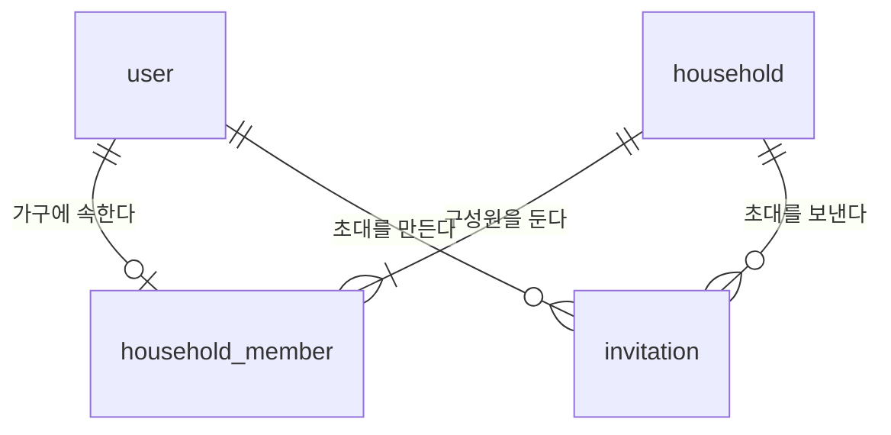
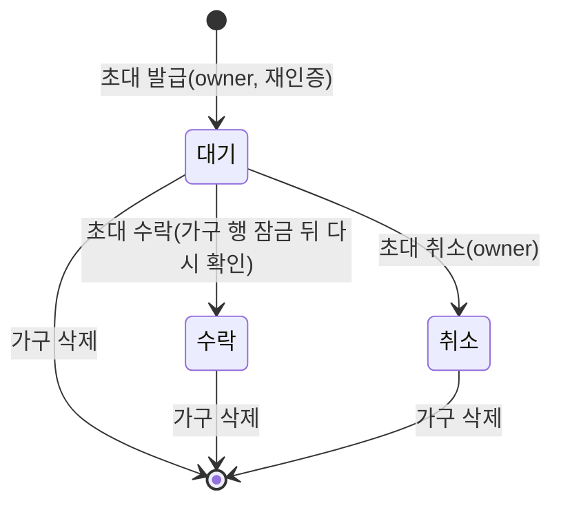
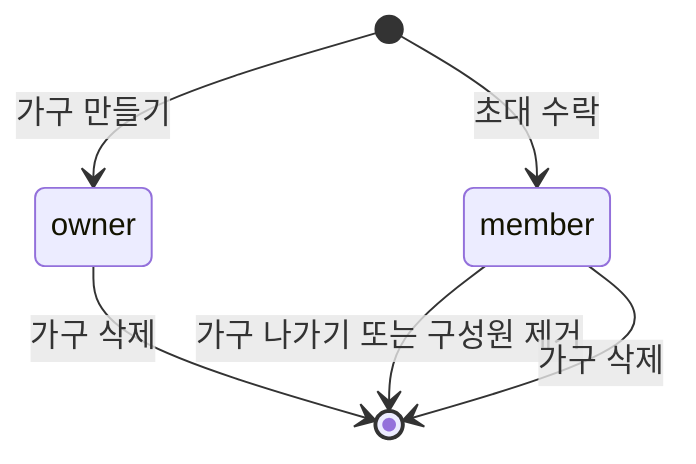

# Data Model: 002 가구와 가족 공유

002가 만드는 테이블은 셋입니다. 열의 형식, 출처, 저장 방식의 기준은 설계 문서의 [데이터 모델](../../docs/architecture/data-model.md#사용자와-가구)이고, 이 문서는 002가 그 가운데 무엇을 어떻게 만드는지만 적습니다. 마이그레이션은 `V2__household.sql` 하나입니다. 001의 `user`, `spring_session`, `spring_session_attributes`는 바꾸지 않습니다.

| 테이블 | 기준 절 | 002에서 하는 일 |
|---|---|---|
| `household` | [`household`](../../docs/architecture/data-model.md#household) | 가구 만들기 때 만들고, 가구 삭제 때 삭제합니다. 구성원과 초대를 바꾸는 동작이 이 행을 잠급니다 |
| `household_member` | [`household_member`](../../docs/architecture/data-model.md#household_member) | 가구 만들기(owner)와 초대 수락(member) 때 만들고, 구성원 제거, 가구 나가기, 가구 삭제 때 삭제합니다 |
| `invitation` | [`invitation`](../../docs/architecture/data-model.md#invitation) | 초대 발급 때 만들고, 취소와 수락 때 상태를 바꾸고, 가구 삭제 때 삭제합니다 |

체크리스트 기본 항목(`checklist_item`, 007)과 알림 설정(`notification_setting`, 009)은 만들지 않습니다(백로그 경계 규칙).

## `household`

| 열 | 형식 | 002의 규칙 |
|---|---|---|
| `id` | bigint, 기본 키 | 시퀀스 `household_id_seq`에서 받습니다(JPA `@GeneratedValue(strategy = SEQUENCE)`, `allocationSize = 1`) |

- 가구 이름 열은 없습니다(설계 데이터 모델의 넣지 않는 것).
- 구성원이나 초대를 바꾸는 동작은 트랜잭션의 첫 쓰기 전에 이 행을 `select id from household where id = :id for update`로 잠급니다([research R9](research.md#r9-동시성과-잠금)). 잠금 조회가 빈 결과면 그 가구는 삭제된 것입니다.

## `household_member`

| 열 | 형식 | 002의 규칙 |
|---|---|---|
| `household_id` | bigint, 비울 수 없음, `household(id)` 참조 | 속한 가구 |
| `user_id` | bigint, 비울 수 없음, `"user"(id)` 참조 | 사용자 |
| `role` | text, 비울 수 없음 | 체크 제약 `role in ('owner', 'member')`. 가구 만들기는 `owner`, 초대 수락은 `member`입니다 |
| `joined_at` | timestamptz, 비울 수 없음 | 가구 만들기나 초대 수락을 처리한 시각(주입한 `Clock`). 009의 거래 알림이 이 시각 뒤의 변경만 보냅니다(FR-001) |

- 기본 키 `(household_id, user_id)`, 유니크 제약 `household_member_user_id_key (user_id)`. 이 유니크 제약이 같은 사람의 동시 가구 만들기와 동시 수락을 막고, 서비스는 이 제약 이름의 위반만 409 `HAS_HOUSEHOLD`로 바꿉니다.
- 외래 키는 둘 다 연쇄 삭제가 없습니다. 가구 삭제는 멤버십 행을 먼저 삭제하고, 멤버십이 있는 사용자의 탈퇴는 409로 막히므로 사용자 행을 삭제할 때 멤버십 행이 남아 있으면 외래 키 위반으로 실패합니다([research R9, R10](research.md#r10-삭제-연쇄)).
- owner는 가구마다 하나이고 가구 만들기에서만 생깁니다. 이 규칙은 데이터베이스 제약으로 두지 않습니다(설계 데이터 모델에 없음).
- 구성원은 가구마다 둘까지입니다. 데이터베이스 제약이 아니라 가구 행을 잠근 뒤 센 수로 확인합니다(설계 데이터 모델의 앱에서 확인하는 규칙).

## `invitation`

| 열 | 형식 | 002의 규칙 |
|---|---|---|
| `id` | bigint, 기본 키 | 시퀀스 `invitation_id_seq`에서 받습니다(`household`와 같은 방식) |
| `household_id` | bigint, 비울 수 없음, `household(id)` 참조 | 초대한 가구 |
| `created_by` | bigint, 비울 수 없음, `"user"(id)` 참조 | 초대를 발급한 owner. 초대 확인 화면이 이 사람의 표시 이름을 보입니다 |
| `token_hash` | bytea, 비울 수 없음 | 토큰(43자 base64url) ASCII 바이트의 SHA-256 32바이트. 유니크 제약, 체크 제약 `octet_length(token_hash) = 32` |
| `status` | text, 비울 수 없음 | 체크 제약 `status in ('대기', '수락', '취소')`. 만료는 상태가 아닙니다 |
| `expires_at` | timestamptz, 비울 수 없음 | `created_at`에 고른 날수(1~7) 곱하기 24시간을 더한 시각 |
| `created_at` | timestamptz, 비울 수 없음 | 주입한 `Clock`의 현재 시각을 마이크로초로 자른 값 |

- 체크 제약 `invitation_expiry_after_creation check (expires_at > created_at)`.
- 외래 키는 둘 다 연쇄 삭제가 없습니다. 가구 삭제가 초대를 먼저 삭제합니다. `created_by`의 owner는 가구를 삭제한 뒤에만 탈퇴할 수 있으므로 탈퇴 때 남은 초대가 없습니다.
- 토큰 원문은 저장하지 않습니다(결정 기록 0012). 체크 제약이 원문(43바이트)을 그대로 저장하는 실수를 막습니다.
- 만료 판단: 현재 시각이 `expires_at`보다 늦으면 만료입니다. 정각에는 수락합니다(FR-007). 보낸 초대 목록은 `status = '대기' and expires_at >= :now`입니다.
- 수락, 취소, 만료된 행은 가구를 삭제할 때까지 남습니다. 오래된 행을 정리하는 작업은 두지 않습니다(사용자 두 명, 가구마다 수락 대기 중인 초대는 하나).
- 인덱스는 기본 키와 `token_hash` 유니크만 둡니다. `household_id`로 찾는 조회(목록, 발급 때 수락 대기 중인 초대 세기, 가구 삭제)는 가구마다 행이 몇 개뿐이라 따로 인덱스를 두지 않습니다.

## 초대의 상태

- `대기`이면서 `expires_at`이 지난 초대는 만료된 초대입니다. 상태는 `대기`로 남지만 수락할 수 없고, 목록에 보이지 않고, 수락 대기 중인 초대로 세지 않으며, 취소하려 하면 409 `INVITATION_NOT_PENDING`입니다.
- 가구마다 `대기`이면서 만료되지 않은 초대는 하나까지입니다. 가구 행을 잠근 뒤 세서 확인합니다.
- 확인 화면에서 취소하거나, 다른 가구에 속한 사람이 링크를 열거나, owner가 자기 링크를 열어도 상태는 바뀌지 않습니다(FR-014).

## 멤버십의 상태

- 역할은 바뀌지 않습니다(owner 역할 이전은 범위 밖).
- 멤버십 행이 없어지면 그 사람의 다음 가구 요청은 403 `NO_HOUSEHOLD`입니다. 역할을 세션에 담지 않고 요청마다 이 테이블을 읽기 때문입니다(FR-019).

## 삭제와 보존

| 일 | 삭제하는 것(순서대로) | 남기는 것 |
|---|---|---|
| owner가 가구를 삭제함 | 그 가구의 `invitation` 행, `household_member` 행, `household` 행 | 사용자 행, 세션 |
| owner가 member를 제거함, member가 나감 | 그 사람의 `household_member` 행 | 사용자 행, 세션, 초대 행 |

뒤 기능이 이 연쇄에 추가하는 자리는 [research R10](research.md#r10-삭제-연쇄)에 있습니다.
