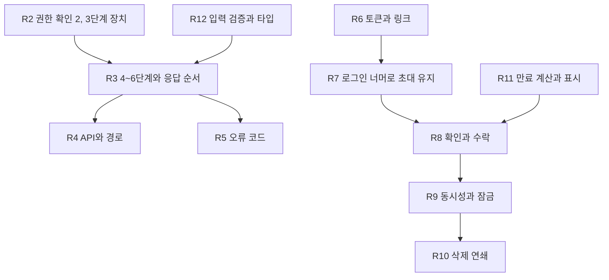
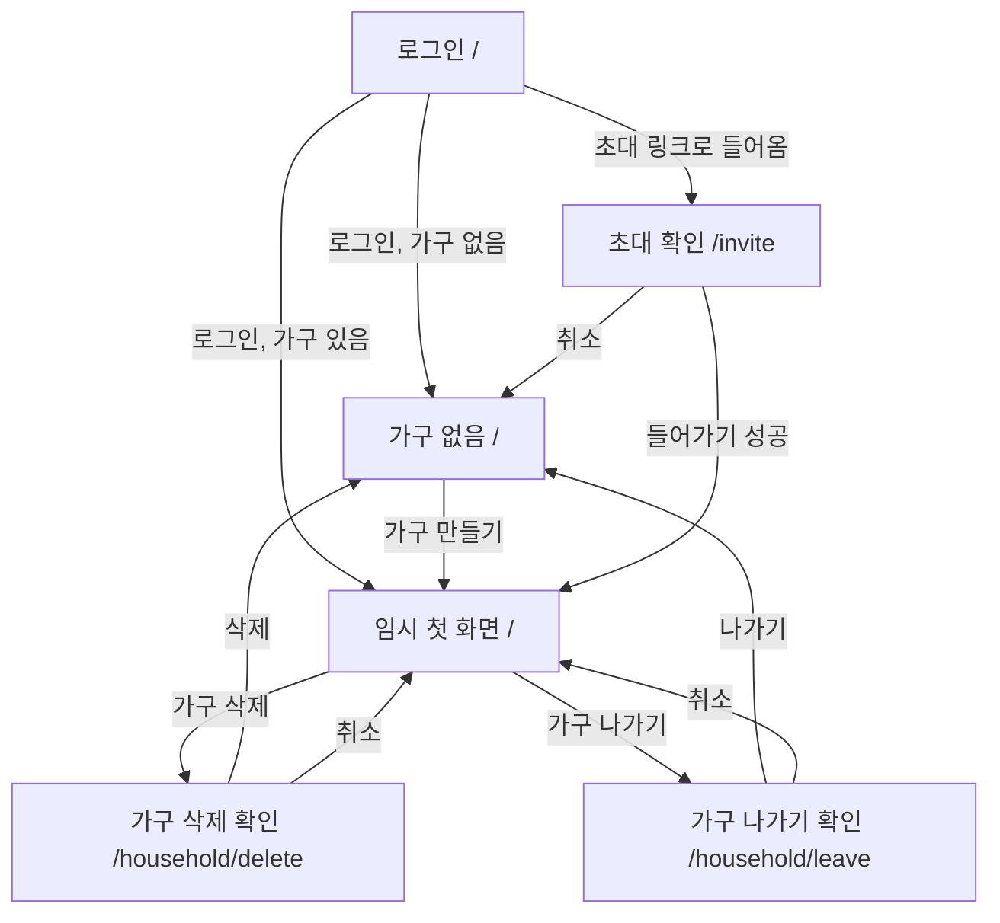

# Research: 002 가구와 가족 공유

이 문서는 002 plan이 정한 기술 판단과 그 근거를 적습니다. 설계 문서가 이미 정한 것(결정 기록 0011, 0012, 0013, 0016, 0017, API 공통 규칙, 데이터 모델, C4 컴포넌트)과 001이 만든 구조([001 research](../001-login/research.md))는 다시 정하지 않고, 설계 문서와 spec이 plan으로 넘긴 것만 다룹니다. 001 코드의 현재 동작은 2026-11-17에 `001-login` 머지 뒤의 `develop/v1` 코드(이 브랜치의 `src/`, `web/`)에서 확인했습니다.

판단 사이의 관계는 아래와 같습니다. 권한 확인 장치(R2, R3)가 모든 API의 입구이고, 초대 흐름(R6~R8)과 잠금(R9), 삭제 연쇄(R10)가 그 위에서 돕니다.



## R1. 모듈과 패키지

- Decision:
  - 가구 모듈은 `estate.household` 패키지 하나입니다. 001의 사용자 모듈(`estate.user`)과 같은 나눔으로 `domain/`(엔티티, 저장소), `application/`(서비스), `authz/`(권한 확인기, R2), `web/`(컨트롤러)를 둡니다. 세 테이블 `household`, `household_member`, `invitation`은 가구 모듈만 씁니다([C4 컴포넌트의 모듈과 테이블](../../docs/architecture/c4-component.md#모듈과-테이블)).
  - 사용자 모듈에 공개 조회 인터페이스 하나(`user/application/UserProfiles`)를 추가합니다. 사용자 번호 목록을 받아 표시 이름, 복호화한 로그인 이메일, 검증 여부를 반환합니다. 임시 첫 화면의 함께 보는 사람 목록과 초대 확인 화면의 owner 표시 이름이 사용합니다. 두 화면의 응답은 가구 모듈 컨트롤러(화면 API)가 가구 모듈 서비스의 결과와 이 인터페이스의 결과를 합쳐 만듭니다(C4 컴포넌트의 "화면 API 어댑터가 합침(가족 초대)" 행).
  - 가구 모듈에 공개 인터페이스 하나(`household/application/Memberships.hasMembership(userId)`)를 둡니다. 탈퇴 서비스가 사용자 행을 잠근 뒤 호출합니다(R13, C4 컴포넌트의 "사용자와 인증의 내 정보와 탈퇴" 행).
  - 엔티티는 JPA, 잠금(`SELECT ... FOR UPDATE`)은 `JdbcClient`의 SQL입니다(결정 기록 0016). 세 테이블에는 암호화 열이 없어 AAD용으로 기본 키를 삽입 전에 받을 필요는 없지만, 001과 같이 시퀀스에서 받습니다. 엔티티는 `@GeneratedValue(strategy = SEQUENCE)`와 `allocationSize = 1`로 시퀀스 `household_id_seq`, `invitation_id_seq`를 사용합니다. 시퀀스의 기본 증가값 1과 맞추려는 것입니다.
- Rationale: C4 컴포넌트가 가구 모듈의 컴포넌트(권한 확인기, 가구와 구성원과 초대)와 모듈 사이 호출(탈퇴 전 멤버십 확인, 가족 초대 화면의 사용자 자료 합치기)을 이미 정했습니다. 001의 `MeController`가 이메일을 복호화하는 코드는 그대로 두고, 여러 사람을 한 번에 읽는 조회만 새로 만듭니다.
- Alternatives considered: 가구 모듈이 `user` 테이블을 직접 조회(C4 컴포넌트의 "다른 모듈의 테이블을 직접 조회하지 않습니다"와 어긋나 제외), 001처럼 `nextval`을 직접 호출(암호화 열이 없어 JPA 기본 방식으로 충분해 제외).

## R2. 권한 확인 2, 3단계 장치

001에는 1단계(401)와 6단계(재인증)만 있었습니다. 002가 2단계(멤버십)와 3단계(권한 키)를 처음 만들고, 004부터 010까지의 기능이 같은 장치에 표시만 추가하게 합니다.

- Decision:
  - 컨트롤러 메서드마다 표시(애너테이션) `@Access`를 붙입니다. 값은 권한 키(`Permission`)와 멤버십 규칙(`MembershipRule`) 둘입니다.

    | 멤버십 규칙 | 뜻 | 멤버십이 없을 때 | 멤버십이 있을 때 | 사용하는 동작 |
    |---|---|---|---|---|
    | `REQUIRED`(기본값) | 멤버십이 있어야 함 | 403 `NO_HOUSEHOLD` | 3단계로 | 가구 자원 동작 전부 |
    | `OPTIONAL` | 멤버십 없이도 허용 | 3, 4단계를 건너뜀 | 3단계로 | 로그아웃, 내 정보 조회, 표시 이름 수정, 초대 확인, 초대 수락 |
    | `ABSENT` | 멤버십이 없어야 함 | 통과 | 409 `HAS_HOUSEHOLD` | 가구 만들기, 탈퇴 |

  - `Permission`은 결정 기록 0011의 권한 키를 Java 열거형으로 옮긴 것이고, 002가 사용하는 키만 둡니다(`household:read`, `invitation:read`, `invitation:create`, `invitation:revoke`, `member:remove`, `member:leave`, `household:delete`, `profile:write`, 그리고 0011 표에 없는 동작의 표시 `NONE`). 역할마다 허용하는 키는 0011 표 그대로 열거형에 적습니다. 뒤 기능은 자기 키를 추가합니다.
  - 가구 모듈의 권한 확인기는 `/api/**`에 등록한 Spring MVC `HandlerInterceptor`입니다. Spring Security 필터(1단계 401과 Origin 검사) 뒤, 컨트롤러 인자 해석(본문 읽기) 앞에서 돕니다. 요청마다 `household_member`에서 세션 사용자의 멤버십(가구 번호, 역할)을 한 번 읽고, 위 표대로 2단계와 3단계를 확인한 뒤 멤버십을 요청 속성에 둡니다. 컨트롤러는 인자 해석기로 그 값(`HouseholdMembership(householdId, userId, role)`)을 받아 서비스에 넘깁니다. 역할은 세션에 담지 않으므로 FR-019의 "요청마다 다시 확인"이 이것으로 지켜집니다.
  - `@Access`가 없는 `/api/**` 핸들러는 403 `PERMISSION_DENIED`로 거절합니다(결정 기록 0011의 기본 거부). 001의 컨트롤러 셋(`MeController` 세 메서드, `LogoutController`)에도 표시를 붙입니다.
  - 테스트 하나가 `RequestMappingHandlerMapping`의 모든 `/api/**` 핸들러에 `@Access`가 있는지, 그리고 `specs/*/contracts/openapi.yaml`의 경로마다 `x-permission` 값이 표시의 권한 키와 같은지 확인합니다. YAML은 Spring Boot에 이미 있는 SnakeYAML로 읽습니다. 계약과 코드가 어긋나면 이 테스트가 실패하므로, 뒤 기능이 경로를 추가할 때 표시를 빠뜨리지 않습니다.
- Rationale:
  - 2단계에서 403과 409를 나누고 오류 본문을 Problem 형식으로 써야 해, Spring Security의 메서드 보안(`@PreAuthorize`, 거절이 늘 403)보다 인터셉터가 단순합니다. 인터셉터는 본문을 읽기 전에 실행되어 "입력 검증(400)은 권한 확인 뒤"(API 공통 규칙)를 지킵니다.
  - C4 컴포넌트는 "계약 확장 필드를 코드에 표시하는 방법"을 구현으로 넘겼습니다. 표시 하나와 확인기 하나로 정하면 뒤 기능은 표시만 추가하면 되고, 기능마다 확인 코드를 다시 쓰지 않습니다.
  - 4~6단계는 표시에 넣지 않습니다. 4단계는 자원을 조회하는 서비스만 알 수 있고, 6단계는 4, 5단계 뒤여야 하므로(R3) 표시만으로 확인할 수 없습니다.
- Alternatives considered: Spring Security 메서드 보안(거절 상태 코드를 나누기 어려움), 경로 패턴 표(경로와 키가 코드 밖에 따로 있어 어긋나기 쉬움), 0011의 권한 키 15개를 모두 열거형에 두기(사용하지 않는 값을 미리 만들지 않는다는 constitution VI에 걸려 제외).

## R3. 4~6단계와 응답 순서

- Decision: 요청 하나는 아래 순서로 확인하고, 처음 걸린 단계의 상태 코드로 응답합니다(FR-023, [API 공통 규칙](../../docs/architecture/api-conventions.md#인증과-권한-확인)).

  | 순서 | 확인 | 맡는 곳 | 걸리면 |
  |---|---|---|---|
  | 1 | 로그인 상태 | Spring Security(001) | 401 `UNAUTHENTICATED` |
  | (1 뒤) | 상태를 바꾸는 요청의 Origin | Origin 검사 필터(001) | 403 `ORIGIN_REJECTED` |
  | 2 | 멤버십 | 권한 확인기(R2) | 403 `NO_HOUSEHOLD`, 409 `HAS_HOUSEHOLD` |
  | 3 | 역할의 권한 키 | 권한 확인기(R2) | 403 `PERMISSION_DENIED` |
  | 4 | 경로의 초대나 구성원이 내 가구의 것인지 | 가구 모듈 서비스 | 404 `NOT_FOUND` |
  | 5 | 구성원 제거의 대상이 자기 자신인지 | 가구 모듈 서비스 | 403 `PERMISSION_DENIED` |
  | 6 | 민감 동작의 재인증 | 가구 모듈 서비스가 `ReauthJudge` 호출(001) | 401 `REAUTH_REQUIRED` |
  | 그 뒤 | 입력 검증 | 가구 모듈 서비스 | 400 `VALIDATION_FAILED` |
  | 그 뒤 | 현재 상태와의 충돌 | 가구 모듈 서비스(가구 행을 잠근 뒤) | 409 |

  - 4단계는 서비스가 조회 조건에 늘 세션 멤버십의 가구 번호를 넣는 방식입니다(`where household_id = :mine and user_id = :target`). 다른 가구의 자원과 없는 자원이 모두 조회 결과에 없어 같은 404 본문이 됩니다(FR-024). 경로의 번호는 문자열로 받아 숫자가 아니거나 `long` 범위를 넘으면 같은 404로 응답합니다. Spring의 형식 변환 실패(400, `code` 없음)로 빠지면 다른 본문이 되기 때문입니다.
  - owner가 자기 자신을 구성원 제거로 요청하는 403(US3-4)은 5단계 자리에 둡니다. 대상이 내 가구의 구성원이라 4단계를 통과하고, 재인증보다 먼저 거절합니다. 그래서 마지막 구글 인증이 오래된 owner의 자기 제거 요청도 401이 아니라 403입니다.
  - 초대 발급은 본문이 있는 민감 동작이라, 본문을 Spring이 먼저 읽으면 깨진 JSON이 재인증보다 먼저 400이 됩니다. 그래서 초대 발급만 본문을 문자열(`@RequestBody(required = false) String`)로 받고, 서비스가 재인증 판정 뒤에 본문 해석 함수를 호출합니다(R12). 001의 표시 이름 수정과 002의 초대 확인, 초대 수락은 재인증이 없어 Spring이 본문을 읽어도 순서가 같습니다.
  - 가구 모듈 서비스는 상태를 바꾸기 전에 가구 행을 잠그고(R9) 대상 행을 다시 읽습니다. 권한 확인기가 멤버십을 읽은 뒤 잠금을 얻기 전에 가구가 삭제되었으면 잠금 조회가 빈 결과라 403 `NO_HOUSEHOLD`이고, 대상 구성원이 그 사이에 나갔으면 404입니다.
- Rationale: C4 컴포넌트의 [권한 확인 6단계를 맡는 곳](../../docs/architecture/c4-component.md#권한-확인-6단계를-맡는-곳)이 1~3단계는 공통 계층, 4~6단계는 모듈 서비스로 정했습니다. 6단계를 4단계보다 먼저 확인하면 다른 가구의 구성원 제거에 404 대신 401을 응답해 그 사람이 있는지 알려 주게 됩니다.

## R4. API와 경로

경로는 모두 `/api/v1` 아래입니다. 가구 자원은 단수 `/household` 아래에 두고 경로에 가구 번호를 넣지 않습니다(API 공통 규칙). 계약은 [contracts/openapi.yaml](contracts/openapi.yaml)입니다.

| 동작 | 메서드와 경로 | `x-permission` | 멤버십 규칙 | `x-household-scope` | `x-owner-only` | `x-reauth` | 성공 |
|---|---|---|---|---|---|---|---|
| 가구 만들기 | `POST /household` | `none` | `ABSENT` | false | false | false | 201 |
| 함께 보는 사람 목록 | `GET /household` | `household:read` | `REQUIRED` | true | false | false | 200 |
| 가구 삭제 | `DELETE /household` | `household:delete` | `REQUIRED` | true | false | true | 204 |
| 가구 나가기 | `DELETE /household/membership` | `member:leave` | `REQUIRED` | true | false | false | 204 |
| 구성원 제거 | `DELETE /household/members/{userId}` | `member:remove` | `REQUIRED` | true | false | true | 204 |
| 보낸 초대 목록 | `GET /household/invitations` | `invitation:read` | `REQUIRED` | true | false | false | 200 |
| 초대 발급 | `POST /household/invitations` | `invitation:create` | `REQUIRED` | true | false | true | 201 |
| 초대 취소 | `DELETE /household/invitations/{invitationId}` | `invitation:revoke` | `REQUIRED` | true | false | false | 204 |
| 초대 확인 | `POST /invitations/preview` | `none` | `OPTIONAL` | false | false | false | 200 |
| 초대 수락 | `POST /invitations/accept` | `none` | `OPTIONAL` | false | false | false | 204 |
| 탈퇴(001, 바뀜) | `DELETE /me` | `none` | `ABSENT` | false | false | true | 204 |

- 001의 내 정보 조회(`GET /me`), 표시 이름 수정(`PATCH /me`, `profile:write`), 로그아웃(`POST /logout`)은 계약이 바뀌지 않고 표시만 붙습니다(멤버십 규칙 `OPTIONAL`).
- 초대 확인은 상태를 바꾸지 않지만 POST입니다. 토큰을 질의 값이나 경로에 넣으면 서버와 프록시의 접근 기록, 브라우저 기록에 남으므로 본문으로 보냅니다(R7). API 공통 규칙은 GET이 상태를 바꾸지 않는다고 정했을 뿐 조회를 POST로 하는 것을 막지 않습니다.
- 초대 확인과 수락은 가구 구성원이 아닌 사람도 호출하므로 `/household` 밖에 둡니다. `x-household-scope: false`는 API 공통 규칙의 계약 파일 절이 초대 수락에 정한 값입니다.
- 가구 나가기는 "내 멤버십"을 삭제하는 동작이라 `DELETE /household/membership`입니다. 가구 경로 아래라 `x-household-scope`는 true이고, 대상은 경로가 아니라 세션 사용자로 정하므로 4단계에서 걸리는 경우는 없습니다.
- 경로가 가구 자원을 가리키는 동작은 모두 `x-household-scope: true`입니다. 경로에 번호가 없는 동작(목록, 발급, 삭제, 나가기)은 세션 멤버십의 가구만 다룹니다.
- 임시 첫 화면에 보이는 "새 초대를 만들 수 없는 이유"는 따로 응답 필드를 두지 않습니다. 화면이 구성원 수(둘)와 보낸 초대 목록(비어 있지 않음)으로 정하고, 서버는 발급 요청을 409로 거절합니다(FR-009). 표시 판단이고 권한 판단이 아니라 결정 기록 0017의 "화면은 권한 판정을 하지 않습니다"와 어긋나지 않습니다.

## R5. 오류 코드

새 코드는 열한 개입니다. 001의 `ProblemCode` 열거형에 추가하고, 문구는 코드마다 고정입니다(001과 같음). 화면은 `code`로 분기하고 화면 문구는 화면이 정합니다(R14).

| 상태 | `code` | `title` | `detail` | 쓰는 곳 |
|---|---|---|---|---|
| 403 | `NO_HOUSEHOLD` | 가구가 없습니다 | 가구를 만들거나 초대 링크로 들어온 뒤 다시 시도해 주세요. | 2단계 |
| 403 | `PERMISSION_DENIED` | 할 수 없는 동작입니다 | 이 가구에서 할 수 없는 동작입니다. | 3단계, 자기 제거, 표시 없는 핸들러 |
| 404 | `NOT_FOUND` | 찾을 수 없습니다 | 주소를 확인해 주세요. | 4단계, 없는 초대 링크 |
| 409 | `HAS_HOUSEHOLD` | 이미 가구가 있습니다 | 가구를 나가거나 삭제한 뒤 다시 시도해 주세요. | 가구 만들기, 탈퇴, 다른 가구에 속한 사람의 초대 확인과 수락 |
| 409 | `HOUSEHOLD_FULL` | 구성원이 이미 둘입니다 | 가구 구성원은 둘까지입니다. | 초대 발급, 초대 확인과 수락 |
| 409 | `INVITATION_PENDING` | 수락 대기 중인 초대가 있습니다 | 수락 대기 중인 초대를 취소한 뒤 다시 시도해 주세요. | 초대 발급 |
| 409 | `INVITATION_NOT_PENDING` | 취소할 수 없는 초대입니다 | 이미 수락되었거나 취소되었거나 만료된 초대입니다. | 초대 취소 |
| 409 | `INVITATION_REVOKED` | 취소된 초대 링크입니다 | 가족에게 새 초대 링크를 받아 주세요. | 초대 확인과 수락 |
| 409 | `INVITATION_USED` | 이미 사용된 초대 링크입니다 | 가족에게 새 초대 링크를 받아 주세요. | 초대 확인과 수락 |
| 409 | `INVITATION_EXPIRED` | 초대 링크가 만료되었습니다 | 가족에게 새 초대 링크를 받아 주세요. | 초대 확인과 수락(API 공통 규칙의 예시와 같은 값) |
| 409 | `ALREADY_IN_THIS_HOUSEHOLD` | 이미 이 가구의 구성원입니다 | 링크는 가족에게 보내세요. | 초대 확인과 수락 |

- 없는 초대 링크는 경로 자원의 404와 같은 `NOT_FOUND`입니다. 초대 화면은 어느 요청의 응답인지 알고 있어 코드를 나눌 필요가 없습니다.
- 403을 `NO_HOUSEHOLD`와 `PERMISSION_DENIED`로 나눈 것은 화면 때문입니다. 제거되었거나 나간 사람, 삭제된 가구의 구성원이었던 사람의 다음 요청이 `NO_HOUSEHOLD`를 받으면 화면은 가구 없음 화면으로 갑니다(FR-019).
- 초대 취소의 409를 수락 쪽 코드(`INVITATION_USED` 등)로 다시 사용하지 않은 것은 `detail`이 링크를 받은 사람에게 하는 말("가족에게 새 초대 링크를 받아 주세요.")이라 owner에게 맞지 않기 때문입니다.

## R6. 초대 토큰과 링크 모양

- Decision:
  - 토큰은 32바이트 무작위 값(`SecureRandom`)을 패딩 없는 base64url로 인코딩한 43자입니다. 세션 토큰과 같은 형식입니다(001 research R3).
  - `invitation.token_hash`에는 그 43자 문자열(ASCII 바이트)의 SHA-256 32바이트를 bytea로 저장합니다(결정 기록 0012). 테이블의 체크 제약 `octet_length(token_hash) = 32`가 원문(43바이트)이 잘못 저장되는 것을 막습니다. 001의 `session_id` 체크 제약과 같은 이유입니다.
  - 링크는 `{서비스 주소}/invite#{토큰}`입니다(와이어프레임 예시). `#` 뒤의 값은 브라우저가 서버로 보내지 않아 서버 접근 기록과 Referer에 남지 않습니다.
  - 초대 발급 응답은 링크 전체가 아니라 `token`을 담고, 화면이 `window.location.origin`으로 링크를 만듭니다. 서버에는 서비스 주소가 하나로 정해진 설정이 없고(로컬, Vite 개발 서버, 터널마다 다름), 화면이 연 주소가 곧 링크를 열 주소이기 때문입니다.
  - 토큰 원문은 초대 발급 응답 한 번에만 담습니다(FR-008, API 공통 규칙의 응답에 담는 개인정보 표). 보낸 초대 목록, 초대 확인 응답, 오류 응답에는 토큰도 해시도 담지 않습니다.
- Rationale: 링크 모양은 와이어프레임이 정했고, 해시 저장은 결정 기록 0012가 정했습니다. 256비트 무작위 값이라 추측으로 맞힐 수 없어 확인 요청에 시도 횟수 제한을 두지 않습니다.
- Alternatives considered: 서버가 링크 전체를 반환(서비스 주소 설정을 새로 둬야 해 제외), 짧은 토큰(결정 기록 0011이 추측 위험으로 제외한 초대 코드와 같은 문제).

## R7. 로그인을 거치는 동안 초대 유지

로그인하지 않은 사람이 `/invite#토큰`을 열면 화면은 로그인 화면을 그리고, 로그인 버튼은 `/oauth2/authorization/google?returnTo=/invite`로 갑니다(001 research R7). `#` 뒤의 토큰은 이 이동에 실리지 않습니다. 구글 로그인을 마치고 `/invite`로 돌아왔을 때 화면이 토큰을 다시 알아야 합니다.

| 선택지 | 토큰이 거치는 곳 | 남는 곳 | 바꾸는 001 코드 | 선택 |
|---|---|---|---|---|
| 화면이 탭 저장소(`sessionStorage`)에 둠 | 브라우저 안에서만 | 그 탭의 `sessionStorage`(탭을 닫으면 삭제) | 없음 | 채택 |
| 돌아갈 경로에 `#토큰`을 넣음 | 로그인 시작 요청의 질의 값(`returnTo=%2Finvite%23...`), 임시 값 쿠키(암호화), 콜백의 Location | 서버와 프록시의 접근 기록, 브라우저 기록 | 없음(`ReturnPath`가 `#`을 받음) | 제외 |
| 로그인 시작을 POST로 바꿔 본문의 토큰을 임시 값 쿠키에 담음 | 로그인 시작 요청 본문, 임시 값 쿠키, 콜백 뒤 별도 쿠키 | 서버 쿠키 | 로그인 시작, 임시 값 쿠키 형식, 콜백 | 제외 |

- Decision:
  - 화면은 앱이 시작될 때(라우터가 화면을 그리기 전) 주소가 `/invite`이고 `#` 뒤에 값이 있으면, 그 값을 `sessionStorage`의 한 키에 두고 `history.replaceState`로 주소에서 `#` 뒤를 제거합니다. 로그인 상태와 관계없이 같은 순서이고, 로그인 화면은 그 뒤에 그려지므로 돌아갈 경로는 늘 `/invite`입니다.
  - `/invite` 화면은 `sessionStorage`의 토큰으로 초대 확인을 호출합니다. 토큰이 없으면 API를 호출하지 않고 "존재하지 않는 링크" 안내를 보입니다.
  - 토큰은 들어가기의 결과(성공이든 실패든), 취소, 확인 단계의 실패 안내를 보일 때 `sessionStorage`에서 삭제합니다. 초대 확인이나 들어가기가 401 `UNAUTHENTICATED`로 끝나면 서버가 처리하지 않은 것이므로 지우지 않고 로그인 화면으로 갑니다. 다시 로그인해 `/invite`로 돌아오면 같은 토큰으로 확인 화면이 다시 열립니다(FR-012). 같은 링크를 다시 열면 `#` 뒤의 값을 다시 저장하므로 확인 화면이 다시 나옵니다(US2-10).
  - 001의 `ReturnPath`와 임시 값 쿠키(`LoginCookieAuthorizationRequestRepository`)는 바꾸지 않습니다. 돌아갈 경로에는 `/invite`만 담기고 토큰은 서버로 가지 않습니다.
  - 서버에서 토큰은 초대 확인과 수락 요청의 JSON 본문으로만 들어옵니다. 서버는 요청 본문을 기록하지 않고, 001처럼 예외 메시지를 로그와 응답에 쓰지 않습니다(`ProblemAdvice`가 본문 읽기 예외의 메시지를 버림). 토큰과 그 해시를 예외 메시지, 로그, 오류 응답에 넣지 않습니다(FR-028).
- Rationale:
  - API 공통 규칙의 넘겨받은 항목 표가 이 판단을 002 plan으로 넘기며 "토큰 원문은 로그에 남기지 않습니다"를 조건으로 적었습니다. 탭 저장소는 토큰이 서버 쪽 어디에도 남지 않는 유일한 선택지입니다.
  - 결정 기록 0013이 브라우저 저장소에 담지 말라고 한 것은 재인증 뒤의 밀린 민감 동작과 입력값입니다. 초대 수락은 민감 동작이 아니고, 토큰을 저장해도 확인 화면에서 사용자가 들어가기를 눌러야 수락되므로 다른 사이트의 링크가 수락까지 이어서 실행하지 못합니다.
  - XSS(스크립트 주입)가 일어나면 스크립트가 `sessionStorage`의 토큰을 읽을 수 있습니다. 같은 스크립트는 링크를 연 순간의 주소(`location.hash`)도 읽을 수 있으므로 저장 때문에 새로 생기는 위험은 아닙니다.
  - spec 엣지 케이스대로 구글 로그인을 10분 안에 마치지 못하면 로그인 실패 화면으로 가고, 그 화면의 로그인 버튼은 돌아갈 경로를 담지 않으므로(001) 사용자는 링크를 다시 엽니다.

## R8. 초대 확인과 수락

- Decision:
  - 초대 확인(`POST /invitations/preview`)과 초대 수락(`POST /invitations/accept`)은 같은 확인 함수를 사용합니다. 확인 함수는 아래 순서로 처음 걸린 사유를 반환합니다(FR-013의 "링크 자체의 사유 먼저").

    ```mermaid
    flowchart TD
      t{토큰 형식이 43자 base64url인가} -- 아니요 --> nf[404 NOT_FOUND]
      t -- 예 --> h{해시로 찾은 초대가 있나}
      h -- 아니요 --> nf
      h -- 예 --> r{상태가 취소인가}
      r -- 예 --> rv[409 INVITATION_REVOKED]
      r -- 아니요 --> u{상태가 수락인가}
      u -- 예 --> us[409 INVITATION_USED]
      u -- 아니요 --> e{현재 시각이 만료 시각보다 늦은가}
      e -- 예 --> ex[409 INVITATION_EXPIRED]
      e -- 아니요 --> f{그 가구의 구성원이 둘인가}
      f -- 예 --> fu[409 HOUSEHOLD_FULL]
      f -- 아니요 --> m{요청한 사람이 그 가구의 구성원인가}
      m -- 예 --> th[409 ALREADY_IN_THIS_HOUSEHOLD]
      m -- 아니요 --> o{요청한 사람에게 다른 가구가 있나}
      o -- 예 --> hh[409 HAS_HOUSEHOLD]
      o -- 아니요 --> ok[확인 200 또는 수락]
    ```

  - 초대 확인은 잠금 없이 확인 함수만 실행하고, 통과하면 서비스는 초대를 만든 owner의 사용자 번호(`created_by`)만 반환합니다. 컨트롤러(화면 API)가 사용자 모듈의 공개 조회(R1)로 그 사람의 현재 표시 이름을 읽어 `inviterDisplayName`(비어 있으면 null)으로 만듭니다. owner의 로그인 이메일과 구성원 목록은 담지 않습니다(FR-012).
  - 초대 수락은 해시로 초대를 찾은 뒤 그 가구 행을 잠그고(R9), 초대 행을 다시 읽어 확인 함수를 실행합니다. 통과하면 초대 상태를 `수락`으로 바꾼 뒤 멤버십 행(`member`, `joined_at`은 현재 시각)을 만듭니다(데이터 모델의 순서, 한 트랜잭션). 확인 화면을 연 뒤 그 사이에 취소, 수락, 만료, 가구 삭제가 일어났으면 이 두 번째 확인에서 걸립니다(US2-11, US2-12). 가구 행이 그 사이에 삭제되었으면 잠금 조회가 빈 결과라 404입니다(US4-5).
  - 확인 화면의 취소는 API를 호출하지 않습니다. 초대는 대기 상태로 남고 화면은 가구 없음 화면(`/`)으로 갑니다(US2-10).
  - 들어가기가 성공하면 화면은 `/`로 가고, 앱은 내 정보와 함께 보는 사람 목록을 다시 읽어 임시 첫 화면을 그립니다.
  - 이미 가구에 속한 사람의 수락 거절(409)과 확인 단계의 거절은 초대 행을 바꾸지 않습니다(FR-014).
- Rationale: spec Clarifications가 확인 화면을 넣고 "들어가기를 누른 순간에도 다시 확인"을 정했습니다. 확인과 수락이 같은 함수를 사용하면 사유 순서가 두 요청에서 같습니다.

## R9. 동시성과 잠금

- Decision:
  - 구성원이나 초대를 바꾸는 동작(초대 발급, 초대 취소, 초대 수락, 구성원 제거, 가구 나가기, 가구 삭제)은 모두 트랜잭션의 첫 쓰기 전에 그 가구 행을 `select id from household where id = :id for update`로 잠급니다. 한 가구 안의 이 동작들은 한 줄로 서고, 잠근 뒤 읽은 구성원 수와 수락 대기 중인 초대 수가 커밋까지 바뀌지 않습니다.
  - 그래서 "구성원 둘까지"와 "수락 대기 중이면서 만료되지 않은 초대는 가구마다 하나"(데이터 모델의 앱에서 확인하는 규칙)를 데이터베이스 제약 없이 지킵니다. 만료가 상태가 아니라 시각 비교라, `대기` 행에 거는 부분 유니크 인덱스로는 만료된 초대가 새 발급을 막아 버려 사용할 수 없습니다.
  - 같은 링크의 동시 수락: 둘째 요청은 가구 행 잠금을 기다렸다가 초대 행을 다시 읽어 `수락` 상태를 보고 409 `INVITATION_USED`입니다(FR-015, SC-003).
  - 같은 사람의 동시 가구 만들기: `household_member.user_id` 유니크 제약이 막습니다. 둘째 삽입은 첫째 트랜잭션이 끝날 때까지 기다렸다가 유니크 위반이 나고, 서비스가 제약 이름(`household_member_user_id_key`)을 확인해 409 `HAS_HOUSEHOLD`로 바꿉니다. 같은 사람이 가구 만들기와 초대 수락을 동시에 보내도 같은 제약이 막습니다. 유니크 위반이 나면 PostgreSQL이 그 트랜잭션을 중단하므로 같은 트랜잭션의 가구 행 삽입도 롤백됩니다.
  - 잠금 순서는 가구 행 하나뿐이라 가구 동작끼리 교착이 생기지 않습니다. 수락은 해시로 초대를 찾을 때 잠그지 않고, 가구 행을 잠근 뒤 초대 행을 다시 읽습니다.
  - 탈퇴와의 관계: 탈퇴는 001대로 사용자 행을 `FOR UPDATE`로 잠근 뒤 가구 모듈의 `hasMembership`을 호출합니다(R13). 멤버십 행 삽입은 외래 키 확인 때 사용자 행에 `FOR KEY SHARE` 잠금을 걸고, 이 잠금은 `FOR UPDATE`와 충돌합니다. 그래서 탈퇴와 같은 사람의 가구 만들기나 수락은 한 줄로 섭니다. 탈퇴가 먼저면 삽입이 외래 키 위반으로 실패하고(사용자 행이 없음), 삽입이 먼저면 탈퇴가 커밋된 멤버십을 보고 409입니다. 어느 순서든 사용자 없는 멤버십이나 멤버십 있는 탈퇴가 남지 않습니다. 앞 경우(같은 사람이 두 탭에서 탈퇴와 수락을 동시에 누름)의 응답은 Problem 형식의 500이고 따로 바꾸지 않습니다.
- 테스트: 동시 요청은 테스트가 다른 연결에서 그 가구 행을 먼저 잠가 두고, 요청 N개가 모두 잠금을 기다리는 것을 `pg_stat_activity`의 `wait_event_type = 'Lock'` 수로 확인한 뒤 잠금을 해제합니다. 그래서 요청들이 실제로 겹칩니다. 동시 가구 만들기는 테스트가 커밋하지 않은 멤버십 행을 먼저 넣어 두고 요청을 보낸 뒤, 커밋하면 409, 롤백하면 201인지 두 순서를 모두 확인합니다(리뷰 기준의 "동시 실행 테스트가 실제로 두 순서를 모두 만드는가").
- Rationale: C4 컴포넌트의 삭제 연쇄가 "부모 행을 `SELECT ... FOR UPDATE`로 먼저 잠근다"는 관례를 정했습니다. 가구 동작의 부모 행을 가구 행으로 하는 것은 002가 새로 정했습니다(002에는 매물이 없어 가구 행을 먼저 잠급니다. C4 컴포넌트는 가구 삭제의 부모 행을 "그 가구의 매물들"로 적었습니다). 결정 기록 0016이 잠금은 SQL로 직접 쓰기로 정했습니다.
- Alternatives considered: 직렬화 격리 수준(실패한 트랜잭션을 다시 실행하는 코드가 필요해 제외), 초대 행만 잠금(발급은 잠글 초대 행이 아직 없어 가구 단위 규칙을 지키지 못해 제외), 권고 잠금(행 잠금으로 충분하고 C4 컴포넌트의 관례와 달라 제외).

## R10. 삭제 연쇄

- Decision:
  - 가구 삭제: 재인증 판정 뒤 가구 행을 잠그고, `invitation`, `household_member`, `household` 순서로 그 가구의 행을 삭제합니다. 사용자 행과 세션은 남습니다(FR-020, 데이터 모델의 삭제와 보존).
  - 구성원 제거와 가구 나가기: 가구 행을 잠그고 그 사람의 멤버십 행 하나만 삭제합니다. 사용자 행과 세션은 남습니다.
  - 외래 키는 모두 연쇄 삭제(`on delete cascade`) 없이 둡니다. 삭제 순서를 빠뜨리면 외래 키 위반으로 실패해 바로 드러납니다.
  - 뒤 기능이 연쇄에 추가할 자리는 확장 지점(인터페이스, 이벤트)을 만들지 않고 이 서비스 메서드 안의 순서로 둡니다. C4 컴포넌트의 [삭제 연쇄](../../docs/architecture/c4-component.md#삭제-연쇄) 규칙대로 뒤 기능은 가구 행을 잠근 뒤, 가구 모듈 자신의 행을 삭제하기 전에 자기 모듈의 공개 인터페이스 호출을 추가합니다.

    | 동작 | 002가 하는 일 | 뒤 기능이 추가할 호출(잠금 뒤, 가구 행 삭제 전) |
    |---|---|---|
    | 가구 삭제 | 초대, 멤버십, 가구 행 삭제 | 004: 관심 단지, 매물, 호가 이력. 007: 임장 기록, 체크리스트 항목. 008: 사진. 010: 방문 알림 발송 기록 |
    | 구성원 제거, 가구 나가기 | 멤버십 행 삭제 | 007: 그 사람의 임장 기록 `author_id` 비우기 |

  - 가구 삭제 확인 화면과 가구 나가기 확인 화면의 문구는 이 기능의 자료만 가리키고, 뒤 기능이 연쇄를 추가할 때 문구도 함께 수정합니다(spec 가정 절).
- Rationale: constitution VI가 사용하지 않는 확장 지점을 금지합니다. 연쇄를 추가하는 기능이 그 테이블을 연쇄에 넣고 테스트한다는 것은 백로그의 경계 규칙입니다.
- Alternatives considered: 외래 키 연쇄 삭제(뒤 기능의 사진 파일처럼 데이터베이스 밖 삭제와 순서가 맞지 않고, 빠뜨린 순서가 조용히 넘어가 제외), 삭제 이벤트 발행(사용하는 곳이 없는 확장 지점이라 제외).

## R11. 만료 계산과 표시

- Decision:
  - 발급 때 `created_at`은 주입한 `Clock`의 현재 시각을 마이크로초로 자른 값이고(PostgreSQL `timestamptz`의 정밀도), `expires_at`은 거기에 고른 날수 곱하기 24시간을 더한 값입니다(FR-007). 잘라서 저장해야 저장한 값과 계산한 값이 같아 경계 테스트가 정확합니다.
  - 만료 판단은 서버가 `Clock`의 현재 시각으로 합니다. 현재 시각이 `expires_at`보다 늦으면(`now.isAfter(expiresAt)`) 만료이고, 같으면 수락합니다. 보낸 초대 목록은 `status = '대기' and expires_at >= :now`인 행만 반환합니다(FR-010).
  - 남은 기간은 서버가 계산해 `remainingDays`(정수)로 반환합니다. 남은 시간을 하루(24시간) 단위로 올림하고 최소 1입니다(만료 시각 정각처럼 남은 시간이 0이어도 아직 유효하면 1). 화면은 "N일 남음"으로 씁니다. 처음에는 내림이었으나, 3일을 골라 만든 직후에 "2일 남음"으로 보이는 문제가 있어 spec과 함께 올림으로 바꿨습니다(2026-11-17). 서버가 계산하면 만료 판단과 같은 시계를 사용하고 `Clock`으로 테스트할 수 있습니다. 화면이 계산하면 휴대폰 시계가 틀릴 때 목록 필터(서버)와 남은 기간(화면)이 어긋납니다.
  - 응답의 시각(`createdAt`, `expiresAt`)은 Asia/Seoul 오프셋(`+09:00`)을 붙인 ISO 8601입니다. 화면은 `createdAt`의 월과 일로 "M월 D일 만듦"을 씁니다(와이어프레임 "10월 19일 만듦, 6일 남음"). 서비스 사용자가 한국에 있어 날짜의 기준 시간대를 Asia/Seoul로 둡니다. 설계 문서에 시간대 기준이 없어 이 plan이 정했습니다.
  - 테스트: `MutableClock.freezeAt`으로 발급 시각을 고정한 뒤 옮깁니다. 1일 초대는 23시간 59분 59초와 정확히 24시간에 수락, 24시간 1초에 거절. 7일 초대는 6일 23시간 59분 59초에 수락, 7일 1초에 거절. 확인 화면 응답 뒤 시계를 만료 뒤로 옮기고 수락하면 409 `INVITATION_EXPIRED`. 남은 기간은 3일 정각(3일을 골라 만든 직후)이면 3, 2일 5시간이면 3, 5시간이면 1, 만료 시각 정각이면 1. 경계 양쪽을 함께 봅니다(리뷰 기준).

## R12. 입력 검증과 타입 제약

001에서 Jackson이 숫자를 문자열로 바꿔 받아 숫자가 표시 이름으로 저장된 결함이 있었습니다. 002의 본문 필드는 받는 형식을 아래처럼 고정합니다.

- Decision:
  - 초대 발급 본문은 `{"expiresInDays": 정수}` 하나입니다. 본문을 문자열로 받아(R3) 재인증 판정 뒤 `ObjectMapper.readTree`로 읽고, 결과가 객체이고 키가 `expiresInDays` 하나이며 값이 `JsonNode.isInt()`이고 1 이상 7 이하일 때만 받습니다. `isInt()`는 정수 리터럴만 참이므로 `1.5`, `3.0`, `1e0`(실수 노드), `"3"`(문자열), `true`, `null`, 배열, 객체, `int` 범위를 넘는 수가 모두 거절됩니다.
    - 값이 없거나 형식이 틀리면 400 `VALIDATION_FAILED`, `errors[0].pointer`는 `#/expiresInDays`, `detail`은 "만료 기간은 1일부터 7일까지 고를 수 있습니다."입니다.
    - 다른 키가 있거나, 본문이 객체가 아니거나, 깨진 JSON이거나, 빈 본문이면 400 `VALIDATION_FAILED`, `errors[0].pointer`는 `#`입니다(001 research R11과 같음).
  - 초대 확인과 수락 본문은 `{"token": 문자열}` 하나입니다. 001의 `UpdateMe`처럼 레코드의 필드를 `JsonNode`로 받아 문자열 노드만 받습니다. 알 수 없는 필드, 깨진 JSON, 빈 본문은 `fail-on-unknown-properties`와 `ProblemAdvice`(001)대로 400, pointer `#`입니다. `token`이 없거나 문자열이 아니면 400, pointer `#/token`, `detail`은 "초대 링크를 확인해 주세요."입니다. 문자열이지만 43자 base64url이 아니면 400이 아니라 404 `NOT_FOUND`입니다. 화면 입장에서는 링크가 깨진 것이라 "존재하지 않는 링크" 안내가 맞기 때문입니다.
  - 응답 본문에는 요청 값(만료 기간, 토큰)을 담지 않습니다(001과 같음).
  - 계약에는 `type`, `required`, `additionalProperties: false`, `minimum`, `maximum`을 적고, 테스트는 위 값마다 하나씩 보냅니다(R16의 보안 경계 테스트 B9).
- Rationale: FR-006이 정수 1~7만 받고 소수, 문자열, 빈 값, 값 없음을 400으로 정했습니다. Jackson의 기본 형변환(문자열 "3"을 정수로, 실수를 정수로)에 맡기면 이 규칙을 어깁니다.
- `VALIDATION_FAILED`의 최상위 `detail` "입력값 하나를 확인해 주세요."(001에서 넘긴 것): 002의 본문은 모두 필드가 하나이고 오류도 하나만 반환하므로 그대로 둡니다. 필드가 둘 이상인 본문이 처음 생기는 기능(004 매물 등록)에서 문구를 오류 개수에 맞게 바꿉니다.

## R13. 탈퇴 409

- Decision:
  - 001의 탈퇴 확인 화면(`web/src/pages/WithdrawPage.tsx`)은 지금 401도 `REAUTH_REQUIRED`도 아닌 오류를 모두 "잠시 후 다시 시도해 주세요."로 보입니다. 409를 받아도 같은 안내입니다(코드 확인). 002는 `code`가 `HAS_HOUSEHOLD`인 409에 "가구를 나가거나 삭제한 뒤 탈퇴할 수 있습니다."를 보이게 바꿉니다(FR-021). 그 밖의 오류는 001대로입니다.
  - 서버: `DELETE /api/v1/me`에 멤버십 규칙 `ABSENT`를 지정해 권한 확인기가 2단계에서 409를 응답합니다. 재인증 판정(6단계)보다 먼저라 마지막 구글 인증 시각과 관계없이 409입니다.
  - `WithdrawService`는 사용자 행을 잠근 뒤 가구 모듈의 `hasMembership`을 다시 호출해 멤버십이 있으면 409를 던집니다. 권한 확인기가 확인한 뒤 잠금을 얻기 전에 같은 사람의 수락이 커밋되는 경우를 막습니다(R9). 서비스 안의 순서는 001의 재인증 판정, 사용자 행 잠금 다음에 이 확인이 들어갑니다.
  - 탈퇴 확인 화면 경로(`/withdraw`)는 가구가 있는 사람도 주소로 직접 열 수 있습니다. 임시 첫 화면에는 탈퇴 버튼이 없습니다(US4-7).
- Rationale: API 공통 규칙이 2단계에서 탈퇴 409를 정했고, C4 컴포넌트가 탈퇴 전 멤버십 확인을 사용자 모듈이 가구 모듈 공개 인터페이스로 하게 정했습니다. 두 곳이 같은 확인을 하는 것은 한쪽이 응답 순서, 다른 쪽이 잠금 아래의 정확성을 맡기 때문입니다.

## R14. 화면과 문구

화면은 모두 휴대폰 폭(360px 기준)에서 가로 스크롤이 없게 만듭니다(FR-029). "spec"은 spec에 문구가 있는 것이고, "새로 정함"은 이 plan이 정한 것이고 2026-11-17 저장소 소유자가 그대로 쓰기로 했습니다.



가구 있음과 가구 없음은 가장 나중에 보낸 목록 조회(`GET /api/v1/household`)의 응답으로만 정합니다. 가구 삭제와 나가기의 204, 다른 요청의 403 `NO_HOUSEHOLD`는 첫 화면(`/`)에서 목록을 다시 읽게 하는 신호이고, 정상이면 다시 읽은 목록이 403이라 가구 없음 화면입니다. 가구 만들기의 201과 409 `HAS_HOUSEHOLD`, 초대 확인 화면을 떠난 뒤에 온 들어가기 성공도 첫 화면에서 목록을 다시 읽습니다. 이미 첫 화면에 있으면 화면을 내리지 않고 목록만 다시 읽어, 방금 만든 초대 링크와 입력값이 남습니다. 로그인 화면으로 가는 전환(401, 로그아웃, 탈퇴) 전에 보낸 요청의 응답은 앱 상태를 바꾸지 않습니다. 같은 로그인 세션에서 온 401은 언제 오든, 어느 화면에 있든 로그인 화면으로 보냅니다. 초대를 막 만들어 링크가 보이는 중이라도 그렇습니다(세션이 끝났으므로. 2026-11-19 저장소 소유자 결정). 늦게 온 옛 응답이 새 가구 화면이나 로그인 화면을 덮지 않게 하려는 규칙입니다(2026-11-19 브랜치 최종 리뷰).

| 경로 | 화면 | 문구 | 출처 |
|---|---|---|---|
| 모든 경로(로그인 상태 없음) | 로그인 | 안내 "가족에게 받은 초대 링크로 들어왔다면 로그인한 뒤 들어갈 가구를 확인합니다." | spec FR-012 |
| `/`(가구 없음) | 가구 없음 | "아직 가구가 없습니다.", "가족과 함께 볼 기록을 모으려면 가구를 만드세요.", "가족에게 받은 초대 링크가 있으면 그 링크를 여세요.", 버튼 "가구 만들기", "로그아웃", "탈퇴" | spec FR-002. 앞 두 문장 끝의 마침표는 001 화면("아직 가구가 없습니다.")에 맞춰 새로 붙임 |
| `/`(가구 있음) | 임시 첫 화면 | 아래 표 | spec과 새로 정함 |
| `/invite` | 초대 확인 | "{표시 이름}님의 가구에 들어갑니다. 가족에게 받은 링크가 맞을 때만 들어가세요.", 이름이 없으면 "가구에 들어갑니다. 가족에게 받은 링크가 맞을 때만 들어가세요.", 버튼 "들어가기", "취소" | spec US2-9 |
| `/invite` | 초대 수락 실패 안내 | 아래 표, 버튼 "첫 화면으로"(`/`로 이동) | 일부 spec, 일부 새로 정함 |
| `/household/delete` | 가구 삭제 확인 | "가구를 삭제하면 가구, 구성원 {N}명의 연결, 보낸 초대가 삭제되며 되돌릴 수 없습니다.", 버튼 "가구 삭제", "취소". 401 `REAUTH_REQUIRED`면 "가구를 삭제하려면 구글 계정을 한 번 더 확인해야 합니다."와 버튼 "구글 계정 확인"(`purpose=reauth&returnTo=/household/delete`) | 새로 정함(spec FR-020이 담을 내용만 정함) |
| `/household/leave` | 가구 나가기 확인 | "가구를 나가면 이 가구의 기록을 볼 수 없습니다. 다시 들어오려면 새 초대 링크가 필요합니다.", 버튼 "나가기", "취소" | spec FR-018 |
| `/withdraw` | 탈퇴 확인(001) | 409 `HAS_HOUSEHOLD`면 "가구를 나가거나 삭제한 뒤 탈퇴할 수 있습니다." | spec FR-021 |

임시 첫 화면(와이어프레임 가족 초대 화면의 구성을 따름):

| 영역 | 문구 | 출처 |
|---|---|---|
| 내 표시 이름 | 제목 "내 표시 이름", 항목 "지금 이름"과 현재 이름(비어 있으면 빈칸), 입력란 자리표시 "새 이름", 버튼 "저장". 400이면 "표시 이름은 1자 이상 20자 이하로 입력해 주세요."(001 계약의 오류 문구) | spec US5-1, 와이어프레임 |
| 함께 보는 사람 | 제목 "함께 보는 사람", 사람마다 표시 이름, "(나)", 역할 "owner" 또는 "member", 로그인 이메일, 검증되지 않았으면 "검증되지 않음". 표시 이름이 없으면 로그인 이메일만. owner에게는 다른 구성원 옆 버튼 "제거", member에게는 자기 행의 버튼 "가구 나가기" | spec FR-016, FR-003, 와이어프레임 |
| 보낸 초대(owner) | 제목 "보낸 초대", 항목 "M월 D일 만듦, N일 남음", 버튼 "취소". 만든 직후에는 링크, 버튼 "복사", "이 화면을 떠나면 링크를 다시 볼 수 없습니다. 가족에게만 보내세요.", "방금 만듦", 버튼 "취소" | spec FR-010, US2-2, 와이어프레임 |
| 초대 만들기(owner) | 만료 기간 선택(목록 "1일"~"7일", 처음 값 "3일"), 버튼 "초대 링크 만들기", "만든 링크를 복사해 메신저나 메일로 보냅니다." 만들 수 없으면 "기다리는 초대가 있어 새 초대를 만들 수 없습니다." 또는 "구성원이 둘이라 새 초대를 만들 수 없습니다." | spec US2-1, FR-009. 문장 끝 마침표와 선택 목록의 라벨 "만료 기간"은 새로 정함 |
| 재인증 안내(owner) | 초대 발급이나 구성원 제거가 401 `REAUTH_REQUIRED`면 "초대 링크를 만들려면 구글 계정을 한 번 더 확인해야 합니다." 또는 "구성원을 제거하려면 구글 계정을 한 번 더 확인해야 합니다."와 버튼 "구글 계정 확인"(`purpose=reauth&returnTo=/`) | 새로 정함(001 탈퇴 안내와 같은 문형) |
| 아래 버튼 | owner "가구 삭제", 모두 "로그아웃" | spec FR-003 |

초대 수락 실패 안내:

| 코드 | 문구 | 출처 |
|---|---|---|
| `NOT_FOUND`, 토큰 없음 | "존재하지 않는 초대 링크입니다. 가족에게 새 초대 링크를 받아 주세요." | 새로 정함 |
| `INVITATION_REVOKED` | "취소된 초대 링크입니다. 가족에게 새 초대 링크를 받아 주세요." | 새로 정함 |
| `INVITATION_USED` | "이미 사용된 초대 링크입니다. 가족에게 새 초대 링크를 받아 주세요." | 새로 정함 |
| `INVITATION_EXPIRED` | "만료된 초대 링크입니다. 가족에게 새 초대 링크를 받아 주세요." | 새로 정함 |
| `HOUSEHOLD_FULL` | "이 가구는 구성원이 이미 둘이라 들어갈 수 없습니다." | 새로 정함 |
| `ALREADY_IN_THIS_HOUSEHOLD` | "이미 이 가구의 구성원입니다. 링크는 가족에게 보내세요." | spec US2-15 |
| `HAS_HOUSEHOLD` | "이미 다른 가구에 속해 있습니다. 가구를 나가거나 삭제한 뒤 이 링크를 다시 여세요." | spec US2-13 |
| 그 밖의 오류 | "잠시 후 다시 시도해 주세요." | 001 |

- 앱 상태는 001의 로그인 여부에 가구 여부를 더해 다섯입니다: 확인 중, 로그인 없음, 가구 없음, 가구 있음, 오류. 내 정보 조회(001)가 성공하면 함께 보는 사람 목록(`GET /household`)을 호출해 200이면 가구 있음, 403 `NO_HOUSEHOLD`면 가구 없음입니다.
- 어느 가구 요청이든 403 `NO_HOUSEHOLD`를 받으면 `/`에서 목록을 다시 읽고, 다시 읽은 목록이 403이면 가구 없음 화면입니다(FR-019, US3-3, US4-4, 위 흐름도 아래 문단). 다시 읽기가 500이나 네트워크 오류면 다른 목록 조회 실패와 같이 오류 상태(다시 시도 화면)입니다. 초대 취소나 발급이 409를 받으면 목록을 다시 읽습니다. 가구 만들기가 409 `HAS_HOUSEHOLD`를 받으면(다른 탭에서 이미 만듦) 목록을 다시 읽어 임시 첫 화면을 그립니다.
- 재인증에서 돌아오면 사용자가 같은 버튼을 다시 누릅니다. 고른 만료 기간은 저장하지 않으므로 처음 값 3일로 돌아갑니다(결정 기록 0013의 "입력값을 어디에도 담지 않음").
- 복사 버튼은 `navigator.clipboard.writeText`를 사용하고 복사했다는 안내는 두지 않습니다(spec과 와이어프레임에 없음).
- 화면의 API 호출(`web/src/api/client.ts`)은 지금 본문을 보내지 못하므로, JSON 본문과 `Content-Type: application/json`을 보내는 인자를 추가합니다. 오류는 001대로 `code`만 읽습니다.
- 001의 e2e와 화면 테스트가 확인하는 로그인 안내 문구와 가구 없음 문구가 바뀌므로 그 테스트도 함께 수정합니다.

## R15. 001에서 넘긴 것

- `MeController.updateMe`의 `@Transactional`을 application 계층으로 옮길지: 옮기지 않습니다. 002는 표시 이름 수정의 동작과 계약을 바꾸지 않고 표시(`@Access`)만 붙입니다. Spring 6 이후 클래스 기반 프록시는 패키지 범위 메서드의 `@Transactional`도 적용하므로 지금 동작에 문제가 없습니다. 표시 이름 수정에 규칙이 더 생기는 기능에서 서비스로 옮깁니다. 구현 때 001의 표시 이름 수정 테스트가 트랜잭션 안에서 행 잠금을 거는지(잠금 테스트가 있는지) 확인하고, 없으면 그 테스트를 추가하는 작업을 tasks에 둡니다.
- `VALIDATION_FAILED`의 최상위 `detail`: R12의 마지막 불릿대로 그대로 둡니다.

## R16. 테스트 방식과 보안 경계 테스트 대상

- Decision:
  - 서버 통합 테스트는 001과 같이 `@LoginIntegrationTest`, MockMvc, Testcontainers PostgreSQL 18, `MutableClock`, 가짜 구글 서버입니다. 가구 둘과 사용자 넷(가구 A의 owner와 member, 가구 B의 owner, 가구 없는 사람)을 만드는 테스트 도우미를 `src/test/java/estate/support/`에 추가합니다. member는 테스트에서도 실제 초대 발급과 수락 API로 만들고, 구성원이 둘이면서 수락 대기 중인 초대가 있는 경우처럼 API로 만들 수 없는 상태만 SQL로 넣습니다.
  - 테스트마다 정리할 것: 001의 정리(세션 행, 시계, 가짜 서버)에 가구 세 테이블의 행 삭제를 추가합니다. 사용자 행도 테스트 사이에 영향을 주지 않게 테스트마다 새 `sub`를 씁니다.
  - 오류 응답 본문이 걸린 요구는 MockMvc와 실제 서버(`@SpringBootTest(webEnvironment = RANDOM_PORT)`, 001의 `ErrorResponseLeakTest` 방식) 둘 다로 확인합니다. 실제 서버 대상: 다른 가구 자원과 없는 자원의 404 본문이 같음(FR-024), 403 `NO_HOUSEHOLD`, 초대 확인과 수락의 409 코드들, 만료 기간 400, 탈퇴 409.
  - 화면은 Vitest와 Testing Library(역할별 버튼, 문구, 403 `NO_HOUSEHOLD`의 이동, 재인증 안내, 409 안내, 토큰 저장과 삭제)와 Playwright(브라우저 둘로 가구 만들기부터 가구 삭제까지 한 바퀴, 새 화면의 360px 가로 스크롤 없음)입니다. Playwright는 001의 `compose.yaml` 가짜 구글 서버를 사용하고 브라우저 컨텍스트 둘에 서로 다른 가짜 계정으로 로그인합니다.
  - 보안 경계 테스트는 constitution V대로 구현과 다른 쪽이 spec과 설계 문서에서 직접 작성합니다. tasks에서 아래 대상마다 별도 작업으로 나눕니다.

| 번호 | 대상 | 확인할 것 | 근거 |
|---|---|---|---|
| B1 | 다른 가구 자원 404 | 가구 둘에서, 경로에 번호가 있는 가구 자원(`DELETE /household/members/{userId}`, `DELETE /household/invitations/{invitationId}`)마다 다른 가구의 번호를 가리키면 404이고 본문이 없는 번호, 숫자가 아닌 값과 같으며 다른 가구가 바뀌지 않음. 번호가 없는 가구 경로(목록 둘, 발급, 삭제, 나가기)는 세션의 가구만 다루고 다른 가구의 구성원과 초대를 반환하거나 바꾸지 않음 | FR-024, SC-006, API 공통 규칙의 테스트 다섯 개 중 첫째 |
| B2 | 응답 순서 | US3-11의 세 예(member 발급 403, 다른 가구 구성원 제거 404, 자기 가구 구성원 제거 401 `REAUTH_REQUIRED`)와 함께: 로그인 없음이면 본문과 권한이 틀려도 401, 멤버십 없음은 가구 경로마다 403 `NO_HOUSEHOLD`, member의 owner 동작은 인증이 오래되어도 403, 자기 제거는 인증이 오래되어도 403, 인증이 오래된 발급은 깨진 JSON이어도 401 `REAUTH_REQUIRED`, 인증이 새로우면 400, 그다음 409 | FR-023, SC-007 |
| B3 | 재인증 | 초대 발급, 구성원 제거, 가구 삭제가 5분 정각에 처리되고 5분 1초에 401이며 아무것도 바뀌지 않음. 마지막 인증 기록 없음, 60초 넘는 미래도 401. 초대 취소와 가구 나가기는 인증이 오래되어도 처리됨 | FR-022, SC-005 |
| B4 | 요청마다 멤버십 다시 읽기 | 같은 세션 쿠키로, 제거된 사람, 나간 사람, 삭제된 가구의 구성원이었던 사람의 다음 가구 요청이 403 `NO_HOUSEHOLD`이고 세션은 남음 | FR-019, SC-004 |
| B5 | 삭제 연쇄 | 가구 삭제 뒤 그 가구의 초대, 멤버십, 가구 행이 없고 사용자 행과 세션은 남으며 다른 가구는 그대로임. 대기 중이던 링크는 404. 구성원 제거와 나가기는 그 사람의 멤버십 행 하나만 삭제함 | FR-017, FR-018, FR-020 |
| B6 | 동시성 | 같은 링크 동시 수락 10건 중 정확히 1건 성공과 구성원 둘 이하, 같은 사람의 동시 가구 만들기 두 순서, 같은 가구의 동시 발급 중 1건만 생성, 수락과 취소의 동시 실행, 수락과 가구 삭제의 동시 실행, 탈퇴와 수락의 동시 실행(R9의 잠금 방식) | FR-004, FR-009, FR-015, SC-003 |
| B7 | 토큰 노출 | 토큰 원문은 발급 응답에만 있고 목록과 확인 응답과 오류 응답에 없음. `token_hash`는 32바이트이고 원문의 바이트와 다름. 로그 출력(`OutputCaptureExtension`)과 모든 응답에 토큰 원문과 해시의 16진수, 가짜 이메일, 가짜 표시 이름이 없음(토큰이 든 깨진 JSON 요청 포함). 초대 확인 응답에 owner 이메일과 구성원 목록이 없음 | FR-008, FR-012, FR-028, SC-009 |
| B8 | 만료 경계 | R11의 테스트 목록 | FR-007, SC-003 |
| B9 | 타입 제약 | 만료 기간 1과 7은 201, 0, 8, 1.5, 3.0, 1e0, "3", true, null, 없음, 배열, 객체, 2147483648은 400 `#/expiresInDays`, 다른 키, 깨진 JSON, 빈 본문은 400 `#`. 토큰 없음, null, 숫자는 400 `#/token`, 다른 키는 400 `#`, 형식이 틀린 문자열은 404 | FR-006, R12 |
| B10 | 탈퇴 409 | 가구가 있는 owner와 member의 탈퇴가 인증이 오래되어도 409이고 사용자 행, 멤버십, 세션이 남음. 가구를 나가거나 삭제한 뒤에는 001대로 처리됨 | FR-021, SC-008 |
| B11 | 권한 키와 표시 | 모든 `/api/**` 핸들러에 표시가 있고 계약의 `x-permission`과 같음(R2). member의 보낸 초대 목록, 발급, 취소, 구성원 제거, 가구 삭제는 403, owner의 나가기는 403 | FR-025, FR-026 |
| B12 | 화면의 토큰 처리 | `/invite#토큰`을 열면 주소에서 토큰이 사라지고 로그인 버튼의 돌아갈 경로에 토큰이 없음. 결과를 보인 뒤 저장소에서 토큰이 삭제됨. 로그인하지 않으면 확인 화면 대신 로그인 화면. 재인증에서 돌아와도 발급, 제거, 삭제를 자동으로 다시 보내지 않음 | FR-012, FR-022, 결정 기록 0013 |

- Rationale: API 공통 규칙이 002에 다른 가구 자원 404와 응답 순서 테스트를 넘겼고(백로그 경계 규칙), 001에서 MockMvc가 오류 페이지 경로의 본문을 보지 못한 일이 있었습니다(리뷰 기준의 테스트 검증력).

## R17. 설계 문서와 달라진 것

아래는 구현 전에 `docs/*` 브랜치에서 설계 문서를 먼저 수정합니다(constitution IV). spec 가정 절이 이미 수정 대상으로 적은 것과 이 plan이 찾은 것을 함께 적습니다.

| 문서와 자리 | 지금 | 바꿀 것 | 근거 |
|---|---|---|---|
| 결정 기록 0011 결정 절 | "링크를 열어 로그인하면 바로 member가 되어" | 로그인 뒤 초대 확인 화면에서 owner 표시 이름을 보고 들어가기를 누르면 member가 됨. 상태 절에 날짜와 이유 | spec Clarifications 1 |
| 와이어프레임 화면 이동 그림과 그 아래 불릿 | 초대 링크에서 로그인 뒤 가족 초대 화면으로 가고 "수락된 상태로 목록에" 보임 | 초대 확인 화면을 거쳐 임시 첫 화면(004 뒤에는 관심 단지 목록)으로 감 | spec Clarifications 1 |
| 와이어프레임 로그인 화면(표와 `login.wireloom`) | "로그인하면 바로 수락된다" | "가족에게 받은 초대 링크로 들어왔다면 로그인한 뒤 들어갈 가구를 확인합니다." | FR-012 |
| 와이어프레임 가구 없음 절 | "초대 링크로 처음 들어온 사람은 가구를 만들지 않고 바로 member가 됩니다." | 확인 화면에서 들어가기를 누르면 member가 됨 | spec Clarifications 1 |
| 와이어프레임 가족 초대 절 | 만료 기간 선택이 없음, "받은 사람은 링크를 열어 구글 로그인하면 바로 수락되어", 목록의 "상태" | 만료 기간 선택(1일~7일, 처음 값 3일)을 그림과 입력 표에 추가, 확인 화면 문장으로 수정, 상태 표현 삭제 | spec 가정 절, FR-006, FR-016 |
| 와이어프레임 새 화면 | 없음 | 초대 확인 화면, 초대 수락 실패 안내, 가구 삭제 확인 화면, 가구 나가기 확인 화면 | spec Clarifications, FR-012, FR-013, FR-018, FR-020 |
| 와이어프레임 정하지 않은 것 표 | "초대 링크의 만료 기간" 행 | 행 삭제(spec이 정함) | FR-006 |
| API 공통 규칙 넘겨받은 항목 표 | 만료 기간 네 행(결정 기록 0011 결정 절, 데이터 모델 다른 문서로 넘기는 것 절, 와이어프레임 가족 초대 화면의 데이터 표, 와이어프레임 정하지 않은 것 절)과 토큰을 로그인 너머로 넘기는 행의 정하는 곳 | 만료 기간은 "기능 명세(정함)", 토큰 행은 "002 plan(정함)"과 방식 한 줄(R7) | R7, FR-006 |
| API 공통 규칙 넘겨받은 항목 표("이 문서에서 넘김" 행) | 데이터 모델의 "가구 구성원은 둘까지" 규칙을 두 사람이 동시에 수락할 때도 지키는 방법의 정하는 곳이 "기능 명세(가구와 가족 공유)" | "002 plan research R9에서 정함"(가구 행 `SELECT ... FOR UPDATE`) | R9 |
| 데이터 모델 다른 문서로 넘기는 것 표 | "초대 링크의 만료 기간"의 정하는 문서 | "(정함)" 표시 | FR-006 |
| C4 컴포넌트 화면별 컴포넌트 표와 모듈 사이 표 | 초대 확인 화면 행이 없음 | 초대 확인 화면(가구와 구성원과 초대의 초대 확인과 수락, 사용자와 인증의 owner 표시 이름) 행 추가 | R1, R8 |
| API 공통 규칙 인증과 권한 확인 절의 멤버십 없이 허용하는 동작 목록과 계약 파일 절의 `x-permission: none` 사용 범위, 응답에 담는 개인정보 표의 표시 이름 행, 결정 기록 0011 결정 절의 멤버십 없이 할 수 있는 동작 목록 | 목록에 초대 확인(`POST /invitations/preview`)이 없음. 표시 이름의 수신자는 "본인, 같은 가구 구성원" | 세 곳과 0011 목록에 초대 확인을 추가. 표시 이름 수신자에 "초대를 받은 로그인한 사람(초대한 owner의 표시 이름 한 건)"을 추가. 초대 확인은 owner의 표시 이름을 가구 밖의 로그인한 사람에게 보냄 | spec Clarifications(2026-11-17 사용자 결정), R8 |
| API 공통 규칙 권한 확인 5단계 정의와 C4 컴포넌트 권한 확인 5단계 설명 | 5단계는 `x-owner-only`가 `true`인 동작에만 적용 | owner가 자기 자신을 대상으로 한 구성원 제거 거절(403 `PERMISSION_DENIED`)도 5단계라고 추가. 계약에서 `member:remove`는 `x-owner-only: false`이므로 이 거절은 `x-owner-only`와 별개의 5단계 확인임. 계약의 구성원 제거 경로 description에도 한 줄 적음 | R3, spec US3-4, FR-023 (5) |
| C4 컴포넌트 삭제 연쇄 절의 부모 행 문장 | 가구 삭제에서는 "그 가구의 매물들" | 002가 새로 정함: 002에는 매물이 없어 가구 행을 먼저 잠금(004 이후에는 그 가구의 매물들도 다룸) | R9 |
| C4 컴포넌트 화면별 컴포넌트 표의 로그인 행 | "초대 링크로 들어왔으면 가구와 구성원과 초대(초대 수락)" | 초대 링크로 들어오면 초대 확인 화면을 거치므로 초대 확인과, 사용자가 들어가기를 누를 때의 초대 수락으로 수정 | R8, spec Clarifications |
| 데이터 모델 초대 절의 수락 처리 순서 | "상태를 `수락`으로 바꾼 뒤 멤버십 행을 만듭니다" | 문서는 수정하지 않음. 이 plan(R8)과 tasks T041의 순서를 문서에 맞춤 | R8 |

## R18. 002를 둘로 나눌지

사용자 스토리는 다섯이라 백로그의 기준(여섯 이상이면 묻기)에 걸리지 않습니다. 산출물 규모로 판단할 수 있게 경계와 이유를 적습니다. 2026-11-17 저장소 소유자가 나누지 않기로 정했습니다.

| 안 | 앞 기능 | 뒤 기능 | 나누면 좋은 점 | 나누면 생기는 일 |
|---|---|---|---|---|
| 가구와 구성원 / 초대 | US1 가구 만들기, US3 목록과 제거와 나가기, US4 가구 삭제와 탈퇴 409, US5 표시 이름. 권한 확인 장치(R2, R3) 전부 | US2 초대 발급, 취소, 목록, 확인, 수락(R6~R8, 초대 쪽 동시성) | 새 장치(권한 확인기)와 새 흐름(토큰, 로그인 너머 유지)이 다른 머지로 나뉘어 리뷰 한 번의 범위가 줄어듭니다 | 앞 기능에는 구성원을 둘로 만드는 API가 없어, US3의 제거와 나가기, B1의 구성원 404, B4는 테스트가 SQL로 멤버십을 넣어 확인합니다. 사용자 화면 확인(quickstart)에서 구성원 제거와 나가기는 뒤 기능 뒤에야 할 수 있습니다. `invitation` 테이블과 가구 삭제 연쇄의 초대 삭제가 뒤 기능으로 갑니다 |
| 나누지 않음 | 전부 | 없음 | 화면 확인 한 번에 두 계정 흐름 전체를 봅니다. 테스트 도우미가 초대 API로 member를 만듭니다 | API 10개, 화면 4개 추가와 3개 수정, 보안 경계 테스트 12묶음이 한 머지에 들어갑니다 |

## 사용자 결정 (2026-11-17 정함)

| 항목 | 지금 | 선택지 | 추천 |
|---|---|---|---|
| 002를 나눌지(R18) | 나누지 않음으로 정함 | 가구와 구성원 / 초대로 나눔, 나누지 않음 | 나누지 않음. 구성원 제거와 나가기를 화면에서 확인하려면 초대가 있어야 하고, 사용자 스토리가 다섯이라 기준 안입니다 |
| 새로 정한 화면 문구(R14의 "새로 정함") | 그대로 쓰기로 정함 | 그대로, 수정 | 그대로 |
