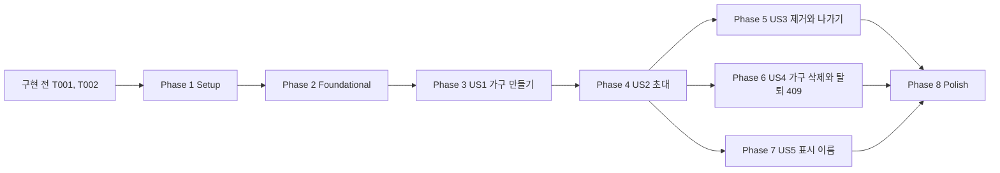

# Tasks: 002 가구와 가족 공유

**Input**: `specs/002-household-sharing/`의 spec.md, plan.md, research.md, data-model.md, contracts/openapi.yaml, quickstart.md

**Tests**: constitution V에 따라 테스트 작업을 둡니다. 테스트 작업마다 검증하는 spec 시나리오(US번호-시나리오 번호), FR, SC를 적었습니다. "보안 경계" 묶음의 테스트(research R16의 B1~B12)는 구현과 다른 쪽이 spec과 설계 문서(결정 기록 0011, 0012, 0013, API 공통 규칙, 데이터 모델, C4 컴포넌트)에서 직접 쓰고, 같은 단계의 구현 작업보다 먼저 씁니다. 한 B 번호가 여러 단계에 걸치면 그 단계의 경로에 해당하는 몫을 그 단계에서 씁니다. 데이터베이스가 걸린 테스트는 Testcontainers PostgreSQL 18입니다. 재인증 5분, 60초 미래, 초대 만료는 `MutableClock`으로, 동시 요청은 다른 연결이 가구 행을 먼저 잠근 채 요청 N개가 그 잠금을 기다리는 것을 `pg_stat_activity`의 `wait_event_type = 'Lock'` 수로 확인한 뒤 잠금을 해제하는 방식으로 실제로 겹치게 합니다(research R9). 오류 응답 본문이 걸린 요구는 MockMvc와 실제 서버(`RANDOM_PORT`) 둘 다로 확인합니다(research R16). 아직 만들지 않은 경로를 쓰는 테스트 항목은 `@Disabled("T0NN에서 켬")`(웹은 `it.skip`)으로 두고 적힌 작업에서 켭니다.

**Organization**: 사용자 스토리별 단계이고 spec의 우선순위 순서(US1, US2, US3, US4, US5)입니다. 002는 나누지 않습니다(research R18, 2026-11-17 저장소 소유자 결정). research R14에서 "새로 정함"으로 표시한 화면 문구는 그대로 사용합니다(2026-11-17 저장소 소유자 결정).

## Format: `[ID] [P?] [Story] Description`

- **[P]**: 다른 파일을 다루고 끝나지 않은 작업에 기대지 않아 함께 진행할 수 있음
- **[Story]**: 사용자 스토리(US1~US5)
- 경로는 저장소 루트 기준입니다. 서버는 `src/main/java/estate/`, 서버 테스트는 `src/test/java/estate/`, 웹 화면은 `web/`입니다. 보안 경계 테스트는 `src/test/java/estate/household/security/`에 B 번호마다 파일 하나를 두고, 단계마다 그 파일에 테스트 메서드를 추가합니다.

---

## 구현 전

**Purpose**: constitution IV의 순서 조건(설계 문서를 먼저 수정)과 CLAUDE.md 구현 절의 점검

- [X] T001 `docs/*` 브랜치(`develop/v1`에서 만든 워크트리)에서 research R17 표의 설계 문서 수정을 하고 `develop/v1`에 `--no-ff` 머지한 뒤, 이 브랜치를 `git rebase develop/v1`로 그 위에 올리고 `git push --force-with-lease`로 올린다. 대상: `docs/adr/0011-household-sharing.md`(결정 절의 "링크를 열어 로그인하면 바로 member가 되어"와 멤버십 없이 할 수 있는 동작 목록에 초대 확인 추가, 상태 절에 날짜와 이유), `docs/design/wireframes.md`(화면 이동 그림과 그 아래 불릿, 로그인 화면 표, 가구 없음 절, 가족 초대 절의 만료 기간 선택과 확인 화면 문장과 상태 표현 삭제, 새 화면 넷, 정하지 않은 것 표의 "초대 링크의 만료 기간" 행 삭제), `docs/design/wireframes/login.wireloom`, `docs/design/wireframes/family-invite*.wireloom`과 새 화면의 `.wireloom`(SVG는 `npm run render`로 다시 만듦), `docs/architecture/api-conventions.md`(넘겨받은 항목 표의 만료 기간 네 행과 토큰 행, 동시 수락 방법 행의 정하는 곳을 "002 plan research R9에서 정함"으로 수정. 멤버십 없이 허용하는 동작 목록과 `x-permission: none`을 사용할 수 있는 동작 목록과 응답에 담는 개인정보 표의 표시 이름 수신자에 초대 확인 추가. 권한 확인 5단계 정의에 자기 자신을 대상으로 한 구성원 제거 거절 추가), `docs/architecture/data-model.md`(다른 문서로 넘기는 것 표. 초대 수락의 처리 순서 문장은 T041이 이 문서에 맞췄으므로 수정하지 않음), `docs/architecture/c4-component.md`(화면별 컴포넌트 표의 초대 확인 화면 행 추가와 로그인 행의 초대 수락 문구 수정, 모듈 사이 표, 권한 확인 5단계 설명에 자기 제거 거절 추가, 삭제 연쇄 절의 가구 삭제 부모 행 문장 수정). rebase 전에 이 브랜치의 아직 커밋하지 않은 spec, plan, research, data-model, contracts, quickstart, tasks를 커밋해야 한다. 커밋, 머지, push, rebase는 모두 사용자 허락을 받은 뒤 한다
- [X] T002 `specs/002-household-sharing/checklists/requirements.md`의 미완료 항목이 없는지 확인한다(CLAUDE.md 구현 절). 있으면 구현 전에 사용자에게 알린다

---

## Phase 1: Setup

**Purpose**: 스키마와 오류 코드

- [X] T003 `src/main/resources/db/migration/V2__household.sql`을 만든다(data-model.md 그대로): 시퀀스 `household_id_seq`, `invitation_id_seq`(기본 증가값 1). `household`는 `id` "bigint, 기본 키" 하나(가구 이름 열 없음). `household_member`는 `household_id` "bigint, 비울 수 없음, `household(id)` 참조", `user_id` "bigint, 비울 수 없음, `"user"(id)` 참조", `role` "text, 비울 수 없음"과 "체크 제약 `role in ('owner', 'member')`", `joined_at` "timestamptz, 비울 수 없음", "기본 키 `(household_id, user_id)`, 유니크 제약 `household_member_user_id_key (user_id)`". `invitation`은 `id` "bigint, 기본 키", `household_id` "bigint, 비울 수 없음, `household(id)` 참조", `created_by` "bigint, 비울 수 없음, `"user"(id)` 참조", `token_hash` "bytea, 비울 수 없음"과 "유니크 제약, 체크 제약 `octet_length(token_hash) = 32`", `status` "text, 비울 수 없음"과 "체크 제약 `status in ('대기', '수락', '취소')`", `expires_at`과 `created_at` "timestamptz, 비울 수 없음", "체크 제약 `invitation_expiry_after_creation check (expires_at > created_at)`". 외래 키는 모두 "연쇄 삭제가 없습니다". 인덱스는 "기본 키와 `token_hash` 유니크만" 둔다. 001의 `user`, `spring_session`, `spring_session_attributes`는 바꾸지 않는다
- [X] T004 [P] 오류 코드 열한 개를 `src/main/java/estate/common/web/ProblemCode.java`에 추가한다(research R5 표의 상태, `code`, `title`, `detail` 그대로, `type`의 끝 이름은 contracts/openapi.yaml 예시와 같음): `NO_HOUSEHOLD`(403), `PERMISSION_DENIED`(403), `NOT_FOUND`(404), `HAS_HOUSEHOLD`, `HOUSEHOLD_FULL`, `INVITATION_PENDING`, `INVITATION_NOT_PENDING`, `INVITATION_REVOKED`, `INVITATION_USED`, `INVITATION_EXPIRED`, `ALREADY_IN_THIS_HOUSEHOLD`(모두 409). 문구는 코드마다 고정이고 요청 값을 담지 않는다
- [X] T005 스키마 테스트 `src/test/java/estate/schema/HouseholdSchemaTest.java`: 43바이트 `token_hash` 저장이 체크 제약으로 실패, `role`과 `status`에 목록 밖 값이 체크 제약으로 실패, 같은 `user_id`의 두 번째 멤버십이 `household_member_user_id_key` 위반으로 실패, `expires_at = created_at`이 `invitation_expiry_after_creation`으로 실패, 멤버십이나 초대가 남은 `household` 행 삭제와 멤버십이 남은 `"user"` 행 삭제가 외래 키 위반으로 실패(연쇄 삭제 없음, research R10)

---

## Phase 2: Foundational

**Purpose**: 모든 사용자 스토리가 함께 사용하는 것. 이 단계가 끝나야 사용자 스토리를 시작합니다.

- [X] T006 권한 확인 장치의 타입을 선언한다 `src/main/java/estate/household/authz/`(research R2, 동작 코드 없음): 표시 `@Access`(값 `Permission`과 `MembershipRule`, 멤버십 규칙 기본값 `REQUIRED`), `MembershipRule`(`REQUIRED`, `OPTIONAL`, `ABSENT`), `Permission`(`household:read`, `invitation:read`, `invitation:create`, `invitation:revoke`, `member:remove`, `member:leave`, `household:delete`, `profile:write`, 그리고 `NONE`. 역할마다 허용하는 키는 결정 기록 0011 권한 키 표 그대로: owner는 `member:leave`만 거부, member는 `household:read`, `member:leave`, `profile:write`만 허용), 인자 값 `HouseholdMembership(householdId, userId, role)`. 0011의 다른 키는 두지 않는다(constitution VI). `x-permission: none`(`NONE`)은 3단계를 통과한다(API 공통 규칙 권한 확인 3단계)
- [X] T007 테스트 지원을 만든다 `src/test/java/estate/support/`(research R16): `LoginIntegrationTest.Reset`이 테스트마다 `invitation`, `household_member`, `household` 행을 이 순서로 삭제하도록 추가(세션 행 삭제보다 먼저). 가구 도우미 `Households.java`: 테스트마다 새 `sub`의 가짜 계정으로 로그인, `POST /api/v1/household`로 가구 만들기, owner의 초대 발급과 다른 사람의 수락 API로 member 만들기, 가구 둘과 사용자 넷(가구 A의 owner와 member, 가구 B의 owner, 가구 없는 사람)을 쿠키와 사용자 번호로 반환, API로 만들 수 없는 상태(구성원이 둘이면서 수락 대기 중인 초대가 있음, 정해진 `status`, `created_at`, `expires_at`의 초대)만 SQL로 삽입. 잠금 도우미 `HouseholdLock.java`: 다른 연결에서 `select id from household where id = :id for update`로 잠금을 유지하고, `pg_stat_activity`의 `wait_event_type = 'Lock'` 수가 N이 될 때까지 기다린 뒤 커밋이나 롤백으로 잠금을 해제한다. 커밋하지 않은 가구와 멤버십 행을 다른 연결에 삽입해 두는 도우미도 둔다. `src/test/java/estate/common/web/ErrorResponseLeakTest.java`의 실제 서버 로그인 절차를 `RealServerClient.java`로 옮겨 함께 사용한다. API를 사용하는 도우미는 가구 만들기(T021), 초대 발급과 수락(T042) 뒤에 동작한다

### 보안 경계 테스트 (구현과 다른 쪽이 먼저 작성)

- [X] T008 [P] B11 `src/test/java/estate/household/security/AccessAnnotationSecurityTest.java`: `RequestMappingHandlerMapping`의 모든 `/api/**` 핸들러에 `@Access`가 있음. `specs/*/contracts/openapi.yaml`(SnakeYAML로 읽음)의 `/api/` 경로와 메서드마다 핸들러가 있고 `x-permission` 값이 표시의 권한 키와 같음(`none`은 `NONE`). 두 계약에 같은 경로와 메서드(`DELETE /api/v1/me`)가 있으면 값이 서로 같음(research R2, FR-025, FR-026). "계약 경로마다 핸들러가 있음" 항목은 마지막 경로(T071) 뒤 T080에서 켠다
- [X] T009 [P] B2(공통 규칙) `src/test/java/estate/household/security/AccessInterceptorSecurityTest.java`: 이 테스트에서만 등록하는 테스트 전용 컨트롤러(`@TestConfiguration` 안, T008의 컨텍스트에 섞이지 않음)로 research R2 멤버십 규칙 표를 그대로 확인한다. `REQUIRED`는 멤버십이 없으면 403 `NO_HOUSEHOLD`, `OPTIONAL`은 멤버십이 없어도 통과, `ABSENT`는 멤버십이 있으면 409 `HAS_HOUSEHOLD`, 역할에 권한 키가 없으면 403 `PERMISSION_DENIED`, `@Access`가 없는 `/api/**` 핸들러는 403 `PERMISSION_DENIED`(0011 기본 거부). 로그인 상태가 없으면 멤버십과 본문과 관계없이 401 `UNAUTHENTICATED`. 거절되는 요청에 깨진 JSON 본문을 보내도 400이 아니라 403(권한 확인기가 본문 읽기 전, API 공통 규칙). 멤버십이 있을 때 `NONE` 핸들러는 3단계를 통과하고, 멤버십이 없을 때는 `REQUIRED`가 2단계에서 403 `NO_HOUSEHOLD`(API 공통 규칙 3단계). 인자 해석기가 넘기는 `householdId`, `userId`, `role`이 데이터베이스 행과 같음(FR-023 (1)~(3)). 멤버십은 SQL로 삽입한다
- [X] T010 [P] B4(공통) `src/test/java/estate/household/security/MembershipRecheckSecurityTest.java`: 같은 세션 쿠키로 가구 요청이 200인 뒤 SQL로 멤버십 행을 삭제하면 다음 요청이 403 `NO_HOUSEHOLD`, 역할을 SQL로 바꾸면 다음 요청부터 바뀐 역할의 권한으로 확인함(역할을 세션에 담지 않음, FR-019). T009의 테스트 전용 컨트롤러 방식을 쓴다

### 구현

- [X] T011 가구 모듈의 도메인과 저장소 `src/main/java/estate/household/domain/`(research R1, data-model.md): 엔티티 `Household`, `HouseholdMember`(기본 키 `(household_id, user_id)`), `Invitation`, 역할 열거형(`owner`, `member`), 초대 상태 열거형(`대기`, `수락`, `취소`. 만료는 상태가 아님). `Household`와 `Invitation`의 `id`는 `@GeneratedValue(strategy = SEQUENCE)`, `allocationSize = 1`로 `household_id_seq`, `invitation_id_seq`를 사용. 가구 행 잠금은 `JdbcClient`의 `select id from household where id = :id for update`(결정 기록 0016)이고 빈 결과는 삭제된 가구
- [X] T012 권한 확인기와 인자 해석기 `src/main/java/estate/household/authz/`(research R2, R3): `/api/**`에 등록한 `HandlerInterceptor`가 Spring Security 필터 뒤, 인자 해석 앞에서 요청마다 `household_member`에서 세션 사용자의 멤버십을 한 번 읽어 R2 표대로 2단계와 3단계를 확인하고 멤버십을 요청 속성에 둔다. 인자 해석기가 그 값을 `HouseholdMembership`으로 넘긴다. 감싸는 계층 없이 `WebMvcConfigurer`로 등록한다. T009, T010이 통과한다
- [X] T013 001 핸들러에 표시를 지정한다 `src/main/java/estate/user/web/MeController.java`, `LogoutController.java`(research R4): `GET /api/v1/me`는 `NONE`과 `OPTIONAL`, `PATCH /api/v1/me`는 `profile:write`와 `OPTIONAL`, `DELETE /api/v1/me`는 `NONE`과 `ABSENT`, `POST /api/v1/logout`은 `NONE`과 `OPTIONAL`. 001의 테스트가 모두 그대로 통과한다
- [X] T014 [P] 사용자 모듈의 공개 조회 `src/main/java/estate/user/application/UserProfiles.java`와 테스트 `src/test/java/estate/user/UserProfilesTest.java`(research R1): 사용자 번호 목록을 받아 표시 이름(비어 있으면 null), 복호화한 로그인 이메일(AAD `user.login_email:{id}`), 검증 여부를 반환. 없는 번호는 결과에 없음. `MeController`의 기존 복호화 코드는 그대로 둔다
- [X] T015 [P] API 호출 `web/src/api/client.ts`(research R14): JSON 본문과 `Content-Type: application/json`을 보내는 인자 추가, 함께 보는 사람 목록 호출(`GET /api/v1/household`, contracts의 `Members`와 `Member` 형식), `isNoHousehold`(403 `NO_HOUSEHOLD`), `Me.displayName`을 `string | null`로 수정(contracts `type: [string, "null"]`). 오류는 001대로 `code`만 읽는다
- [X] T016 앱 상태 `web/src/App.tsx`, `web/tests/unit/api-mock.ts`, 테스트 `web/tests/unit/app-state.test.tsx`(research R14): 상태 다섯(확인 중, 로그인 없음, 가구 없음, 가구 있음, 오류). 내 정보 조회가 성공하면 함께 보는 사람 목록을 호출해 200이면 가구 있음, 403 `NO_HOUSEHOLD`면 가구 없음, 그 밖의 오류는 오류 상태. 어느 가구 요청이든 403 `NO_HOUSEHOLD`를 받으면 가구 없음으로 바꾸고 `/`로 이동(FR-019). 2026-11-19 최종 리뷰 뒤로는 목록을 다시 읽어 그 응답으로 정함(research R14 흐름도 아래 문단). 화면 테스트가 세 갈래와 이동을 확인한다

**Checkpoint**: 권한 확인 장치, 테스트 도우미, 화면의 가구 여부가 준비되어 사용자 스토리를 시작할 수 있습니다.

---

## Phase 3: User Story 1 - 가구를 만든다 (P1) MVP

**Goal**: 가구가 없는 사람이 가구 없음 화면에서 가구를 만들어 owner가 되고 임시 첫 화면으로 갑니다.

**Independent Test**: 가짜 구글 계정으로 로그인해 가구 없음 화면에서 가구 만들기를 누르면 임시 첫 화면에 본인만 owner로 보이는지, 이미 가구가 있는 사용자의 가구 만들기 요청이 거절되는지 확인합니다.

### 보안 경계 테스트 (구현과 다른 쪽이 먼저 작성)

- [X] T017 [P] [US1] B2(US1 몫) `src/test/java/estate/household/security/ResponseOrderSecurityTest.java`: `POST /api/v1/household`는 로그인 없음이면 401, 허용 밖 Origin이면 403 `ORIGIN_REJECTED`이고 가구가 생기지 않음, 멤버십이 있으면 409 `HAS_HOUSEHOLD`이고 가구 수와 멤버십이 그대로(US1-3, FR-005). 멤버십 없는 사람의 `GET /api/v1/household`는 403 `NO_HOUSEHOLD`(US1-6, FR-026). `GET /api/v1/household/invitations`의 같은 확인은 T032에서 추가한다
- [X] T018 [P] [US1] B6(US1 몫) `src/test/java/estate/household/security/HouseholdConcurrencySecurityTest.java`: 같은 사람의 동시 가구 만들기를 두 순서로 만든다. 다른 연결에 그 사람의 커밋하지 않은 가구와 멤버십 행을 삽입해 두고 요청을 보내 기다리게 한 뒤, 커밋하면 409 `HAS_HOUSEHOLD`이고 요청 쪽 가구 행이 롤백되어 남지 않음, 롤백하면 201(US1-4, FR-004, research R9). 탈퇴와 같은 사람의 가구 만들기를 두 순서로 겹치면(테스트가 다른 연결에서 사용자 행을 먼저 `FOR UPDATE`로 잠가 둠) 탈퇴가 먼저일 때 가구 만들기가 Problem 형식의 500이고 가구와 멤버십 행이 남지 않음, 가구 만들기가 먼저일 때 탈퇴가 409 `HAS_HOUSEHOLD`이고 사용자 행이 남음(research R9)

### 동작 테스트

- [X] T019 [P] [US1] `src/test/java/estate/household/HouseholdCreateTest.java`: 가구 만들기가 201이고 본문이 없음, 멤버십 역할이 `owner`이고 `joined_at`이 `Clock` 현재 시각(FR-001), 함께 보는 사람 목록에 본인 한 명이 `role: owner`, `me: true`, 복호화한 로그인 이메일, `emailVerified`, 표시 이름으로 나옴(US1-2). 가구를 만들지 않고 로그아웃과 로그인을 세 번 반복해도 가구 행과 멤버십 행이 없음(US1-7, FR-001). `email_verified=false` 계정도 가구를 만들고 목록에 `emailVerified: false`(spec Edge Cases). 구글이 이름을 보내지 않은 계정은 목록의 `displayName`이 null
- [X] T022 [US1] 실제 서버 확인 `src/test/java/estate/household/HouseholdErrorBodyServerTest.java`(`@SpringBootTest(webEnvironment = RANDOM_PORT)`, T007의 `RealServerClient`): 멤버십 없는 사람의 `GET /api/v1/household` 403 `NO_HOUSEHOLD`와 가구가 있는 사람의 `POST /api/v1/household` 409 `HAS_HOUSEHOLD`의 본문이 `application/problem+json`이고 contracts 예시의 `type`, `title`, `status`, `detail`, `code`와 같으며 T017의 MockMvc 본문과 같음(US1-3, US1-6). 구현과 다른 쪽이 spec과 설계 문서에서 작성하고, T021 뒤 통과시킨다

### 구현

- [X] T020 [US1] 가구 만들기 `src/main/java/estate/household/application/HouseholdService.java`(research R9): 한 트랜잭션에서 가구 행과 owner 멤버십 행(`joined_at`은 주입한 `Clock`)을 삽입. 유니크 위반이 제약 이름 `household_member_user_id_key`일 때만 409 `HAS_HOUSEHOLD`로 바꾸고 다른 위반은 그대로 던짐
- [X] T021 [US1] 가구 컨트롤러 `src/main/java/estate/household/web/HouseholdController.java`(contracts): `POST /api/v1/household`(`@Access(NONE, ABSENT)`, 201, 본문 없음), `GET /api/v1/household`(`household:read`, `REQUIRED`). 목록은 가구 모듈 서비스의 멤버십과 `UserProfiles`의 결과를 컨트롤러(화면 API)가 합쳐 owner, member 순서로 반환(`userId`, `displayName`, `role`, `loginEmail`, `emailVerified`, `me`, C4 컴포넌트의 "화면 API 어댑터가 합침"). T017, T018, T019, T022가 통과한다

### 웹 화면

- [X] T023 [US1] 가구 없음 화면 `web/src/pages/NoHouseholdPage.tsx`, `web/src/api/client.ts`(research R14 표 그대로): "아직 가구가 없습니다.", "가족과 함께 볼 기록을 모으려면 가구를 만드세요.", "가족에게 받은 초대 링크가 있으면 그 링크를 여세요.", 버튼 "가구 만들기", "로그아웃", "탈퇴"(FR-002). 가구 만들기는 `POST /api/v1/household` 뒤 목록을 다시 읽어 임시 첫 화면을 그림. 409 `HAS_HOUSEHOLD`(다른 탭에서 이미 만듦)도 목록을 다시 읽어 임시 첫 화면을 그림
- [X] T024 [US1] 임시 첫 화면의 기본 `web/src/pages/HomePage.tsx`, `web/src/App.tsx`(research R14 임시 첫 화면 표): 가구 있음 상태의 `/`에 그림. "함께 보는 사람" 제목, 사람마다 표시 이름, 내 항목의 "(나)", 역할 "owner" 또는 "member", 로그인 이메일, 검증되지 않았으면 "검증되지 않음", 표시 이름이 없으면 로그인 이메일만. 아래 버튼 "로그아웃". 탈퇴 버튼은 두지 않음(FR-021). owner와 member에게만 보이는 영역은 US2~US5 단계에서 추가한다
- [X] T025 [P] [US1] 화면 테스트 `web/tests/unit/household-create.test.tsx`와 001 테스트 기대값 수정 `web/tests/unit/login.test.tsx`, `web/tests/unit/withdraw.test.tsx`: 가구 없음 화면의 안내 셋과 버튼 셋(US1-1, FR-002), 가구 만들기를 누르면 다른 입력 없이 임시 첫 화면이고 본인 한 명이 "(나)"와 owner로 보임(US1-2, SC-001), 로그인 뒤 목록이 200이면 임시 첫 화면, 403 `NO_HOUSEHOLD`면 가구 없음 화면(US1-5, FR-003), 가구 만들기 409면 임시 첫 화면, 임시 첫 화면에 탈퇴 버튼이 없음. 001 테스트의 가구 없음 화면 기대값(안내 문구, 버튼 둘)을 새 문구와 버튼 셋으로 수정
- [X] T026 [US1] 001 e2e 기대값 수정 `web/tests/e2e/login.spec.ts`: 가짜 구글 로그인 뒤 기다리는 문구와 "가구 없음과 탈퇴 확인" 테스트의 가구 없음 화면 문구를 FR-002의 안내 셋과 "가구 만들기" 버튼으로 수정

**Checkpoint**: US1만으로 가구 만들기와 임시 첫 화면(본인만 보이는 목록)이 동작합니다. 사용자가 브라우저로 확인할 순서는 quickstart "가구 만들기 (사용자 스토리 1)" 1~6번입니다.

---

## Phase 4: User Story 2 - 초대 링크로 가족을 들인다 (P1)

**Goal**: owner가 만료 기간을 골라 초대를 발급하고, 가족이 링크를 열어 구글 로그인과 초대 확인 화면을 거쳐 member가 됩니다. owner는 보낸 초대를 보고 취소합니다.

**Independent Test**: owner가 초대 링크를 만들고, 다른 가짜 구글 계정이 링크를 열어 로그인했을 때 member가 되는지, 만료, 취소, 재사용, 이미 가구가 있는 사람, 동시 수락이 정해진 대로 거절되는지 확인합니다.

### 보안 경계 테스트 (구현과 다른 쪽이 먼저 작성)

- [X] T027 [P] [US2] B9 `src/test/java/estate/household/security/InvitationInputTypeSecurityTest.java`(research R12): 계약 `CreateInvitation`의 `type: object`, `required: [expiresInDays]`, `additionalProperties: false`, `expiresInDays`의 `type: integer`, `minimum: 1`, `maximum: 7`과 `InvitationToken`의 `type: object`, `required: [token]`, `additionalProperties: false`, `token`의 `type: string`을 값마다 하나씩 보낸다. 마지막 구글 인증이 5분 안인 owner의 초대 발급에서 만료 기간 1과 7은 201, 0, 8, 1.5, 3.0, 1e0, "3", true, null, 키 없음, 배열, 객체, 2147483648은 400 `VALIDATION_FAILED`와 `errors[0].pointer` `#/expiresInDays`, `detail` "만료 기간은 1일부터 7일까지 고를 수 있습니다.", 다른 키, 깨진 JSON, 빈 본문, 객체가 아닌 본문은 400 `#`이고 모두 초대 행이 생기지 않음(US2-3, FR-006). 초대 확인과 수락에서 `token`이 없거나 null이거나 숫자면 400 `#/token`과 "초대 링크를 확인해 주세요.", 다른 키는 400 `#`, 문자열이지만 43자 base64url이 아니면 404 `NOT_FOUND`. 응답 본문에 보낸 값이 없음
- [X] T028 [P] [US2] B8 `src/test/java/estate/household/security/InvitationExpirySecurityTest.java`(research R11, spec US2-4와 FR-010의 올림 규칙): 만료 기간 1~7 각각 `expires_at`이 `created_at` 더하기 N 곱하기 24시간이고 `created_at`은 마이크로초로 자른 `Clock` 시각(US2-2, FR-007). 1일 초대는 23시간 59분 59초와 정확히 24시간에 수락, 24시간 1초에 409 `INVITATION_EXPIRED`이고 멤버십이 없음. 7일 초대는 6일 23시간 59분 59초에 수락, 7일 1초에 거절(US2-11, SC-003). 초대 확인 응답 뒤 `Clock`을 만료 뒤로 옮겨 수락하면 409 `INVITATION_EXPIRED`(US2-11). 보낸 초대 목록의 `remainingDays`는 3일 정각(3일을 골라 만든 직후)이면 3, 2일 5시간이면 3, 5시간이면 1, 만료 시각 정각이면 1(US2-4, FR-010). 만료된 초대는 목록에 없고 수락 대기 중인 초대로 세지 않아 새 발급이 201이며, 취소하면 409 `INVITATION_NOT_PENDING`(spec Edge Cases, data-model.md 초대의 상태)
- [X] T029 [P] [US2] B7 `src/test/java/estate/household/security/InvitationTokenLeakSecurityTest.java`(`OutputCaptureExtension`): 토큰 원문은 초대 발급 응답에만 있고 계약의 `pattern: "^[A-Za-z0-9_-]{43}$"`에 맞음. `token_hash`는 32바이트이고 토큰 ASCII 바이트의 SHA-256이며 원문 바이트와 다름. 보낸 초대 목록, 초대 확인, 오류 응답에 토큰도 해시의 16진수도 없음(FR-008). 초대 확인 응답의 키는 `inviterDisplayName` 하나이고 owner의 이메일과 구성원 목록이 없음(US2-9, FR-012). 로그 출력과 모든 응답 본문에 토큰 원문, 해시의 16진수, 가짜 이메일, 가짜 표시 이름이 없음(토큰이 든 깨진 JSON 요청 포함, 표시 이름은 목록, 내 정보, 초대 확인 응답의 그 필드만 허용)(FR-028, SC-009). 구성원 제거, 가구 나가기, 가구 삭제, 표시 이름 400 흐름의 같은 확인도 지금 쓰고 T080에서 켠다
- [X] T030 [P] [US2] B6(US2 몫) `src/test/java/estate/household/security/HouseholdConcurrencySecurityTest.java`: 가구 없는 사용자 열 명이 같은 링크로 수락을 보내 열 건 모두 가구 행 잠금을 기다린 뒤 잠금을 해제하면 정확히 1건이 204, 9건이 409 `INVITATION_USED`이고 구성원이 둘(US2-16, FR-015, SC-003). 같은 가구의 초대 발급 두 건을 같은 방식으로 겹치면 1건만 201, 다른 건은 409 `INVITATION_PENDING`이고 초대 행이 하나(US2-5, FR-009). 수락과 초대 취소를 두 순서로 겹치면 취소가 먼저일 때 수락이 409 `INVITATION_REVOKED`, 수락이 먼저일 때 취소가 409 `INVITATION_NOT_PENDING`
- [X] T031 [P] [US2] B3(US2 몫) `src/test/java/estate/household/security/HouseholdReauthSecurityTest.java`: `Clock`을 옮겨 초대 발급이 마지막 구글 인증 5분 정각에 201, 5분 1초에 401 `REAUTH_REQUIRED`이고 초대 행이 생기지 않음, 마지막 인증 기록 없음과 60초 넘는 미래도 401(FR-022, SC-005). 마지막 인증 기록 없음은 이 테스트에서 빼고 `ReauthJudgeTest`의 null 경우가 맡는다(로그인이 늘 이 시각을 채워 HTTP로 그런 세션을 만들 수 없음, 001과 같음. 2026-11-18 구현 2회차). 초대 취소는 인증이 5분보다 오래되어도 204(민감 동작이 아님)
- [X] T032 [P] [US2] B2(US2 몫) `src/test/java/estate/household/security/ResponseOrderSecurityTest.java`: member가 인증이 오래된 상태로 초대 발급을 요청하면 403 `PERMISSION_DENIED`(US3-11 첫째 예, SC-007). 인증이 오래된 owner의 초대 발급은 깨진 JSON이어도 401 `REAUTH_REQUIRED`, 인증이 새로우면 같은 본문이 400, 올바른 본문이면서 수락 대기 중인 초대가 있으면 409(FR-023). 멤버십 없는 사람의 `GET`과 `POST /api/v1/household/invitations`, `DELETE /api/v1/household/invitations/{invitationId}`는 403 `NO_HOUSEHOLD`(US1-6, FR-026). 초대 확인과 수락은 멤버십 없이 통과하고 로그인 없음이면 401(FR-012). 허용 밖 Origin의 초대 발급, 취소, 확인, 수락은 403 `ORIGIN_REJECTED`이고 아무것도 바뀌지 않음. 다른 가구의 초대 취소는 그 초대가 대기 중이 아니어도 409가 아니라 404
- [X] T033 [P] [US2] B1(초대 몫) `src/test/java/estate/household/security/CrossHouseholdNotFoundSecurityTest.java`: 가구 A의 owner가 `DELETE /api/v1/household/invitations/{가구 B의 초대 번호}`를 보내면 404이고, 본문이 없는 번호, `abc`, `long` 범위를 넘는 번호의 응답과 상태 코드와 본문이 같으며 가구 B의 초대가 바뀌지 않음(US3-12, FR-024, SC-006). 가구 A의 보낸 초대 목록에 가구 B의 초대가 없고, 가구 A의 발급이 가구 B의 초대 수를 바꾸지 않음
- [X] T034 [P] [US2] B11(US2 몫) `src/test/java/estate/household/security/RolePermissionSecurityTest.java`: member의 보낸 초대 목록, 초대 발급(인증 5분 안), 초대 취소는 403 `PERMISSION_DENIED`이고 초대가 바뀌지 않음(US2-6, FR-025)
- [X] T035 [P] [US2] B12(US2 몫) `web/tests/unit/invite-token-security.test.tsx`(구현과 다른 쪽이 spec FR-012, FR-022, 결정 기록 0013, research R7에서 작성): `/invite#토큰`을 열면 화면을 그리기 전에 주소에서 `#` 뒤가 사라지고, 로그인 화면의 로그인 버튼 주소의 `returnTo`가 `/invite`이며 토큰이 없음. 토큰은 `sessionStorage`에만 있고 `localStorage`, 요청 주소, 질의 값에 없으며 초대 확인과 수락 요청의 본문으로만 나감. 들어가기의 성공과 실패, 취소, 확인 단계의 실패 안내 뒤 `sessionStorage`에서 토큰이 삭제됨(초대 확인과 들어가기의 401은 지우지 않음, research R7). 로그인하지 않았으면 확인 화면 대신 로그인 화면. 초대 발급의 재인증에서 돌아와도 발급을 자동으로 다시 보내지 않고 고른 만료 기간을 저장하지 않음

### 동작 테스트

- [X] T036 [P] [US2] `src/test/java/estate/household/InvitationIssueTest.java`: 발급 응답이 201이고 `id`, `token`, `createdAt`, `expiresAt`이 있으며 시각은 `+09:00` 오프셋(US2-2, research R11). 수락 대기 중이면서 만료되지 않은 초대가 있으면 409 `INVITATION_PENDING`, 구성원이 둘이면 409 `HOUSEHOLD_FULL`이고 초대 수가 그대로(US2-5, FR-009). SQL로 만든 두 조건이 겹친 상태(구성원이 둘이면서 수락 대기 중이고 만료되지 않은 초대가 있음)에서도 발급이 409 `HOUSEHOLD_FULL`(FR-009 끝 문장). 대기 중인 초대를 취소하면 204이고 상태가 `취소`이며 새 발급이 201, 수락되었거나 취소되었거나 만료된 초대를 취소하면 409 `INVITATION_NOT_PENDING`이고 행이 그대로(US2-7, FR-011). 보낸 초대 목록은 수락 대기 중이면서 만료되지 않은 초대만이고 `id`, `createdAt`, `expiresAt`, `remainingDays`만 담으며 없으면 빈 배열(US2-4, FR-010)
- [X] T037 [P] [US2] `src/test/java/estate/household/InvitationAcceptTest.java`: 초대 확인은 `inviterDisplayName`(초대를 발급한 owner의 현재 표시 이름, 비어 있으면 null)을 반환하고 초대와 멤버십을 바꾸지 않으며 두 번 호출해도 결과가 같음(US2-9, US2-10, FR-012). 수락하면 204, member 멤버십이 생기고 `joined_at`이 `Clock` 현재 시각, 초대가 `수락`, 양쪽의 함께 보는 사람 목록에 수락한 사람의 표시 이름과 로그인 이메일이 보임(US2-10, US2-17, SC-002, FR-001). 사유 순서는 research R8 순서도 그대로: 없는 토큰 404, 취소 409 `INVITATION_REVOKED`, 사용됨 409 `INVITATION_USED`, 구성원이 이미 둘인 가구의 링크(SQL로 만든 상태) 409 `HOUSEHOLD_FULL`(US2-12). 확인 화면을 연 뒤 취소되거나 다른 사람이 수락한 초대를 수락하면 같은 코드(US2-12). 다른 가구에 속한 사람은 유효한 링크에 409 `HAS_HOUSEHOLD`이고 초대가 `대기`로 남음(US2-13 첫 문장, FR-014), 만료되었거나 취소된 링크에는 409 `HAS_HOUSEHOLD`가 아니라 `INVITATION_EXPIRED`나 `INVITATION_REVOKED`(US2-14, FR-013). owner가 자기 가구의 유효한 링크를 열면 409 `ALREADY_IN_THIS_HOUSEHOLD`이고 초대가 `대기`로 남음(US2-15). 거절 응답에 그 가구의 구성원 정보가 없음(FR-013). `email_verified=false` 계정도 수락됨(spec Edge Cases). 나가기나 가구 삭제 뒤 같은 링크의 수락(US2-13 둘째 문장)은 T055, T069에서 확인한다
- [X] T038 [US2] 실제 서버 확인 `src/test/java/estate/household/HouseholdErrorBodyServerTest.java`(US2 몫): 초대 확인과 수락의 409 여섯 코드, 형식이 틀린 토큰의 404, 초대 발급의 400 `#/expiresInDays`와 `#` 본문이 contracts 예시와 같고 MockMvc 본문과 같음(US2-3, US2-12, US2-13, US2-14, US2-15). 구현과 다른 쪽이 spec과 설계 문서에서 작성하고, T042 뒤 통과시킨다

### 구현

- [X] T039 [US2] 초대 토큰 `src/main/java/estate/household/application/InvitationToken.java`(research R6): `SecureRandom` 32바이트를 패딩 없는 base64url 43자로 인코딩, 해시는 43자 문자열 ASCII 바이트의 SHA-256 32바이트, 형식 확인 `^[A-Za-z0-9_-]{43}$`. SHA-256은 가구 모듈 안에서 `MessageDigest`로 직접 만든다(001의 `HashedSessionIdGenerator`는 package-private이고 16진수 문자열을 반환하므로 호출하지 않는다). 원문과 해시를 예외 메시지와 로그에 쓰지 않는다
- [X] T040 [US2] 초대 발급, 취소, 목록 `src/main/java/estate/household/application/InvitationService.java`(research R3, R9, R11, R12): 발급은 `ReauthJudge`(6단계) 뒤 본문 문자열을 `ObjectMapper.readTree`로 읽어 "결과가 객체이고 키가 `expiresInDays` 하나이며 값이 `JsonNode.isInt()`이고 1 이상 7 이하일 때만" 받고, 가구 행을 잠근 뒤(빈 결과면 403 `NO_HOUSEHOLD`) 구성원이 둘이면 409 `HOUSEHOLD_FULL`, `status = '대기' and expires_at >= :now`인 초대가 있으면 409 `INVITATION_PENDING`, 아니면 `created_at`(마이크로초로 자른 `Clock` 시각)과 `expires_at`(더하기 N 곱하기 24시간)으로 삽입하고 토큰 원문을 반환. 둘 다 해당하는 상태(API로는 만들 수 없음)에서는 구성원 수를 먼저 확인해 409 `HOUSEHOLD_FULL`이고 화면은 "구성원이 둘이라 새 초대를 만들 수 없습니다."(spec FR-009, 2026-11-17 메인 결정). 취소는 경로 번호를 문자열로 받아 숫자가 아니거나 `long` 범위를 넘으면 404, 가구 행을 잠근 뒤 `household_id = :mine`으로 찾고 없으면 404, `대기`가 아니거나 만료면 409 `INVITATION_NOT_PENDING`, 아니면 `취소`로 바꿈(행은 삭제하지 않음). 목록은 `status = '대기' and expires_at >= :now`이고 `remainingDays`는 남은 시간을 24시간 단위로 올림하고 최소 1, 시각은 Asia/Seoul 오프셋
- [X] T041 [US2] 초대 확인과 수락 `src/main/java/estate/household/application/InvitationAcceptance.java`(research R8, R9): 두 요청이 같은 확인 함수를 사용하고 research R8 순서도의 순서(토큰 형식, 해시로 찾음, 취소, 수락, 만료, 구성원 둘, 이 가구의 구성원, 다른 가구)로 처음 걸린 사유를 반환. 확인은 잠금 없이 실행하고 통과하면 `created_by`(사용자 번호)만 반환한다. 표시 이름은 이 서비스가 읽지 않고 T042의 컨트롤러가 합친다(research R1, C4 컴포넌트의 화면 API 어댑터). 수락은 해시로 초대를 잠금 없이 찾은 뒤 가구 행을 잠그고(빈 결과면 404) 초대 행을 다시 읽어 확인하고, 통과하면 초대를 `수락`으로 바꾼 뒤 member 멤버십(`joined_at`은 `Clock`)을 삽입함(데이터 모델의 순서, 한 트랜잭션). 유니크 위반이 `household_member_user_id_key`면 409 `HAS_HOUSEHOLD`. 거절은 초대 행을 바꾸지 않음(FR-014)
- [X] T042 [US2] 초대 컨트롤러 `src/main/java/estate/household/web/InvitationController.java`(contracts, research R3, R4): `GET /api/v1/household/invitations`(`invitation:read`), `POST /api/v1/household/invitations`(`invitation:create`, 본문은 `@RequestBody(required = false) String`, 201), `DELETE /api/v1/household/invitations/{invitationId}`(`invitation:revoke`, 경로 값은 `String`, 204), `POST /api/v1/invitations/preview`와 `POST /api/v1/invitations/accept`(`NONE`, `OPTIONAL`, 본문은 001의 `UpdateMe`처럼 `JsonNode` 필드의 레코드, 200과 204). 초대 확인의 `inviterDisplayName`은 서비스가 반환한 `created_by`로 컨트롤러(화면 API)가 `UserProfiles`를 호출해 만든다(T021의 목록과 같은 방식, 비어 있으면 null). 앞 셋은 `REQUIRED`. T027~T034, T036~T038이 통과한다

### 웹 화면

- [X] T043 [US2] 초대 토큰 보관 `web/src/App.tsx`(research R7, 001의 앱 시작 처리가 있는 파일): `App`이 `BrowserRouter`를 그리기 전에 한 번 실행되는 자리(`useState`의 초기화 함수. `useEffect`는 첫 렌더 뒤에 실행되므로 사용하지 않는다)에서 주소가 `/invite`이고 `#` 뒤 값이 있으면 그 값을 `sessionStorage`의 한 키에 두고 `history.replaceState`로 `#` 뒤를 제거. 로그인 상태와 관계없이 같은 순서. 001의 `ReturnPath`와 로그인 시작 주소는 바꾸지 않음
- [X] T044 [US2] 초대 확인 화면과 실패 안내 `web/src/pages/InvitePage.tsx`, `web/src/App.tsx`의 `/invite` 경로, `web/src/api/client.ts`(초대 확인과 수락 호출)(research R14 표 그대로): `sessionStorage`의 토큰으로 초대 확인을 호출해 "{표시 이름}님의 가구에 들어갑니다. 가족에게 받은 링크가 맞을 때만 들어가세요."(이름이 null이면 "가구에 들어갑니다. 가족에게 받은 링크가 맞을 때만 들어가세요."), 버튼 "들어가기", "취소". 취소는 API 없이 `/`(가구 없음 화면). 들어가기가 성공하면 `/`로 가서 내 정보와 목록을 다시 읽음. 토큰이 없으면 API 없이 `NOT_FOUND` 안내. 실패 안내는 R14 초대 수락 실패 안내 표의 코드별 문구와 버튼 "첫 화면으로". 결과를 보인 뒤 토큰 삭제. 가구 있음 상태에서도 `/invite`로 들어올 수 있다(US2-13, US2-15)
- [X] T045 [US2] 로그인 화면 문구 `web/src/pages/LoginPage.tsx`와 001 테스트 기대값 `web/tests/unit/login.test.tsx`, `web/tests/e2e/login.spec.ts`: 초대 안내를 "가족에게 받은 초대 링크로 들어왔다면 로그인한 뒤 들어갈 가구를 확인합니다."로 바꿈(FR-012)
- [X] T046 [US2] 임시 첫 화면의 owner 초대 영역 `web/src/pages/HomePage.tsx`, `web/src/api/client.ts`(초대 발급, 취소, 목록 호출)(research R14 임시 첫 화면 표 그대로): 라벨 "만료 기간"의 선택 목록 "1일"~"7일"(처음 값 "3일"), 버튼 "초대 링크 만들기", "만든 링크를 복사해 메신저나 메일로 보냅니다.". 구성원이 둘이면 "구성원이 둘이라 새 초대를 만들 수 없습니다.", 보낸 초대 목록이 비어 있지 않으면 "기다리는 초대가 있어 새 초대를 만들 수 없습니다."를 선택과 버튼 대신 보임(둘 다일 때는 "구성원이 둘이라 새 초대를 만들 수 없습니다."만 보임). "보낸 초대": 만든 직후에는 `window.location.origin`으로 만든 `/invite#{token}` 링크, 버튼 "복사"(`navigator.clipboard.writeText`, 복사 안내 없음), "이 화면을 떠나면 링크를 다시 볼 수 없습니다. 가족에게만 보내세요.", "방금 만듦", 버튼 "취소". 다시 열면 "M월 D일 만듦, N일 남음"(`createdAt`의 Asia/Seoul 날짜와 `remainingDays`)과 "취소". 목록이 비면 영역을 보이지 않음. 발급이나 취소가 409면 목록을 다시 읽음. 발급이 401 `REAUTH_REQUIRED`면 "초대 링크를 만들려면 구글 계정을 한 번 더 확인해야 합니다."와 버튼 "구글 계정 확인"(`/oauth2/authorization/google?purpose=reauth&returnTo=/`). member에게는 이 영역이 없음
- [X] T047 [P] [US2] 화면 테스트 `web/tests/unit/invite.test.tsx`: 초대 영역의 선택(일곱 개, 처음 값 3일), 버튼, 안내(US2-1). 만든 직후의 링크, 복사, 경고 문구, "방금 만듦", 취소, 남은 기간 없음(US2-2). 다시 열었을 때 "M월 D일 만듦, N일 남음"과 링크 없음(US2-4). 만들 수 없는 이유 문구 둘(US2-5). 구성원이 둘이면서 보낸 초대 목록도 비어 있지 않은 상태의 문구가 "구성원이 둘이라 새 초대를 만들 수 없습니다."(FR-009 끝 문장). member에게 선택, 버튼, 보낸 초대, 취소가 없음(US2-6). 취소 뒤 만들기가 다시 보임(US2-7). 로그인 화면의 새 초대 안내와 로그인 뒤 다른 입력 없이 확인 화면(US2-8). 확인 화면 문구(이름 있음과 없음), 이메일과 구성원 목록 없음(US2-9). 들어가기 한 번이면 임시 첫 화면, 취소면 가구 없음 화면, 같은 링크를 다시 열면 확인 화면(US2-10, SC-002). 만료 안내(US2-11), 취소, 사용됨, 존재하지 않음, 구성원 둘 안내(US2-12), 다른 가구 안내(US2-13), 다른 가구에 속한 사람이 만료 링크를 열면 만료 안내(US2-14), owner가 자기 링크를 열면 이미 이 가구의 구성원 안내(US2-15), 동시 수락에서 진 쪽의 사용됨 안내(US2-16), 수락 뒤 목록에 member와 이메일(US2-17), 발급의 재인증 안내와 버튼 주소

**Checkpoint**: 초대 발급, 보낸 초대, 취소, 초대 확인과 수락이 동작합니다. 사용자가 브라우저로 확인할 순서는 quickstart "초대와 수락 (사용자 스토리 2)" 1~11번, "이미 가구가 있는 사람과 owner가 연 링크" 1~2번, "만료 기간과 만료 (선택)" 1~4번입니다.

---

## Phase 5: User Story 3 - 함께 보는 사람을 확인하고 제거하거나 나간다 (P2)

**Goal**: 구성원이 함께 보는 사람 목록을 보고, owner는 다른 구성원을 제거하며, member는 확인 화면을 거쳐 가구를 나갑니다.

**Independent Test**: 구성원이 둘인 가구에서 owner가 member를 제거하면 member의 다음 요청이 막히는지, member가 나가면 가구 없음 화면이 열리는지, owner의 나가기와 member의 제거 요청이 거절되는지 확인합니다.

### 보안 경계 테스트 (구현과 다른 쪽이 먼저 작성)

- [X] T048 [P] [US3] B1(구성원 몫) `src/test/java/estate/household/security/CrossHouseholdNotFoundSecurityTest.java`: 가구 A의 owner(인증 5분 안)가 `DELETE /api/v1/household/members/{가구 B의 owner 번호}`를 보내면 404이고, 없는 번호, `abc`, `long` 범위를 넘는 번호의 응답과 상태 코드와 본문이 같으며 가구 B의 멤버십이 그대로(US3-12, FR-024, SC-006). 함께 보는 사람 목록에 다른 가구의 구성원이 없고, 가구 나가기가 다른 가구의 멤버십을 바꾸지 않음
- [X] T049 [P] [US3] B2(US3 몫) `src/test/java/estate/household/security/ResponseOrderSecurityTest.java`: US3-11의 Given(가구 A는 owner와 member, 가구 B는 owner 혼자와 수락 대기 초대 하나, 모든 사람의 마지막 구글 인증이 5분보다 오래됨)에서 가구 A의 member의 초대 발급 403, 가구 A의 owner가 가구 B의 owner를 제거 요청하면 404, 가구 A의 owner가 자기 가구의 member를 제거 요청하면 401 `REAUTH_REQUIRED`(US3-11, SC-007). owner가 자기 자신을 제거 요청하면 인증이 오래되어도 403 `PERMISSION_DENIED`이고 멤버십이 그대로(US3-4, FR-023 (5)). 마지막 구글 인증이 오래된 member의 구성원 제거 요청도 401 `REAUTH_REQUIRED`가 아니라 403 `PERMISSION_DENIED`(research R16 B2, US3-8). 멤버십 없는 사람의 구성원 제거와 가구 나가기는 403 `NO_HOUSEHOLD`. 허용 밖 Origin의 제거와 나가기는 403 `ORIGIN_REJECTED`
- [X] T050 [P] [US3] B3(US3 몫) `src/test/java/estate/household/security/HouseholdReauthSecurityTest.java`: 구성원 제거가 마지막 구글 인증 5분 정각에 204, 5분 1초에 401 `REAUTH_REQUIRED`이고 멤버십이 그대로, 기록 없음과 60초 넘는 미래도 401(FR-022, SC-005). 마지막 인증 기록 없음은 T031과 같은 이유로 이 테스트에서 빼고 `ReauthJudgeTest`의 null 경우가 맡는다(2026-11-19 구현 4회차). 가구 나가기는 인증이 오래되어도 204(FR-018)
- [X] T051 [P] [US3] B4(US3 몫) `src/test/java/estate/household/security/MembershipRecheckSecurityTest.java`: 제거된 사람과 나간 사람이 같은 세션 쿠키로 보낸 다음 `GET /api/v1/household`가 403 `NO_HOUSEHOLD`이고 그 사람의 세션 행이 남음(US3-3, FR-019, SC-004)
- [X] T052 [P] [US3] B5(US3 몫) `src/test/java/estate/household/security/HouseholdDeletionCascadeSecurityTest.java`: 구성원 제거와 가구 나가기는 그 사람의 `household_member` 행 하나만 삭제하고 사용자 행, 세션 행, 초대 행, 다른 구성원의 멤버십이 그대로(US3-2, US3-6, FR-017, FR-018, data-model.md 삭제와 보존)
- [X] T053 [P] [US3] B11(US3 몫) `src/test/java/estate/household/security/RolePermissionSecurityTest.java`: member의 구성원 제거(인증 5분 안)는 403 `PERMISSION_DENIED`(US3-8), owner의 가구 나가기는 403 `PERMISSION_DENIED`(US3-7)이고 멤버십이 그대로(FR-025)
- [X] T054 [P] [US3] B12(US3 몫) `web/tests/unit/invite-token-security.test.tsx`: 구성원 제거의 재인증에서 돌아와도 제거 요청을 자동으로 다시 보내지 않고, 재인증 전후로 `localStorage`, `sessionStorage`, 화면 주소, `returnTo`에 밀린 동작과 대상 번호가 없음(FR-022, 결정 기록 0013)

### 동작 테스트

- [X] T055 [P] [US3] `src/test/java/estate/household/MemberManagementTest.java`: 목록에 사람마다 표시 이름, 역할, 로그인 이메일, 검증 여부가 있고 요청한 사람만 `me: true`, 표시 이름이 없으면 null(US3-1, FR-016). owner가 member를 제거하면 확인 단계 없이 204(US3-2, FR-017). member가 나가면 204이고 멤버십만 삭제(US3-6). 제거되었거나 나간 사람이 새 초대 링크로 다시 member가 됨(US3-9). 구성원이 둘인 가구에서 member가 제거되었거나 나간 직후 owner의 초대 발급이 201(US3-10, spec Edge Cases). 가구 A의 member가 나간 뒤 가구 B의 대기 중이던 링크를 수락하면 204(US2-13 둘째 문장)
- [X] T056 [US3] 실제 서버 확인 `src/test/java/estate/household/HouseholdErrorBodyServerTest.java`(US3 몫): 다른 가구 구성원, 없는 번호, 숫자가 아닌 값의 구성원 제거 404 본문 셋이 서로 같고 MockMvc 본문과 같음(US3-12, FR-024). 제거된 사람의 다음 요청 403 `NO_HOUSEHOLD` 본문(US3-3). 구현과 다른 쪽이 spec과 설계 문서에서 작성하고, T058 뒤 통과시킨다

### 구현

- [X] T057 [US3] 구성원 제거와 가구 나가기 `src/main/java/estate/household/application/HouseholdService.java`(research R3, R9, R10): 제거는 경로 번호를 문자열로 받아 숫자가 아니거나 `long` 범위를 넘으면 404, `where household_id = :mine and user_id = :target`으로 찾고 없으면 404(4단계), 대상이 자기 자신이면 403 `PERMISSION_DENIED`(5단계), `ReauthJudge`(6단계), 가구 행 잠금(빈 결과면 403 `NO_HOUSEHOLD`), 대상 행을 다시 읽어 없으면 404, 그 멤버십 행 하나만 삭제. 나가기는 가구 행 잠금 뒤 세션 사용자의 멤버십 행 하나만 삭제. 007이 추가할 호출 자리(research R10 표)는 인터페이스나 이벤트 없이 메서드 안 순서로만 남긴다
- [X] T058 [US3] 컨트롤러 `src/main/java/estate/household/web/HouseholdController.java`(contracts): `DELETE /api/v1/household/members/{userId}`(`member:remove`, 경로 값은 `String`, 204), `DELETE /api/v1/household/membership`(`member:leave`, 204). T048~T053, T055, T056이 통과한다

### 웹 화면

- [X] T059 [US3] 구성원 제거와 가구 나가기 화면 `web/src/pages/HomePage.tsx`, `web/src/pages/LeaveHouseholdPage.tsx`, `web/src/App.tsx`의 `/household/leave` 경로, `web/src/api/client.ts`(research R14): owner에게 다른 구성원 옆 버튼 "제거"(확인 화면 없음), 제거가 401 `REAUTH_REQUIRED`면 "구성원을 제거하려면 구글 계정을 한 번 더 확인해야 합니다."와 버튼 "구글 계정 확인"(`purpose=reauth&returnTo=/`), 돌아와도 자동으로 다시 보내지 않음. member에게 자기 행의 버튼 "가구 나가기". 가구 나가기 확인 화면 "가구를 나가면 이 가구의 기록을 볼 수 없습니다. 다시 들어오려면 새 초대 링크가 필요합니다.", 버튼 "나가기", "취소". 취소는 임시 첫 화면, 나가기는 `DELETE /api/v1/household/membership` 뒤 가구 없음 화면
- [X] T060 [P] [US3] 화면 테스트 `web/tests/unit/members.test.tsx`: 목록의 표시 이름, 역할, 이메일, "(나)", "검증되지 않음", 이름 없는 사람은 이메일만(US3-1). 제거를 누르면 확인 화면 없이 요청하고 목록에서 사라짐(US3-2). 목록 요청이 403 `NO_HOUSEHOLD`면 가구 없음 화면(US3-3). 가구 나가기 확인 화면의 문구와 버튼, 재인증 안내 없음, 취소면 요청 없이 임시 첫 화면(US3-5). 나가기를 누르면 가구 없음 화면(US3-6). owner에게 가구 나가기 버튼이 없음(US3-7), member에게 제거 버튼이 없음(US3-8). 제거 뒤 owner 화면에 만료 기간 선택과 초대 링크 만들기가 다시 보임(US3-10). 제거의 재인증 안내와 버튼 주소

**Checkpoint**: 구성원 목록 확인, 제거, 가구 나가기가 동작합니다. 사용자가 브라우저로 확인할 순서는 quickstart "제거, 취소, 나가기 (사용자 스토리 2, 3)" 1~10번, "이미 가구가 있는 사람과 owner가 연 링크" 3번입니다.

---

## Phase 6: User Story 4 - 가구를 삭제하고, 가구가 있는 사람의 탈퇴를 막는다 (P3)

**Goal**: owner가 확인 화면과 재인증을 거쳐 가구를 삭제하고, 가구가 있는 사람의 탈퇴는 409로 막힙니다.

**Independent Test**: owner가 가구를 삭제하면 구성원 모두가 가구 없음 화면을 보는지, 대기 중이던 초대 링크가 존재하지 않는 링크로 안내되는지, 가구가 있는 사용자의 탈퇴 요청이 거절되는지 확인합니다.

### 보안 경계 테스트 (구현과 다른 쪽이 먼저 작성)

- [X] T061 [P] [US4] B2(US4 몫) `src/test/java/estate/household/security/ResponseOrderSecurityTest.java`: 멤버십 없는 사람의 `DELETE /api/v1/household`는 403 `NO_HOUSEHOLD`, member가 인증이 오래된 상태로 가구 삭제를 요청하면 401이 아니라 403 `PERMISSION_DENIED`, 허용 밖 Origin은 403 `ORIGIN_REJECTED`이고 아무것도 바뀌지 않음(FR-023)
- [X] T062 [P] [US4] B3(US4 몫) `src/test/java/estate/household/security/HouseholdReauthSecurityTest.java`: 가구 삭제가 마지막 구글 인증 5분 정각에 204, 5분 1초에 401 `REAUTH_REQUIRED`이고 가구, 멤버십, 초대가 그대로, 기록 없음과 60초 넘는 미래도 401(US4-3, FR-022, SC-005). 재인증 한 번 뒤 5분 안에 초대 발급, 구성원 제거, 가구 삭제가 각각 재인증 없이 처리됨(spec Edge Cases). "기록 없음"은 HTTP로 그런 세션을 만들 수 없어(T031과 같은 사정) `HouseholdConcurrencySecurityTest`가 서비스를 직접 불러 확인한다
- [X] T063 [P] [US4] B4(US4 몫) `src/test/java/estate/household/security/MembershipRecheckSecurityTest.java`: 가구가 삭제된 뒤 owner였던 사람과 member였던 사람이 같은 세션 쿠키로 보낸 다음 가구 요청이 403 `NO_HOUSEHOLD`이고 두 사람의 세션 행이 남음(US4-4, FR-019, SC-004)
- [X] T064 [P] [US4] B5(US4 몫) `src/test/java/estate/household/security/HouseholdDeletionCascadeSecurityTest.java`: 가구 삭제 뒤 그 가구의 `invitation`, `household_member`, `household` 행이 없고 사용자 행과 세션 행이 남으며 다른 가구의 행이 그대로(US4-4, FR-020). 삭제된 가구의 대기 중이던 링크의 초대 확인과 수락이 404 `NOT_FOUND`(US4-5)
- [X] T065 [P] [US4] B6(US4 몫) `src/test/java/estate/household/security/HouseholdConcurrencySecurityTest.java`: 수락과 가구 삭제를 두 순서로 겹치면 삭제가 먼저일 때 수락이 404이고 멤버십이 생기지 않음, 수락이 먼저일 때 삭제가 새 멤버십까지 삭제함. 탈퇴와 같은 사람의 수락을 두 순서로 겹치면(테스트가 다른 연결에서 사용자 행을 먼저 `FOR UPDATE`로 잠가 둠) 탈퇴가 먼저일 때 수락이 Problem 형식의 500이고 멤버십이 없음, 수락이 먼저일 때 탈퇴가 409이고 사용자 행이 남음. 어느 순서든 사용자 없는 멤버십이나 멤버십 있는 탈퇴가 남지 않음(research R9). 같은 사람의 가구 만들기와 초대 수락을 두 순서로 겹치면(다른 연결에 그 사람의 커밋하지 않은 멤버십 행을 삽입해 둠) 먼저 커밋된 쪽만 성공하고 다른 쪽은 409 `HAS_HOUSEHOLD`이며 멤버십 행이 하나(research R9)
- [X] T066 [P] [US4] B10 `src/test/java/estate/household/security/WithdrawWithHouseholdSecurityTest.java`: 가구가 있는 owner와 member의 `DELETE /api/v1/me`가 마지막 구글 인증이 오래되어도 409 `HAS_HOUSEHOLD`이고 사용자 행, 멤버십, 세션 행이 그대로(US4-7, FR-021, SC-008). 권한 확인기를 통과한 뒤 같은 사람의 멤버십이 커밋되면(다른 연결이 멤버십을 삽입하고 탈퇴가 사용자 행 잠금을 기다리는 동안 커밋) 탈퇴가 409(research R13). 가구를 나간 member와 가구를 삭제한 owner의 탈퇴는 001대로 204이고 사용자 행과 세션 행이 삭제됨(US4-8)
- [X] T067 [P] [US4] B11(US4 몫) `src/test/java/estate/household/security/RolePermissionSecurityTest.java`: member의 가구 삭제(인증 5분 안)가 403 `PERMISSION_DENIED`이고 가구가 그대로(US4-6, FR-025)
- [X] T068 [P] [US4] B12(US4 몫) `web/tests/unit/invite-token-security.test.tsx`: 가구 삭제의 재인증에서 `/household/delete`로 돌아와도 삭제 요청을 자동으로 다시 보내지 않고, 브라우저 저장소와 주소에 밀린 동작이 없음(US4-3, FR-022)

### 동작 테스트

- [X] T069 [P] [US4] `src/test/java/estate/household/HouseholdDeleteTest.java`: 가구 삭제 204 뒤 owner의 목록 요청이 403 `NO_HOUSEHOLD`이고 다시 가구를 만들 수 있음(US4-4). 다른 가구의 대기 중이던 링크를 가진 owner가 자기 가구를 삭제한 뒤 그 링크를 수락하면 204(US2-13 둘째 문장, spec Edge Cases의 "실수로 가구를 먼저 만들었다면"). 가구를 삭제한 owner가 탈퇴하면 001대로 처리됨(US4-8)
- [X] T070 [US4] 실제 서버 확인 `src/test/java/estate/household/HouseholdErrorBodyServerTest.java`(US4 몫): 가구가 있는 사람의 탈퇴 409 `HAS_HOUSEHOLD` 본문이 contracts 예시와 같고 MockMvc 본문과 같음(US4-7, SC-008). 구현과 다른 쪽이 spec과 설계 문서에서 작성하고, T071 뒤 통과시킨다

### 구현

- [X] T071 [US4] 가구 삭제와 탈퇴 확인 `src/main/java/estate/household/application/HouseholdService.java`, `src/main/java/estate/household/application/Memberships.java`, `src/main/java/estate/household/web/HouseholdController.java`, `src/main/java/estate/user/application/WithdrawService.java`(research R10, R13): 가구 삭제는 `ReauthJudge` 뒤 가구 행을 잠그고(빈 결과면 403 `NO_HOUSEHOLD`) 그 가구의 `invitation`, `household_member`, `household` 행을 이 순서로 삭제(사용자 행과 세션은 남김, 뒤 기능의 호출 자리는 research R10 표대로 메서드 안 순서로만). `DELETE /api/v1/household`(`household:delete`, 204). 공개 인터페이스 `Memberships.hasMembership(userId)`를 두고, `WithdrawService`가 001의 재인증 판정과 사용자 행 잠금 다음에 호출해 멤버십이 있으면 409 `HAS_HOUSEHOLD`. T061~T067, T069, T070이 통과한다. T018의 "가구 만들기가 먼저, 탈퇴가 다음" 항목의 `@Disabled("T071에서 켬")`을 켠다

### 웹 화면

- [X] T072 [US4] 가구 삭제 확인 화면 `web/src/pages/DeleteHouseholdPage.tsx`, `web/src/pages/HomePage.tsx`(owner의 아래 버튼 "가구 삭제"), `web/src/App.tsx`의 `/household/delete` 경로, `web/src/api/client.ts`(research R14): "가구를 삭제하면 가구, 구성원 {N}명의 연결, 보낸 초대가 삭제되며 되돌릴 수 없습니다.", 버튼 "가구 삭제", "취소". 취소는 요청 없이 임시 첫 화면, 삭제가 204면 가구 없음 화면, 401 `REAUTH_REQUIRED`면 "가구를 삭제하려면 구글 계정을 한 번 더 확인해야 합니다."와 버튼 "구글 계정 확인"(`purpose=reauth&returnTo=/household/delete`). member에게는 가구 삭제 버튼이 없음
- [X] T073 [US4] 탈퇴 확인 화면의 409 `web/src/pages/WithdrawPage.tsx`, `web/src/App.tsx`(research R13): `code`가 `HAS_HOUSEHOLD`인 409면 "가구를 나가거나 삭제한 뒤 탈퇴할 수 있습니다."(그 밖의 오류는 001대로). 가구가 있는 사람도 `/withdraw`를 주소로 열 수 있게 경로 조건을 수정
- [X] T074 [P] [US4] 화면 테스트 `web/tests/unit/household-delete.test.tsx`와 `web/tests/unit/withdraw.test.tsx`: 가구 삭제를 누르면 구성원 수, 삭제되는 자료, 되돌릴 수 없다는 안내가 있는 확인 화면이 먼저 보임(US4-1). 취소면 요청 없이 임시 첫 화면(US4-2). 재인증 안내와 버튼 주소, 돌아와 같은 버튼을 다시 눌러야 요청함(US4-3). 삭제 뒤 가구 없음 화면, 다른 구성원은 다음 요청의 403 `NO_HOUSEHOLD`로 가구 없음 화면(US4-4). member에게 가구 삭제 버튼이 없음(US4-6). 임시 첫 화면에 탈퇴 버튼이 없고 가구가 있는 사람이 `/withdraw`에서 탈퇴를 누르면 409 안내(US4-7). 가구 없음 화면의 탈퇴는 001대로(US4-8)

**Checkpoint**: 가구 삭제와 탈퇴 409가 동작합니다. 사용자가 브라우저로 확인할 순서는 quickstart "이미 가구가 있는 사람과 owner가 연 링크" 4번, "탈퇴 409와 가구 삭제 (사용자 스토리 4)" 1~9번입니다.

---

## Phase 7: User Story 5 - 내 표시 이름을 화면에서 수정한다 (P3)

**Goal**: 임시 첫 화면에서 자기 표시 이름을 수정하고, 함께 보는 사람 목록에 새 이름이 보입니다. 저장 규칙과 API는 001 그대로입니다.

**Independent Test**: 이름을 수정해 저장하면 양쪽 구성원의 함께 보는 사람 목록에 새 이름이 보이는지, 빈 이름과 21자 이름이 거절되는지, 다른 구성원의 이름을 바꾸는 길이 없는지 확인합니다.

### 동작 테스트

- [X] T075 [P] [US5] `src/test/java/estate/user/MeUpdateLockTest.java`(research R15): 다른 연결이 세션 사용자의 `"user"` 행을 `FOR UPDATE`로 잠근 동안 `PATCH /api/v1/me`가 그 잠금을 기다리는 것을 `pg_stat_activity`로 확인하고, 잠금을 해제한 뒤 200(표시 이름 수정이 트랜잭션 안에서 행을 잠금)
- [X] T076 [P] [US5] `src/test/java/estate/household/DisplayNameInHouseholdTest.java`: member가 `PATCH /api/v1/me`로 이름을 바꾸면 본인과 owner의 함께 보는 사람 목록에 새 이름(US5-2). 빈 이름과 21자 이름은 400 `#/displayName`이고 양쪽 목록의 이름이 이전 그대로(US5-3, FR-027). 본문에 `userId` 같은 다른 키를 넣으면 400이고 다른 구성원의 이름이 바뀌지 않으며, 계약에 다른 사람의 이름을 바꾸는 경로가 없음(US5-4, 이 항목은 구현과 다른 쪽이 spec과 설계 문서에서 작성). 멤버십이 있는 owner와 member, 멤버십 없는 사람 모두 수정할 수 있음(`profile:write`, `OPTIONAL`). owner가 이름을 바꾸면 초대 확인 응답의 `inviterDisplayName`이 새 이름(research R8)

### 웹 화면

- [X] T077 [US5] 내 표시 이름 영역 `web/src/pages/HomePage.tsx`, `web/src/api/client.ts`(001의 `PATCH /api/v1/me` 호출)(research R14): 제목 "내 표시 이름", 항목 "지금 이름"과 현재 이름(비어 있으면 빈칸), 자리표시 "새 이름"인 빈 입력란, 버튼 "저장". 400이면 "표시 이름은 1자 이상 20자 이하로 입력해 주세요."이고 지금 이름은 그대로, 성공하면 내 정보와 목록을 다시 읽음. 지금 이름은 목록의 내 행에서 읽으므로 성공 뒤에는 목록만 다시 읽는다(내 정보까지 다시 읽는 앱 재시작 경로는 첫 화면을 다시 그려 방금 만든 초대 링크를 지움)
- [X] T078 [P] [US5] 화면 테스트 `web/tests/unit/display-name.test.tsx`: 지금 이름과 빈 "새 이름" 입력란과 저장 버튼, 이름이 null이면 빈칸(US5-1). 저장 뒤 지금 이름과 목록의 내 이름이 새 이름(US5-2). 공백만과 21자를 저장하면 이유 문구가 보이고 지금 이름이 그대로(US5-3). 다른 구성원의 행에 이름 입력란이 없음(US5-4)

**Checkpoint**: 다섯 사용자 스토리가 모두 동작합니다. 사용자가 브라우저로 확인할 순서는 quickstart "표시 이름 (사용자 스토리 5)" 1~3번입니다.

---

## Phase 8: Polish

- 최종 리뷰 반영(2026-11-19, 작업 번호 없음): 초대 수락의 쓰기 순서 트리거 테스트(`InvitationAcceptTest`, T041), 다른 가구 초대 취소 404의 실서버 본문(`HouseholdErrorBodyServerTest`, T033, T056), 목록 두 조회 사이에 사라진 사람 제외(`HouseholdController.list`, `HouseholdControllerTest`, T021), 앱 상태 전환 규칙(`App.tsx`와 화면 넷, `web/tests/unit/app-state-races.test.tsx`, T016, T044, T046, T059, T072, research R14 흐름도 아래 문단)
- [X] T079 [P] 비활성으로 둔 항목을 확인한다: `src/test/java/estate/`와 `web/tests/`에서 `@Disabled`와 `it.skip` 중 이 기능의 작업 번호가 적힌 것이 T080의 둘 말고 남지 않았는지
- [X] T080 T008의 "계약 경로마다 핸들러가 있음" 항목과 T029의 구성원 제거, 가구 나가기, 가구 삭제, 표시 이름 400 흐름 항목을 켜고 통과시킨다 `src/test/java/estate/household/security/AccessAnnotationSecurityTest.java`, `InvitationTokenLeakSecurityTest.java`(B11, B7, FR-025, FR-028, SC-009)
- [X] T081 Playwright 테스트 `web/tests/e2e/household.spec.ts`(필요하면 `web/scripts/e2e.sh`): 브라우저 컨텍스트 둘에 001 `login.spec.ts`의 가짜 구글 로그인 방식으로 서로 다른 가짜 계정(`example.com` 주소)을 로그인시켜, 가구 만들기, 초대 발급과 링크 복사, 다른 컨텍스트에서 링크 열기와 로그인과 확인 화면과 들어가기, 양쪽 목록, 구성원 제거, 다시 초대와 수락, 가구 나가기, 다시 초대와 수락, 탈퇴 409 안내, 가구 삭제와 양쪽 가구 없음 화면을 차례로 확인(SC-001, SC-002). 너비 360px에서 임시 첫 화면(owner, 방금 만든 초대가 있는 owner, member), 초대 확인 화면, 초대 수락 실패 안내, 가구 삭제 확인 화면, 가구 나가기 확인 화면, 바뀐 가구 없음 화면, 바뀐 로그인 화면, 탈퇴 확인 화면의 409 안내에서 가로 스크롤이 없고 모든 버튼을 누를 수 있음(FR-029, SC-010)
- [X] T082 전체 테스트를 통과시킨다: `./gradlew test --rerun`, `cd web && npm test`, `./gradlew bootJar` 뒤 `cd web && npm run e2e`
- [X] T083 커밋 전 점검: 저장소 소유자의 비공개 계획 파일에 있는 공통 점검 명령(금지 기호, 공개하지 않을 낱말, 실제 지역 코드), 실제 이메일 주소와 키 값 검색(`git grep`으로 `@gmail.com`, 32바이트 base64 형태, 43자 base64url 토큰 형태), 테스트와 quickstart의 계정이 가짜 값인지, `.env`가 스테이징되지 않았는지(constitution III)
- [X] T084 quickstart.md를 따라 앱을 실제로 실행하고(`local` 프로필, `V2__household.sql` 적용 확인), 구글 로그인 없이 확인할 수 있는 것(바뀐 로그인 안내, `/invite#값`을 열면 주소에서 `#` 뒤가 사라지고 로그인 버튼의 `returnTo`가 `/invite`, 로그인 없이 `/api/v1/household` 401, 휴대폰 폭)을 구현한 쪽이 직접 확인해 기대 결과와 다른 곳을 수정한 뒤, 사용자에게 실행 명령, 접속 주소, quickstart "화면에서 확인하기"의 절 순서와 "로그 확인" 절을 넘긴다
- [X] T085 사용자와 함께 실제 구글 계정 둘(계정 가, 계정 나. 둘 다 구글 콘솔의 테스트 사용자여야 함)로 초대 발급, 링크 열기, 로그인, 확인 화면, 들어가기를 확인한다(quickstart "초대와 수락" 1~10번). 결과를 진행 원장에 적는다
- [X] T086 `docs/backlog.md`의 002 상태를 완료로 바꾼다(001과 같이 `develop/v1` 머지 직전 커밋, 사용자 허락 필요)

---

## Dependencies & Execution Order



- T001은 사용자 허락이 필요하고, 끝나야 Setup을 시작합니다(constitution IV).
- Setup 안: T003이 T005보다 먼저입니다. T004는 따로 진행할 수 있습니다.
- Foundational 안: T006, T007이 먼저이고, 보안 경계 테스트(T008~T010)를 쓴 뒤 T011, T012, T013 순서입니다. T014~T016은 T006 뒤 함께 진행할 수 있습니다.
- 각 사용자 스토리 안: 보안 경계 테스트와 동작 테스트를 먼저 쓰고, 서비스, 컨트롤러, 실제 서버 확인 순서로 구현합니다. 웹 화면은 그 단계의 서버 구현과 함께 진행할 수 있습니다.
- US2는 US1의 가구 만들기가 필요합니다(테스트 도우미가 owner를 API로 만듦). US3과 US4는 구성원이 둘인 가구를 초대 API로 만들므로 US2가 필요합니다. US3과 US4는 서로 다른 메서드를 수정하지만 같은 파일(`HouseholdService.java`, `HouseholdController.java`, `HomePage.tsx`)을 다루므로 차례로 진행합니다. US5의 T076은 member를 초대 API로 만들고 초대 확인 응답의 `inviterDisplayName`을 확인하므로 US2가 필요합니다. T077은 US3, US4와 같은 `HomePage.tsx`를 수정하므로 US3, US4 뒤에 차례로 진행합니다.
- `DELETE /api/v1/me`의 `ABSENT` 표시는 Foundational(T013)에서 지정하고, 그 규칙 자체는 T009가 테스트 전용 컨트롤러로 확인합니다. 탈퇴 쪽의 잠금 아래 재확인과 화면은 US4(T066, T071, T073)입니다.
- T008과 T029의 비활성 항목은 T080에서 켭니다.

## Parallel Example: User Story 2

```text
보안 경계 테스트 작성(구현과 다른 쪽):
T027 InvitationInputTypeSecurityTest, T028 InvitationExpirySecurityTest, T029 InvitationTokenLeakSecurityTest,
T030 HouseholdConcurrencySecurityTest, T031 HouseholdReauthSecurityTest, T032 ResponseOrderSecurityTest,
T033 CrossHouseholdNotFoundSecurityTest, T034 RolePermissionSecurityTest, T035 invite-token-security.test.tsx

함께 진행할 수 있는 동작 테스트:
T036 InvitationIssueTest, T037 InvitationAcceptTest
```

## Implementation Strategy

1. T001(설계 문서 수정 머지와 rebase)과 T002를 마칩니다.
2. Setup과 Foundational을 마칩니다.
3. US1을 마치고 가구 만들기와 임시 첫 화면을 확인합니다(MVP 확인 지점, 아직 머지하지 않음).
4. US2를 마치고 두 계정으로 초대와 수락을 확인합니다.
5. US3, US4, US5를 차례로 마칩니다. 단계가 끝날 때마다 Checkpoint의 quickstart 절을 사용자에게 넘깁니다.
6. Polish에서 비활성 항목 켜기, Playwright, 전체 테스트, 커밋 전 점검, 사용자 화면 확인, 실제 구글 두 계정 확인을 마친 뒤 기능 브랜치 전체를 spec, plan, tasks와 대조하는 최종 리뷰를 하고 `develop/v1`에 머지합니다.
