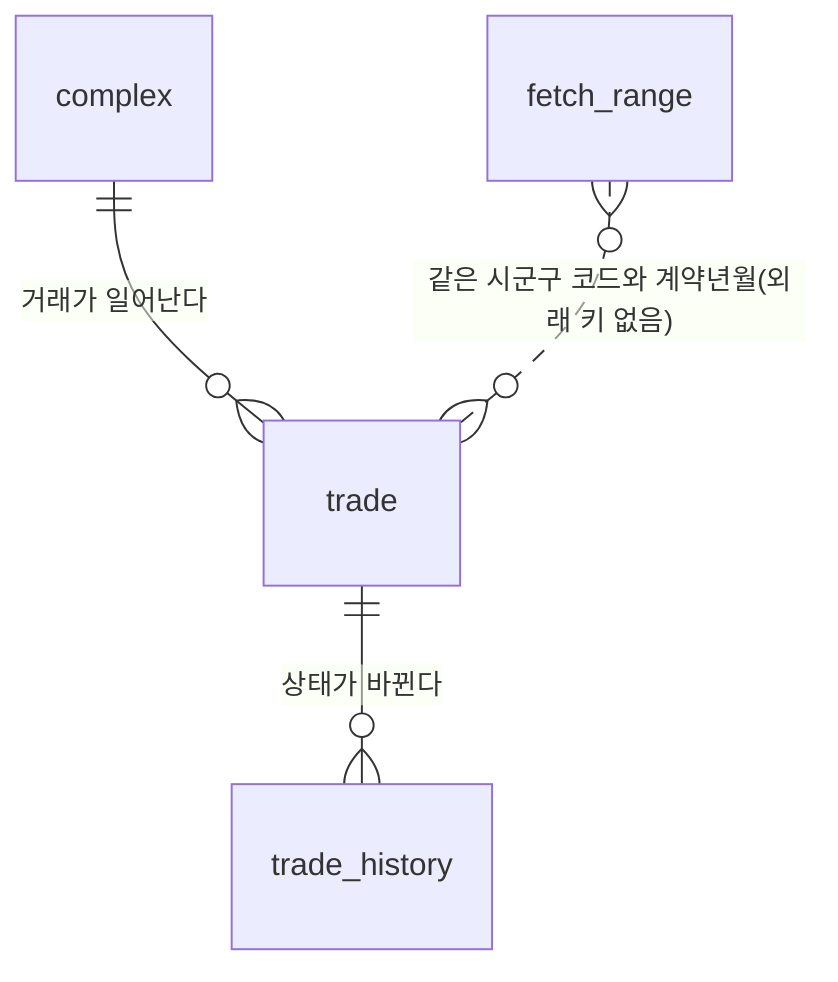

# Data Model: 003 실거래 수집

003이 만드는 테이블은 넷입니다. 열의 형식, 출처, 저장 방식의 기준은 설계 문서의 [데이터 모델: 단지와 거래](../../docs/architecture/data-model.md#단지와-거래)이고, 이 문서는 003이 그 위에 정하는 것(시퀀스, 제약 이름, 인덱스, 값 변환, 쓰는 규칙)만 적습니다. 마이그레이션은 `V3__trade_collection.sql` 하나입니다.

| 테이블 | 기준 절 | 003에서 하는 일 |
|---|---|---|
| `complex` | [`complex`](../../docs/architecture/data-model.md#complex) | 범위 반영에서 처음 보는 단지 번호마다 만듭니다. 수정하지 않습니다 |
| `trade` | [`trade`](../../docs/architecture/data-model.md#trade) | 범위 반영에서 만들고 건수와 등기일, 동, 해제 사유 발생일을 갱신합니다. 삭제하지 않습니다 |
| `trade_history` | [`trade_history`](../../docs/architecture/data-model.md#trade_history) | 범위 반영에서 바뀐 것마다 한 행을 만듭니다. 수정하거나 삭제하지 않습니다 |
| `fetch_range` | [`fetch_range`](../../docs/architecture/data-model.md#fetch_range) | 초기 적재와 범위 확장의 선기록, 범위마다 성공과 실패를 기록합니다. 삭제하지 않습니다 |

관심 단지(`interest_complex`, 004)와 알림 발송 기록(`notification_delivery`, 009)은 만들지 않습니다. 원본 응답 파일은 데이터베이스가 아니라 원본 응답 버킷에 있습니다([contracts/raw-response-object-key.md](contracts/raw-response-object-key.md)).

`fetch_range`와 `trade` 사이에는 외래 키가 없습니다. 범위의 거래는 `complex.sgg_cd = fetch_range.lawd_cd`이고 `trade.deal_date`가 `deal_ymd`의 달 안인 행입니다([research R5](research.md#r5-변경-감지와-범위-반영)).

## `complex`

| 열 | 형식 | 003의 규칙 |
|---|---|---|
| `id` | bigint, 기본 키 | 시퀀스 `complex_id_seq`에서 받습니다 |
| `apt_seq` | text, 비울 수 없음 | 응답 `aptSeq` 그대로. 유니크 제약 `complex_apt_seq_key` |
| `name` | text, 비울 수 없음 | 응답 `aptNm`. 앞뒤 공백을 뺍니다 |
| `sgg_cd` | text, 비울 수 없음 | 응답 `sggCd`. 체크 제약 `complex_sgg_cd_format`(숫자 다섯 자리) |
| `umd_nm` | text, 비울 수 없음 | 응답 `umdNm`. 앞뒤 공백을 뺍니다 |
| `jibun` | text, 비울 수 있음 | 응답 `jibun`. 빈 값이면 비웁니다 |

- 처음 보는 단지 번호의 행은 범위 반영 트랜잭션 안에서 만듭니다. 이미 있는 단지 행은 이름이나 주소가 응답과 달라도 바꾸지 않습니다(설계 데이터 모델에 갱신 규칙이 없고, 004가 이 값을 보여 줍니다). 값이 달라진 단지 번호는 로그에 단지 번호만 남깁니다.
- 수집은 한 프로세스 안에서 한 번에 하나만 돌아([research R3](research.md#r3-예약-실행)) 같은 단지 번호를 두 반영이 동시에 만들지 않습니다. 그래도 유니크 위반이 나면 그 범위의 반영을 롤백하고 실패로 기록합니다.

## `trade`

| 열 | 형식 | 003의 규칙 |
|---|---|---|
| `id` | bigint, 기본 키 | 시퀀스 `trade_id_seq`에서 받습니다 |
| `complex_id` | bigint, 비울 수 없음, `complex(id)` 참조 | 식별 키. 응답 `aptSeq`로 찾은 단지 |
| `deal_date` | date, 비울 수 없음 | 식별 키. `dealYear`, `dealMonth`, `dealDay` |
| `floor` | integer, 비울 수 없음 | 식별 키. 응답 `floor` |
| `exclusive_area` | numeric, 비울 수 없음 | 식별 키. 응답 `excluUseAr`의 글자를 그대로 숫자로 저장합니다. 비교는 값으로 합니다([research R1](research.md#r1-외부-api-응답-형식)) |
| `amount` | bigint, 비울 수 없음 | 식별 키. 응답 `dealAmount`에서 쉼표와 공백을 뺀 만원 단위 |
| `canceled` | boolean, 비울 수 없음 | 식별 키. 응답 `cdealType`이 공백을 뺀 뒤 비어 있지 않으면 참 |
| `same_key_count` | integer, 비울 수 없음 | 오늘 결과의 건수. 키가 오늘 결과에 없으면 0. 체크 제약 `trade_same_key_count_check (same_key_count >= 0)` |
| `cancel_date` | date, 비울 수 있음 | 응답 `cdealDay` |
| `registry_date` | date, 비울 수 있음 | 응답 `rgstDate` |
| `apt_dong` | text, 비울 수 있음 | 응답 `aptDong`. 공백을 뺀 뒤 비어 있으면 비웁니다 |
| `first_seen_at` | timestamptz, 비울 수 없음 | 이 행을 만든 범위 반영의 수집 시각 |

- 유니크 제약 `trade_identity_key (complex_id, deal_date, floor, exclusive_area, amount, canceled)`. PostgreSQL의 numeric 비교는 자릿수를 보지 않아(84.9와 84.90은 같음) 유니크 제약과 같은 값을 같은 키로 봅니다. Java 쪽 비교도 값으로 합니다(`BigDecimal.compareTo`).
- 외래 키는 연쇄 삭제가 없습니다. 거래 행과 단지 행은 삭제하지 않습니다.
- 건수가 1인 행은 등기일, 동, 해제 사유 발생일을 오늘 결과의 값으로 갱신하고, 2 이상인 행은 비어 있는 열만 채우고 처음 값을 유지합니다(설계 결정 기록 0007). 오늘 결과의 값은 같은 키 묶음 안에서 처음 나온 비어 있지 않은 값입니다(응답의 행 순서가 날마다 바뀜, research R5). 건수가 0인 행(사라짐)은 세 값을 바꾸지 않습니다.
- 이미 행이 있는 범위를 기준 적재로 반영할 때(`fetched_at`이 7일보다 오래됨, research R6)도 같은 규칙으로 건수와 세 값을 맞추고 이력은 남기지 않습니다.

## `trade_history`

| 열 | 형식 | 003의 규칙 |
|---|---|---|
| `id` | bigint, 기본 키 | 시퀀스 `trade_history_id_seq`에서 받습니다 |
| `trade_id` | bigint, 비울 수 없음, `trade(id)` 참조 | 바뀐 거래 행 |
| `change_type` | text, 비울 수 없음 | 체크 제약 `trade_history_change_type_check (change_type in ('신규', '해제', '등기', '사라짐'))` |
| `observed_at` | timestamptz, 비울 수 없음 | 이 이력을 기록한 범위 반영의 수집 시각. 같은 반영에서 만든 거래 행의 `first_seen_at`과 같은 값 |

- 건수가 2 이상 늘거나 줄어도 이력은 키마다 한 행입니다(설계 결정 기록 0007의 "그 키의 건수가 늘었습니다"). 몇 건이 바뀌었는지는 기록하지 않습니다.
- 한 반영에서 한 키에 `신규`(또는 `해제`)와 `등기`가 함께 생기는 경우(직전 결과에 있던 키의 건수가 늘면서 비어 있던 등기일이 채워짐)는 두 행을 기록합니다. 직전 결과에 없던 키는 `등기`를 기록하지 않습니다.
- `등기`는 건수 1 행이면 비어 있던 등기일이나 동에 값이 생길 때(같은 반영에서 둘 다 생겨도 한 행), 건수 2 이상 행이면 등기일과 동이 모두 비어 있던 행에 하나라도 값이 생길 때 한 번만 기록합니다.
- 009가 `observed_at` 범위로 후보를 읽는 인덱스는 009가 추가합니다(constitution VI).

## `fetch_range`

| 열 | 형식 | 003의 규칙 |
|---|---|---|
| `lawd_cd` | text, 기본 키 | 체크 제약 `fetch_range_lawd_cd_format`(숫자 다섯 자리) |
| `deal_ymd` | text, 기본 키 | 체크 제약 `fetch_range_deal_ymd_format`(`YYYYMM`, 월은 01~12) |
| `status` | text, 비울 수 없음 | 체크 제약 `fetch_range_status_check (status in ('성공', '실패'))` |
| `fetched_at` | timestamptz, 비울 수 있음 | 마지막으로 성공한 범위 반영의 수집 시각. 실패해도 비우지 않습니다 |
| `failure_reason` | text, 비울 수 있음 | 마지막 시도가 실패면 이유([research R7](research.md#r7-범위-결과-기록과-트랜잭션)의 이유 코드와 짧은 설명). 성공하면 비웁니다. 인증키 값은 넣지 않습니다 |

- 기본 키 `fetch_range_pk (lawd_cd, deal_ymd)`. 지역에 행이 하나라도 있는지와 기준 적재 판정에 쓰는 `fetched_at`(그 범위와 바로 앞 달)은 실행이 시작될 때 대상 지역의 행을 한 번 읽어 둔 값으로 봅니다(research R6). 같은 실행에서 갱신한 값은 판정에 쓰지 않습니다.
- 실행이 멈출 때 시도하지 않은 범위 가운데 행이 있는 범위만 `실패`와 `RUN_STOPPED`로 기록하고, 행이 없는 범위는 만들지 않습니다(research R7).
- 초기 적재와 범위 확장은 첫 범위를 수집하기 전에 60개 범위를 `status = '실패'`, `fetched_at` 빈 값, `failure_reason = 'NOT_YET_COLLECTED'`으로 한 트랜잭션에서 만듭니다(spec FR-005).

## 인덱스

| 인덱스 | 쓰는 곳 |
|---|---|
| `complex_apt_seq_key`(유니크 제약) | 범위 반영에서 단지 번호로 단지 찾기 |
| `complex_sgg_cd_idx (sgg_cd)` | 범위의 직전 결과 읽기(시군구 코드로 단지를 좁힘) |
| `trade_identity_key`(유니크 제약, 앞 두 열 `complex_id, deal_date`) | 범위의 직전 결과 읽기(단지와 계약일 범위), 식별 키로 행 찾기 |
| `fetch_range_pk`(기본 키) | 범위 결과 읽기와 기록, 지역에 행이 있는지, 바로 앞 달 범위 |

한 자치구 60개월이 약 1만 2천 건이라 이 밖의 인덱스는 두지 않습니다. 서울 전체로 넓히는 4단계에서 측정해 다시 정합니다.
