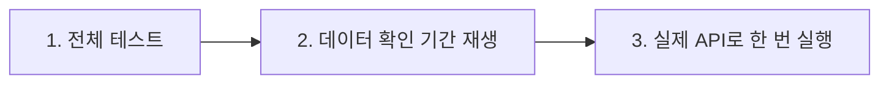

# Quickstart: 003 실거래 수집 실행 확인

003에는 화면이 없어서, 001과 002의 화면 확인 순서 대신 아래 세 가지로 기능을 확인합니다.



| 확인 | 무엇을 보나 | 누가 |
|---|---|---|
| 1. 전체 테스트 | spec의 시나리오와 실패 여덟 가지(가짜 데이터) | 구현 쪽 |
| 2. 데이터 확인 기간 재생 | 실제 응답 23일치를 날짜순으로 반영한 결과가 독립 비교 집계와 정의 차이 안에서 맞는지 | 구현 쪽, 결과는 저장소 밖에 둠 |
| 3. 실제 API로 한 번 실행 | 실제 인증키와 관심 지역으로 초기 적재가 성공하고 원본 파일이 쌓이는지 | 저장소 소유자 |

## 준비

- Docker, Java 25(Gradle 툴체인이 받음).
- 로컬 PostgreSQL: `docker compose -f compose.yaml up -d postgres`. 워크트리에서 기존 개발 데이터베이스를 쓸 때는 `COMPOSE_PROJECT_NAME`을 그 데이터베이스를 띄운 프로젝트 이름으로 줍니다.
- 로컬 S3 호환 저장소: `docker compose -f compose.yaml up -d garage` 뒤 `scripts/garage-init.sh`. 원본 응답 버킷과 사진 버킷, collector 키(원본 응답 버킷에만 읽기와 쓰기)를 만들고, 키 값은 저장소 루트 `.env`에 씁니다([research R4](research.md#r4-파일-저장소)).
- 저장소 루트 `.env`(추적 제외)에 아래 값을 둡니다. 이름은 [research R9](research.md#r9-설정과-인증키-노출-막기)와 `.env.example`이 기준입니다.

| 변수 | 값 |
|---|---|
| `DATA_GO_KR_SERVICE_KEY` | 공공데이터포털 Decoding 키 |
| `ESTATE_COLLECTOR_REGIONS` | 본인의 관심 지역 코드(쉼표로 여럿) |
| `ESTATE_COLLECTOR_CRON` | 예약 시각. 기본값은 매일 09:00(한국 시간). 확인할 때만 가까운 시각으로 바꿉니다 |
| `ESTATE_RAW_S3_ACCESS_KEY`, `ESTATE_RAW_S3_SECRET_KEY` | `scripts/garage-init.sh`가 출력한 collector 키. 주소, 리전, 버킷(`ESTATE_RAW_S3_ENDPOINT`, `ESTATE_RAW_S3_REGION`, `ESTATE_RAW_S3_BUCKET`)은 `application-local.yml` 기본값을 쓰고 필요할 때만 덮습니다 |

## 1. 전체 테스트

```bash
./gradlew test --rerun
```

- 기대: 모두 통과. 변경 감지 23경우, 실패 여덟 가지, 순서 테스트, 인증키 노출 테스트가 포함됩니다.

## 2. 데이터 확인 기간 재생

데이터 확인 기간(2026-10-19부터 11-10까지, 23일)에 매일 수집해 둔 실제 원본 응답을 가짜 외부 API 서버가 날짜순으로 반환하게 하고, collector의 예약 실행을 날짜마다 한 번씩 돌립니다. 원본 응답과 대조 결과는 저장소 밖(`.private`)에만 두고 커밋하지 않습니다.

1. 독립 비교 집계를 11-10까지 다시 만듭니다(지금 보고서는 11-02까지).

```bash
python3 spike/data-probe/probe.py compare
```

2. 재생 테스트를 실행합니다. 이 테스트는 `ESTATE_REPLAY_DIR`가 없으면 건너뛰므로 평소 전체 테스트에는 들어가지 않습니다.

```bash
ESTATE_REPLAY_DIR=<원래 체크아웃>/.private/data/snapshots ESTATE_REPLAY_OUT=<원래 체크아웃>/.private/data/replay ESTATE_REPLAY_LAWD_CD=<본인의 관심 지역 코드> ./gradlew test --tests '*TradeReplayTest' --rerun
```

3. 결과를 대조합니다. 재생 테스트는 날짜와 계약월마다 변경 종류별 이력 건수를 `ESTATE_REPLAY_OUT`에 씁니다.

| 대조 | 기대 |
|---|---|
| 첫날(60개월) | 초기 적재로 60개 범위 성공, 이력 0건 |
| 2026-10-24의 한 달(데이터 확인 때 네트워크 오류) | 가짜 서버가 연결을 끊어 실패한 범위로 남고, 다음 날 다시 수집해 그 사이 변화가 한 번에 기록됨 |
| 2026-11-01(재수집 기간 이동) | 새로 들어온 이번 달은 바로 앞 달이 전날 성공해 빈 결과와 비교되고, 0건이라 성공. 재수집 기간을 벗어난 달은 더는 요청하지 않음 |
| 변경 종류별 건수 | 아래 정의 차이로 설명되지 않는 차이가 0건 |

독립 비교 집계와 이력의 정의 차이([research R11](research.md#r11-실행-확인-방법)):

| 독립 비교 | 이력 | 차이 |
|---|---|---|
| 신규, 해제, 사라짐은 건수 차이(`b - a`)만큼 셈 | 키마다 한 행 | 한 키의 건수가 하루에 2 이상 바뀌면 이력이 적음 |
| 등기일 채워짐과 동 채워짐을 따로 셈 | 둘을 `등기` 한 행으로 | 같은 날 둘 다 채워지면 이력이 적음 |
| 등기 채워짐은 건수가 같을 때만, 건수 2 이상 키는 빈 행이 줄어든 만큼 | 건수가 바뀌어도 기록, 건수 2 이상 키는 처음 한 번만 | 어느 쪽으로도 다를 수 있음. 해당 키를 목록으로 뽑아 하나씩 설명 |
| 값 바뀜 | 없음 | 비교에서 뺌(데이터 확인 기간 0건) |

## 3. 실제 API로 한 번 실행

외부 API의 하루 호출 한도(개발계정 10,000회)를 씁니다. 한 자치구 초기 적재는 60회입니다. 같은 날 여러 번 돌리지 않습니다.

1. `.env`에 실제 인증키와 본인의 관심 지역 코드를 넣고, `ESTATE_COLLECTOR_CRON`을 몇 분 뒤 한 번으로 바꿉니다.
2. 앱을 실행합니다.

```bash
./gradlew bootRun --args='--spring.profiles.active=local'
```

3. 확인합니다.

| 확인 | 기대 |
|---|---|
| 로그 | 실행 종류가 초기 적재, 범위 60개 성공, 호출 약 60회, 이력 0건. 인증키 값이 로그에 없음 |
| `fetch_range` | 그 지역 60개 행이 모두 `성공`, `fetched_at` 있음 |
| `complex`, `trade` | 단지와 거래 행이 있고 `trade_history`는 0건 |
| 원본 응답 버킷 | `{오늘}/{실행 시작 시각}/` 아래 파일 60개 이상 |

4. 확인이 끝나면 앱을 멈추고 `ESTATE_COLLECTOR_CRON`을 지워 기본값(매일 09:00)으로 돌린 뒤 다시 실행합니다. cron은 "한 번만"을 나타내지 못해, 그대로 두면 다음 날도 바꾼 시각에 돕니다.
5. 다음 날 09:00 매일 수집이 돌고, 호출 6회와 이력이 기록되는지 봅니다.

데이터 확인 기간의 launchd 예약은 다시 켜지 않습니다. 이 기능의 매일 수집이 그 역할을 맡습니다.
