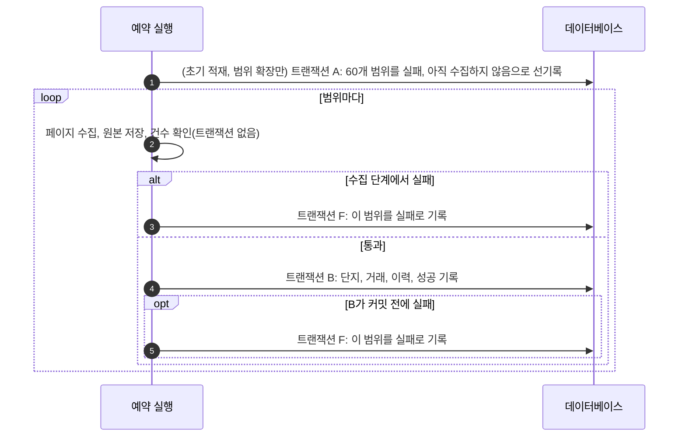

# Research: 003 실거래 수집

plan의 기술 판단과 근거입니다. 판단마다 선택지, 고른 것, 근거(공식 문서나 실측과 확인 날짜)를 적습니다. 실측은 데이터 확인 기간(2026-10-19부터 11-10까지 23일)에 한 자치구를 매일 수집해 저장소 밖에 둔 원본 응답 191개(항목 46,880건)를 2026-11-19에 센 값입니다. 공개 문서라 실제 지역, 코드, 단지 이름, 값은 옮기지 않고 형식만 가짜 예시로 적습니다.

| 번호 | 판단 |
|---|---|
| [R1](#r1-외부-api-응답-형식) | 외부 API 응답 형식 |
| [R2](#r2-http-클라이언트와-재시도) | HTTP 클라이언트와 재시도 |
| [R3](#r3-예약-실행) | 예약 실행 |
| [R4](#r4-파일-저장소) | 파일 저장소 |
| [R5](#r5-변경-감지와-범위-반영) | 변경 감지와 범위 반영 |
| [R6](#r6-연속-수집-조건의-판정) | 연속 수집 조건의 판정 |
| [R7](#r7-범위-결과-기록과-트랜잭션) | 범위 결과 기록과 트랜잭션 |
| [R8](#r8-하루-호출-한도와-스스로-멈추는-기준값) | 하루 호출 한도와 스스로 멈추는 기준값 |
| [R9](#r9-설정과-인증키-노출-막기) | 설정과 인증키 노출 막기 |
| [R10](#r10-테스트-방식) | 테스트 방식 |
| [R11](#r11-실행-확인-방법) | 실행 확인 방법 |
| [R12](#r12-설계-문서와-달라진-것) | 설계 문서와 달라진 것 |

## R1. 외부 API 응답 형식

공식 페이지([15126468](https://www.data.go.kr/data/15126468/openapi.do), 2026-11-19 확인)의 본문에는 요청 인자 다섯(`serviceKey`, `LAWD_CD`, `DEAL_YMD`, `pageNo`, `numOfRows`)과 "데이터 형식 XML"만 있고, 항목 형식과 오류 코드 표는 첨부 기술문서에만 있습니다(구현 1회차인 2026-11-19에 내려받아 오류 코드표와 응답 예제를 대조함, 아래 오류 응답 절). 그래서 형식은 실측으로 정하고, 오류 처리는 두 모양을 모두 받는 쪽으로 정합니다. 요청과 응답의 계약은 [contracts/trade-api-response.md](contracts/trade-api-response.md)입니다.

| 판단 | 고른 것 | 근거 |
|---|---|---|
| 응답 형식 | XML. JSON 옵션은 쓰지 않습니다 | 공식 본문이 XML만 적고, 데이터 확인 때 JSON을 시도한 적이 없습니다. 원본 응답 파일은 응답 바이트 그대로 보관하므로 형식을 바꾸면 데이터 확인 자료와 비교할 수 없게 됩니다 |
| XML 해석 | JDK StAX(`XMLInputFactory`, 외부 엔티티와 DTD 끔) | 의존성 추가가 없습니다. 응답이 평평한 구조(item 아래 32개 요소)라 객체 매핑 라이브러리가 필요 없습니다 |
| 정상 결과 코드 | `000` | 191개 응답 모두 `resultCode` `000`, `resultMsg` `OK`, HTTP 200 |
| 빈 값 | 앞뒤 공백을 뺀 뒤 빈 문자열이면 값 없음 | 32개 요소가 모든 item에 늘 있고, 빈 값은 늘 공백 한 칸(`" "`)이었습니다. 빈 요소(`<x/>`)와 요소 없음은 0건이지만 같은 규칙으로 받습니다 |
| 계약일 | `dealYear`, `dealMonth`, `dealDay`를 정수로 읽음 | 월과 일에 앞 0이 없습니다(한 자리와 두 자리가 섞임) |
| 전용면적 | 글자를 `BigDecimal`로 읽고 비교는 값으로 | 소수 자릿수가 정해져 있지 않습니다(정수, 소수 한 자리부터 네 자리까지 섞임) |
| 거래 금액 | 쉼표를 뺀 정수(만원) | 쉼표 천 단위, 늘 값이 있음 |
| 층 | 정수(음수 허용) | 한 자리와 두 자리만 관측. 지하층은 확인하지 않았습니다 |
| 해제 여부 | `cdealType`이 비어 있지 않으면 해제 | 값은 `O`(1,305건)와 빈 값뿐 |
| 해제 사유 발생일, 등기일 | `YY.MM.DD`를 `20YY-MM-DD`로 | 두 항목 모두 두 자리 연도. `cdealDay`는 해제 행에서만, 늘 채워짐 |
| 동 | 앞뒤 공백을 뺀 문자열 그대로 | `101`, `101동`, 한글, 사이 공백 등 형식이 제각각 |
| 단지 번호 | 문자열 그대로 | `시군구코드-일련번호` 모양이고 일련번호 자릿수가 다릅니다. 숫자로 바꾸지 않습니다 |
| 행 순서 | 쓰지 않음 | 정렬 기준이 없고, 같은 달을 이틀 연속 수집한 124쌍 가운데 3쌍에서 공통 행의 순서가 달랐습니다 |
| 페이지 크기 | `numOfRows` 1000 | 데이터 확인 때 1000으로 성공. 한 달 최대 701건이라 두 페이지 이상은 관측되지 않았고 상한은 확인하지 않았습니다. 여러 페이지는 테스트로 검증합니다 |
| 건수 확인 | 모든 페이지의 item 수 합과 `totalCount` 비교 | 191개 모두 일치했습니다(불일치는 실제로는 없었지만 규칙은 설계대로) |
| 빈 달 | `<items/>`와 `totalCount` 0인 정상 응답 | 달이 바뀐 직후 다섯 번 관측 |
| 인증키 인코딩 | Decoding 키를 URI 템플릿 변수로 넘겨 엄격 인코딩(`UriComponentsBuilder`의 `queryParam("serviceKey", "{key}")`, `encode()`, `buildAndExpand(key)`, `toUri()`)하고 `URI` 객체로 `RestClient`에 넘김 | 데이터 확인 스크립트는 Decoding 키를 한 번 URL 인코딩해 성공했습니다. 템플릿 변수로 넘겨야 `+`, `/`, `=`까지 인코딩되고, 문자열을 `RestClient`에 다시 넘기면 두 번 인코딩됩니다 |
| 요청과 응답의 일치 | 항목의 `sggCd`가 요청한 `LAWD_CD`와 다르거나 계약년월이 `DEAL_YMD`와 다르면 해석 실패(`PARSE_ERROR`) | 범위의 직전 결과는 시군구 코드와 계약일로 읽으므로(R5), 어긋난 항목이 있으면 매일 유니크 위반이 반복됩니다. 실측 46,880건에서 어긋남은 0건이었습니다 |
| 여러 페이지의 전체 건수 | 페이지마다 `totalCount`가 같지 않으면 건수 확인 실패(`COUNT_MISMATCH`) | 행 순서가 불안정해 수집 중 신고가 들어오면 페이지가 밀릴 수 있습니다 |

오류 응답은 데이터 확인 기간에 한 번도 오지 않았습니다. 공공데이터포털 공통 형식에 기대어 아래 두 모양을 처리합니다. 처음 실제 오류를 받으면 그 원본 파일로 이 표를 확인하고 수정합니다.

| 모양 | 코드를 읽는 곳 | 실행을 멈추는 코드 |
|---|---|---|
| `response/header/resultCode`가 `000`이 아님 | `resultCode` | `22`(하루 호출 한도 초과), `30`(등록되지 않은 서비스키), `31`(기한 만료된 서비스키), `20`(서비스 접근 거부), `32`(등록되지 않은 IP) |
| 루트가 `OpenAPI_ServiceResponse` | `cmmMsgHeader/returnReasonCode` | 위와 같음 |

- 첨부 기술문서(`아파트 매매 실거래가 상세자료 기술문서.hwp`, 2026-11-19 대조)의 오류 코드표는 `01`(애플리케이션 오류), `02`(DB 오류), `03`(데이터 없음), `04`(HTTP 오류), `05`(시간 초과), `10`(서비스키 파라미터 없음), `11`(필수 파라미터 없음), `12`(없거나 폐기된 서비스), `20`(서비스 접근 거부), `22`(일일 호출 한도 초과), `30`(등록되지 않은 서비스키), `31`(기간 만료된 서비스키), `32`(등록되지 않은 도메인이나 IP)입니다. 멈추는 코드 다섯(`20`, `22`, `30`, `31`, `32`)은 표와 일치합니다.
- 표의 코드는 두 자리이고 정상 코드는 세 자리(`000`)라, 코드는 숫자로 바꿔 비교합니다(`22`와 `022`가 같음).
- `10`, `11`, `12`는 우리 요청이나 주소가 틀렸다는 뜻이라 범위 하나만의 문제는 아니지만 멈추는 코드에 넣지 않습니다. 결과 코드 오류는 재시도하지 않아 범위마다 호출 한 번이고, 자료가 손상되지 않으며, 첫 실제 실행(T049)에서 바로 드러납니다. `01`, `02`, `04`, `05`는 제공기관 쪽 문제라 그 범위만 실패로 두고 다음 날 다시 수집합니다.
- 빈 달을 `03`(데이터 없음)으로 돌려주는지는 확인하지 못했습니다. 데이터 확인 기간에는 빈 달이 `000`과 `totalCount` 0이었습니다. 처음 `03`을 받으면 빈 달 처리를 다시 정합니다.
- HTTP 상태가 200이 아니면 본문을 해석하지 않고 HTTP 오류(재시도 대상)로 봅니다. 인증키 오류나 한도 초과를 HTTP 401, 403, 429로 반환하는 경우가 있는지는 첨부 기술문서에도 설명이 없어 확인하지 못했습니다(문서의 오류 코드표는 결과 코드만 다룸). 그렇다면 범위마다 세 번 시도하고 실행을 멈추지 않아, 초기 적재 한 번에 호출 180회를 쓰고 범위 60개가 모두 실패합니다(스스로 멈추는 기준값 안이라 자료는 손상되지 않음). 처음 실제로 그런 응답을 받으면 그 상태 코드를 실행을 멈추는 쪽으로 분류할지 저장소 소유자에게 묻고, 설계 문서(핵심 흐름의 재시도 규칙)부터 수정합니다.

## R2. HTTP 클라이언트와 재시도

근거는 Spring Framework 7.0.10과 Spring Boot 4.1.2 소스(2026-11-19, 이 저장소의 Gradle 캐시와 Maven Central)와 [Spring Framework 재시도 문서](https://docs.spring.io/spring-framework/reference/core/resilience.html)입니다.

| 판단 | 선택지 | 고른 것 | 근거 |
|---|---|---|---|
| HTTP 클라이언트 | Boot의 `spring-boot-starter-restclient` 자동 설정 / `RestClient.builder()`를 직접 구성 | `RestClient.builder()`에 `JdkClientHttpRequestFactory`(JDK `HttpClient`)를 직접 줍니다. 새 의존성이 없습니다 | 지금 의존성(`spring-boot-starter-webmvc`)에는 `RestClient.Builder` 자동 설정과 `spring.http.clients.*` 속성이 없습니다. 외부 API가 하나뿐이라 스타터를 추가하지 않고 연결 타임아웃과 읽기 타임아웃 두 값만 직접 줍니다 |
| 타임아웃 | | 연결 5초, 읽기 30초(설정값) | 데이터 확인 때 호출 한 번이 보통 0.5~1초, 가끔 5~7초였고 스크립트의 타임아웃 30초에서 시간 초과는 없었습니다 |
| 본문 받기 | | `.retrieve().body(byte[].class)` | 원본 응답 파일에 응답 바이트를 그대로 압축해 둡니다. 해석은 같은 바이트로 합니다 |
| 재시도 | Spring Retry / Spring Framework 7의 `RetryTemplate` / 직접 반복문 | `org.springframework.core.retry.RetryTemplate`과 `RetryPolicy.builder().maxRetries(2).delay(2초).multiplier(2)`. 재시도 대상은 `ResourceAccessException`(네트워크 오류, 시간 초과)과 `HttpStatusCodeException`(HTTP 오류)입니다 | 실측으로 대기가 2,000ms, 4,000ms 뒤 멈춤(3번 시도)을 확인했습니다. Spring Retry는 2026-07-27에 보관되었습니다. 결과 코드 오류와 해석 실패는 이 기능의 예외로 던져 재시도 대상에서 빠집니다 |
| 테스트에서 기다리지 않기 | | `RetryPolicy`를 빈으로 두고 테스트 설정에서 대기 0인 정책으로 바꿉니다. 운영 정책의 대기 값(2초, 4초, 멈춤)은 정책의 `BackOff`를 직접 꺼내 따로 확인합니다 | `RetryTemplate`은 `Thread.sleep`을 직접 호출해 시간을 주입할 곳이 없습니다 |
| 재시도 소진 뒤 | | 마지막 예외를 이 기능의 예외(고정 문장, HTTP 상태, 원인 예외의 클래스 이름)로 바꿔 던지고 원인 예외 객체는 넘기지 않습니다 | [R9](#r9-설정과-인증키-노출-막기)의 인증키 노출 막기 |
| 호출 수 세기 | | 재시도를 포함해 HTTP 요청 한 번마다 실행의 호출 수를 1 늘리고, 요청하기 전에 기준값을 확인합니다(기준값 바로 아래 호출은 허용). 기준값에 도달하면 재시도 대상이 아닌 예외로 멈춥니다 | [R8](#r8-하루-호출-한도와-스스로-멈추는-기준값) |

## R3. 예약 실행

| 판단 | 고른 것 | 근거 |
|---|---|---|
| 예약 | `@EnableScheduling`과 `@Scheduled(cron = "${estate.collector.cron}", zone = "Asia/Seoul")`. 기본값 `0 0 9 * * *` | cron과 zone은 설정값 자리표시를 받습니다. 설정 이름은 [R9](#r9-설정과-인증키-노출-막기) |
| 실행이 겹치지 않게 | 따로 잠금을 두지 않습니다 | Boot의 기본 스케줄러는 스레드 하나(`spring.task.scheduling.pool.size` 기본 1)이고, cron 작업은 한 번 끝난 뒤에 다음 시각을 계산해 같은 작업이 겹치지 않습니다(`ReschedulingRunnable`). 수동 실행 경로가 없습니다(실행 확인은 예약 시각 설정값으로, [R11](#r11-실행-확인-방법)). 스케줄러 스레드 수를 늘리거나 수동 실행을 추가할 때 다시 정합니다 |
| 멈춰 있던 날 | 따라잡지 않습니다(spec FR-002) | 스케줄러에 마지막 실행 기록이 없고, 시작할 때 현재 시각으로 다음 시각을 계산합니다(소스 확인, 실행하지 않음) |
| 시간 | 실행 시작 시각, 이번 달, 재수집 기간, 원본 응답 파일 오브젝트 키의 날짜와 시각은 주입한 `Clock`(UTC)에서 읽어 한국 시간(`Asia/Seoul`)으로 바꿉니다 | 서버 시간대와 관계없이 "이번 달"이 한국 달력으로 정해집니다. 2026-11-01 00:30(한국 시간)은 UTC로 10월 31일입니다 |
| 테스트 | 예약 메서드는 지역 목록을 받는 실행 메서드(`run(List<String> regions)`)를 설정값으로 호출하기만 하고, 테스트는 실행 메서드를 직접 호출하며 `MutableClock`으로 시각을 옮깁니다. 테스트 설정은 `estate.collector.cron=-`로 예약을 끕니다. cron과 zone은 애노테이션 값을 읽어 확인합니다 | 스케줄러의 지연은 실제 시간이라 시계를 옮겨도 작업이 실행되지 않습니다 |
| 한 예약 실행의 순서 | ① 실행 시작 시각을 정함 ② 매일 수집(행이 있는 지역의 재수집 기간 달, 그다음 실패한 범위) ③ 매일 수집이 멈추지 않았으면 행이 없는 지역마다 초기 적재나 범위 확장(선기록 뒤 60개월) | spec FR-003, FR-004, FR-005. 매일 수집이 인증키 오류, 코드 22, 스스로 멈춤으로 멈추면 ③을 하지 않습니다 |
| 초기 적재와 범위 확장의 구분 | 이 실행 전에 `fetch_range`에 다른 지역의 행이 하나라도 있으면 범위 확장, 없으면 초기 적재. 로그의 실행 종류에만 쓰고 동작은 같습니다 | spec Assumptions(같은 동작, 이름만 다름) |
| 호출 수 | 매일 수집, 초기 적재, 범위 확장은 각각 하나의 실행이고 호출 수를 실행마다 새로 셉니다. 한 예약 실행 안에서 이어져도 같습니다 | 결정 기록 0009와 핵심 흐름의 "뒤 실행은 앞 실행의 호출 수를 모름"을 그대로 따릅니다. 한 자치구 하루 호출은 66회 남짓이라 여유 500 안입니다([R8](#r8-하루-호출-한도와-스스로-멈추는-기준값)) |

## R4. 파일 저장소

| 판단 | 선택지 | 고른 것 | 근거(2026-11-19 확인) |
|---|---|---|---|
| 로컬과 테스트의 S3 호환 저장소 | MinIO, Garage, SeaweedFS, RustFS, LocalStack, Adobe S3Mock | Garage `dxflrs/garage:v2.5.0`(로컬 compose와 Testcontainers에 같은 이미지) | MinIO는 GitHub 저장소가 보관(archived) 상태이고 공개 이미지 배포가 멈췄습니다. Garage는 키마다 버킷 읽기와 쓰기 권한을 CLI 두 줄로 줘(spec FR-023을 로컬에서 재현), v2.3부터 단일 노드 실행 옵션이 있습니다(v2.5.0 태그 2026-10-24). S3Mock은 인증을 검증하지 않아 버킷 권한 분리를 재현할 수 없고, LocalStack 최신 이미지는 계정 토큰이 필요합니다. SeaweedFS(Apache-2.0)는 파일 하나로 권한을 선언하지만 구성이 무겁습니다 |
| 라이선스 | | Garage는 AGPL-3.0이지만 개발과 테스트용 별도 컨테이너로만 실행하고 애플리케이션에 들어가지 않습니다 | 운영 저장소 업체는 배포 환경을 정할 때 고릅니다(결정 기록 0014) |
| Java 클라이언트 | AWS SDK for Java v2 `S3Client`, Spring Cloud AWS 4.x | `software.amazon.awssdk:s3`와 `url-connection-client`(BOM `software.amazon.awssdk:bom:2.59.4`, 2026-11-18). `apache-client`와 `netty-nio-client`는 뺍니다 | Spring Boot 4.1.2 BOM에 AWS SDK가 없어 BOM을 직접 가져옵니다. 쓰는 동작은 `PutObject`(와 테스트의 `GetObject`) 하나라 Spring Cloud AWS의 자동 설정은 필요 없습니다(constitution VI) |
| 클라이언트 설정 | | `endpointOverride`, `forcePathStyle(true)`, 고정 자격 증명, `requestChecksumCalculation(WHEN_REQUIRED)`, `responseChecksumValidation(WHEN_REQUIRED)` | SDK 2.30부터 업로드에 CRC32 체크섬이 기본으로 붙어 일부 S3 호환 저장소가 거절한다는 보고가 있습니다. Garage에서 이 문제가 나는지는 확인하지 못해, 구현 첫 작업에서 컨테이너에 업로드하고 다운로드하는 테스트로 확인합니다 |
| 버킷 권한 재현 | | `scripts/garage-init.sh`가 원본 응답 버킷과 사진 버킷을 만들고, collector 키에 원본 응답 버킷 읽기와 쓰기만 줍니다 | S3 어댑터 테스트 하나가 collector 키로 사진 버킷에 쓰기를 시도해 거절되는지 확인합니다 |
| 테스트의 저장소 | 모든 테스트에서 Garage / 기록하는 가짜 구현 | 수집과 변경 감지 테스트는 원본 응답 파일 포트의 가짜 구현(쓰기를 순서와 함께 기록하고 실패를 주입), S3 어댑터 테스트만 Garage 컨테이너 | 순서 테스트("원본 저장 뒤 비교")와 실패 주입이 단순해집니다. constitution V의 "실제로 실행"은 데이터베이스에만 적용됩니다 |
| Testcontainers | | Spring Boot BOM이 관리하는 2.0.5. Garage는 공식 모듈이 없어 `GenericContainer`에 설정 파일(`garage.toml`)을 넣고, 시작 뒤 컨테이너 안 CLI로 노드 ID 확인(`garage status`), 레이아웃 지정과 적용(`garage layout assign`, `garage layout apply`), 버킷 둘 생성, 테스트용 고정 키 넣기(`garage key import`), 원본 응답 버킷 권한(`garage bucket allow --read --write`)을 차례로 실행합니다. 명령 이름과 인자는 v2.5.0 문서로 T014에서 확인합니다 | 앞 기능과 같은 테스트 기반입니다 |

## R5. 변경 감지와 범위 반영

| 판단 | 선택지 | 고른 것 | 근거 |
|---|---|---|---|
| 범위의 직전 결과 읽기 | 범위마다 `trade`를 단지와 계약일로 조회 / 범위의 모든 행을 메모리에 올려 비교 | 범위 반영 트랜잭션 안에서 `complex.sgg_cd = :lawd_cd`이고 `deal_date`가 그 달 안인 `trade` 행을 건수와 관계없이 모두 읽어 식별 키로 맵을 만듭니다. 직전 결과는 그 가운데 건수가 1 이상인 행입니다 | 한 범위는 많아야 수백 건(한 자치구 한 달 최대 약 700건, 결정 기록 0009)이라 메모리 비교가 가장 단순합니다. 건수 0인 행도 읽어야 사라졌다 다시 보인 키를 같은 행으로 되살립니다(설계 결정 기록 0007의 "행은 삭제하지 않음") |
| 오늘 결과 묶기 | 응답 행을 식별 키로 묶어 건수를 셈 | 응답 행마다 식별 키(단지 번호, 계약일, 층, 전용면적, 거래 금액, 해제 여부)를 만들고 키마다 건수, 그리고 등기일, 동, 해제 사유 발생일 각각의 묶음 안에서 처음 나온 비어 있지 않은 값을 모읍니다 | 건수 2 이상 행은 "묶음 안에서 처음 기록된 값"을 유지하므로(0007), 오늘 결과에서 하나의 값만 필요합니다. 응답의 행 순서는 날마다 바뀌고(R1), 데이터 확인 기간에 건수 2 이상인 키 591건(날짜별) 가운데 27건은 묶음 안 값이 서로 달랐습니다. 첫 행의 값을 쓰면 빈 행이 먼저 온 날 등기를 놓치므로 비어 있지 않은 값을 씁니다. 건수 2 이상 행에서는 이 값을 열이 비어 있을 때만 씁니다 |
| 전용면적 비교 | 문자열 / `BigDecimal.equals` / 값 비교 | 키의 전용면적은 `BigDecimal.stripTrailingZeros()`로 맞춘 값으로 비교합니다 | `BigDecimal.equals`는 자릿수까지 비교해(84.90과 84.9는 다름) 같은 거래를 다른 키로 볼 수 있습니다. 데이터베이스의 numeric 유니크 제약은 값으로 비교하므로 두 쪽을 맞춥니다 |
| 반영 방식 | JPA 엔티티로 행마다 저장 / `JdbcClient`로 SQL 직접 | 읽기와 쓰기 모두 `JdbcClient`로 SQL을 직접 씁니다. 엔티티는 두지 않습니다 | 결정 기록 0016이 대량 반영에 SQL 직접 사용을 허용합니다. 초기 적재는 범위 60개에 약 1만 2천 건을 넣고, 이 기능에는 엔티티로 다룰 화면 조회가 없습니다. 004와 006이 조회용 엔티티가 필요하면 그때 만듭니다(constitution VI) |
| 기본 키 | `IDENTITY` / 시퀀스 | 시퀀스 셋(`complex_id_seq`, `trade_id_seq`, `trade_history_id_seq`). 삽입문에서 `nextval`을 쓰고 `returning id`로 받습니다 | 결정 기록 0016과 앞 기능의 규칙(삽입 전에 받을 수 있는 키)을 따릅니다. 이 테이블들에는 열 암호화가 없어 삽입 전에 키를 미리 받을 필요는 없습니다 |
| 유니크 위반 판별 | 예외 메시지 문장 / 제약 이름 | `PSQLException.getServerErrorMessage().getConstraint()`의 제약 이름 | Hibernate는 메시지 문장에서 잘라 DB 메시지 언어에 따라 비게 됩니다(002 교훈). 003에서는 위반이 나면 그 범위를 롤백하고 실패로 기록하므로 판별은 실패 이유에만 씁니다 |
| 동시성 | 행 잠금 / 프로세스 안 실행 하나 | 수집 실행은 프로세스 안에서 하나만 돌고([R3](#r3-예약-실행)), 이 네 테이블에 쓰는 곳은 collector뿐이라 행 잠금을 두지 않습니다 | API 서버의 단지 조회와 실거래 추이 조회(004, 006)는 읽기만 합니다(C4 컴포넌트의 3단계 표). 여러 대 실행의 중복 실행 잠금은 3단계입니다(결정 기록 0004) |

변경 종류는 키마다 아래 순서로 정합니다. `prev`는 직전 결과의 건수(행이 없거나 0이면 0), `today`는 오늘 결과의 건수입니다.

| 조건 | 기록 |
|---|---|
| `today > prev`이고 해제되지 않은 키 | `신규` 한 행 |
| `today > prev`이고 해제 키 | `해제` 한 행 |
| `today < prev` | `사라짐` 한 행 |
| `prev ≥ 1`, `today ≥ 1`이고 건수 1 행: 비어 있던 등기일이나 동에 값이 생김 | `등기` 한 행(같은 반영에서 둘 다 생겨도 한 행) |
| `prev ≥ 1`, `today ≥ 1`이고 건수 2 이상 행: 등기일과 동이 모두 비어 있던 행에 하나라도 값이 생김 | `등기` 한 행(그 뒤 다른 열이 채워져도 기록하지 않음) |

- `prev = 0`이고 `today ≥ 1`이면서 응답의 등기일이 이미 있는 경우(사라졌다 다시 보인 키, 처음 보는 키)는 `신규`(또는 `해제`)만 기록하고 `등기`는 기록하지 않습니다. 0007의 `등기`는 "같은 키에서 비어 있던 등기일이나 동에 값이 생김"이고, 직전 결과에 없던 키는 비교할 값이 없기 때문입니다. 이 해석은 설계 문서에 직접 적힌 것이 아니므로 [R12](#r12-설계-문서와-달라진-것)에서 0007에 한 문장을 추가합니다.
- 기준 적재는 위 표를 쓰지 않고 거래 행만 만들거나 갱신합니다(이력 없음, [R6](#r6-연속-수집-조건의-판정)). 건수 1 행의 세 값은 오늘 값으로, 건수 2 이상 행은 비어 있는 열만 채웁니다.
- "건수 1 행"과 "건수 2 이상 행"은 오늘 결과의 건수로 가릅니다(2026-11-24 구현 2회차에서 정함). 건수가 늘거나 줄면서 값도 바뀌는 경우를 spec이 따로 정하지 않아, 반영 뒤의 행 상태를 기준으로 두었습니다. 오늘 결과에 없는 키(건수 0)는 세 값을 바꾸지 않습니다.

## R6. 연속 수집 조건의 판정

spec FR-018의 기준 적재 규칙을 실행 시작 때 찍어 둔 값으로 판정합니다.

- 실행 시작 시각 `runStartedAt`은 예약 실행이 시작될 때 주입한 `Clock`에서 한 번 읽어 그 실행 전체에서 씁니다. 원본 응답 파일의 오브젝트 키(실행 시작 시각 `HHmmss`)와 같은 값입니다.
- 실행이 시작될 때 대상 지역들의 `fetch_range` 행(계약년월, `fetched_at`, 행이 있는지)을 한 번 읽어 실행 스냅숏으로 둡니다. 범위마다 판정은 이 스냅숏으로 하고, 같은 실행에서 갱신된 `fetch_range`는 판정에 쓰지 않습니다.
- "최근 성공"은 스냅숏의 `fetched_at`이 있고 `runStartedAt - 7일 <= fetched_at < runStartedAt`인 것입니다.

| 그 범위의 스냅숏 | 비교하는 경우 | 그 밖 |
|---|---|---|
| 행이 있고 `fetched_at`이 있음 | 그 범위가 최근 성공(경우 12) | 기준 적재(경우 21, 오래 끊겼던 범위) |
| 행이 있고 `fetched_at`이 빔(앞서 실패만 한 범위, 선기록 포함) | 없음 | 기준 적재(경우 10, 11) |
| 행이 없음, 매일 수집 | 바로 앞 달 범위가 최근 성공(경우 13) | 기준 적재(경우 19, 20) |

- 바로 앞 달은 범위의 계약년월에서 한 달을 뺀 `YYYYMM`입니다(1월이면 전해 12월).
- 초기 적재와 범위 확장은 선기록 뒤에 수집하므로 그 범위는 늘 "행이 있고 `fetched_at`이 빔"이고, 범위 반영은 실행 종류를 보지 않습니다. 초기 적재의 스냅숏은 선기록을 마친 뒤에 찍습니다.
- 기준 적재를 행이 이미 있는 범위에 할 때(경우 21)는 오늘 결과의 키마다 건수를 오늘 값으로 맞추고 세 값은 R5의 규칙대로(건수 1 행은 오늘 값, 2 이상 행은 빈 열만) 맞추며, 새 키는 행을 만들며(`first_seen_at`은 이 반영의 수집 시각), 오늘 없는 키는 건수를 0으로 둡니다. 이력은 남기지 않습니다.

| 선택지 | 고른 것과 이유 |
|---|---|
| 실행 시작 때 스냅숏을 찍어 판정 | 채택. 범위 반영 트랜잭션 안에서 그때그때 읽으면, 같은 실행에서 앞 달을 먼저 반영할 때 앞 달의 `fetched_at`이 이 실행 시각으로 덮여 이번 달이 기준 적재가 됩니다(경우 22). 2026-11-01처럼 달이 바뀐 날마다 새 달의 `신규`가 사라지는 결함이라, 처음 고른 "트랜잭션 안에서 읽기"를 analyze 뒤 바꿨습니다 |
| 범위 반영 트랜잭션 안에서 바로 앞 달을 읽음 | 제외. 위 결함 |
| `fetched_at` 대신 `status = '성공'` | 제외. 상태는 마지막 시도의 결과라, 7일 전에 성공하고 어제 실패한 앞 달을 "끊김"으로 봅니다 |

## R7. 범위 결과 기록과 트랜잭션

- 외부 API 호출과 원본 저장은 트랜잭션 밖에서 합니다. 호출을 기다리는 동안 데이터베이스 연결을 잡지 않습니다.
- 실패 기록(트랜잭션 F)은 `insert ... on conflict (lawd_cd, deal_ymd) do update set status = '실패', failure_reason = :reason`이고 `fetched_at`은 바꾸지 않습니다. 성공 기록은 같은 문장으로 `status = '성공'`, `fetched_at = :observedAt`, `failure_reason = null`입니다.
- 선기록(트랜잭션 A)은 `on conflict do nothing`입니다. 초기 적재와 범위 확장은 행이 하나도 없는 지역에만 돌므로 충돌은 없습니다. 도중에 멈춘 지역은 행이 생겨 매일 수집 대상이 되므로 같은 지역에 다시 초기 적재가 돌지 않습니다.
- `failure_reason`은 `코드: 설명` 형식입니다(예: `HTTP_ERROR: 503`). 설명에 예외 메시지 원문은 넣지 않습니다(인증키가 담길 수 있음, [R9](#r9-설정과-인증키-노출-막기)). spec SC-004의 실패 여덟 가지와 코드는 아래와 같습니다.

| 실패 종류 | 코드와 설명 |
|---|---|
| HTTP와 네트워크 오류 | `HTTP_ERROR: 상태 코드`, `NETWORK_ERROR: 원인 예외 클래스 이름` |
| 정상이 아닌 결과 코드 | `RESULT_CODE: 결과 코드 결과 메시지` |
| 응답 해석 실패 | `PARSE_ERROR: 이유`(XML 아님, 필수 항목 빔, 형식 다름, 시군구 코드나 계약년월이 요청과 다름) |
| 인증키 오류와 코드 22 | `AUTH_KEY_ERROR: 결과 코드`, `DAILY_LIMIT: 22` |
| 스스로 멈춤 | `SELF_STOP: 호출 수` |
| 원본 저장 실패 | `RAW_SAVE_FAILED: 원인 예외 클래스 이름` |
| 건수 확인 실패 | `COUNT_MISMATCH: 수집 건수와 전체 건수`, `EMPTY_AFTER_TRADES` |
| 반영 트랜잭션 실패 | `APPLY_FAILED: 원인 예외 클래스 이름과 제약 이름` |

- 그 밖의 코드: 선기록 `NOT_YET_COLLECTED`, 실행이 멈춰 시도하지 않은 행 있는 범위 `RUN_STOPPED: 멈춘 이유 코드`.
- 범위 반영이 던진 예외(커밋 때의 오류 포함)는 범위 반영을 호출한 쪽(범위 수집)이 받아 별도 트랜잭션으로 `APPLY_FAILED`를 기록합니다. 범위 반영 클래스 안에서 자기 메서드를 불러 새 트랜잭션을 열면 Spring 트랜잭션 프록시를 거치지 않기 때문입니다.
- 실패 기록 자체가 실패하면(데이터베이스 장애) 따로 받지 않습니다. 예외가 실행 밖으로 나가 그 예약 실행이 끝납니다(2026-11-25 구현 3회차에서 정함). 초기 적재의 남은 범위는 선기록 행이 남아 다음 날 이어서 수집합니다.
- 인증키 오류, 코드 22, 스스로 멈춤은 그 범위의 문제가 아니므로, 그 범위 자신도 행이 없으면 기록하지 않습니다. 이런 실패가 나면 같은 예약 실행의 남은 초기 적재와 범위 확장도 시작하지 않습니다.
- 재수집 기간의 달은 오래된 달부터 차례로 수집합니다.
- 실행을 멈추는 실패(인증키 오류, 코드 22, 스스로 멈춤)에서 "아직 수집하지 않은 범위"는 그 실행의 범위 목록에서 남은 것입니다. 그 가운데 행이 있는 범위만 `RUN_STOPPED`로 기록하고, 행이 없는 범위(매일 수집의 새로 들어온 달)는 기록하지 않습니다. 기록하면 다음 날 "앞서 실패만 한 범위"가 되어 그 달의 `신규`가 빠집니다. 매일 수집에서 멈추면 같은 예약 실행의 초기 적재와 범위 확장은 시작하지 않으므로, 그 지역들은 행이 없는 채 남아 다음 날 다시 초기 적재 대상이 됩니다.
- 선기록(트랜잭션 A)이 실패하면 그 지역은 그 실행에서 수집하지 않습니다. 롤백되어 행이 없으므로 다음 예약 실행에서 다시 초기 적재 대상이 됩니다.

## R8. 하루 호출 한도와 스스로 멈추는 기준값

| 설정 | 기본값 | 근거 |
|---|---|---|
| `estate.collector.daily-call-limit` | 10000 | 개발계정 하루 한도(인계 자료, 결정 기록 0009) |
| `estate.collector.self-stop-margin` | 500 | 실행 안에서 센 호출 수가 `한도 - 여유`(기본 9,500)에 도달하면 다음 호출을 하지 않습니다 |

- 여유를 두는 이유: 같은 날 뒤 실행(초기 적재나 범위 확장)은 앞 실행의 호출 수를 모르고([R3](#r3-예약-실행)), 실행 확인 때 같은 날 앱을 다시 실행할 수도 있습니다. 한 자치구 매일 수집은 하루 6회라 여유 500이면 수동 실행 여러 번과 재시도를 넉넉히 덮습니다. 초기 적재 한 번은 60회입니다.
- 재시도 호출도 한 번으로 셉니다(공공데이터포털이 요청마다 세는 것으로 보고 보수적으로 셈. 확인하지 않은 가정).
- JDK `HttpClient`는 서버가 응답 없이 연결을 끊으면 같은 GET을 내부에서 한 번 더 보냅니다(2026-11-19 가짜 서버로 확인). 그러면 서버가 받는 요청이 시도 수의 두 배까지 늘 수 있고, 실행 안에서 센 호출 수는 시도 수라 실제보다 작을 수 있습니다. 연결이 끊기는 오류가 대량으로 나는 날이 아니면 여유 500 안에서 흡수됩니다. 실제 호출 수와 센 값이 어긋나는지는 T049의 실제 실행에서 확인합니다.
- 기준값에 도달해도 한도에는 여유가 있으므로 코드 22를 받는 일은 다른 실행이 같은 날 많이 호출했을 때뿐입니다.

## R9. 설정과 인증키 노출 막기

설정은 `estate.collector` 아래 record 하나(`CollectorProperties`)로 받고, 생성자에서 형식을 확인합니다. 형식이 틀리면 바인딩이 실패해 애플리케이션이 시작하지 않습니다(spec FR-001). Bean Validation 스타터를 추가하지 않습니다(실측으로 record 생성자 예외가 시작 실패로 이어짐을 확인).

| 설정 | 환경 변수 | 기본값 | 검사 |
|---|---|---|---|
| `estate.collector.regions` | `ESTATE_COLLECTOR_REGIONS`(쉼표로 여럿) | 없음(비우면 수집할 지역이 없음) | 값마다 숫자 다섯 자리, 중복 없음 |
| `estate.collector.service-key` | `DATA_GO_KR_SERVICE_KEY` | 없음 | 지역이 하나라도 있으면 비어 있지 않음 |
| `estate.collector.cron` | `ESTATE_COLLECTOR_CRON` | `0 0 9 * * *` | Spring cron 형식(`-`이면 예약 끔) |
| `estate.collector.base-url` | | 공식 엔드포인트 | 테스트가 가짜 서버로 바꿈 |
| `estate.collector.daily-call-limit`, `self-stop-margin` | | 10000, 500 | 양수, 여유가 한도보다 작음 |
| `estate.collector.connect-timeout`, `read-timeout` | | 5초, 30초 | 양수 |
| `estate.collector.raw.endpoint`, `region`, `bucket`, `access-key`, `secret-key` | `ESTATE_RAW_S3_ENDPOINT`, `ESTATE_RAW_S3_REGION`, `ESTATE_RAW_S3_BUCKET`, `ESTATE_RAW_S3_ACCESS_KEY`, `ESTATE_RAW_S3_SECRET_KEY` | 주소, 리전, 버킷의 로컬 값은 `application-local.yml`, 키 둘은 `.env` | 지역이 하나라도 있으면 비어 있지 않음 |

- 지역이 비어 있으면 예약 실행은 아무것도 하지 않고 로그 한 줄만 남깁니다. 001, 002 테스트처럼 collector를 쓰지 않는 테스트가 인증키 없이 시작되게 하려는 것입니다. 그래서 S3 클라이언트와 API 어댑터는 지역이 있을 때만 만들고(`estate.trade.ConditionalOnCollectorRegions`로 지역 설정이 비어 있지 않을 때), 예약 실행은 수집 빈을 `ObjectProvider`로 받아 지역이 있을 때만 꺼냅니다.
- `.env.example`에는 지역, 예약 시각, collector 키 둘(`ESTATE_RAW_S3_ACCESS_KEY`, `ESTATE_RAW_S3_SECRET_KEY`)을 자리표시 값으로 추가합니다. 주소, 리전, 버킷은 `application-local.yml` 기본값을 씁니다. 인증키 `DATA_GO_KR_SERVICE_KEY`는 이미 있습니다. 데이터 확인 스크립트가 쓰는 `LAWD_CD`는 그대로 둡니다.

인증키가 유출되는 경로와 막는 방법(Spring Framework 7.0.10 소스 확인):

| 경로 | 지금 상태 | 막는 방법 |
|---|---|---|
| `ResourceAccessException` 메시지 | Spring이 URL의 `?` 뒤를 잘라 메시지에 쿼리가 없습니다. 원인 예외 메시지는 그대로 붙습니다 | 재시도 소진 뒤 이 기능의 예외로 바꾸고 원인 예외 객체를 넘기지 않습니다. 실패 이유와 로그에는 원인 예외의 클래스 이름만 씁니다 |
| `HttpStatusCodeException` 메시지 | URL은 없고 응답 본문 일부가 들어갑니다 | 위와 같이 상태 코드만 씁니다(오류 본문이 키를 그대로 반환할 수 있음, 확인하지 못함) |
| `RetryTemplate`의 DEBUG 로그(`org.springframework.core.retry`) | 시도가 실패할 때마다 받은 예외 객체를 남겨, 응답 본문이 담긴 `HttpStatusCodeException` 메시지도 남습니다(2026-11-25 최종 리뷰에서 확인) | 재시도 안에서 예외를 상태 코드나 원인 예외의 클래스 이름만 담은 예외로 바꿔 `RetryTemplate`에 넘깁니다. 이 로거를 DEBUG로 켠 테스트로 확인합니다 |
| 결과 메시지에 담긴 인증키 | 서버가 키를 인코딩해 돌려주면 퍼센트 인코딩의 16진수가 소문자일 수 있습니다 | 원문, 폼 인코딩, 엄격 인코딩, 이중 인코딩을 대소문자 구분 없이 가립니다 |
| Spring과 JDK HTTP 클라이언트 로그 | Spring의 디버그 로그에 URL이 없고, JDK 클라이언트 로그는 시스템 속성을 켜야만 남습니다 | 요청 URI를 직접 로그에 쓰지 않습니다 |
| 관측(Micrometer)의 `http.url` 태그 | 쿼리를 포함하지만 관측 레지스트리 빈이 없어 지금은 기록되지 않습니다 | 관측을 추가하는 단계(2단계)에서 이 태그를 빼는 설정을 함께 둡니다. 그때를 위해 [넘김](#넘김)에 적습니다 |
| URI 생성 실패(`URISyntaxException`) | 메시지에 문자열 전체가 들어갑니다 | 인증키를 템플릿 변수로 엄격 인코딩해 만들고([R1](#r1-외부-api-응답-형식)), 생성 예외도 고정 문장으로 바꿉니다 |
| 원본 응답 파일 | 응답 본문에는 요청 주소가 없습니다 | 테스트로 확인합니다 |

인증키 노출 테스트는 가짜 서버가 HTTP 500, 연결 끊김, 시간 초과, 결과 코드 오류를 내는 동안 로그 출력(`OutputCaptureExtension`), `fetch_range.failure_reason`, 원본 파일에 가짜 인증키 문자열이 0건인지 봅니다(spec SC-008).

## R10. 테스트 방식

| 층 | 무엇으로 | 검증하는 것 |
|---|---|---|
| 응답 해석 | 단위 테스트(가짜 XML 문자열) | 필드 변환(금액 쉼표, 면적 자릿수, 빈 값, 해제 여부, 날짜 형식), 결과 코드 분류 |
| 변경 감지 | 통합 테스트, 실제 PostgreSQL(Testcontainers) | spec US2 경우 1~7, 10~21(경우 8, 9, 22, 23은 수집 실행이 필요해 수집 테스트에서). 어제 결과와 오늘 결과를 가짜 응답으로 차례로 반영하고 거래 행과 이력, `observed_at`과 `first_seen_at`의 같고 다름을 봅니다 |
| 수집과 실패 격리 | 통합 테스트, 가짜 외부 API(JDK `HttpServer`), S3 호환 저장소 컨테이너 | spec US1, US3, US4. 실패 여덟 가지를 가짜 서버와 저장소에 주입합니다 |
| 순서 | 통합 테스트 | 아래 순서 요구를 결과로 드러냅니다 |
| 인증키 노출 | 통합 테스트 | 가짜 서버가 오류와 끊김을 내는 동안 로그와 `failure_reason`과 원본 파일에서 가짜 인증키 문자열이 0건 |
| 반영 롤백 | 통합 테스트, 테스트가 만든 트리거 | 트리거를 `fetch_range`의 `성공` 기록에 걸고, 입력은 처음 보는 단지가 든 비교 범위로 해서 새 단지, 거래, 이력, 성공 기록이 모두 롤백되는지 봄 |

순서 요구와 그것을 결과로 드러내는 방법(docs/review-criteria.md의 순서 조항):

| 순서 요구 | 드러내는 방법 |
|---|---|
| 원본 저장 뒤 비교 | 원본 저장을 실패하게 하면 그 범위의 거래와 이력이 바뀌지 않음. 저장소가 받은 쓰기 시각과 범위 반영 시각의 순서를 가짜 저장소 기록으로 비교 |
| 재수집 기간의 달 먼저, 그다음 실패한 범위 | 가짜 서버가 받은 요청의 `DEAL_YMD` 순서. 그리고 스스로 멈추는 기준값을 재수집 기간 호출 수에 맞춰 두면 재수집 기간의 달은 성공하고 실패한 범위만 실패로 남음 |
| 매일 수집 뒤 초기 적재 | 가짜 서버 요청 순서. 매일 수집에서 코드 22를 내면 초기 적재 요청이 0회 |
| 선기록 뒤 수집 | 초기 적재의 첫 요청을 받는 순간(가짜 서버 처리 안에서) `fetch_range`에 그 지역 60개 행이 이미 있음 |
| 연속 수집 조건은 실행 시작 때의 스냅숏으로 | spec US2 경우 20(같은 실행에서 끊긴 앞 달을 반영한 뒤 다음 달)과 경우 22(어제 성공한 앞 달을 같은 실행에서 먼저 반영한 뒤 이번 달). 두 경우 모두 반영 순서를 바꾸면 결과가 달라지게 만듭니다 |

- 변경 감지와 실패 격리 테스트는 구현과 다른 쪽이 spec과 이 research에서 먼저 씁니다(constitution V의 보안 경계는 아니지만, 이 기능에서 결함 비용이 가장 큰 곳이라 같은 방식을 씁니다).
- 테스트 fixture의 단지 번호, 단지 이름, 시군구 코드, 법정동, 지번은 모두 가짜 값입니다(예: 시군구 코드 `99999`, 단지 이름 "가상단지").
- 시간은 테스트용 `MutableClock`(이미 있음)으로 옮깁니다. 재시도의 2초와 4초는 테스트에서 잠들지 않게 쉬는 방법을 주입합니다([R2](#r2-http-클라이언트와-재시도)).

## R11. 실행 확인 방법

003은 화면이 없어 001, 002의 화면 확인 순서 대신 [quickstart](quickstart.md)의 세 단계로 확인합니다(2026-11-19 저장소 소유자 결정: 데이터 확인 기간 재생, 실제 API 한 번).

| 판단 | 고른 것 | 근거 |
|---|---|---|
| 재생 방식 | 테스트 클래스 하나(`TradeReplayTest`)가 저장소 밖 폴더(`ESTATE_REPLAY_DIR`), 결과 폴더(`ESTATE_REPLAY_OUT`), 지역 코드(`ESTATE_REPLAY_LAWD_CD`)를 환경 변수로 받아, 가짜 외부 API 서버가 날짜마다 그 날 폴더의 원본을 반환하게 하고 `MutableClock`을 그 날 09:00(한국 시간)으로 옮긴 뒤 예약 실행 메서드를 직접 호출합니다. 환경 변수가 없으면 건너뜁니다 | 운영 코드에 재생용 분기를 넣지 않습니다(constitution VI). 실제 응답 원문은 저장소 밖에만 있습니다(constitution III) |
| 실패한 날 | 데이터 확인 때 실패한 달(파일 없음)은 가짜 서버가 연결을 끊습니다 | 실제로 일어난 네트워크 오류를 같은 모양으로 재현하고, 다음 날 다시 수집하는 경로까지 실제 데이터로 지나갑니다 |
| 대조 대상 | 데이터 확인 스크립트의 비교 보고서를 11-10까지 다시 만든 것 | 지금 보고서는 11-02까지만 반영했습니다 |
| 결과 저장 | 날짜와 계약월마다 변경 종류별 이력 건수를 저장소 밖 폴더(환경 변수)에 씀 | 대조 결과에 실제 수치가 들어가므로 저장소에 두지 않습니다 |
| 실제 API 실행 | 예약 시각 설정값(`ESTATE_COLLECTOR_CRON`)을 몇 분 뒤로 바꿔 앱을 실행하고 끝나면 되돌립니다 | 수동 실행 엔드포인트나 시작 때 실행하는 옵션을 만들지 않아도 됩니다([R3](#r3-예약-실행)) |

독립 비교 집계와 거래 이력은 세는 방법이 달라 같은 데이터에서도 수치가 다를 수 있습니다. 차이가 아래 정의로 설명되면 통과로 봅니다.

| 독립 비교 | 거래 이력 | 차이가 나는 경우 |
|---|---|---|
| 신규, 해제, 사라짐을 건수 차이만큼 셈 | 키마다 한 행 | 한 키의 건수가 하루에 2 이상 바뀜 |
| 등기일 채워짐과 동 채워짐을 따로 셈 | 둘을 `등기` 한 행으로 | 같은 날 둘 다 채워짐 |
| 등기 채워짐은 건수가 그대로인 키에서만, 건수 2 이상 키는 빈 행이 줄어든 만큼 | 건수가 바뀌어도 기록하고, 건수 2 이상 키는 처음 한 번만 | 건수 변화와 등기가 같은 날, 또는 건수 2 이상 키 |
| 해제가 생기며 같은 조건의 해제되지 않은 키가 줄면 사라짐에 셈 | 같음(`해제`와 `사라짐`을 함께 기록, 결정 기록 0007) | 없음 |
| 실패한 달은 그 날을 빼고 앞 성공 결과와 비교 | 실패한 범위는 다음 날 다시 수집해 데이터베이스의 직전 결과(마지막 성공)와 비교 | 없음 |
| 값 바뀜(건수 1 키의 일곱 항목 값 변경) | 없음 | 대조에서 뺍니다. 데이터 확인 기간에 0건이었습니다 |

- 재생은 첫날 60개월이 초기 적재(이력 0건)로 들어가고, 2026-11-01에 재수집 기간이 한 달 이동하며, 새로 들어온 달(이번 달)이 바로 앞 달의 전날 성공으로 빈 결과와 비교되는 경로를 실제 데이터로 지나갑니다.
- 데이터 확인용 launchd 예약은 다시 켜지 않습니다(2026-11-19 저장소 소유자 결정). 데이터 확인 자료는 2026-11-10에서 멈춰 있고, 멈춘 이유는 확인하지 못했습니다.

## R12. 설계 문서와 달라진 것

구현 전에 `docs/*` 브랜치에서 아래를 수정합니다(constitution IV). 머지와 이 기능 브랜치의 rebase는 저장소 소유자 허락을 받습니다.

| 문서 | 위치 | 수정 |
|---|---|---|
| 결정 기록 0007 | 결정 절의 기준 적재 문단 | `fetched_at`이 있는 범위는 그 값이 실행 시작 전 7일 안일 때만 비교하고 아니면 기준 적재(이미 행이 있는 범위의 기준 적재는 건수와 값을 오늘 결과로 맞추고 이력 없음). 행이 없는 범위가 매일 수집이면 바로 앞 달 범위가 실행 시작 전 7일 안에 성공했을 때만 빈 직전 결과와 비교. 판정은 실행 시작 때 읽은 값으로. 이유(뺐다가 다시 넣은 지역, 7일 넘게 멈춘 서비스, 같은 실행에서 앞 달을 먼저 반영)와 대가(7일 넘게 실패만 한 범위와 7일 넘게 멈춘 뒤 새 달의 변화는 이력에 남지 않음) |
| 결정 기록 0007 | 변경 종류 표의 `등기` 행, 건수 2 이상 행 문단 | 직전 결과에 없던 키는 응답에 등기일이 있어도 `등기`를 기록하지 않음. 건수 2 이상 행의 `등기`는 등기일과 동이 모두 비어 있던 행에 하나라도 값이 생길 때만. 오늘 결과의 값은 묶음 안에서 처음 나온 비어 있지 않은 값([R5](#r5-변경-감지와-범위-반영)) |
| 결정 기록 0007 | 상태 절 | 2026-11-19 날짜와 이유 |
| 핵심 흐름 | 수집과 변경 감지 절 머리 | 초기 적재를 시작하는 방법(매일 수집은 `fetch_range` 행이 있는 지역만, 행이 없는 지역은 같은 예약 실행에서 매일 수집 뒤 적재)과 60개 범위 선기록 |
| 핵심 흐름 | 범위마다 수집 다이어그램과 아래 목록 | 실행 시작 때 `fetch_range` 스냅숏 읽기, 초기 적재의 선기록 단계, 멈출 때 그 범위와 남은 범위 가운데 행이 있는 범위만 실패로 기록하고 남은 초기 적재도 멈춤, 재수집 기간의 달은 오래된 달부터, 페이지마다 `totalCount`가 다르면 실패, 시군구 코드나 계약년월이 요청과 다른 항목은 해석 실패 |
| 핵심 흐름 | 범위 반영 다이어그램의 세 분기와 아래 목록 | 위 0007의 판정(스냅숏, 7일 조건 둘) |
| 핵심 흐름 | 수집이 실패하면 표 | 해석 실패 행, 멈출 때 행 없는 범위는 기록하지 않음 |
| 핵심 흐름 | 구현 때 고정할 테스트의 변경 감지 표 | 기존 "기준 적재" 행의 Given(선기록된 달), "재수집 기간을 벗어난 실패한 범위"와 "재수집 기간에 새로 들어온 달" 행의 Given(7일 조건), 새 행 넷(끊겼던 지역의 행 없는 달, 같은 실행 안의 성공, 오래 끊겼던 범위, 같은 실행에서 앞 달을 먼저 반영) |
| 핵심 흐름 | 이 문서에서 정한 것 표의 `fetched_at` 행, 정하지 않은 것 표의 "초기 적재와 범위 확장을 시작하는 방법" 행 | 판정 규칙. 정하지 않은 것 행은 003 spec으로 정함 |
| 데이터 모델 | `trade_history` 절의 기준 적재 목록, `fetch_range` 절의 `fetched_at` 출처 칸과 그 아래 문단 | 판정 규칙 |
| 데이터 모델 | `trade` 절 | 건수 2 이상 행의 `등기` 판정과 오늘 결과의 값 |
| C4 컴포넌트 | collector 표의 실패한 범위 수집 행과 변경 감지 행 | 멈출 때 기록하는 범위, 판정 규칙 |
| 결정 기록 0009 | 결정 절 마지막 항목 | 초기 적재를 시작하는 방법을 003 spec이 정했다는 링크 |
## 넘김

| 항목 | 넘기는 곳 |
|---|---|
| 인증키 오류와 한도 초과의 HTTP 상태(오류 코드표는 2026-11-19 첨부 기술문서와 대조를 마쳤고, 문서에 HTTP 상태 설명은 없음) | 실제 오류 응답을 처음 받을 때([R1](#r1-외부-api-응답-형식)) |
| Garage와 SDK 체크섬 설정의 호환 | tasks의 S3 어댑터 첫 작업([R4](#r4-파일-저장소)) |
| 관측(Micrometer)을 추가할 때 외부 API 호출의 `http.url` 태그에서 쿼리 빼기 | 2단계 관측 구성([R9](#r9-설정과-인증키-노출-막기)) |
| 실제 오류 응답을 처음 받았을 때 계약과 이 문서 확인 | 운영 |
| 스케줄러 스레드 수를 늘리거나 수동 실행 경로를 추가할 때 실행 겹침 막기 | 그 기능의 plan([R3](#r3-예약-실행)) |
| 운영 S3 호환 저장소 업체 | 배포 환경을 정할 때(결정 기록 0014) |
| 009가 `trade_history`를 `observed_at`으로 읽는 인덱스 | 009 plan |

## 저장소 소유자 결정 (2026-11-19)

- 초기 적재를 시작하는 방법: 매일 수집은 `fetch_range` 행이 있는 지역만, 행이 없는 지역은 같은 예약 실행에서 매일 수집 뒤 적재(spec).
- 설정에서 뺐다가 다시 넣은 지역: 행이 없는 달은 바로 앞 달 범위가 실행 시작 전 7일 안에 성공했을 때만 빈 결과와 비교하고, 행이 있는 달도 `fetched_at`이 7일보다 오래되었으면 기준 적재(spec FR-018, [R6](#r6-연속-수집-조건의-판정), [R12](#r12-설계-문서와-달라진-것)). 뒤쪽은 analyze 뒤 같은 날 정함.
- 실행 확인: 데이터 확인 기간 재생과 실제 API 한 번. 데이터 확인용 launchd 예약은 다시 켜지 않음([R11](#r11-실행-확인-방법)).
