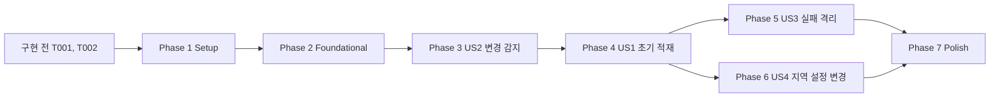

# Tasks: 003 실거래 수집

**Input**: `specs/003-trade-collection/`의 spec.md, plan.md, research.md, data-model.md, contracts/trade-api-response.md, contracts/raw-response-object-key.md, quickstart.md

**Tests**: constitution V에 따라 테스트 작업을 둡니다. 테스트 작업마다 검증하는 spec 시나리오(US번호-시나리오 번호), FR, SC를 적었습니다. "독립 테스트" 묶음은 구현과 다른 쪽이 spec과 research만 보고 구현보다 먼저 씁니다. 독립 테스트 작업을 마치면 구현을 일부러 틀리게 바꿔 그 테스트가 실패하는지 확인하고 원복합니다(변이 확인). 변이가 테스트 입력에서 실제로 다른 결과를 내는지도 봅니다.

**Organization**: 사용자 스토리별 단계입니다. US2(변경 감지)를 US1(초기 적재)보다 먼저 둡니다. 변경 감지는 범위 하나의 거래 목록을 받아 반영하므로 외부 API와 스케줄러 없이 실제 PostgreSQL만으로 검증할 수 있고, US1과 US3이 그 위에 섭니다. US2 경우 8, 9, 22, 23은 수집 실행이 필요해 US1 단계에서 검증합니다.

## Format: `[ID] [P?] [Story] Description`

- **[P]**: 다른 파일을 다루고 끝나지 않은 작업에 기대지 않아 함께 진행할 수 있음
- **[Story]**: 사용자 스토리(US1~US4)
- 경로는 저장소 루트 기준입니다. 서버는 `src/main/java/estate/`, 테스트는 `src/test/java/estate/`입니다.
- 테스트 fixture의 단지 번호, 단지 이름, 시군구 코드, 법정동, 지번은 모두 가짜 값입니다(시군구 코드 `99999`와 `99998`, 단지 이름 "가상단지", 단지 번호 `99999-1` 형식). 계약 문서의 예시 값은 그 경우 하나의 값이고, 같은 자리의 모든 경우 기대값으로 일반화하지 않습니다.
- 데이터베이스가 걸린 테스트는 기존 `@IntegrationTest`(Testcontainers PostgreSQL 18)로 실행합니다.

---

## 구현 전

**Purpose**: constitution IV의 순서 조건(설계 문서를 먼저 수정)과 CLAUDE.md 구현 절의 점검

- [ ] T001 `docs/*` 브랜치(`develop/v1`에서 만든 워크트리)에서 research R12 표의 설계 문서 수정 전부(결정 기록 0007 세 곳, 핵심 흐름 여섯 곳, 데이터 모델 두 곳, C4 컴포넌트 한 곳, 결정 기록 0009 한 곳)을 하고 `develop/v1`에 `--no-ff` 머지한 뒤, 이 브랜치를 `git rebase develop/v1`로 그 위에 놓고 `git push --force-with-lease`한다. 머지, rebase, push는 각각 저장소 소유자 허락을 받는다. 설계 문서를 수정하다가 spec이나 research와 다르게 써야 할 곳이 나오면 지어내지 말고 저장소 소유자에게 묻는다
- [ ] T002 `specs/003-trade-collection/checklists/requirements.md`의 미완료 항목이 없는지 확인한다(CLAUDE.md 구현 절). 있으면 구현 전에 저장소 소유자에게 알린다

---

## Phase 1: Setup

**Purpose**: 의존성, 스키마, 설정, 로컬 저장소

- [ ] T003 `build.gradle.kts`에 `implementation(platform("software.amazon.awssdk:bom:2.59.4"))`, `implementation("software.amazon.awssdk:s3")`(전이 의존성 `software.amazon.awssdk:apache-client`와 `software.amazon.awssdk:netty-nio-client` 제외), `implementation("software.amazon.awssdk:url-connection-client")`를 추가한다(research R4). 다른 의존성은 추가하지 않는다(Bean Validation, `spring-boot-starter-restclient`, WireMock 없음: research R2, R9, R10)
- [ ] T004 `src/main/resources/db/migration/V3__trade_collection.sql`을 만든다(data-model.md 그대로). 시퀀스 `complex_id_seq`, `trade_id_seq`, `trade_history_id_seq`. `complex`: `id` bigint 기본 키, `apt_seq` text not null과 유니크 제약 `complex_apt_seq_key`, `name` text not null, `sgg_cd` text not null과 체크 제약 `complex_sgg_cd_format`(숫자 다섯 자리), `umd_nm` text not null, `jibun` text(비울 수 있음), 인덱스 `complex_sgg_cd_idx (sgg_cd)`. `trade`: `id` bigint 기본 키, `complex_id` bigint not null `complex(id)` 참조(연쇄 삭제 없음), `deal_date` date not null, `floor` integer not null, `exclusive_area` numeric not null, `amount` bigint not null, `canceled` boolean not null, `same_key_count` integer not null과 체크 제약 `trade_same_key_count_check (same_key_count >= 0)`, `cancel_date` date, `registry_date` date, `apt_dong` text, `first_seen_at` timestamptz not null, 유니크 제약 `trade_identity_key (complex_id, deal_date, floor, exclusive_area, amount, canceled)`. `trade_history`: `id` bigint 기본 키, `trade_id` bigint not null `trade(id)` 참조, `change_type` text not null과 체크 제약 `trade_history_change_type_check (change_type in ('신규', '해제', '등기', '사라짐'))`, `observed_at` timestamptz not null. `fetch_range`: `lawd_cd` text, `deal_ymd` text, 기본 키 `fetch_range_pk (lawd_cd, deal_ymd)`, 체크 제약 `fetch_range_lawd_cd_format`(숫자 다섯 자리)과 `fetch_range_deal_ymd_format`(`YYYYMM`, 월은 01~12), `status` text not null과 체크 제약 `fetch_range_status_check (status in ('성공', '실패'))`, `fetched_at` timestamptz(비울 수 있음), `failure_reason` text(비울 수 있음)
- [ ] T005 스키마 테스트 `src/test/java/estate/schema/TradeSchemaTest.java`: `change_type`과 `status`에 목록 밖 값, `same_key_count` -1, `lawd_cd` 네 자리, `deal_ymd` `202613`이 체크 제약으로 실패. 같은 단지 번호 두 번째 행이 `complex_apt_seq_key`로 실패. 전용면적 `84.9`와 `84.90`의 같은 식별 키 두 행이 `trade_identity_key`로 실패(numeric 값 비교, data-model). 각 실패의 제약 이름을 `PSQLException.getServerErrorMessage().getConstraint()`로 확인한다. 실패를 확인하기 전에 같은 테이블에 정상 행이 들어가는지 먼저 확인한다
- [ ] T006 [P] 설정 `src/main/java/estate/trade/CollectorProperties.java`(record, `@ConfigurationProperties("estate.collector")`): research R9 표의 설정과 기본값. 생성자에서 형식을 확인한다: 지역은 값마다 숫자 다섯 자리이고 중복이 없음, 지역이 하나라도 있으면 인증키와 원본 응답 버킷 설정이 비어 있지 않음, 한도와 여유는 양수이고 여유가 한도보다 작음, 타임아웃은 양수. 지역이 없으면(설정하지 않음) 빈 목록. 예외 메시지에 잘못된 지역 값은 넣되 인증키 값은 넣지 않는다. `src/main/resources/application.yml`에 기본값(`cron` `0 0 9 * * *`, 기본 엔드포인트, 한도 10000, 여유 500, 연결 5초, 읽기 30초)과 환경 변수 연결(`ESTATE_COLLECTOR_REGIONS`, `DATA_GO_KR_SERVICE_KEY`, `ESTATE_COLLECTOR_CRON`, `ESTATE_RAW_S3_ENDPOINT`, `ESTATE_RAW_S3_REGION`, `ESTATE_RAW_S3_BUCKET`, `ESTATE_RAW_S3_ACCESS_KEY`, `ESTATE_RAW_S3_SECRET_KEY`, research R9)을 추가한다. `src/test/java/estate/support/IntegrationTest.java`의 `@TestPropertySource`에 `estate.collector.cron=-`를 추가해 테스트에서 예약이 돌지 않게 한다
- [ ] T007 [P] 설정 테스트 `src/test/java/estate/trade/CollectorPropertiesTest.java`(spec US4-4, FR-001): `ESTATE_COLLECTOR_REGIONS=99999,99998`이 두 값 목록으로 바인딩, 공백 섞인 쉼표 목록도 같은 결과, `9999x`와 네 자리와 중복이 바인딩 실패(애플리케이션 시작 실패), 지역이 있는데 인증키가 없으면 실패이고 그 메시지에 인증키 자리 값이 없음, 지역을 설정하지 않으면 빈 목록이고 인증키 없이 시작됨(001, 002 테스트가 영향받지 않음), 여유가 한도 이상이거나 0 이하이면 실패(FR-009)
- [ ] T008 [P] 로컬 S3 호환 저장소: `compose.yaml`에 `garage` 서비스(`dxflrs/garage:v2.5.0`, `127.0.0.1` 바인딩, 데이터 볼륨, 설정 파일 마운트), `compose/garage.toml`(`replication_factor = 1`, `[s3_api]`, 로컬 전용 `rpc_secret`), `scripts/garage-init.sh`(원본 응답 버킷과 사진 버킷 생성, collector 키 생성, collector 키에 원본 응답 버킷 읽기와 쓰기만 허용, 키 값을 출력해 `.env`에 넣게 안내). `.env.example`에 `ESTATE_COLLECTOR_REGIONS`, `ESTATE_COLLECTOR_CRON`, `ESTATE_RAW_S3_ACCESS_KEY`, `ESTATE_RAW_S3_SECRET_KEY`를 자리표시 값으로 추가한다(실제 지역 코드 넣지 않음, 기존 `LAWD_CD`는 그대로). `application-local.yml`에 로컬 Garage 주소, 리전, 버킷 이름 기본값을 둔다
- [ ] T009 [P] 무시 파일 확인(CLAUDE.md 구현 절): `.gitignore`가 `.env`, `.private/`, Garage 데이터 볼륨 폴더, 재생 결과 폴더를 저장소에서 빼는지 확인하고 빠진 것만 추가한다

---

## Phase 2: Foundational

**Purpose**: 외부 API 어댑터, 원본 응답 파일 어댑터, 달력 계산, 테스트 도우미. 이 단계가 끝나야 사용자 스토리를 시작합니다.

### 응답 해석

- [ ] T010 공공데이터포털 오류 코드표를 대조한다(research R1의 "확인할 것"): 데이터셋 15126468 페이지의 첨부 기술문서에서 결과 코드 표(정상 `000`, 인증키 오류에 해당하는 코드, 하루 한도 초과 `22`)와 오류 응답 모양, 인증키 오류와 한도 초과 때의 HTTP 상태(401, 403, 429로 오는지)를 확인한다. 첨부 파일 다운로드는 파일 이름과 크기를 알리고 저장소 소유자 허락을 받는다. 결과가 research R1과 contracts/trade-api-response.md와 다르면 두 문서를 먼저 수정하고 알린다. 인증키 오류나 한도 초과가 HTTP 상태로 온다면 그 상태를 실행을 멈추는 쪽으로 분류할지 저장소 소유자에게 묻고, 정하면 설계 문서(핵심 흐름의 재시도 규칙)부터 수정한다
- [ ] T011 [P] 응답 해석 테스트 `src/test/java/estate/trade/api/TradeResponseParserTest.java`(가짜 XML 문자열, contracts/trade-api-response.md): 금액 `98,500`을 98500으로, 전용면적 `84.97`과 `114`와 `59.9934`를 값 그대로, 앞 0 없는 월과 일, 해제 여부(`O`와 공백 한 칸), `YY.MM.DD`를 20YY 날짜로, 동의 앞뒤 공백 제거와 빈 값, 빈 요소(`<x/>`)도 빈 값, `<items/>`와 `totalCount` 0, `resultCode` `000`이 아닌 응답과 루트 `OpenAPI_ServiceResponse` 응답의 코드 분류(멈추는 코드와 그 밖), XML이 아닌 본문과 필수 항목이 빈 item과 `sggCd`가 요청한 `LAWD_CD`와 다른 item과 계약년월이 `DEAL_YMD`와 다른 item이 해석 실패(`PARSE_ERROR`, FR-008), 외부 엔티티 선언이 들어 있는 XML을 해석하지 않음
- [ ] T012 응답 해석 `src/main/java/estate/trade/api/TradeResponseParser.java`, `TradeItem.java`(record: 단지 번호, 단지 이름, 시군구 코드, 법정동, 지번, 계약일, 층, 전용면적 `BigDecimal`, 금액 `long`, 해제 여부, 해제 사유 발생일, 등기일, 동), `TradePage.java`(결과 코드, item 목록, `totalCount`, 페이지 번호): JDK StAX, DTD와 외부 엔티티 끔, 요청한 시군구 코드와 계약년월을 받아 항목과 대조(research R1)

### 원본 응답 파일

- [ ] T013 [P] 원본 응답 파일 포트 `src/main/java/estate/trade/raw/RawResponseStore.java`(페이지 하나의 바이트와 키를 받아 gzip으로 저장)와 키 `RawObjectKey.java`(contracts/raw-response-object-key.md: `{수집 날짜 YYYY-MM-DD}/{실행 시작 시각 HHmmss}/{시군구 코드}-{계약년월}-p{페이지 번호}.xml.gz`, 날짜와 시각은 실행 시작 시각을 `Asia/Seoul`로 바꾼 값). 키 단위 테스트 `src/test/java/estate/trade/raw/RawObjectKeyTest.java`: UTC 2026-10-31T15:30:00Z가 `2026-11-01/003000/`로 시작, 페이지 번호 `p1`
- [ ] T014 S3 어댑터 테스트(S3 어댑터의 첫 작업) `src/test/java/estate/trade/raw/S3RawResponseStoreTest.java`와 테스트 도우미 `src/test/java/estate/support/GarageContainer.java`(`GenericContainer`, `dxflrs/garage:v2.5.0`, 설정 파일 `garage.toml`, 시작 뒤 컨테이너 안 CLI로 노드 ID 확인, 레이아웃 지정과 적용, 버킷 둘 생성, 테스트용 고정 키 넣기(`key import`), 원본 응답 버킷 읽기와 쓰기 권한. 명령 이름과 인자는 v2.5.0 문서로 확인): gzip 파일 하나를 업로드하고 다운로드해 압축을 푼 바이트가 원래 바이트와 같음(SDK 체크섬 설정 `WHEN_REQUIRED` 확인, research R4), `Content-Type` `application/gzip`, collector 키로 사진 버킷에 쓰기가 거절됨(spec FR-023). 체크섬 설정으로도 업로드가 실패하면 진행을 멈추고 저장소 소유자에게 알린다
- [ ] T015 S3 어댑터 `src/main/java/estate/trade/raw/S3RawResponseStore.java`와 클라이언트 설정 `RawStoreConfiguration.java`(`S3Client`, `UrlConnectionHttpClient`, `endpointOverride`, `forcePathStyle(true)`, 고정 자격 증명, `requestChecksumCalculation(WHEN_REQUIRED)`, `responseChecksumValidation(WHEN_REQUIRED)`, 지역을 설정하지 않으면 빈을 만들지 않음(`@ConditionalOnExpression`으로 지역 설정이 비어 있지 않을 때), research R9). 지역을 설정한 수집 테스트는 T016의 가짜 저장소를 `@Primary` 빈으로 둔 테스트 설정을 쓰고, S3 설정에는 가짜 값을 준다. T014 통과
- [ ] T016 [P] 기록하는 가짜 원본 저장소 `src/test/java/estate/support/RecordingRawResponseStore.java`: 저장한 키와 바이트와 저장 순번을 기록, 특정 키(또는 n번째 저장)에서 실패를 주입, 저장 순번을 범위 반영 시점과 비교할 수 있게 공유 순번 카운터를 둠(research R10 순서 테스트)

### 외부 API 어댑터

- [ ] T017 [P] 가짜 실거래 API 서버 `src/test/java/estate/support/FakeTradeApiServer.java`(JDK `com.sun.net.httpserver.HttpServer`): `(LAWD_CD, DEAL_YMD, pageNo)`마다 응답 바이트나 동작(HTTP 500, 응답 없이 연결 끊기, 읽기 타임아웃보다 오래 지연, 결과 코드 오류 본문)을 순서대로 지정, 받은 요청의 쿼리(인증키 포함)와 순서 기록, 요청을 받는 순간 실행할 콜백(선기록 순서 테스트용). 가짜 XML을 만드는 `src/test/java/estate/support/TradeFixtures.java`(가짜 값만, 항목 32개, 빈 값은 공백 한 칸)
- [ ] T018 API 어댑터 테스트 `src/test/java/estate/trade/api/TradeApiClientTest.java`(가짜 서버, 대기 0 재시도 정책): HTTP 500 두 번 뒤 성공이면 요청 3번에 성공, 세 번 모두 실패하면 이 기능의 HTTP 오류 예외, 연결 끊김도 같음, 결과 코드 오류와 해석 실패는 요청 1번, 두 페이지(`totalCount` 1500, `numOfRows` 1000)를 차례로 요청, 두 번째 페이지의 결과 코드 오류는 그 범위 실패(FR-006), 재시도 포함 요청마다 호출 수가 1 늘어남, 호출 수가 기준값보다 1 적으면 요청함과 기준값에 도달하면 요청하지 않고 스스로 멈춤 예외(경계 양쪽, FR-009), 가짜 인증키에 `+`, `/`, `=`가 들어 있어도 가짜 서버가 쿼리를 디코딩한 값이 원래 키와 같음(한 번만 인코딩, research R1). 운영 재시도 정책 빈의 대기 값이 2000ms, 4000ms, 멈춤임을 정책 객체에서 직접 확인(research R2)
- [ ] T019 API 어댑터 `src/main/java/estate/trade/api/TradeApiClient.java`, `TradeApiConfiguration.java`, 예외 `TradeApiException.java`(종류: HTTP 오류와 상태 코드, 네트워크 오류와 원인 클래스 이름, 결과 코드와 메시지, 멈추는 코드, 해석 실패, 스스로 멈춤), 호출 수 `CallCounter.java`(실행마다 하나): `RestClient.builder()`와 `JdkClientHttpRequestFactory`(연결과 읽기 타임아웃), `RetryTemplate`과 빈으로 둔 `RetryPolicy`(`ResourceAccessException`과 `HttpStatusCodeException`만, `maxRetries(2)`, 2초, 배수 2), 인증키를 URI 템플릿 변수로 넘겨 엄격 인코딩한 `URI` 객체(research R1), 응답 본문 `byte[]`. 재시도 소진과 URI 생성 실패는 원인 예외 객체를 넘기지 않고 고정 문장, 상태 코드, 원인 클래스 이름만 담은 `TradeApiException`으로 바꾼다. 요청 URI를 로그에 쓰지 않는다(research R9). T018 통과

### 달력

- [ ] T020 [P] 달력 계산 `src/main/java/estate/trade/collect/CollectionCalendar.java`와 테스트 `src/test/java/estate/trade/collect/CollectionCalendarTest.java`: 실행 시작 시각(UTC `Instant`)을 `Asia/Seoul`로 바꿔 이번 달을 정함, 재수집 기간은 이번 달을 포함한 최근 6개월(2026-11-01 한국 시간이면 202606~202611, 결정 기록 0009의 예), 초기 적재는 이번 달을 포함한 최근 60개월, 바로 앞 달(202601이면 202512). UTC 2026-10-31T15:30:00Z가 이번 달 202611

**Checkpoint**: 해석, 어댑터 둘, 달력이 각각 테스트를 통과합니다.

---

## Phase 3: User Story 2 - 매일 재수집해 바뀐 거래를 거래 이력으로 기록한다 (P1)

**Goal**: 범위 하나의 거래 목록을 직전 결과와 비교해 거래, 거래 이력, 범위 결과를 한 트랜잭션으로 반영합니다.

**Independent Test**: 범위 반영 서비스를 직접 호출해 어제 결과와 오늘 결과를 차례로 반영하고, 거래 행, 건수, 이력의 변경 종류, `observed_at`과 `first_seen_at`의 같고 다름을 확인합니다(외부 API와 스케줄러 없음).

- [ ] T021 [US2] 범위 반영의 타입을 선언한다(동작 코드 없음, 독립 테스트가 쓸 공개 표면): `src/main/java/estate/trade/detect/RangeApplier.java`(클래스, 메서드 `apply(RangeInput)`이 결과를 반환하고 지금은 `UnsupportedOperationException`), `RangeInput.java`(시군구 코드, 계약년월, `TradeItem` 목록, 실행 스냅숏), `RunSnapshot.java`(실행 시작 시각과, 실행 시작 때 읽은 대상 지역의 `fetch_range` 행: 범위마다 행이 있는지와 `fetched_at`, research R6), `ApplyResult.java`(기준 적재였는지, 변경 종류별 이력 건수). 범위 반영의 수집 시각은 반영할 때 주입한 `Clock`에서 한 번 읽는다(research R5). 범위 반영은 실행 종류를 받지 않는다(초기 적재의 범위는 선기록으로 늘 앞서 실패만 한 범위, research R6)

### 독립 테스트 (구현과 다른 쪽이 먼저 작성)

- [ ] T022 [P] [US2] 변경 감지 테스트 `src/test/java/estate/trade/detect/ChangeDetectionTest.java`: spec US2 경우 1, 2, 3, 4, 5, 6, 7, 10, 11, 12, 13(핵심 흐름의 변경 감지 표 순서, FR-015, FR-016, FR-018, FR-019, SC-002, SC-003). 경우마다 `fetch_range` 상태(행 없음, 선기록, `fetched_at` 빔, 있음)를 직접 만들고 어제 결과를 반영한 뒤 시계를 옮겨 오늘 결과를 반영한다. 실행 스냅숏은 반영 전의 `fetch_range`를 읽어 만든다. 성공한 반영은 `fetch_range`가 `성공`이고 `fetched_at`이 그 반영의 수집 시각인지도 본다(FR-019). 기대: 이력 행의 변경 종류와 개수, 건수, `observed_at`과 그 거래 행의 `first_seen_at`의 같고 다름, 경우 8과 9는 범위 반영 전에 수집 쪽이 거르는 규칙이라 T031에서 검증한다(research R7). 경우 4는 행이 삭제되지 않았음을 확인하기 전에 그 행이 어제 있었음을 확인한다. 작성 뒤 변이 확인(예: 다시 보인 키의 이력 시각을 `first_seen_at`으로 바꿈, 건수 비교를 행 존재 비교로 바꿈)
- [ ] T023 [P] [US2] 변경 감지 추가 테스트 `src/test/java/estate/trade/detect/ChangeDetectionRulesTest.java`: spec US2 경우 14(해제와 함께 사라진 해제되지 않은 키), 15(정정), 16(건수 2 이상 행의 등기는 처음 한 번, 그 뒤 다른 등기일이 와도 값 유지, 등기일이 채워진 다음 날 동이 채워져도 `등기`를 다시 기록하지 않음, 묶음의 첫 행이 빈 값이고 둘째 행에 등기일이 있으면 그 등기일로 `등기`), 17(건수 1 행의 세 값 갱신, 비어 있던 값에 값이 생긴 경우만 `등기`, 같은 날 등기일과 동이 함께 생기면 한 행), 18(한 반영의 새 거래 행과 모든 이력의 시각이 같음), 처음 보는 키와 다시 보인 키는 등기일이 있어도 `등기` 없음(research R5), 전용면적 `84.9`와 `84.90`이 같은 키, 건수가 늘면서 비어 있던 등기일이 채워지면 `신규`와 `등기` 두 행(data-model). FR-014~FR-017. 작성 뒤 변이 확인(예: 건수 2 이상 행의 등기일을 덮어씀)
- [ ] T024 [P] [US2] 연속 수집 조건 테스트 `src/test/java/estate/trade/detect/ContinuityTest.java`: spec US2 경우 19(바로 앞 달 성공이 없거나 7일보다 오래됨이면 기준 적재), 20(같은 실행 안에서 끊긴 앞 달을 반영한 직후 다음 달도 기준 적재), 21(`fetched_at`이 7일보다 오래된 범위는 기준 적재: 새 키는 행만, 사라진 키는 건수 0이고 `사라짐` 없음, 건수 1 행의 세 값은 오늘 값, 건수 2 이상 행은 빈 열만 채움, 이력 0건), research R10 순서 테스트 "실행 시작 때의 스냅숏으로"(같은 스냅숏으로 반영 순서를 바꿔도 결과가 같음), 경계값(앞 달 `fetched_at`과 그 범위 자신의 `fetched_at` 각각이 실행 시작 정확히 7일 전이면 비교, 7일 1초 전이면 기준 적재, 실행 시작 시각과 같으면 기준 적재), 바로 앞 달의 상태가 `실패`여도 `fetched_at`이 7일 안이면 비교(research R6), 1월 범위의 바로 앞 달이 전해 12월. FR-018. 작성 뒤 변이 확인(예: 판정을 스냅숏 대신 데이터베이스의 현재 값으로 바꿈, 그 범위 자신의 7일 조건을 지움)

### 구현

- [ ] T025 [P] [US2] 단지 등록 `src/main/java/estate/complex/ComplexRegistry.java`(공개, `JdbcClient`, FR-013): 단지 번호 목록을 받아 없는 것만 `complex` 행을 만들고 단지 번호에서 `id`로의 맵을 반환, 이미 있는 행은 바꾸지 않고 이름이나 주소가 다르면 단지 번호만 로그. 테스트 `src/test/java/estate/complex/ComplexRegistryTest.java`(spec US1-4: 새 행의 단지 번호, 단지 이름, 시군구 코드, 법정동, 지번이 응답 값, 같은 단지 번호의 행은 하나, 이미 있는 행의 이름 유지)
- [ ] T026 [P] [US2] 범위 결과 저장소 `src/main/java/estate/trade/detect/FetchRangeStore.java`(`JdbcClient`, research R7): 범위 상태 읽기, 성공 기록(`on conflict` 갱신, `status` `성공`, `fetched_at` 수집 시각, 실패 이유 비움), 실패 기록(`fetched_at` 유지, 새 트랜잭션, `코드: 설명` 형식), 60개 선기록(`on conflict do nothing`, `실패`, `NOT_YET_COLLECTED`), 실행 스냅숏 읽기(대상 지역들의 모든 행), 실행이 멈출 때 행이 있는 범위만 `RUN_STOPPED`로 기록(FR-019)
- [ ] T027 [P] [US2] 거래 저장소 `src/main/java/estate/trade/detect/TradeStore.java`(`JdbcClient`, research R5): 범위의 거래 행 모두 읽기(`complex.sgg_cd`와 계약일 범위, 건수 0 포함), 거래 행 삽입(`nextval`, `returning id`), 건수와 세 값 갱신, 이력 삽입
- [ ] T028 [US2] 비교 규칙 `src/main/java/estate/trade/detect/ChangeDetector.java`(데이터베이스 없는 순수 계산, research R5의 표): 오늘 결과를 식별 키(전용면적은 `stripTrailingZeros`)로 묶어 건수와 첫 값을 모으고, 직전 행과 비교해 만들 행, 갱신할 행, 기록할 이력을 반환. 단위 테스트 `src/test/java/estate/trade/detect/ChangeDetectorTest.java`
- [ ] T029 [US2] 범위 반영 `src/main/java/estate/trade/detect/RangeApplier.java`(T021의 클래스에 동작을 채움, `@Transactional`, FR-012): 수집 시각을 한 번 정함, 실행 스냅숏으로 기준 적재인지 정함(FR-018, research R6), 단지 등록 호출, 비교 규칙 적용, 성공 기록, 커밋. 실패 기록은 이 클래스에서 하지 않는다(같은 클래스 안 호출은 Spring 트랜잭션 프록시를 거치지 않고, 커밋 때의 오류는 메서드 밖에서 남). 호출한 쪽이 예외를 받아 `FetchRangeStore`의 실패 기록(별도 트랜잭션)을 부른다(T035, research R7). T022~T024 통과(T022~T024의 범위 반영 호출 도우미가 같은 방식으로 실패를 기록)
- [ ] T030 [US2] T022~T024의 변이 확인 결과를 `.private/plans/003_구현_원장.md`에 적는다(작성자와 다른 쪽이 변이를 넣고 실패를 확인한 기록)

**Checkpoint**: 변경 감지 경우 1~7, 10~21이 실제 PostgreSQL에서 통과합니다(경우 8, 9, 22, 23은 US1).

---

## Phase 4: User Story 1 - 새 관심 지역의 실거래를 초기 적재로 쌓는다 (P1)

**Goal**: 예약 실행이 매일 수집 뒤 행이 없는 지역을 60개월 초기 적재(또는 범위 확장)로 적재하고, 범위마다 페이지 수집, 원본 저장, 건수 확인, 범위 반영을 합니다.

**Independent Test**: 가짜 API 서버와 기록하는 가짜 원본 저장소로 빈 데이터베이스에서 예약 실행 메서드를 한 번 호출하고, 60개 범위의 결과와 이력 0건을 확인합니다.

### 독립 테스트 (구현과 다른 쪽이 먼저 작성)

- [ ] T031 [P] [US1] 초기 적재 테스트 `src/test/java/estate/trade/collect/InitialLoadTest.java`: spec US1-1(행 없는 지역은 매일 수집 요청이 0회이고 매일 수집 뒤 60개월 요청), US1-2(60개 범위 성공, 이력 0건, 거래 행마다 `first_seen_at`), US1-5(범위의 페이지마다 원본 키가 계약 형식), US1-6(다음 날 같은 지역은 매일 수집 요청 6회와 초기 적재 요청 0회), SC-001, SC-003, SC-006, SC-007. US2 경우 8(직전에 거래가 있던 범위가 0건이면 실패로 두고 비교 안 함)과 9(수집 건수가 `totalCount`와 다르면 실패로 두고 비교 안 함, 페이지마다 `totalCount`가 다르면 실패), 경우 22(앞 달이 어제 성공하고 이번 달은 행 없음, 같은 매일 수집에서 앞 달을 먼저 반영한 뒤 이번 달 A는 `신규`. 가짜 서버 기록으로 앞 달이 이번 달보다 먼저 요청됐는지도 확인), 달이 바뀐 첫날 행 없는 이번 달이 0건이면 성공(spec Edge Cases), FR-003, FR-005, FR-006, FR-010, FR-011. 작성 뒤 변이 확인(예: 판정을 데이터베이스의 현재 값으로 바꾸면 경우 22가 실패)
- [ ] T032 [P] [US1] 순서 테스트 `src/test/java/estate/trade/collect/CollectionOrderTest.java`(research R10의 순서 넷): 원본 저장 뒤 비교(기록하는 가짜 저장소의 저장 순번이 그 범위 반영보다 앞, 원본 저장을 실패시키면 그 범위의 거래가 바뀌지 않음), 재수집 기간의 달 먼저 그다음 실패한 범위(가짜 서버 요청 순서, spec US2 경우 23과 FR-004), 매일 수집 뒤 초기 적재(요청 순서), 선기록 뒤 수집(초기 적재 첫 요청을 받는 콜백 안에서 `fetch_range`에 그 지역 60개 행이 이미 있음, spec US1-3). 작성 뒤 순서 요구마다 구현의 순서를 바꿔 실패를 확인하고 원복한다
- [ ] T033 [P] [US1] 예약 테스트 `src/test/java/estate/trade/collect/CollectionScheduleTest.java`: 예약 메서드의 `@Scheduled` cron이 설정값 자리표시이고 기본값이 `0 0 9 * * *`, zone이 `Asia/Seoul`(FR-002). 지역을 설정하지 않으면 예약 실행이 요청 0회와 로그 한 줄. 실행 요약 로그(FR-021: 실행 종류, 대상 범위 수, 성공한 범위와 실패한 범위의 수, 호출 수, 변경 종류별 이력 건수, 멈춘 이유)를 `OutputCaptureExtension`으로 확인. 실패한 범위마다 지역, 계약년월, 이유가 든 로그 줄. 다른 지역의 행이 있는 상태에서 새 지역은 실행 종류가 범위 확장(research R3). 예약 시각에 멈춰 있던 날을 따라잡지 않는 것은 Spring 스케줄러의 동작이라 테스트하지 않고 research R3의 근거로 둔다

### 구현

- [ ] T034 [US1] 수집 계획 `src/main/java/estate/trade/collect/CollectionPlanner.java`: 매일 수집 범위(설정한 지역 가운데 행이 있는 지역의 재수집 기간 달, 그다음 그 지역들의 실패한 범위, 중복 없이), 초기 적재 대상 지역(설정한 지역 가운데 행이 없는 지역), 실행 종류(research R3). 설정에서 뺀 지역의 범위는 넣지 않음(FR-020)
- [ ] T035 [US1] 범위 수집 `src/main/java/estate/trade/collect/RangeCollector.java`: 페이지를 마지막까지 수집, 모든 페이지를 수집한 뒤 페이지마다 원본 저장, 건수 확인(`totalCount` 불일치는 `COUNT_MISMATCH`, 직전에 거래가 있던 범위의 0건은 `EMPTY_AFTER_TRADES`), 통과하면 범위 반영 호출. 범위 반영이 던진 예외(커밋 때의 오류 포함)는 여기서 받아 `APPLY_FAILED`로 실패 기록(별도 트랜잭션). 범위 하나의 실패는 실패 기록 뒤 다음 범위로(이유 코드는 research R7). 재수집 기간의 달은 오래된 달부터 차례로 수집한다(FR-004). 실행을 멈추는 예외(멈추는 코드, 스스로 멈춤)는 호출한 쪽으로 넘긴다
- [ ] T036 [US1] 예약 실행 `src/main/java/estate/trade/collect/CollectionRun.java`(`@Scheduled` 메서드는 설정의 지역으로 `run(List<String> regions)`를 호출하기만 함, `@EnableScheduling`은 `src/main/java/estate/trade/collect/SchedulingConfiguration.java`, 수집 빈은 `ObjectProvider`로 받음, research R3, R9. 스스로 멈춤과 멈추는 코드는 그 예약 실행의 남은 초기 적재도 시작하지 않음): 실행 시작 시각을 `Clock`에서 한 번 읽음, 매일 수집 대상 지역의 실행 스냅숏을 찍음, 매일 수집 범위를 차례로 수집(실행 하나에 호출 수 하나), 멈추지 않았으면 초기 적재 대상 지역마다 60개 선기록 뒤 그 지역의 스냅숏을 찍고 수집(초기 적재마다 호출 수를 새로 셈, research R3), 실행 요약 로그. 지역이 없으면 로그 한 줄. T031~T033 통과

**Checkpoint**: 빈 데이터베이스에서 예약 실행 한 번으로 초기 적재가 끝나고, 다음 날 매일 수집이 6회로 돕니다.

---

## Phase 5: User Story 3 - 실패한 범위만 다시 수집하고, 실패가 다른 범위를 망치지 않는다 (P2)

**Goal**: 실패 여덟 가지가 그 범위만 실패로 남기고(실행을 멈추는 셋은 실행을 멈춤), 다음 실행이 실패한 범위를 다시 수집하며, 인증키가 어디에도 남지 않습니다.

**Independent Test**: 가짜 서버와 가짜 저장소에 실패를 주입하고 핵심 흐름의 "수집이 실패하면" 표대로 남는지, 다음 실행에서 그 범위만 다시 수집하는지 확인합니다.

### 독립 테스트 (구현과 다른 쪽이 먼저 작성)

- [ ] T037 [P] [US3] 실패 격리 테스트 `src/test/java/estate/trade/collect/FailureIsolationTest.java`: spec US3-1(HTTP 오류와 네트워크 오류는 3번 시도 뒤 그 범위만 실패, 다음 범위 계속, `fetched_at`과 거래와 이력 그대로), US3-2(정상이 아닌 결과 코드와 해석 실패는 요청 1번에 그 범위만 실패), US3-3(멈추는 코드와 코드 22는 그 범위와 남은 범위 가운데 행이 있는 범위가 실패이고 `RUN_STOPPED`, 남은 범위 가운데 행이 없는 이번 달은 행이 생기지 않음, 같은 예약 실행의 초기 적재 요청 0회, 다음 날 그 이번 달이 연속 수집 조건으로 비교됨), US3-4(스스로 멈춤은 페이지를 수집하던 범위와 남은 범위 가운데 행이 있는 범위가 실패이고 그 범위의 원본 없음), US3-5(원본 저장 실패는 비교 안 함, 저장된 앞 페이지 파일은 남음), US3-7(재수집 기간을 벗어난 실패한 범위를 다음 날 함께 수집, 성공하면 상태와 `fetched_at` 갱신, 실패하면 `fetched_at` 유지), US3-8(실패가 하나 섞인 실행의 성공 범위 결과가 실패 없는 실행과 같음), SC-004의 실패 여덟 가지 각각의 `failure_reason`이 research R7 표의 코드로 시작함, 선기록이 실패하면 그 지역의 행이 없고 다음 실행에서 다시 초기 적재 대상, SC-005, FR-007, FR-008, FR-009. 작성 뒤 변이 확인(예: 실패한 범위를 매일 수집 범위에서 뺌, 멈출 때 행 없는 범위도 기록함)
- [ ] T038 [P] [US3] 반영 롤백 테스트 `src/test/java/estate/trade/detect/ApplyRollbackTest.java`: spec US3-6. 테스트가 만든 트리거를 `fetch_range`의 `성공` 기록(범위 반영의 마지막 쓰기)에 걸고, 입력은 직전 결과가 있는 비교 범위에 처음 보는 단지와 새 키를 넣은 것으로 해서, 그 범위의 새 단지, 새 거래, 이력, 건수 갱신, 성공 기록이 모두 없고 `실패`와 `APPLY_FAILED`만 기록됨(FR-012). 트리거는 테스트가 끝나면 실패 경로에서도 삭제한다(docs/review-criteria.md). 롤백을 확인하기 전에 트리거 없이는 같은 입력이 성공함을 먼저 확인한다. 작성 뒤 변이 확인(예: 실패 기록을 같은 트랜잭션에서 함)
- [ ] T039 [P] [US3] 인증키 노출 테스트 `src/test/java/estate/trade/collect/ServiceKeyLeakTest.java`(SC-008, FR-022): 가짜 인증키 문자열(특수 문자 포함)로 실패 경로 넷(HTTP 500, 연결 끊김, 읽기 시간 초과, 결과 코드 오류)을 각각 일으키고, 로그 출력(`OutputCaptureExtension`), `fetch_range.failure_reason`, 기록된 원본 바이트, 던져진 예외의 메시지와 원인 사슬에 그 문자열과 인코딩한 문자열이 0건. 먼저 가짜 서버가 받은 쿼리에 그 키가 실제로 있었음을 확인한다. 작성 뒤 변이 확인(예: 재시도 소진 예외에 원인 예외를 넘김)

### 구현

- [ ] T040 [US3] T037~T039가 드러낸 부족한 곳을 채운다 `src/main/java/estate/trade/collect/RangeCollector.java`, `CollectionRun.java`, `src/main/java/estate/trade/api/TradeApiClient.java`: 실패 이유 코드(research R7), 멈추는 예외에서 그 범위와 남은 범위 가운데 행이 있는 범위만 실패로 기록하고(FR-008) 같은 예약 실행의 남은 초기 적재를 시작하지 않음, 스스로 멈춤에서 수집하던 범위의 원본을 저장하지 않음. T037~T039 통과
- [ ] T041 [US3] T037~T039의 변이 확인 결과를 `.private/plans/003_구현_원장.md`에 적는다

**Checkpoint**: 실패 여덟 가지와 인증키 노출 경로 넷이 통과합니다.

---

## Phase 6: User Story 4 - 관심 지역 설정을 바꾼다 (P3)

**Goal**: 추가한 지역은 범위 확장으로, 뺀 지역은 수집하지 않고 자료를 남기며, 다시 넣은 지역의 끊긴 달은 기준 적재로 반영합니다.

**Independent Test**: 지역 하나로 적재와 매일 수집을 돌린 뒤 설정을 바꿔 예약 실행을 호출하고, 수집 대상과 남은 자료와 이력을 확인합니다.

- [ ] T042 [P] [US4] 지역 설정 변경 테스트 `src/test/java/estate/trade/collect/RegionChangeTest.java`: spec US4-1(지역 `99998` 추가는 매일 수집 뒤 범위 확장, 그 지역 이력 0건), US4-2(지역 `99999`를 빼면 그 지역의 재수집 기간 달과 실패한 범위 요청 0회, 단지와 거래와 이력과 `fetch_range` 행 수 그대로), US4-3(빼고 시계를 3개월 옮긴 뒤 다시 넣으면 재수집 기간 안의 행 없는 달이 기준 적재로 반영되어 그 달 이력 0건, 행이 있는 달도 `fetched_at`이 7일보다 오래되어 기준 적재로 반영되어 그 달 이력 0건, spec US2 경우 21). 설정 변경은 실행 메서드 `run(List<String> regions)`에 넘기는 지역 목록을 바꾸는 것으로 나타낸다(같은 데이터베이스 상태를 이어서 씀, research R3). US4-3은 뺀 동안 신고된 거래를 행이 없는 달과 행이 있는 달 양쪽의 가짜 서버 응답에 넣어, 그 거래가 어느 달에서도 `신규`로 기록되지 않음을 본다(그 거래 행은 생김). FR-020. US4-4는 T007에서 검증한다
- [ ] T043 [US4] T042가 드러낸 부족한 곳을 `src/main/java/estate/trade/collect/CollectionPlanner.java`에서 채운다. T042 통과

**Checkpoint**: 모든 사용자 스토리가 통과합니다.

---

## Phase 7: Polish

- [ ] T044 재생 테스트 `src/test/java/estate/trade/replay/TradeReplayTest.java`(research R11): `ESTATE_REPLAY_DIR`가 없으면 건너뜀. 날짜 폴더를 차례로 읽어 가짜 서버가 그 날의 달 파일을 반환하게 하고(파일이 없는 달은 연결 끊김), 시계를 그 날 09:00(한국 시간)으로 옮겨 예약 실행 메서드를 호출. 지역 코드는 파일이나 폴더에서 읽지 않고 `ESTATE_REPLAY_LAWD_CD`로 받는다. 날짜와 계약월마다 변경 종류별 이력 건수를 `ESTATE_REPLAY_OUT`에 쓴다(저장소 밖). 이 파일에 실제 값을 넣지 않는다
- [ ] T045 quickstart "2. 데이터 확인 기간 재생"을 실행한다: 데이터 확인 스크립트로 비교 보고서를 11-10까지 다시 만들고, T044를 실제 원본으로 돌려, quickstart의 정의 차이 표로 설명되지 않는 차이가 0건인지 대조한다. 결과와 대조 기록은 `.private/`에만 둔다. 설명되지 않는 차이가 있으면 원인을 적고 저장소 소유자에게 알린다
- [ ] T046 [P] 비활성으로 둔 테스트를 확인한다: `src/test/java/estate/`에서 `@Disabled` 중 이 기능의 작업 번호가 적힌 것이 남지 않았는지(T044의 환경 변수 조건 건너뜀은 제외)
- [ ] T047 전체 테스트를 통과시킨다: `./gradlew test --rerun`. 결과 집계는 `build/test-results/test/*.xml`로 센다
- [ ] T048 커밋 전 점검: `git add` 뒤 `python3 -I <원래 체크아웃>/.private/tools/precommit_check.py <저장소>`, 그리고 저장소 소유자의 `.env`에 있는 실제 지역 코드와 인증키 값이 스테이징된 파일과 커밋 메시지에 없는지 `git grep`으로 확인한다(값은 출력하지 않는다). 43자 이상의 긴 테스트 메서드 이름이 키로 오인되면 이름을 줄이거나 근거를 적는다
- [ ] T049 quickstart "3. 실제 API로 한 번 실행"을 저장소 소유자와 함께 한다(실제 인증키, 본인의 관심 지역 코드, 하루 호출 한도 확인). 결과(실행 종류, 범위 수, 호출 수, 원본 파일 수, 인증키가 로그에 없음)를 진행 원장에 적는다. 다음 날 매일 수집 결과도 확인한다
- [ ] T050 기능 브랜치 전체를 spec, plan, tasks, `docs/review-criteria.md`와 대조하는 최종 리뷰를 한다
- [ ] T051 `docs/backlog.md`의 003 상태를 완료로 바꾼다(`develop/v1` 머지 직전 커밋, 저장소 소유자 허락 필요)

---

## Dependencies & Execution Order



- T001은 저장소 소유자 허락이 필요하고, 끝나야 Setup을 시작합니다(constitution IV).
- Setup 안: T003, T004가 먼저이고 T005는 T004 뒤입니다. T006~T009는 함께 진행할 수 있습니다(T007은 T006 뒤).
- Foundational 안: T010이 T011, T012보다 먼저입니다(코드표가 바뀌면 테스트 기대값이 바뀜). T014가 T015보다 먼저입니다(S3 어댑터의 첫 작업). T018, T019는 T012와 T017 뒤입니다. T013, T016, T017, T020은 함께 진행할 수 있습니다.
- US2 안: T021(타입 선언) 뒤 독립 테스트 T022~T024를 쓰고, T025~T027을 함께, 그다음 T028, T029 순서입니다.
- US1은 US2의 범위 반영이 필요합니다. US1 안: 독립 테스트 T031~T033 뒤 T034, T035, T036 순서입니다.
- US3과 US4는 US1의 수집 실행이 필요하고 서로 다른 파일을 주로 다루지만, T040과 T043이 `CollectionRun`과 `CollectionPlanner`를 각각 수정하므로 같은 파일을 두 쪽이 동시에 수정하지 않게 차례로 합니다.
- 각 테스트 작업이 기대는 구현은 그 작업보다 앞 단계나 같은 단계에 있습니다. US2 경우 8, 9, 22는 T031, 경우 23은 T032에서 검증합니다(수집 실행이 필요).

## Parallel Example: User Story 2

```text
타입 선언 뒤 독립 테스트 작성(구현과 다른 쪽):
T022 ChangeDetectionTest, T023 ChangeDetectionRulesTest, T024 ContinuityTest

함께 진행할 수 있는 구현:
T025 ComplexRegistry, T026 FetchRangeStore, T027 TradeStore
```

## Implementation Strategy

1. T001(설계 문서 수정 머지와 rebase)과 T002를 마칩니다.
2. Setup과 Foundational을 마칩니다. S3 어댑터는 Garage 업로드 테스트(T014)부터 합니다.
3. US2를 마치고 변경 감지 경우 1~7, 10~21을 확인합니다(이 기능에서 결함 비용이 가장 큰 곳).
4. US1을 마치고 빈 데이터베이스에서 초기 적재와 다음 날 매일 수집을 확인합니다(MVP 확인 지점, 아직 머지하지 않음).
5. US3, US4를 차례로 마칩니다.
6. Polish에서 재생 확인, 전체 테스트, 커밋 전 점검, 실제 API 실행을 마친 뒤 기능 브랜치 전체를 spec, plan, tasks와 대조하는 최종 리뷰를 하고 `develop/v1`에 머지합니다.
